# Casos de prueba con imágenes — IBM MQ REST, Vercel y Supabase Cloud

> **Documento principal:** [Los diez requisitos de la EV2, con su prueba y resultado](requisitos-ev2-pruebas-y-resultados.md). Este archivo es el anexo de 35 subpruebas.


**Rondas del 19 y 20 de octubre de 2026 · America/Santiago (UTC−03).** Documento visual actualizado después de verificar la DLQ nativa y los fallos reales de procesamiento.

Se documentan los diez requisitos de mensajería acordados y sus variantes funcionales y de seguridad. Cada caso explica cómo funciona, lo observado y sus límites. Las respuestas HTTP de error esperadas también constituyen una prueba satisfactoria del rechazo. No se afirma cubrir toda combinación posible de fallos de los proveedores.

- Rama: `feature/mq-consumidor`; checkout local `951ebddeec31682251623bacded4a80fc8d0a0bf`. No se obtuvo el hash de build de Vercel para asegurar equivalencia exacta.
- [Preview probado](https://auth-cdn-git-feature-mq-consumidor-anthonys-projects-0d8acba7.vercel.app). Queue manager: `AUTHCDNQM`. Supabase: `vqeusrctsfqykzwwrucn`.
- Datos propios de prueba: workspace `443b712e-a038-45b5-bdc9-be54b9abad82`, prefijo `MQ-E2E-20261020004000`.
- Sin contraseñas, JWT, cookies ni certificados. No se realizaron commits, push, merges ni despliegues durante esta validación.

## Cómo leer la evidencia

Las imágenes **“Respuesta registrada”** son vistas legibles generadas a partir de los JSON guardados: no son capturas del panel IBM ni nuevas peticiones. Pueden abreviar listas o cadenas; debajo se conserva el registro completo. Las imágenes tituladas **“Captura real”** provienen de la aplicación o de IBM MQ Console; las nuevas capturas de consola se tomaron en Firefox con la sesión iniciada manualmente por el usuario.

Las rutas de la aplicación se invocaron sobre el preview. Las peticiones con `queue` se ejecutaron sobre `https://web-authcdnqm-0a39.qm.eu-de.mq.appdomain.cloud/ibmmq/rest/v3/messaging/qmgr/AUTHCDNQM/queue/{queue}/message`. El JSON conserva los argumentos del cliente; no reproduce cabeceras de autorización. Las verificaciones `LIVE_SQL` consultan estados internos mediante acceso administrativo restringido, no una API pública del usuario.

## Capa de autenticación y recorrido

Usuario → Supabase Auth → API Vercel (JWT, MFA y permisos) → Supabase/outbox → productor REST con credenciales privadas → IBM MQ. Para recibir: consumidor Vercel → inbox durable → `process_reminder_event` → notificación Supabase → GET de avisos con JWT del usuario. Cron llama al procesador con secreto de máquina en Vault; no necesita un JWT personal ni una computadora encendida. El Request/Reply sigue usando las dos colas IBM y correlación aunque la API del usuario espere de forma síncrona.

## Requisitos y casos asociados

| Requisito | Casos | Evidencia principal |
|---|---|---|
| IBM MQ como broker | C07 | POST 201, MsgId y persistencia |
| Mensajería asíncrona | C08–C11, C32 | Avisos y entrega autónoma |
| Mensajería síncrona | C12–C13 | Request/Reply, concurrencia, 504 y recuperación |
| ACK / confirmaciones | C14 | Captura durable y retirada por MsgId |
| Durabilidad / recuperación | C07, C16–C18 | Persistencia, pausa y backend SQL interrumpido |
| DLQ / gestión de fallidos | C21–C26, C33–C34 | BOQ y MQDLH nativo MQRC_Q_FULL |
| Reintentos | C25–C28 | Cinco fallos reales de lógica/productor y salida recuperada |
| Retención | C31 | Purga técnica y conservación de pendientes/cuarentena |
| Expiración | C29–C30 | TTL real y reconciliación SQL |
| Alertas | C28 | Aviso automático visible y deduplicado |

## Índice de casos

- [C01 · JWT válido, JWT alterado y ausencia de sesión](#c01)

- [C02 · MFA: contraseña sola y segundo factor verificado](#c02)

- [C03 · Permisos: miembro ajeno, viewer y membresía retirada](#c03)

- [C04 · Recepción de avisos aislada por usuario](#c04)

- [C05 · Separación entre usuario, Cron y credenciales de IBM](#c05)

- [C06 · Validación de fechas e identificadores](#c06)

- [C07 · IBM MQ como broker y envío persistente REST](#c07)

- [C08 · Recordatorio asíncrono de extremo a extremo](#c08)

- [C09 · Completar o cancelar antes del envío](#c09)

- [C10 · Aviso preventivo y aviso de vencimiento](#c10)

- [C11 · Marcar un aviso propio como leído](#c11)

- [C12 · Request/Reply síncrono y solicitudes simultáneas](#c12)

- [C13 · Request/Reply: tiempo de espera agotado y recuperación](#c13)

- [C14 · ACK y retirada segura: capturar antes de DELETE](#c14)

- [C15 · Idempotencia ante mensajes repetidos](#c15)

- [C16 · Recuperación después de una pausa entre captura y procesamiento](#c16)

- [C17 · Durabilidad ante interrupción real del procesamiento SQL](#c17)

- [C18 · Concurrencia y recuperación de una reserva vencida](#c18)

- [C19 · Colisión de MsgId con cuerpo diferente](#c19)

- [C20 · Evento atrasado de una versión anterior](#c20)

- [C21 · BOQ: JSON mal formado](#c21)

- [C22 · BOQ: contrato de recordatorio inválido](#c22)

- [C23 · BOQ: error permanente de correspondencia](#c23)

- [C24 · BOQ: ReplyTo fuera de la lista permitida](#c24)

- [C25 · Consumidor: cinco fallos y paso a BOQ](#c25)

- [C26 · Salida a BOQ: cinco fallos conservan el cuerpo y recuperación posterior](#c26)

- [C27 · Productor: cinco intentos reales hasta FAILED](#c27)

- [C28 · Alerta efectiva después de agotar los reintentos](#c28)

- [C29 · TTL de IBM: expiración sin consumidor](#c29)

- [C30 · Reconciliación SQL de mensajes expirados](#c30)

- [C31 · Retención de registros técnicos terminados](#c31)

- [C32 · Supabase Cron autónomo y programación permanente](#c32)

- [C33 · DLQ nativa asignada al queue manager](#c33)

- [C34 · DLQ nativa: entrega automática rechazada por cola llena](#c34)

- [C35 · Limpieza del ensayo y estado final](#c35)


<a id="c01"></a>

## C01 · JWT válido, JWT alterado y ausencia de sesión

**Cómo funciona y cómo se probó.** El usuario inicia sesión en Supabase; Vercel valida su JWT antes de consultar avisos o producir solicitudes MQ.

**Resultado observado.** Sesión válida: 200. JWT alterado y lectura sin sesión: 401.

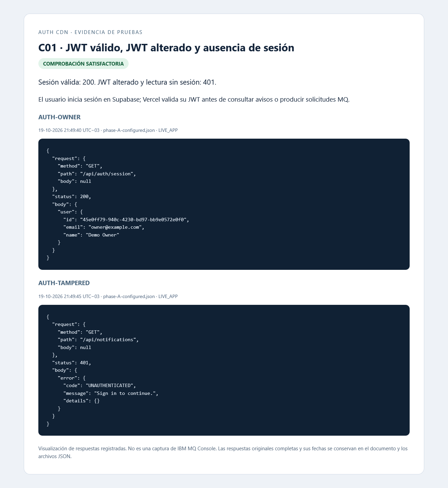

*Vista generada de las respuestas registradas; no es una fotografía de consola.*


**Registro `AUTH-OWNER` · 19-10-2026 21:49:40 UTC−03 · LIVE_APP.** [JSON original](respuestas/phase-A-configured.json).

<details>
<summary>Ver petición, respuesta y estado completo registrados</summary>

```json
{
  "request": {
    "method": "GET",
    "path": "/api/auth/session",
    "body": null
  },
  "status": 200,
  "body": {
    "user": {
      "id": "45e0ff79-940c-4230-bd97-bb9e0572e0f0",
      "email": "owner@example.com",
      "name": "Demo Owner"
    }
  }
}
```

</details>


**Registro `AUTH-TAMPERED` · 19-10-2026 21:49:45 UTC−03 · LIVE_APP.** [JSON original](respuestas/phase-A-configured.json).

<details>
<summary>Ver petición, respuesta y estado completo registrados</summary>

```json
{
  "request": {
    "method": "GET",
    "path": "/api/notifications",
    "body": null
  },
  "status": 401,
  "body": {
    "error": {
      "code": "UNAUTHENTICATED",
      "message": "Sign in to continue.",
      "details": {}
    }
  }
}
```

</details>


**Registro `JWT-STILL-REQUIRED` · 19-10-2026 22:12:12 UTC−03 · LIVE_AUTOMATION_PREFLIGHT.** [JSON original](respuestas/phase-J-access.json).

<details>
<summary>Ver petición, respuesta y estado completo registrados</summary>

```json
{
  "request": {
    "method": "GET",
    "path": "/api/notifications",
    "authenticatedMachine": false,
    "cookies": false
  },
  "status": 401,
  "body": {
    "error": {
      "code": "UNAUTHENTICATED",
      "message": "Sign in to continue.",
      "details": {}
    }
  }
}
```

</details>


<a id="c02"></a>

## C02 · MFA: contraseña sola y segundo factor verificado

**Cómo funciona y cómo se probó.** Una identidad desechable con TOTP activo entra primero con AAL1 y luego completa el desafío. No se cambia el MFA del owner.

**Resultado observado.** AAL1 con MFA activo: 403; tras verificar el segundo factor, AAL2: 200.

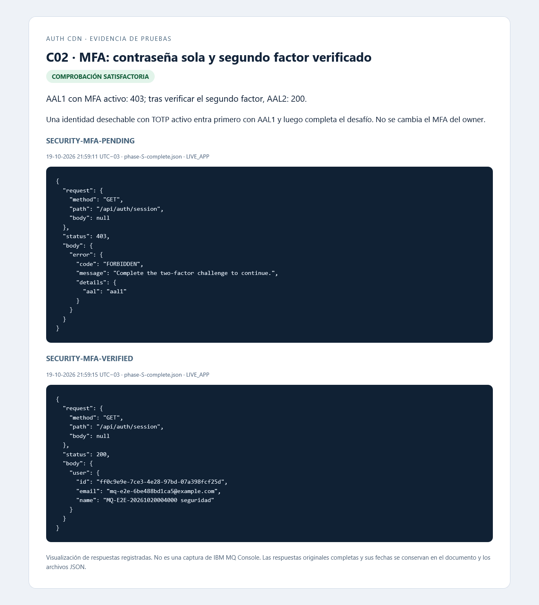

*Vista generada de las respuestas registradas; no es una fotografía de consola.*


**Registro `SECURITY-MFA-PENDING` · 19-10-2026 21:59:11 UTC−03 · LIVE_APP.** [JSON original](respuestas/phase-S-complete.json).

<details>
<summary>Ver petición, respuesta y estado completo registrados</summary>

```json
{
  "request": {
    "method": "GET",
    "path": "/api/auth/session",
    "body": null
  },
  "status": 403,
  "body": {
    "error": {
      "code": "FORBIDDEN",
      "message": "Complete the two-factor challenge to continue.",
      "details": {
        "aal": "aal1"
      }
    }
  }
}
```

</details>


**Registro `SECURITY-MFA-VERIFIED` · 19-10-2026 21:59:15 UTC−03 · LIVE_APP.** [JSON original](respuestas/phase-S-complete.json).

<details>
<summary>Ver petición, respuesta y estado completo registrados</summary>

```json
{
  "request": {
    "method": "GET",
    "path": "/api/auth/session",
    "body": null
  },
  "status": 200,
  "body": {
    "user": {
      "id": "ff0c9e9e-7ce3-4e28-97bd-07a398fcf25d",
      "email": "mq-e2e-6be488bd1ca5@example.com",
      "name": "MQ-E2E-20261020004000 seguridad"
    }
  }
}
```

</details>


<a id="c03"></a>

## C03 · Permisos: miembro ajeno, viewer y membresía retirada

**Cómo funciona y cómo se probó.** Se consulta el mismo tablero con otra identidad, con rol viewer y después de revocar la membresía. Los permisos se comprueban en cada petición.

**Resultado observado.** Ajeno y revocado: 404. Viewer puede leer (200), pero no programar (403).

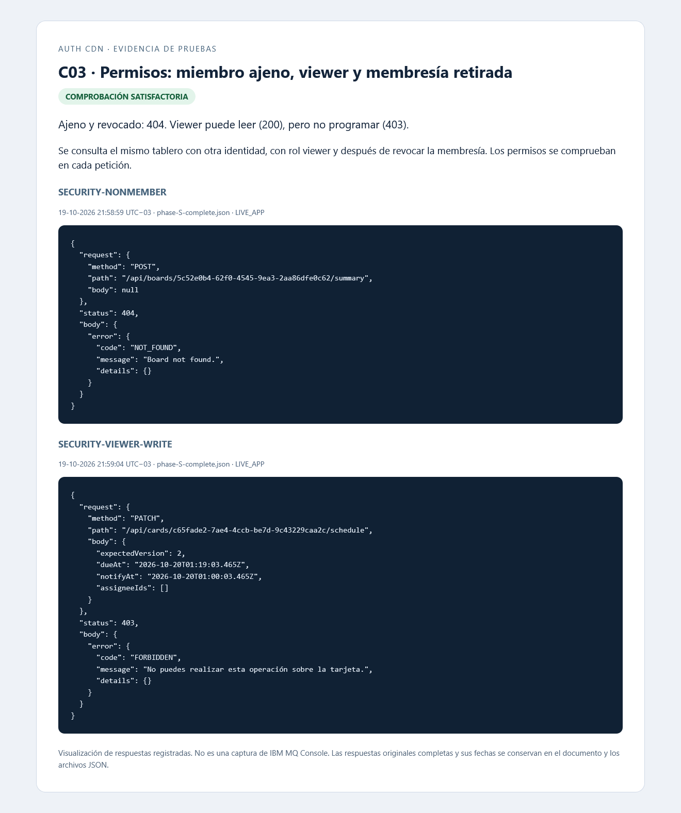

*Vista generada de las respuestas registradas; no es una fotografía de consola.*


**Registro `SECURITY-NONMEMBER` · 19-10-2026 21:58:59 UTC−03 · LIVE_APP.** [JSON original](respuestas/phase-S-complete.json).

<details>
<summary>Ver petición, respuesta y estado completo registrados</summary>

```json
{
  "request": {
    "method": "POST",
    "path": "/api/boards/5c52e0b4-62f0-4545-9ea3-2aa86dfe0c62/summary",
    "body": null
  },
  "status": 404,
  "body": {
    "error": {
      "code": "NOT_FOUND",
      "message": "Board not found.",
      "details": {}
    }
  }
}
```

</details>


**Registro `SECURITY-VIEWER-WRITE` · 19-10-2026 21:59:04 UTC−03 · LIVE_APP.** [JSON original](respuestas/phase-S-complete.json).

<details>
<summary>Ver petición, respuesta y estado completo registrados</summary>

```json
{
  "request": {
    "method": "PATCH",
    "path": "/api/cards/c65fade2-7ae4-4ccb-be7d-9c43229caa2c/schedule",
    "body": {
      "expectedVersion": 2,
      "dueAt": "2026-10-20T01:19:03.465Z",
      "notifyAt": "2026-10-20T01:00:03.465Z",
      "assigneeIds": []
    }
  },
  "status": 403,
  "body": {
    "error": {
      "code": "FORBIDDEN",
      "message": "No puedes realizar esta operación sobre la tarjeta.",
      "details": {}
    }
  }
}
```

</details>


**Registro `SECURITY-VIEWER-READ` · 19-10-2026 21:59:05 UTC−03 · LIVE_APP.** [JSON original](respuestas/phase-S-complete.json).

<details>
<summary>Ver petición, respuesta y estado completo registrados</summary>

```json
{
  "status": 200,
  "boardId": "5c52e0b4-62f0-4545-9ea3-2aa86dfe0c62"
}
```

</details>


**Registro `SECURITY-REVOKED` · 19-10-2026 21:59:09 UTC−03 · LIVE_APP.** [JSON original](respuestas/phase-S-complete.json).

<details>
<summary>Ver petición, respuesta y estado completo registrados</summary>

```json
{
  "request": {
    "method": "POST",
    "path": "/api/boards/5c52e0b4-62f0-4545-9ea3-2aa86dfe0c62/summary",
    "body": null
  },
  "status": 404,
  "body": {
    "error": {
      "code": "NOT_FOUND",
      "message": "Board not found.",
      "details": {}
    }
  }
}
```

</details>


<a id="c04"></a>

## C04 · Recepción de avisos aislada por usuario

**Cómo funciona y cómo se probó.** La API de avisos aplica la identidad de la sesión; se intenta leer y marcar como leído un aviso perteneciente al owner desde otra cuenta.

**Resultado observado.** La otra cuenta no recibe avisos del owner; modificar el aviso ajeno devuelve 404.

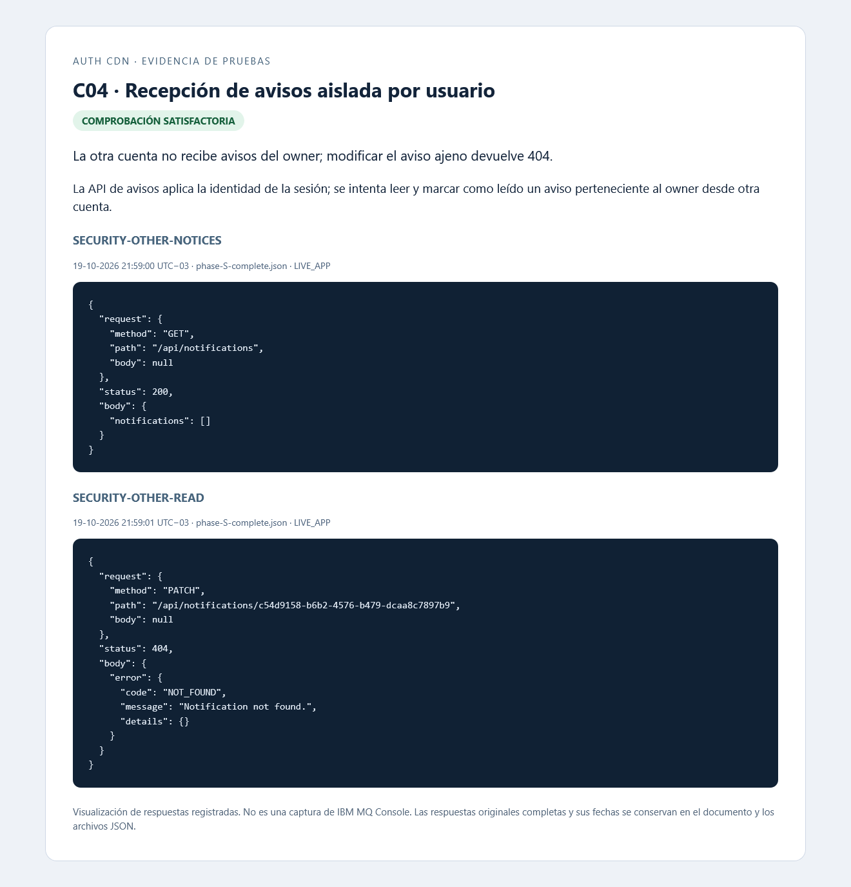

*Vista generada de las respuestas registradas; no es una fotografía de consola.*


**Registro `SECURITY-OTHER-NOTICES` · 19-10-2026 21:59:00 UTC−03 · LIVE_APP.** [JSON original](respuestas/phase-S-complete.json).

<details>
<summary>Ver petición, respuesta y estado completo registrados</summary>

```json
{
  "request": {
    "method": "GET",
    "path": "/api/notifications",
    "body": null
  },
  "status": 200,
  "body": {
    "notifications": []
  }
}
```

</details>


**Registro `SECURITY-OTHER-READ` · 19-10-2026 21:59:01 UTC−03 · LIVE_APP.** [JSON original](respuestas/phase-S-complete.json).

<details>
<summary>Ver petición, respuesta y estado completo registrados</summary>

```json
{
  "request": {
    "method": "PATCH",
    "path": "/api/notifications/c54d9158-b6b2-4576-b479-dcaa8c7897b9",
    "body": null
  },
  "status": 404,
  "body": {
    "error": {
      "code": "NOT_FOUND",
      "message": "Notification not found.",
      "details": {}
    }
  }
}
```

</details>


<a id="c05"></a>

## C05 · Separación entre usuario, Cron y credenciales de IBM

**Cómo funciona y cómo se probó.** El JWT del usuario protege sus operaciones. Cron usa un secreto de máquina en Vault. Solo el servidor posee las credenciales IBM; las tablas y RPC técnicas rechazan el JWT de usuario.

**Resultado observado.** Sin secreto o con solo JWT de owner: tick 401. Secreto correcto: 200. IBM sin sus credenciales: 401. Inbox y RPC internos: denegados.

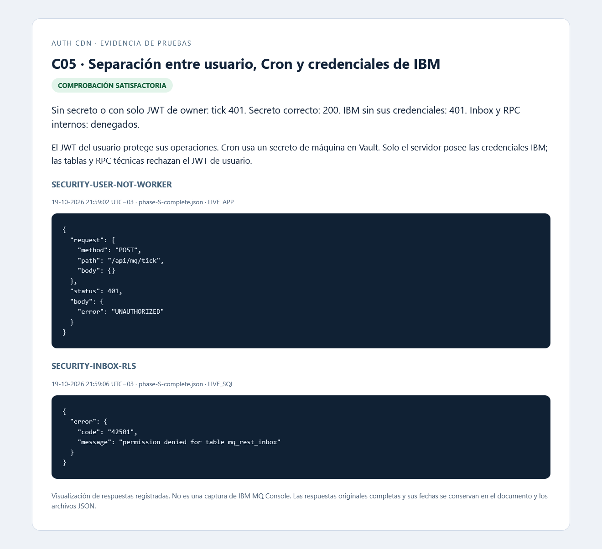

*Vista generada de las respuestas registradas; no es una fotografía de consola.*


**Registro `SECURITY-USER-NOT-WORKER` · 19-10-2026 21:59:02 UTC−03 · LIVE_APP.** [JSON original](respuestas/phase-S-complete.json).

<details>
<summary>Ver petición, respuesta y estado completo registrados</summary>

```json
{
  "request": {
    "method": "POST",
    "path": "/api/mq/tick",
    "body": {}
  },
  "status": 401,
  "body": {
    "error": "UNAUTHORIZED"
  }
}
```

</details>


**Registro `SECURITY-INBOX-RLS` · 19-10-2026 21:59:06 UTC−03 · LIVE_SQL.** [JSON original](respuestas/phase-S-complete.json).

<details>
<summary>Ver petición, respuesta y estado completo registrados</summary>

```json
{
  "error": {
    "code": "42501",
    "message": "permission denied for table mq_rest_inbox"
  }
}
```

</details>


**Registro `SECURITY-WORKER-RPC` · 19-10-2026 21:59:06 UTC−03 · LIVE_SQL.** [JSON original](respuestas/phase-S-complete.json).

<details>
<summary>Ver petición, respuesta y estado completo registrados</summary>

```json
{
  "error": {
    "code": "42501",
    "message": "permission denied for function mq_rest_claim"
  }
}
```

</details>


**Registro `CRON-STILL-PRIVATE` · 19-10-2026 22:12:13 UTC−03 · LIVE_AUTOMATION_PREFLIGHT.** [JSON original](respuestas/phase-J-access.json).

<details>
<summary>Ver petición, respuesta y estado completo registrados</summary>

```json
{
  "request": {
    "method": "POST",
    "path": "/api/mq/tick",
    "authenticatedMachine": false,
    "cookies": false
  },
  "status": 401,
  "body": {
    "error": "UNAUTHORIZED"
  }
}
```

</details>


**Registro `CRON-SERVER-ACCESS` · 19-10-2026 22:12:18 UTC−03 · LIVE_AUTOMATION_PREFLIGHT.** [JSON original](respuestas/phase-J-access.json).

<details>
<summary>Ver petición, respuesta y estado completo registrados</summary>

```json
{
  "request": {
    "method": "POST",
    "path": "/api/mq/tick",
    "authenticatedMachine": true,
    "cookies": false
  },
  "status": 200,
  "body": {
    "published": 0,
    "captured": 0,
    "worked": 1,
    "errors": 0
  }
}
```

</details>


**Registro `IBM-REST-AUTH` · 19-10-2026 22:08:39 UTC−03 · LIVE_MQ.** [JSON original](respuestas/phase-I.json).

<details>
<summary>Ver petición, respuesta y estado completo registrados</summary>

```json
{
  "status": 401,
  "body": {
    "error": [
      {
        "msgId": "MQWB0104E",
        "action": "Provide credentials using a client certificate, LTPA security token, or username and password via HTTP basic authentication header. On z/OS, if the mqweb server has been configured for SAF authentication, check the messages.log file for messages indicating that SAF authentication is not available. Start the Liberty angel process if it is not already running. You might need to restart the mqweb server for any changes to take effect.",
        "completionCode": 0,
        "reasonCode": 0,
        "type": "rest",
        "message": "MQWB0104E: The REST API request to 'v3/messaging/qmgr/AUTHCDNQM/queue/AUTHCDN.REMINDERS.Q/message' is not authenticated.",
        "explanation": "The REST API request cannot be completed because credentials were omitted from the request. On z/OS, if the mqweb server has been configured for SAF authentication, this can be caused by the Liberty angel process not being active."
      }
    ]
  }
}
```

</details>


<a id="c06"></a>

## C06 · Validación de fechas e identificadores

**Cómo funciona y cómo se probó.** La API valida boardId y la relación notifyAt/dueAt antes de aceptar una programación.

**Resultado observado.** Fechas incoherentes e identificador inválido: 400. Tablero inexistente: 404.

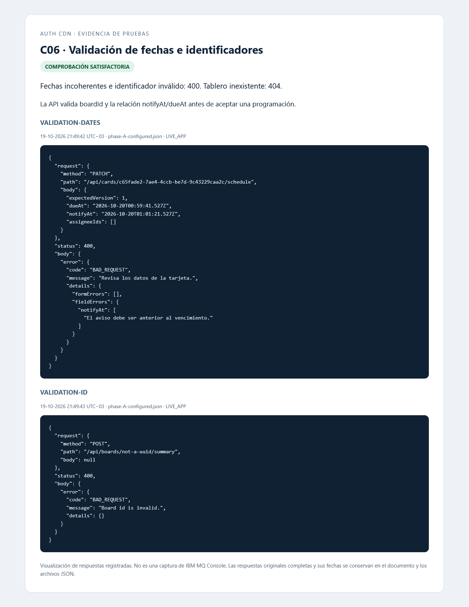

*Vista generada de las respuestas registradas; no es una fotografía de consola.*


**Registro `VALIDATION-DATES` · 19-10-2026 21:49:42 UTC−03 · LIVE_APP.** [JSON original](respuestas/phase-A-configured.json).

<details>
<summary>Ver petición, respuesta y estado completo registrados</summary>

```json
{
  "request": {
    "method": "PATCH",
    "path": "/api/cards/c65fade2-7ae4-4ccb-be7d-9c43229caa2c/schedule",
    "body": {
      "expectedVersion": 1,
      "dueAt": "2026-10-20T00:59:41.527Z",
      "notifyAt": "2026-10-20T01:01:21.527Z",
      "assigneeIds": []
    }
  },
  "status": 400,
  "body": {
    "error": {
      "code": "BAD_REQUEST",
      "message": "Revisa los datos de la tarjeta.",
      "details": {
        "formErrors": [],
        "fieldErrors": {
          "notifyAt": [
            "El aviso debe ser anterior al vencimiento."
          ]
        }
      }
    }
  }
}
```

</details>


**Registro `VALIDATION-ID` · 19-10-2026 21:49:43 UTC−03 · LIVE_APP.** [JSON original](respuestas/phase-A-configured.json).

<details>
<summary>Ver petición, respuesta y estado completo registrados</summary>

```json
{
  "request": {
    "method": "POST",
    "path": "/api/boards/not-a-uuid/summary",
    "body": null
  },
  "status": 400,
  "body": {
    "error": {
      "code": "BAD_REQUEST",
      "message": "Board id is invalid.",
      "details": {}
    }
  }
}
```

</details>


**Registro `AUTH-UNKNOWN-BOARD` · 19-10-2026 21:49:44 UTC−03 · LIVE_APP.** [JSON original](respuestas/phase-A-configured.json).

<details>
<summary>Ver petición, respuesta y estado completo registrados</summary>

```json
{
  "request": {
    "method": "POST",
    "path": "/api/boards/9769ac59-1e5e-4fdc-8429-5b738825f7e6/summary",
    "body": null
  },
  "status": 404,
  "body": {
    "error": {
      "code": "NOT_FOUND",
      "message": "Board not found.",
      "details": {}
    }
  }
}
```

</details>


<a id="c07"></a>

## C07 · IBM MQ como broker y envío persistente REST

**Cómo funciona y cómo se probó.** Vercel publica por HTTPS con la identidad productora. IBM asigna un MsgId. Una lectura GET de ese MsgId permite comprobar el mensaje sin retirarlo.

**Resultado observado.** POST 201 y MsgId de IBM; GET 200 con persistence=persistent.

**Alcance.** La foto muestra otro mensaje persistente de la BOQ del mismo ensayo; la respuesta REST identifica exactamente el MsgId de la cola principal. No se afirma un reinicio del queue manager.

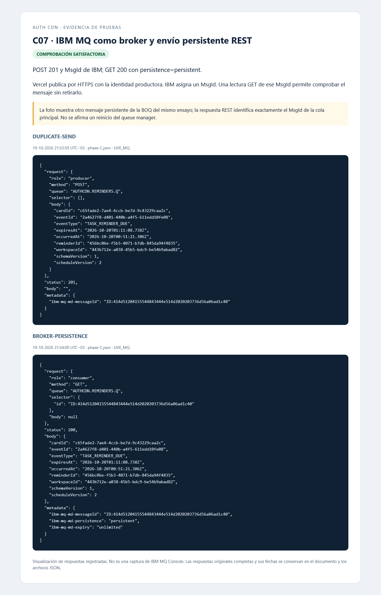

*Vista generada de las respuestas registradas; no es una fotografía de consola.*

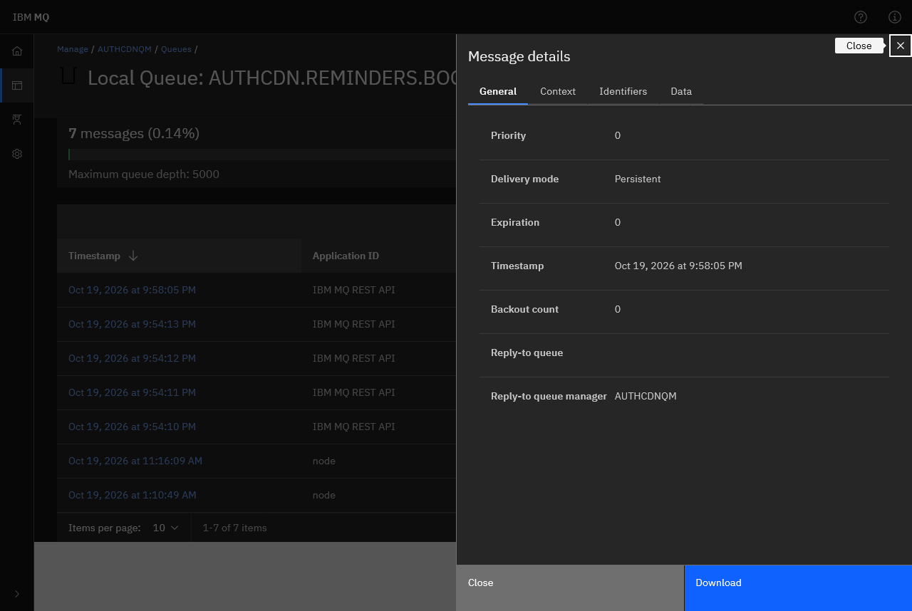

*Captura real: 22-ibm-boq-persistencia.png. Corresponde a su momento de prueba; no es un contador en vivo.*


**Registro `DUPLICATE-SEND` · 19-10-2026 21:53:59 UTC−03 · LIVE_MQ.** [JSON original](respuestas/phase-C.json).

<details>
<summary>Ver petición, respuesta y estado completo registrados</summary>

```json
{
  "request": {
    "role": "producer",
    "method": "POST",
    "queue": "AUTHCDN.REMINDERS.Q",
    "selector": {},
    "body": {
      "cardId": "c65fade2-7ae4-4ccb-be7d-9c43229caa2c",
      "eventId": "2a4627f8-d401-440b-a4f5-611edd10fe08",
      "eventType": "TASK_REMINDER_DUE",
      "expiresAt": "2026-10-20T01:11:08.738Z",
      "occurredAt": "2026-10-20T00:51:21.306Z",
      "reminderId": "456bc06e-f5b3-4071-b7db-845da94f4835",
      "workspaceId": "443b712e-a038-45b5-bdc9-be54b9abad82",
      "schemaVersion": 1,
      "scheduleVersion": 2
    }
  },
  "status": 201,
  "body": "",
  "metadata": {
    "ibm-mq-md-messageId": "ID:414d51204155544843444e514d2020203736d56a06ad1c40"
  }
}
```

</details>


**Registro `BROKER-PERSISTENCE` · 19-10-2026 21:54:00 UTC−03 · LIVE_MQ.** [JSON original](respuestas/phase-C.json).

<details>
<summary>Ver petición, respuesta y estado completo registrados</summary>

```json
{
  "request": {
    "role": "consumer",
    "method": "GET",
    "queue": "AUTHCDN.REMINDERS.Q",
    "selector": {
      "id": "ID:414d51204155544843444e514d2020203736d56a06ad1c40"
    },
    "body": null
  },
  "status": 200,
  "body": {
    "cardId": "c65fade2-7ae4-4ccb-be7d-9c43229caa2c",
    "eventId": "2a4627f8-d401-440b-a4f5-611edd10fe08",
    "eventType": "TASK_REMINDER_DUE",
    "expiresAt": "2026-10-20T01:11:08.738Z",
    "occurredAt": "2026-10-20T00:51:21.306Z",
    "reminderId": "456bc06e-f5b3-4071-b7db-845da94f4835",
    "workspaceId": "443b712e-a038-45b5-bdc9-be54b9abad82",
    "schemaVersion": 1,
    "scheduleVersion": 2
  },
  "metadata": {
    "ibm-mq-md-messageId": "ID:414d51204155544843444e514d2020203736d56a06ad1c40",
    "ibm-mq-md-persistence": "persistent",
    "ibm-mq-md-expiry": "unlimited"
  }
}
```

</details>


<a id="c08"></a>

## C08 · Recordatorio asíncrono de extremo a extremo

**Cómo funciona y cómo se probó.** PATCH con JWT programa la tarjeta en Supabase. Al llegar notifyAt, el productor crea/publica el outbox; Vercel captura y procesa el evento; el usuario lo recibe en GET /api/notifications.

**Resultado observado.** Programación 200, tick 200 y un aviso normal. La confirmación de programar no significa que ya haya un mensaje pendiente en MQ.

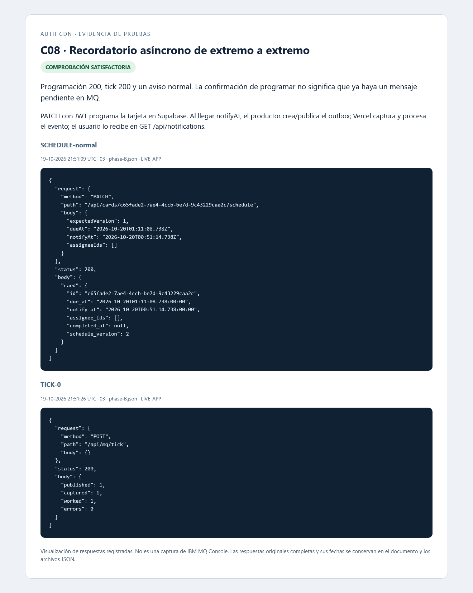

*Vista generada de las respuestas registradas; no es una fotografía de consola.*

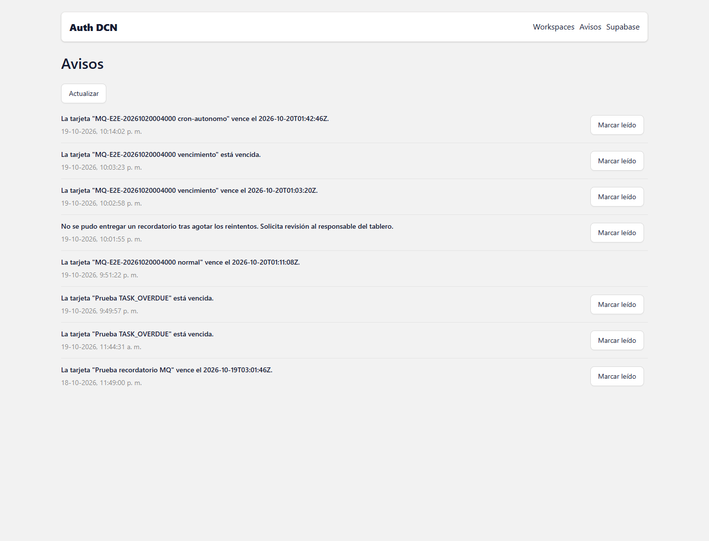

*Captura real: 13-avisos-cargados.png. Corresponde a su momento de prueba; no es un contador en vivo.*


**Registro `SCHEDULE-normal` · 19-10-2026 21:51:09 UTC−03 · LIVE_APP.** [JSON original](respuestas/phase-B.json).

<details>
<summary>Ver petición, respuesta y estado completo registrados</summary>

```json
{
  "request": {
    "method": "PATCH",
    "path": "/api/cards/c65fade2-7ae4-4ccb-be7d-9c43229caa2c/schedule",
    "body": {
      "expectedVersion": 1,
      "dueAt": "2026-10-20T01:11:08.738Z",
      "notifyAt": "2026-10-20T00:51:14.738Z",
      "assigneeIds": []
    }
  },
  "status": 200,
  "body": {
    "card": {
      "id": "c65fade2-7ae4-4ccb-be7d-9c43229caa2c",
      "due_at": "2026-10-20T01:11:08.738+00:00",
      "notify_at": "2026-10-20T00:51:14.738+00:00",
      "assignee_ids": [],
      "completed_at": null,
      "schedule_version": 2
    }
  }
}
```

</details>


**Registro `TICK-0` · 19-10-2026 21:51:26 UTC−03 · LIVE_APP.** [JSON original](respuestas/phase-B.json).

<details>
<summary>Ver petición, respuesta y estado completo registrados</summary>

```json
{
  "request": {
    "method": "POST",
    "path": "/api/mq/tick",
    "body": {}
  },
  "status": 200,
  "body": {
    "published": 1,
    "captured": 1,
    "worked": 1,
    "errors": 0
  }
}
```

</details>


**Registro `NOTIFICATIONS-DELIVERY` · 19-10-2026 21:51:36 UTC−03 · LIVE_APP.** [JSON original](respuestas/phase-B.json).

<details>
<summary>Ver petición, respuesta y estado completo registrados</summary>

```json
{
  "request": {
    "method": "GET",
    "path": "/api/notifications",
    "body": null
  },
  "status": 200,
  "body": {
    "notifications": [
      {
        "id": "c54d9158-b6b2-4576-b479-dcaa8c7897b9",
        "card_id": "c65fade2-7ae4-4ccb-be7d-9c43229caa2c",
        "message": "La tarjeta \"MQ-E2E-20261020004000 normal\" vence el 2026-10-20T01:11:08Z.",
        "created_at": "2026-10-20T00:51:22.247911+00:00",
        "read_at": null
      }
    ]
  }
}
```

</details>


<a id="c09"></a>

## C09 · Completar o cancelar antes del envío

**Cómo funciona y cómo se probó.** Se completan o desprograman tarjetas antes de notifyAt. La programación se invalida y las posteriores lecturas no muestran sus avisos.

**Resultado observado.** Las APIs aceptan el cambio; los recordatorios quedan cancelados y no hay avisos de esas tarjetas.

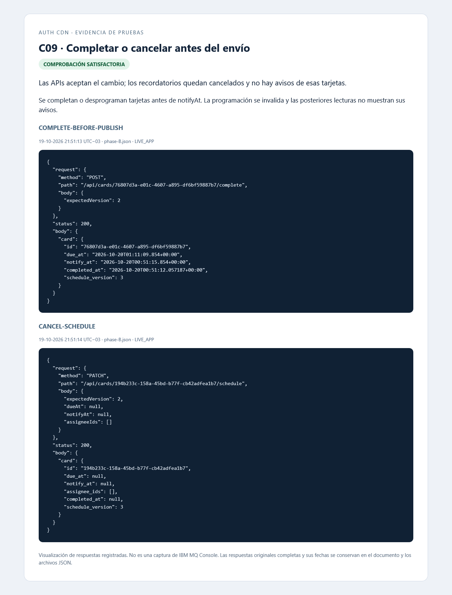

*Vista generada de las respuestas registradas; no es una fotografía de consola.*


**Registro `COMPLETE-BEFORE-PUBLISH` · 19-10-2026 21:51:13 UTC−03 · LIVE_APP.** [JSON original](respuestas/phase-B.json).

<details>
<summary>Ver petición, respuesta y estado completo registrados</summary>

```json
{
  "request": {
    "method": "POST",
    "path": "/api/cards/76807d3a-e01c-4607-a895-df6bf59887b7/complete",
    "body": {
      "expectedVersion": 2
    }
  },
  "status": 200,
  "body": {
    "card": {
      "id": "76807d3a-e01c-4607-a895-df6bf59887b7",
      "due_at": "2026-10-20T01:11:09.854+00:00",
      "notify_at": "2026-10-20T00:51:15.854+00:00",
      "completed_at": "2026-10-20T00:51:12.057187+00:00",
      "schedule_version": 3
    }
  }
}
```

</details>


**Registro `CANCEL-SCHEDULE` · 19-10-2026 21:51:14 UTC−03 · LIVE_APP.** [JSON original](respuestas/phase-B.json).

<details>
<summary>Ver petición, respuesta y estado completo registrados</summary>

```json
{
  "request": {
    "method": "PATCH",
    "path": "/api/cards/194b233c-158a-45bd-b77f-cb42adfea1b7/schedule",
    "body": {
      "expectedVersion": 2,
      "dueAt": null,
      "notifyAt": null,
      "assigneeIds": []
    }
  },
  "status": 200,
  "body": {
    "card": {
      "id": "194b233c-158a-45bd-b77f-cb42adfea1b7",
      "due_at": null,
      "notify_at": null,
      "assignee_ids": [],
      "completed_at": null,
      "schedule_version": 3
    }
  }
}
```

</details>


**Registro `REMINDERS-STATE` · 19-10-2026 21:51:35 UTC−03 · LIVE_SQL.** [JSON original](respuestas/phase-B.json).

<details>
<summary>Ver petición, respuesta y estado completo registrados</summary>

```json
{
  "status": 200,
  "body": [
    {
      "id": "58de68e2-983d-4ea9-a037-e7a5cf9bf1c5",
      "card_id": "194b233c-158a-45bd-b77f-cb42adfea1b7",
      "kind": "TASK_REMINDER_DUE",
      "status": "CANCELLED",
      "schedule_version": 2,
      "notify_at": "2026-10-20T00:51:17.185+00:00",
      "expires_at": "2026-10-20T01:11:11.185+00:00",
      "processed_at": null
    },
    {
      "id": "ee2e977b-ee58-4756-a5b4-493a4c153297",
      "card_id": "194b233c-158a-45bd-b77f-cb42adfea1b7",
      "kind": "TASK_OVERDUE",
      "status": "CANCELLED",
      "schedule_version": 2,
      "notify_at": "2026-10-20T01:11:11.185+00:00",
      "expires_at": "2026-10-21T01:11:11.185+00:00",
      "processed_at": null
    },
    {
      "id": "66b106ca-3272-45df-80a9-621bcd11eb01",
      "card_id": "76807d3a-e01c-4607-a895-df6bf59887b7",
      "kind": "TASK_REMINDER_DUE",
      "status": "CANCELLED",
      "schedule_version": 2,
      "notify_at": "2026-10-20T00:51:15.854+00:00",
      "expires_at": "2026-10-20T01:11:09.854+00:00",
      "processed_at": null
    },
    {
      "id": "6d96e05b-5ca4-4ee2-96ad-4d72afa6ab1a",
      "card_id": "76807d3a-e01c-4607-a895-df6bf59887b7",
      "kind": "TASK_OVERDUE",
      "status": "CANCELLED",
      "schedule_version": 2,
      "notify_at": "2026-10-20T01:11:09.854+00:00",
      "expires_at": "2026-10-21T01:11:09.854+00:00",
      "processed_at": null
    },
    {
      "id": "b5aecf37-3658-4b1f-9b88-36942dff5284",
      "card_id": "c65fade2-7ae4-4ccb-be7d-9c43229caa2c",
      "kind": "TASK_OVERDUE",
      "status": "SCHEDULED",
      "schedule_version": 2,
      "notify_at": "2026-10-20T01:11:08.738+00:00",
      "expires_at": "2026-10-21T01:11:08.738+00:00",
      "processed_at": null
    },
    {
      "id": "456bc06e-f5b3-4071-b7db-845da94f4835",
      "card_id": "c65fade2-7ae4-4ccb-be7d-9c43229caa2c",
      "kind": "TASK_REMINDER_DUE",
      "status": "PROCESSED",
      "schedule_version": 2,
      "notify_at": "2026-10-20T00:51:14.738+00:00",
      "expires_at": "2026-10-20T01:11:08.738+00:00",
      "processed_at": "2026-10-20T00:51:22.24936+00:00"
    }
  ]
}
```

</details>


**Registro `NOTIFICATIONS-DELIVERY` · 19-10-2026 21:51:36 UTC−03 · LIVE_APP.** [JSON original](respuestas/phase-B.json).

<details>
<summary>Ver petición, respuesta y estado completo registrados</summary>

```json
{
  "request": {
    "method": "GET",
    "path": "/api/notifications",
    "body": null
  },
  "status": 200,
  "body": {
    "notifications": [
      {
        "id": "c54d9158-b6b2-4576-b479-dcaa8c7897b9",
        "card_id": "c65fade2-7ae4-4ccb-be7d-9c43229caa2c",
        "message": "La tarjeta \"MQ-E2E-20261020004000 normal\" vence el 2026-10-20T01:11:08Z.",
        "created_at": "2026-10-20T00:51:22.247911+00:00",
        "read_at": null
      }
    ]
  }
}
```

</details>


<a id="c10"></a>

## C10 · Aviso preventivo y aviso de vencimiento

**Cómo funciona y cómo se probó.** Se programa una tarjeta con un vencimiento cercano y se espera al reloj real. Cada tipo de evento tiene su propia identidad.

**Resultado observado.** Un aviso preventivo y un aviso de tarjeta vencida; ambos recordatorios PROCESSED y sin duplicados.

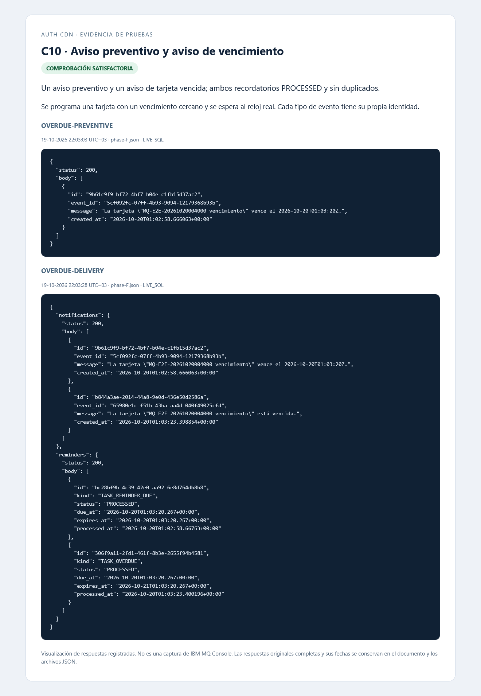

*Vista generada de las respuestas registradas; no es una fotografía de consola.*


*Captura real: 13-avisos-cargados.png. Corresponde a su momento de prueba; no es un contador en vivo.*


**Registro `OVERDUE-PREVENTIVE` · 19-10-2026 22:03:03 UTC−03 · LIVE_SQL.** [JSON original](respuestas/phase-F.json).

<details>
<summary>Ver petición, respuesta y estado completo registrados</summary>

```json
{
  "status": 200,
  "body": [
    {
      "id": "9b61c9f9-bf72-4bf7-b04e-c1fb15d37ac2",
      "event_id": "5cf092fc-07ff-4b93-9094-12179368b93b",
      "message": "La tarjeta \"MQ-E2E-20261020004000 vencimiento\" vence el 2026-10-20T01:03:20Z.",
      "created_at": "2026-10-20T01:02:58.666063+00:00"
    }
  ]
}
```

</details>


**Registro `OVERDUE-DELIVERY` · 19-10-2026 22:03:28 UTC−03 · LIVE_SQL.** [JSON original](respuestas/phase-F.json).

<details>
<summary>Ver petición, respuesta y estado completo registrados</summary>

```json
{
  "notifications": {
    "status": 200,
    "body": [
      {
        "id": "9b61c9f9-bf72-4bf7-b04e-c1fb15d37ac2",
        "event_id": "5cf092fc-07ff-4b93-9094-12179368b93b",
        "message": "La tarjeta \"MQ-E2E-20261020004000 vencimiento\" vence el 2026-10-20T01:03:20Z.",
        "created_at": "2026-10-20T01:02:58.666063+00:00"
      },
      {
        "id": "b844a3ae-2014-44a8-9e0d-436e50d2586a",
        "event_id": "65980e1c-f51b-43ba-aa4d-040f49025cfd",
        "message": "La tarjeta \"MQ-E2E-20261020004000 vencimiento\" está vencida.",
        "created_at": "2026-10-20T01:03:23.398854+00:00"
      }
    ]
  },
  "reminders": {
    "status": 200,
    "body": [
      {
        "id": "bc28bf9b-4c39-42e0-aa92-6e8d764db8b8",
        "kind": "TASK_REMINDER_DUE",
        "status": "PROCESSED",
        "due_at": "2026-10-20T01:03:20.267+00:00",
        "expires_at": "2026-10-20T01:03:20.267+00:00",
        "processed_at": "2026-10-20T01:02:58.66763+00:00"
      },
      {
        "id": "306f9a11-2fd1-461f-8b3e-2655f94b4581",
        "kind": "TASK_OVERDUE",
        "status": "PROCESSED",
        "due_at": "2026-10-20T01:03:20.267+00:00",
        "expires_at": "2026-10-21T01:03:20.267+00:00",
        "processed_at": "2026-10-20T01:03:23.400196+00:00"
      }
    ]
  }
}
```

</details>


**Registro `SUMMARY-AFTER-OVERDUE` · 19-10-2026 22:03:31 UTC−03 · LIVE_APP.** [JSON original](respuestas/phase-F.json).

<details>
<summary>Ver petición, respuesta y estado completo registrados</summary>

```json
{
  "request": {
    "method": "POST",
    "path": "/api/boards/5c52e0b4-62f0-4545-9ea3-2aa86dfe0c62/summary",
    "body": null
  },
  "status": 200,
  "body": {
    "summary": {
      "totalActive": 6,
      "pending": 4,
      "completed": 1,
      "overdue": 1
    },
    "requestId": "e45adba4-5d0e-4ac0-ae7a-1aed778e05ee",
    "generatedAt": "2026-10-20T01:03:29.056Z"
  }
}
```

</details>


<a id="c11"></a>

## C11 · Marcar un aviso propio como leído

**Cómo funciona y cómo se probó.** El usuario recibe el aviso mediante GET autenticado y envía PATCH a su identificador.

**Resultado observado.** PATCH 200; la lectura se asocia al aviso del usuario.

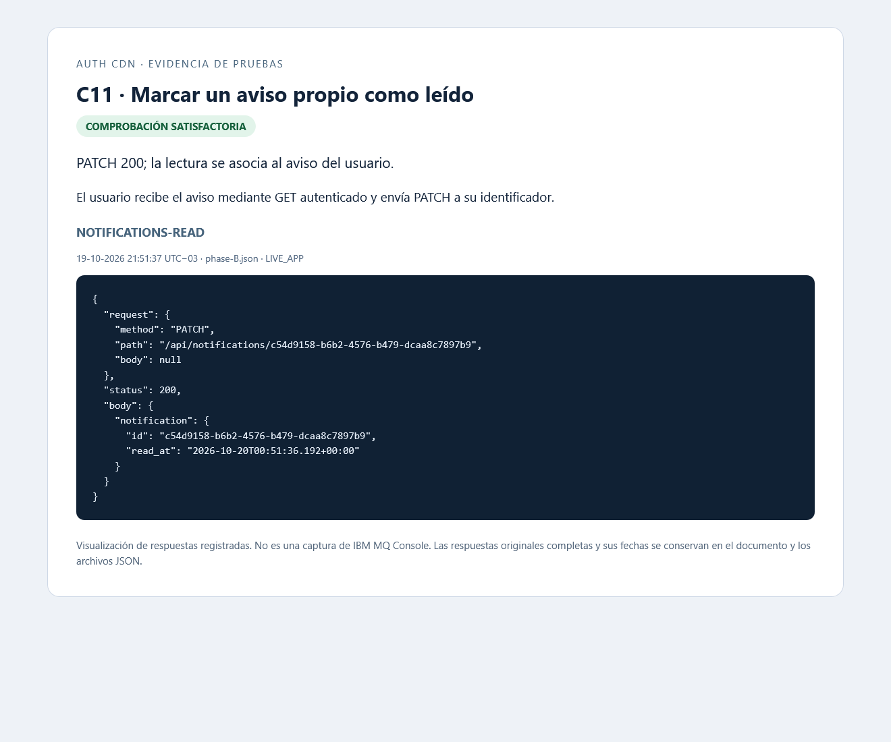

*Vista generada de las respuestas registradas; no es una fotografía de consola.*


**Registro `NOTIFICATIONS-READ` · 19-10-2026 21:51:37 UTC−03 · LIVE_APP.** [JSON original](respuestas/phase-B.json).

<details>
<summary>Ver petición, respuesta y estado completo registrados</summary>

```json
{
  "request": {
    "method": "PATCH",
    "path": "/api/notifications/c54d9158-b6b2-4576-b479-dcaa8c7897b9",
    "body": null
  },
  "status": 200,
  "body": {
    "notification": {
      "id": "c54d9158-b6b2-4576-b479-dcaa8c7897b9",
      "read_at": "2026-10-20T00:51:36.192+00:00"
    }
  }
}
```

</details>


<a id="c12"></a>

## C12 · Request/Reply síncrono y solicitudes simultáneas

**Cómo funciona y cómo se probó.** POST del usuario publica en SUMMARY.REQUEST.Q. El responder cloud publica en SUMMARY.REPLY.Q con CorrelId igual al MsgId de la solicitud. La API espera la respuesta de su requestId.

**Resultado observado.** Dos tableros y dos solicitudes simultáneas reciben 200, con requestId distintos y estadísticas correlacionadas.

**Alcance.** La foto corresponde a la ronda inicial con ocho tarjetas. Los conteos cambian al crear nuevas tarjetas de ensayo; se debe comparar cada respuesta con su fecha.

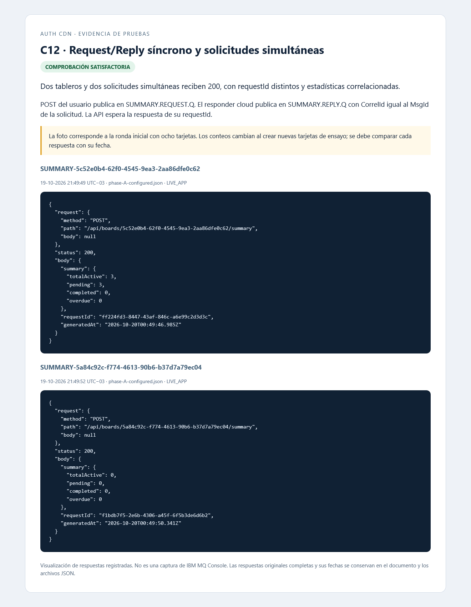

*Vista generada de las respuestas registradas; no es una fotografía de consola.*

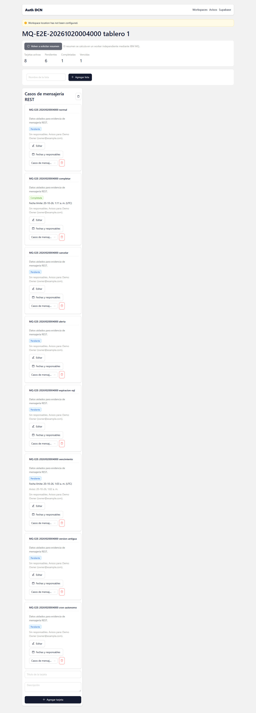

*Captura real: 14-resumen-cargado.png. Corresponde a su momento de prueba; no es un contador en vivo.*


**Registro `SUMMARY-5c52e0b4-62f0-4545-9ea3-2aa86dfe0c62` · 19-10-2026 21:49:49 UTC−03 · LIVE_APP.** [JSON original](respuestas/phase-A-configured.json).

<details>
<summary>Ver petición, respuesta y estado completo registrados</summary>

```json
{
  "request": {
    "method": "POST",
    "path": "/api/boards/5c52e0b4-62f0-4545-9ea3-2aa86dfe0c62/summary",
    "body": null
  },
  "status": 200,
  "body": {
    "summary": {
      "totalActive": 3,
      "pending": 3,
      "completed": 0,
      "overdue": 0
    },
    "requestId": "ff224fd3-8447-43af-846c-a6e99c2d3d3c",
    "generatedAt": "2026-10-20T00:49:46.985Z"
  }
}
```

</details>


**Registro `SUMMARY-5a84c92c-f774-4613-90b6-b37d7a79ec04` · 19-10-2026 21:49:52 UTC−03 · LIVE_APP.** [JSON original](respuestas/phase-A-configured.json).

<details>
<summary>Ver petición, respuesta y estado completo registrados</summary>

```json
{
  "request": {
    "method": "POST",
    "path": "/api/boards/5a84c92c-f774-4613-90b6-b37d7a79ec04/summary",
    "body": null
  },
  "status": 200,
  "body": {
    "summary": {
      "totalActive": 0,
      "pending": 0,
      "completed": 0,
      "overdue": 0
    },
    "requestId": "f1bdb7f5-2e6b-4306-a45f-6f5b3de6d6b2",
    "generatedAt": "2026-10-20T00:49:50.341Z"
  }
}
```

</details>


**Registro `SUMMARY-CONCURRENT` · 19-10-2026 21:49:56 UTC−03 · LIVE_APP.** [JSON original](respuestas/phase-A-configured.json).

<details>
<summary>Ver petición, respuesta y estado completo registrados</summary>

```json
[
  {
    "request": {
      "method": "POST",
      "path": "/api/boards/5c52e0b4-62f0-4545-9ea3-2aa86dfe0c62/summary",
      "body": null
    },
    "status": 200,
    "body": {
      "summary": {
        "totalActive": 3,
        "pending": 3,
        "completed": 0,
        "overdue": 0
      },
      "requestId": "2a126144-da81-4319-a8ad-145ce48ea3c4",
      "generatedAt": "2026-10-20T00:49:53.524Z"
    }
  },
  {
    "request": {
      "method": "POST",
      "path": "/api/boards/5a84c92c-f774-4613-90b6-b37d7a79ec04/summary",
      "body": null
    },
    "status": 200,
    "body": {
      "summary": {
        "totalActive": 0,
        "pending": 0,
        "completed": 0,
        "overdue": 0
      },
      "requestId": "c254fd28-693c-4d60-baa0-0900a792dbdf",
      "generatedAt": "2026-10-20T00:49:53.963Z"
    }
  }
]
```

</details>


**Registro `SUMMARY-SQL-TRACE` · 19-10-2026 21:50:01 UTC−03 · LIVE_SQL.** [JSON original](respuestas/phase-A-configured.json).

<details>
<summary>Ver petición, respuesta y estado completo registrados</summary>

```json
{
  "status": 200,
  "body": [
    {
      "id": "b61c942d-62ae-4631-a6a9-e495f4823b34",
      "queue_name": "AUTHCDN.SUMMARY.REPLY.Q",
      "message_id": "ID:414D51204155544843444E514D2020203736D56A156A1C40",
      "correlation_id": "ID:414D51204155544843444E514D2020203736D56A136A1C40",
      "reply_to": null,
      "state": "DONE",
      "attempts": 1,
      "output_attempts": 0,
      "body": "{\"schemaVersion\":1,\"requestId\":\"c254fd28-693c-4d60-baa0-0900a792dbdf\",\"boardId\":\"5a84c92c-f774-4613-90b6-b37d7a79ec04\",\"generatedAt\":\"2026-10-20T00:49:53.963Z\",\"status\":\"OK\",\"stats\":{\"totalActive\":0,\"pending\":0,\"completed\":0,\"overdue\":0}}",
      "output": null,
      "created_at": "2026-10-20T00:49:54.290631+00:00"
    },
    {
      "id": "a9f18544-a5f7-488e-bd06-2d25fcaea80c",
      "queue_name": "AUTHCDN.SUMMARY.REPLY.Q",
      "message_id": "ID:414D51204155544843444E514D2020203736D56A146A1C40",
      "correlation_id": "ID:414D51204155544843444E514D2020203736D56A126A1C40",
      "reply_to": null,
      "state": "DONE",
      "attempts": 1,
      "output_attempts": 0,
      "body": "{\"schemaVersion\":1,\"requestId\":\"2a126144-da81-4319-a8ad-145ce48ea3c4\",\"boardId\":\"5c52e0b4-62f0-4545-9ea3-2aa86dfe0c62\",\"generatedAt\":\"2026-10-20T00:49:53.524Z\",\"status\":\"OK\",\"stats\":{\"totalActive\":3,\"pending\":3,\"completed\":0,\"overdue\":0}}",
      "output": null,
      "created_at": "2026-10-20T00:49:54.043914+00:00"
    },
    {
      "id": "18200de9-fddc-4b77-bbea-5891a359a7a8",
      "queue_name": "AUTHCDN.SUMMARY.REQUEST.Q",
      "message_id": "ID:414D51204155544843444E514D2020203736D56A136A1C40",
      "correlation_id": null,
      "reply_to": "AUTHCDN.SUMMARY.REPLY.Q@AUTHCDNQM",
      "state": "DONE",
      "attempts": 1,
      "output_attempts": 1,
      "body": "{\"schemaVersion\":1,\"requestId\":\"c254fd28-693c-4d60-baa0-0900a792dbdf\",\"boardId\":\"5a84c92c-f774-4613-90b6-b37d7a79ec04\",\"userId\":\"45e0ff79-940c-4230-bd97-bb9e0572e0f0\",\"createdAt\":\"2026-10-20T00:49:53.103Z\",\"expiresAt\":\"2026-10-20T00:50:23.103Z\"}",
      "output": {
        "body": "{\"schemaVersion\":1,\"requestId\":\"c254fd28-693c-4d60-baa0-0900a792dbdf\",\"boardId\":\"5a84c92c-f774-4613-90b6-b37d7a79ec04\",\"generatedAt\":\"2026-10-20T00:49:53.963Z\",\"status\":\"OK\",\"stats\":{\"totalActive\":0,\"pending\":0,\"completed\":0,\"overdue\":0}}",
        "queue": "AUTHCDN.SUMMARY.REPLY.Q",
        "expiresAt": "2026-10-20T00:50:53.963Z",
        "correlationId": "ID:414D51204155544843444E514D2020203736D56A136A1C40"
      },
      "created_at": "2026-10-20T00:49:53.221116+00:00"
    },
    {
      "id": "76ae4d38-cd9c-47b1-b320-566ce0301b1f",
      "queue_name": "AUTHCDN.SUMMARY.REQUEST.Q",
      "message_id": "ID:414D51204155544843444E514D2020203736D56A126A1C40",
      "correlation_id": null,
      "reply_to": "AUTHCDN.SUMMARY.REPLY.Q@AUTHCDNQM",
      "state": "DONE",
      "attempts": 1,
      "output_attempts": 1,
      "body": "{\"schemaVersion\":1,\"requestId\":\"2a126144-da81-4319-a8ad-145ce48ea3c4\",\"boardId\":\"5c52e0b4-62f0-4545-9ea3-2aa86dfe0c62\",\"userId\":\"45e0ff79-940c-4230-bd97-bb9e0572e0f0\",\"createdAt\":\"2026-10-20T00:49:52.720Z\",\"expiresAt\":\"2026-10-20T00:50:22.720Z\"}",
      "output": {
        "body": "{\"schemaVersion\":1,\"requestId\":\"2a126144-da81-4319-a8ad-145ce48ea3c4\",\"boardId\":\"5c52e0b4-62f0-4545-9ea3-2aa86dfe0c62\",\"generatedAt\":\"2026-10-20T00:49:53.524Z\",\"status\":\"OK\",\"stats\":{\"totalActive\":3,\"pending\":3,\"completed\":0,\"overdue\":0}}",
        "queue": "AUTHCDN.SUMMARY.REPLY.Q",
        "expiresAt": "2026-10-20T00:50:53.524Z",
        "correlationId": "ID:414D51204155544843444E514D2020203736D56A126A1C40"
      },
      "created_at": "2026-10-20T00:49:52.840421+00:00"
    },
    {
      "id": "95d51ae7-397c-4c2a-931f-08c1b2e01159",
      "queue_name": "AUTHCDN.SUMMARY.REPLY.Q",
      "message_id": "ID:414D51204155544843444E514D2020203736D56A116A1C40",
      "correlation_id": "ID:414D51204155544843444E514D2020203736D56A106A1C40",
      "reply_to": null,
      "state": "DONE",
      "attempts": 1,
      "output_attempts": 0,
      "body": "{\"schemaVersion\":1,\"requestId\":\"f1bdb7f5-2e6b-4306-a45f-6f5b3de6d6b2\",\"boardId\":\"5a84c92c-f774-4613-90b6-b37d7a79ec04\",\"generatedAt\":\"2026-10-20T00:49:50.341Z\",\"status\":\"OK\",\"stats\":{\"totalActive\":0,\"pending\":0,\"completed\":0,\"overdue\":0}}",
      "output": null,
      "created_at": "2026-10-20T00:49:50.71831+00:00"
    },
    {
      "id": "25216ec4-5b72-46c1-a245-ba968ea5392d",
      "queue_name": "AUTHCDN.SUMMARY.REQUEST.Q",
      "message_id": "ID:414D51204155544843444E514D2020203736D56A106A1C40",
      "correlation_id": null,
      "reply_to": "AUTHCDN.SUMMARY.REPLY.Q@AUTHCDNQM",
      "state": "DONE",
      "attempts": 1,
      "output_attempts": 1,
      "body": "{\"schemaVersion\":1,\"requestId\":\"f1bdb7f5-2e6b-4306-a45f-6f5b3de6d6b2\",\"boardId\":\"5a84c92c-f774-4613-90b6-b37d7a79ec04\",\"userId\":\"45e0ff79-940c-4230-bd97-bb9e0572e0f0\",\"createdAt\":\"2026-10-20T00:49:49.675Z\",\"expiresAt\":\"2026-10-20T00:50:19.675Z\"}",
      "output": {
        "body": "{\"schemaVersion\":1,\"requestId\":\"f1bdb7f5-2e6b-4306-a45f-6f5b3de6d6b2\",\"boardId\":\"5a84c92c-f774-4613-90b6-b37d7a79ec04\",\"generatedAt\":\"2026-10-20T00:49:50.341Z\",\"status\":\"OK\",\"stats\":{\"totalActive\":0,\"pending\":0,\"completed\":0,\"overdue\":0}}",
        "queue": "AUTHCDN.SUMMARY.REPLY.Q",
        "expiresAt": "2026-10-20T00:50:50.341Z",
        "correlationId": "ID:414D51204155544843444E514D2020203736D56A106A1C40"
      },
      "created_at": "2026-10-20T00:49:49.784075+00:00"
    },
    {
      "id": "aa748a00-5d44-4ac4-919c-9ece4ddcc62d",
      "queue_name": "AUTHCDN.SUMMARY.REPLY.Q",
      "message_id": "ID:414D51204155544843444E514D2020203736D56A0F6A1C40",
      "correlation_id": "ID:414D51204155544843444E514D2020203736D56A0E6A1C40",
      "reply_to": null,
      "state": "DONE",
      "attempts": 1,
      "output_attempts": 0,
      "body": "{\"schemaVersion\":1,\"requestId\":\"ff224fd3-8447-43af-846c-a6e99c2d3d3c\",\"boardId\":\"5c52e0b4-62f0-4545-9ea3-2aa86dfe0c62\",\"generatedAt\":\"2026-10-20T00:49:46.985Z\",\"status\":\"OK\",\"stats\":{\"totalActive\":3,\"pending\":3,\"completed\":0,\"overdue\":0}}",
      "output": null,
      "created_at": "2026-10-20T00:49:47.308335+00:00"
    },
    {
      "id": "499c307b-cd4d-429a-9541-58325a4b99f1",
      "queue_name": "AUTHCDN.SUMMARY.REQUEST.Q",
      "message_id": "ID:414D51204155544843444E514D2020203736D56A0E6A1C40",
      "correlation_id": null,
      "reply_to": "AUTHCDN.SUMMARY.REPLY.Q@AUTHCDNQM",
      "state": "DONE",
      "attempts": 1,
      "output_attempts": 1,
      "body": "{\"schemaVersion\":1,\"requestId\":\"ff224fd3-8447-43af-846c-a6e99c2d3d3c\",\"boardId\":\"5c52e0b4-62f0-4545-9ea3-2aa86dfe0c62\",\"userId\":\"45e0ff79-940c-4230-bd97-bb9e0572e0f0\",\"createdAt\":\"2026-10-20T00:49:45.861Z\",\"expiresAt\":\"2026-10-20T00:50:15.861Z\"}",
      "output": {
        "body": "{\"schemaVersion\":1,\"requestId\":\"ff224fd3-8447-43af-846c-a6e99c2d3d3c\",\"boardId\":\"5c52e0b4-62f0-4545-9ea3-2aa86dfe0c62\",\"generatedAt\":\"2026-10-20T00:49:46.985Z\",\"status\":\"OK\",\"stats\":{\"totalActive\":3,\"pending\":3,\"completed\":0,\"overdue\":0}}",
        "queue": "AUTHCDN.SUMMARY.REPLY.Q",
        "expiresAt": "2026-10-20T00:50:46.985Z",
        "correlationId": "ID:414D51204155544843444E514D2020203736D56A0E6A1C40"
      },
      "created_at": "2026-10-20T00:49:46.272551+00:00"
    }
  ]
}
```

</details>


<a id="c13"></a>

## C13 · Request/Reply: tiempo de espera agotado y recuperación

**Cómo funciona y cómo se probó.** Se demora solo la captura de solicitudes del segundo tablero de ensayo. La API agota su espera, conserva la solicitud durable y luego vuelve a responder al retirar la demora.

**Resultado observado.** 504 GATEWAY_TIMEOUT real, solicitud PENDING y una nueva petición posterior 200.

**Alcance.** La espera medida de extremo a extremo fue 28.520 ms en esta ronda; incluye trabajo previo y red. Se provocó una demora acotada en SQL, no una caída general de IBM ni de Vercel.

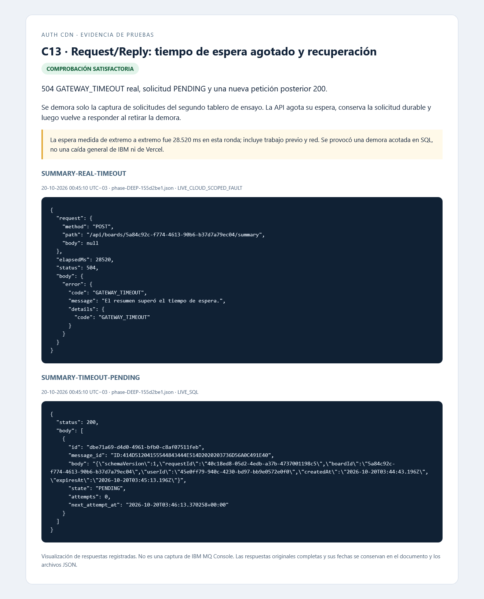

*Vista generada de las respuestas registradas; no es una fotografía de consola.*


**Registro `SUMMARY-REAL-TIMEOUT` · 20-10-2026 00:45:10 UTC−03 · LIVE_CLOUD_SCOPED_FAULT.** [JSON original](respuestas/phase-DEEP-155d2be1.json).

<details>
<summary>Ver petición, respuesta y estado completo registrados</summary>

```json
{
  "request": {
    "method": "POST",
    "path": "/api/boards/5a84c92c-f774-4613-90b6-b37d7a79ec04/summary",
    "body": null
  },
  "elapsedMs": 28520,
  "status": 504,
  "body": {
    "error": {
      "code": "GATEWAY_TIMEOUT",
      "message": "El resumen superó el tiempo de espera.",
      "details": {
        "code": "GATEWAY_TIMEOUT"
      }
    }
  }
}
```

</details>


**Registro `SUMMARY-TIMEOUT-PENDING` · 20-10-2026 00:45:10 UTC−03 · LIVE_SQL.** [JSON original](respuestas/phase-DEEP-155d2be1.json).

<details>
<summary>Ver petición, respuesta y estado completo registrados</summary>

```json
{
  "status": 200,
  "body": [
    {
      "id": "dbe71a69-d4d0-4961-bfb0-c8af07511feb",
      "message_id": "ID:414D51204155544843444E514D2020203736D56A0C491E40",
      "body": "{\"schemaVersion\":1,\"requestId\":\"40c18ed8-05d2-4edb-a37b-4737001198c5\",\"boardId\":\"5a84c92c-f774-4613-90b6-b37d7a79ec04\",\"userId\":\"45e0ff79-940c-4230-bd97-bb9e0572e0f0\",\"createdAt\":\"2026-10-20T03:44:43.196Z\",\"expiresAt\":\"2026-10-20T03:45:13.196Z\"}",
      "state": "PENDING",
      "attempts": 0,
      "next_attempt_at": "2026-10-20T03:46:13.370258+00:00"
    }
  ]
}
```

</details>


**Registro `SUMMARY-AFTER-TIMEOUT` · 20-10-2026 00:45:20 UTC−03 · LIVE_APP.** [JSON original](respuestas/phase-DEEP-155d2be1.json).

<details>
<summary>Ver petición, respuesta y estado completo registrados</summary>

```json
{
  "request": {
    "method": "POST",
    "path": "/api/boards/5a84c92c-f774-4613-90b6-b37d7a79ec04/summary",
    "body": null
  },
  "elapsedMs": 3650,
  "status": 200,
  "body": {
    "summary": {
      "totalActive": 0,
      "pending": 0,
      "completed": 0,
      "overdue": 0
    },
    "requestId": "5dfafc03-802b-44a0-8ff7-7ca6dc7c5e4e",
    "generatedAt": "2026-10-20T03:45:18.793Z"
  }
}
```

</details>


<a id="c14"></a>

## C14 · ACK y retirada segura: capturar antes de DELETE

**Cómo funciona y cómo se probó.** GET examina el mensaje; mq_rest_capture guarda su cuerpo en Supabase; después DELETE retira exclusivamente el MsgId capturado. Si la ejecución se detiene, otra invocación encuentra el trabajo en inbox.

**Resultado observado.** Captura durable confirmada; DELETE 200 devuelve el mensaje retirado; inbox sigue PENDING hasta recuperarse.

**Alcance.** Son confirmaciones HTTP y persistencia de aplicación. REST no ofrece una transacción distribuida MQ/Supabase ni se presentan estas operaciones como MQCMIT/MQBACK. Ante una respuesta ambigua se admite reentrega y la idempotencia limita sus efectos.

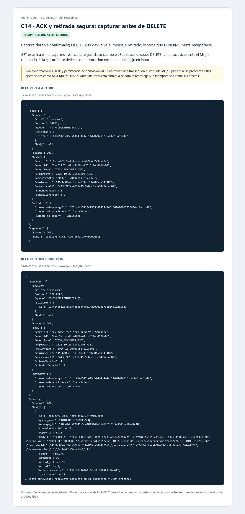

*Vista generada de las respuestas registradas; no es una fotografía de consola.*


**Registro `RECOVERY-CAPTURE` · 19-10-2026 21:54:23 UTC−03 · LIVE_HANDOFF.** [JSON original](respuestas/phase-C.json).

<details>
<summary>Ver petición, respuesta y estado completo registrados</summary>

```json
{
  "read": {
    "request": {
      "role": "consumer",
      "method": "GET",
      "queue": "AUTHCDN.REMINDERS.Q",
      "selector": {
        "id": "ID:414d51204155544843444e514d2020203736d56a10ad1c40"
      },
      "body": null
    },
    "status": 200,
    "body": {
      "cardId": "c65fade2-7ae4-4ccb-be7d-9c43229caa2c",
      "eventId": "2a4627f8-d401-440b-a4f5-611edd10fe08",
      "eventType": "TASK_REMINDER_DUE",
      "expiresAt": "2026-10-20T01:11:08.738Z",
      "occurredAt": "2026-10-20T00:51:21.306Z",
      "reminderId": "456bc06e-f5b3-4071-b7db-845da94f4835",
      "workspaceId": "443b712e-a038-45b5-bdc9-be54b9abad82",
      "schemaVersion": 1,
      "scheduleVersion": 2
    },
    "metadata": {
      "ibm-mq-md-messageId": "ID:414d51204155544843444e514d2020203736d56a10ad1c40",
      "ibm-mq-md-persistence": "persistent",
      "ibm-mq-md-expiry": "unlimited"
    }
  },
  "captured": {
    "status": 200,
    "body": "cb89c973-cac0-4cd0-bf32-17f49eb9ecc5"
  }
}
```

</details>


**Registro `RECOVERY-INTERRUPTION` · 19-10-2026 21:54:24 UTC−03 · LIVE_HANDOFF.** [JSON original](respuestas/phase-C.json).

<details>
<summary>Ver petición, respuesta y estado completo registrados</summary>

```json
{
  "removed": {
    "request": {
      "role": "consumer",
      "method": "DELETE",
      "queue": "AUTHCDN.REMINDERS.Q",
      "selector": {
        "id": "ID:414d51204155544843444e514d2020203736d56a10ad1c40"
      },
      "body": null
    },
    "status": 200,
    "body": {
      "cardId": "c65fade2-7ae4-4ccb-be7d-9c43229caa2c",
      "eventId": "2a4627f8-d401-440b-a4f5-611edd10fe08",
      "eventType": "TASK_REMINDER_DUE",
      "expiresAt": "2026-10-20T01:11:08.738Z",
      "occurredAt": "2026-10-20T00:51:21.306Z",
      "reminderId": "456bc06e-f5b3-4071-b7db-845da94f4835",
      "workspaceId": "443b712e-a038-45b5-bdc9-be54b9abad82",
      "schemaVersion": 1,
      "scheduleVersion": 2
    },
    "metadata": {
      "ibm-mq-md-messageId": "ID:414d51204155544843444e514d2020203736d56a10ad1c40",
      "ibm-mq-md-persistence": "persistent",
      "ibm-mq-md-expiry": "unlimited"
    }
  },
  "pending": {
    "status": 200,
    "body": [
      {
        "id": "cb89c973-cac0-4cd0-bf32-17f49eb9ecc5",
        "queue_name": "AUTHCDN.REMINDERS.Q",
        "message_id": "ID:414d51204155544843444e514d2020203736d56a10ad1c40",
        "correlation_id": null,
        "reply_to": null,
        "body": "{\"cardId\":\"c65fade2-7ae4-4ccb-be7d-9c43229caa2c\",\"eventId\":\"2a4627f8-d401-440b-a4f5-611edd10fe08\",\"eventType\":\"TASK_REMINDER_DUE\",\"expiresAt\":\"2026-10-20T01:11:08.738Z\",\"occurredAt\":\"2026-10-20T00:51:21.306Z\",\"reminderId\":\"456bc06e-f5b3-4071-b7db-845da94f4835\",\"workspaceId\":\"443b712e-a038-45b5-bdc9-be54b9abad82\",\"schemaVersion\":1,\"scheduleVersion\":2}",
        "state": "PENDING",
        "attempts": 0,
        "output_attempts": 0,
        "output": null,
        "next_attempt_at": "2026-10-20T00:54:22.609284+00:00",
        "last_error": null
      }
    ]
  }
}
```

</details>


**Registro `RECOVERY-BROKER-EMPTY` · 19-10-2026 21:54:31 UTC−03 · LIVE_MQ.** [JSON original](respuestas/phase-C.json).

<details>
<summary>Ver petición, respuesta y estado completo registrados</summary>

```json
{
  "request": {
    "role": "consumer",
    "method": "GET",
    "queue": "AUTHCDN.REMINDERS.Q",
    "selector": {
      "id": "ID:414d51204155544843444e514d2020203736d56a10ad1c40"
    },
    "body": null
  },
  "status": 204,
  "body": "",
  "metadata": {}
}
```

</details>


<a id="c15"></a>

## C15 · Idempotencia ante mensajes repetidos

**Cómo funciona y cómo se probó.** Se publican dos mensajes con MsgId distintos para el mismo eventId y se procesan ambos. La unicidad y la lógica de process_reminder_event evitan un segundo aviso.

**Resultado observado.** Inbox DONE y una sola notificación para el eventId.

**Alcance.** La primera consulta de auditoría usó igualdad de MsgId sensible a mayúsculas; la verificación corregida de fase V confirmó el resultado. El error de la consulta histórica no fue pérdida de mensajes.

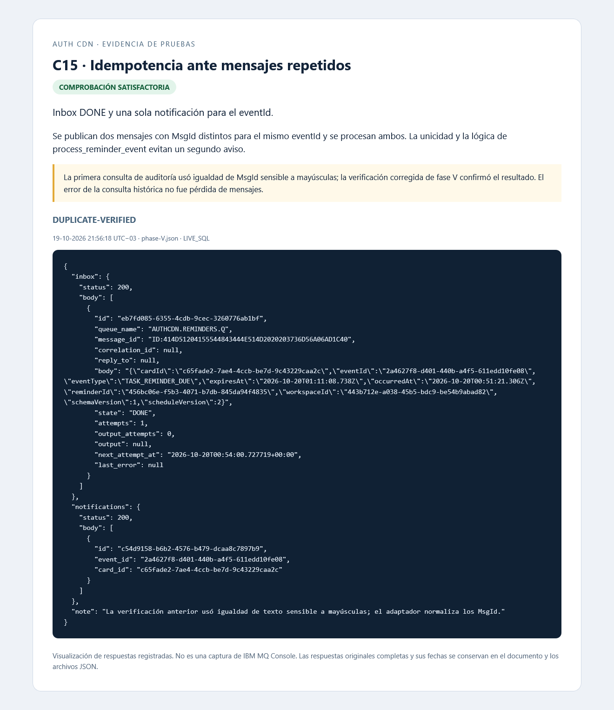

*Vista generada de las respuestas registradas; no es una fotografía de consola.*


**Registro `DUPLICATE-VERIFIED` · 19-10-2026 21:56:18 UTC−03 · LIVE_SQL.** [JSON original](respuestas/phase-V.json).

<details>
<summary>Ver petición, respuesta y estado completo registrados</summary>

```json
{
  "inbox": {
    "status": 200,
    "body": [
      {
        "id": "eb7fd085-6355-4cdb-9cec-3260776ab1bf",
        "queue_name": "AUTHCDN.REMINDERS.Q",
        "message_id": "ID:414D51204155544843444E514D2020203736D56A06AD1C40",
        "correlation_id": null,
        "reply_to": null,
        "body": "{\"cardId\":\"c65fade2-7ae4-4ccb-be7d-9c43229caa2c\",\"eventId\":\"2a4627f8-d401-440b-a4f5-611edd10fe08\",\"eventType\":\"TASK_REMINDER_DUE\",\"expiresAt\":\"2026-10-20T01:11:08.738Z\",\"occurredAt\":\"2026-10-20T00:51:21.306Z\",\"reminderId\":\"456bc06e-f5b3-4071-b7db-845da94f4835\",\"workspaceId\":\"443b712e-a038-45b5-bdc9-be54b9abad82\",\"schemaVersion\":1,\"scheduleVersion\":2}",
        "state": "DONE",
        "attempts": 1,
        "output_attempts": 0,
        "output": null,
        "next_attempt_at": "2026-10-20T00:54:00.727719+00:00",
        "last_error": null
      }
    ]
  },
  "notifications": {
    "status": 200,
    "body": [
      {
        "id": "c54d9158-b6b2-4576-b479-dcaa8c7897b9",
        "event_id": "2a4627f8-d401-440b-a4f5-611edd10fe08",
        "card_id": "c65fade2-7ae4-4ccb-be7d-9c43229caa2c"
      }
    ]
  },
  "note": "La verificación anterior usó igualdad de texto sensible a mayúsculas; el adaptador normaliza los MsgId."
}
```

</details>


<a id="c16"></a>

## C16 · Recuperación después de una pausa entre captura y procesamiento

**Cómo funciona y cómo se probó.** Se captura y retira un mensaje real; el ensayo se pausa antes de procesarlo. Un tick posterior recupera el payload desde Supabase.

**Resultado observado.** PENDING → DONE; el MsgId ya no está en IBM y se conserva una sola notificación.

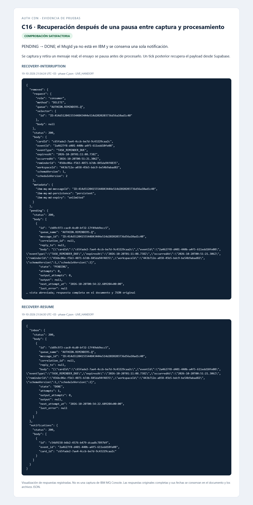

*Vista generada de las respuestas registradas; no es una fotografía de consola.*


**Registro `RECOVERY-INTERRUPTION` · 19-10-2026 21:54:24 UTC−03 · LIVE_HANDOFF.** [JSON original](respuestas/phase-C.json).

<details>
<summary>Ver petición, respuesta y estado completo registrados</summary>

```json
{
  "removed": {
    "request": {
      "role": "consumer",
      "method": "DELETE",
      "queue": "AUTHCDN.REMINDERS.Q",
      "selector": {
        "id": "ID:414d51204155544843444e514d2020203736d56a10ad1c40"
      },
      "body": null
    },
    "status": 200,
    "body": {
      "cardId": "c65fade2-7ae4-4ccb-be7d-9c43229caa2c",
      "eventId": "2a4627f8-d401-440b-a4f5-611edd10fe08",
      "eventType": "TASK_REMINDER_DUE",
      "expiresAt": "2026-10-20T01:11:08.738Z",
      "occurredAt": "2026-10-20T00:51:21.306Z",
      "reminderId": "456bc06e-f5b3-4071-b7db-845da94f4835",
      "workspaceId": "443b712e-a038-45b5-bdc9-be54b9abad82",
      "schemaVersion": 1,
      "scheduleVersion": 2
    },
    "metadata": {
      "ibm-mq-md-messageId": "ID:414d51204155544843444e514d2020203736d56a10ad1c40",
      "ibm-mq-md-persistence": "persistent",
      "ibm-mq-md-expiry": "unlimited"
    }
  },
  "pending": {
    "status": 200,
    "body": [
      {
        "id": "cb89c973-cac0-4cd0-bf32-17f49eb9ecc5",
        "queue_name": "AUTHCDN.REMINDERS.Q",
        "message_id": "ID:414d51204155544843444e514d2020203736d56a10ad1c40",
        "correlation_id": null,
        "reply_to": null,
        "body": "{\"cardId\":\"c65fade2-7ae4-4ccb-be7d-9c43229caa2c\",\"eventId\":\"2a4627f8-d401-440b-a4f5-611edd10fe08\",\"eventType\":\"TASK_REMINDER_DUE\",\"expiresAt\":\"2026-10-20T01:11:08.738Z\",\"occurredAt\":\"2026-10-20T00:51:21.306Z\",\"reminderId\":\"456bc06e-f5b3-4071-b7db-845da94f4835\",\"workspaceId\":\"443b712e-a038-45b5-bdc9-be54b9abad82\",\"schemaVersion\":1,\"scheduleVersion\":2}",
        "state": "PENDING",
        "attempts": 0,
        "output_attempts": 0,
        "output": null,
        "next_attempt_at": "2026-10-20T00:54:22.609284+00:00",
        "last_error": null
      }
    ]
  }
}
```

</details>


**Registro `RECOVERY-RESUME` · 19-10-2026 21:54:30 UTC−03 · LIVE_HANDOFF.** [JSON original](respuestas/phase-C.json).

<details>
<summary>Ver petición, respuesta y estado completo registrados</summary>

```json
{
  "inbox": {
    "status": 200,
    "body": [
      {
        "id": "cb89c973-cac0-4cd0-bf32-17f49eb9ecc5",
        "queue_name": "AUTHCDN.REMINDERS.Q",
        "message_id": "ID:414d51204155544843444e514d2020203736d56a10ad1c40",
        "correlation_id": null,
        "reply_to": null,
        "body": "{\"cardId\":\"c65fade2-7ae4-4ccb-be7d-9c43229caa2c\",\"eventId\":\"2a4627f8-d401-440b-a4f5-611edd10fe08\",\"eventType\":\"TASK_REMINDER_DUE\",\"expiresAt\":\"2026-10-20T01:11:08.738Z\",\"occurredAt\":\"2026-10-20T00:51:21.306Z\",\"reminderId\":\"456bc06e-f5b3-4071-b7db-845da94f4835\",\"workspaceId\":\"443b712e-a038-45b5-bdc9-be54b9abad82\",\"schemaVersion\":1,\"scheduleVersion\":2}",
        "state": "DONE",
        "attempts": 1,
        "output_attempts": 0,
        "output": null,
        "next_attempt_at": "2026-10-20T00:54:22.609284+00:00",
        "last_error": null
      }
    ]
  },
  "notifications": {
    "status": 200,
    "body": [
      {
        "id": "c54d9158-b6b2-4576-b479-dcaa8c7897b9",
        "event_id": "2a4627f8-d401-440b-a4f5-611edd10fe08",
        "card_id": "c65fade2-7ae4-4ccb-be7d-9c43229caa2c"
      }
    ]
  }
}
```

</details>


**Registro `RECOVERY-BROKER-EMPTY` · 19-10-2026 21:54:31 UTC−03 · LIVE_MQ.** [JSON original](respuestas/phase-C.json).

<details>
<summary>Ver petición, respuesta y estado completo registrados</summary>

```json
{
  "request": {
    "role": "consumer",
    "method": "GET",
    "queue": "AUTHCDN.REMINDERS.Q",
    "selector": {
      "id": "ID:414d51204155544843444e514d2020203736d56a10ad1c40"
    },
    "body": null
  },
  "status": 204,
  "body": "",
  "metadata": {}
}
```

</details>


<a id="c17"></a>

## C17 · Durabilidad ante interrupción real del procesamiento SQL

**Cómo funciona y cómo se probó.** Se detiene únicamente el backend PostgreSQL identificado que ejecuta process_reminder_event para la tarjeta de ensayo. La transacción se interrumpe después de intentar insertar el aviso y antes de confirmar el estado final. Se retira la condición de fallo y se invoca otro ciclo.

**Resultado observado.** Backend terminado; cero avisos parciales y trabajo PENDING. Recuperación posterior DONE con attempts=2 y exactamente un aviso.

**Alcance.** Se interrumpió un backend real de la RPC, restringido al fixture. No se reinició IBM MQ ni se apagó una función de Vercel; esta prueba no demuestra todos los fallos posibles de proveedores.

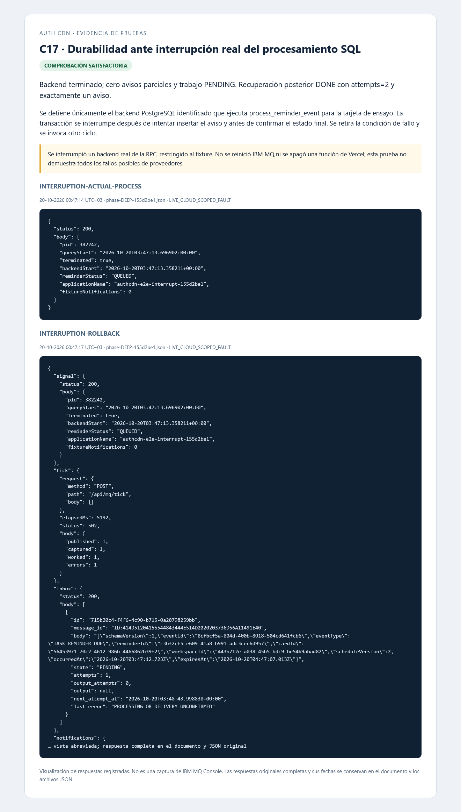

*Vista generada de las respuestas registradas; no es una fotografía de consola.*

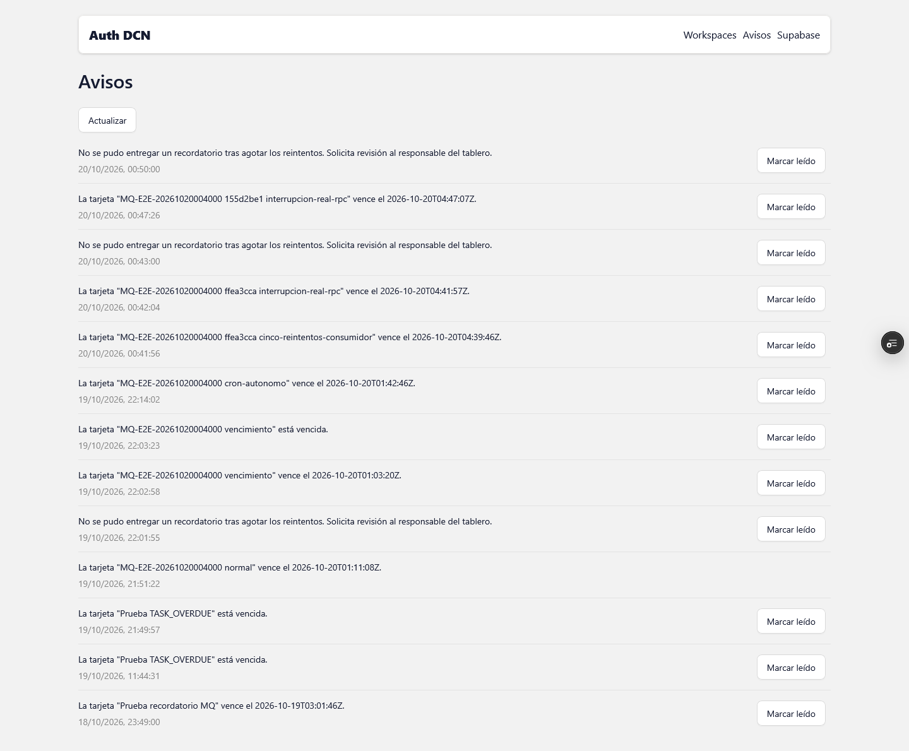

*Captura real: 43-avisos-finales-firefox.png. Corresponde a su momento de prueba; no es un contador en vivo.*


**Registro `INTERRUPTION-ACTUAL-PROCESS` · 20-10-2026 00:47:14 UTC−03 · LIVE_CLOUD_SCOPED_FAULT.** [JSON original](respuestas/phase-DEEP-155d2be1.json).

<details>
<summary>Ver petición, respuesta y estado completo registrados</summary>

```json
{
  "status": 200,
  "body": {
    "pid": 382242,
    "queryStart": "2026-10-20T03:47:13.696902+00:00",
    "terminated": true,
    "backendStart": "2026-10-20T03:47:13.358211+00:00",
    "reminderStatus": "QUEUED",
    "applicationName": "authcdn-e2e-interrupt-155d2be1",
    "fixtureNotifications": 0
  }
}
```

</details>


**Registro `INTERRUPTION-ROLLBACK` · 20-10-2026 00:47:17 UTC−03 · LIVE_CLOUD_SCOPED_FAULT.** [JSON original](respuestas/phase-DEEP-155d2be1.json).

<details>
<summary>Ver petición, respuesta y estado completo registrados</summary>

```json
{
  "signal": {
    "status": 200,
    "body": {
      "pid": 382242,
      "queryStart": "2026-10-20T03:47:13.696902+00:00",
      "terminated": true,
      "backendStart": "2026-10-20T03:47:13.358211+00:00",
      "reminderStatus": "QUEUED",
      "applicationName": "authcdn-e2e-interrupt-155d2be1",
      "fixtureNotifications": 0
    }
  },
  "tick": {
    "request": {
      "method": "POST",
      "path": "/api/mq/tick",
      "body": {}
    },
    "elapsedMs": 5192,
    "status": 502,
    "body": {
      "published": 1,
      "captured": 1,
      "worked": 1,
      "errors": 1
    }
  },
  "inbox": {
    "status": 200,
    "body": [
      {
        "id": "715b20c4-f4f6-4c90-b715-0a20798259bb",
        "message_id": "ID:414D51204155544843444E514D2020203736D56A11491E40",
        "body": "{\"schemaVersion\":1,\"eventId\":\"8cfbcf5a-804d-400b-8018-504cd641fcb6\",\"eventType\":\"TASK_REMINDER_DUE\",\"reminderId\":\"c3bf2cf5-e609-41a8-b991-adc3cec6d957\",\"cardId\":\"56453971-70c2-4612-986b-4466862b39f2\",\"workspaceId\":\"443b712e-a038-45b5-bdc9-be54b9abad82\",\"scheduleVersion\":2,\"occurredAt\":\"2026-10-20T03:47:12.723Z\",\"expiresAt\":\"2026-10-20T04:47:07.013Z\"}",
        "state": "PENDING",
        "attempts": 1,
        "output_attempts": 0,
        "output": null,
        "next_attempt_at": "2026-10-20T03:48:43.998838+00:00",
        "last_error": "PROCESSING_OR_DELIVERY_UNCONFIRMED"
      }
    ]
  },
  "notifications": {
    "status": 200,
    "body": []
  }
}
```

</details>


**Registro `INTERRUPTION-RECOVERED` · 20-10-2026 00:47:29 UTC−03 · LIVE_CLOUD_SCOPED_FAULT.** [JSON original](respuestas/phase-DEEP-155d2be1.json).

<details>
<summary>Ver petición, respuesta y estado completo registrados</summary>

```json
{
  "tick": {
    "request": {
      "method": "POST",
      "path": "/api/mq/tick",
      "body": {}
    },
    "elapsedMs": 4223,
    "status": 200,
    "body": {
      "published": 0,
      "captured": 0,
      "worked": 1,
      "errors": 0
    }
  },
  "inbox": {
    "status": 200,
    "body": [
      {
        "id": "715b20c4-f4f6-4c90-b715-0a20798259bb",
        "message_id": "ID:414D51204155544843444E514D2020203736D56A11491E40",
        "body": "{\"schemaVersion\":1,\"eventId\":\"8cfbcf5a-804d-400b-8018-504cd641fcb6\",\"eventType\":\"TASK_REMINDER_DUE\",\"reminderId\":\"c3bf2cf5-e609-41a8-b991-adc3cec6d957\",\"cardId\":\"56453971-70c2-4612-986b-4466862b39f2\",\"workspaceId\":\"443b712e-a038-45b5-bdc9-be54b9abad82\",\"scheduleVersion\":2,\"occurredAt\":\"2026-10-20T03:47:12.723Z\",\"expiresAt\":\"2026-10-20T04:47:07.013Z\"}",
        "state": "DONE",
        "attempts": 2,
        "output_attempts": 0,
        "output": null,
        "next_attempt_at": "2026-10-20T03:47:24.904+00:00",
        "last_error": null
      }
    ]
  },
  "notifications": {
    "status": 200,
    "body": [
      {
        "id": "0c0cc90a-cc9b-46d1-a2fe-ab13bf56a39a",
        "event_id": "8cfbcf5a-804d-400b-8018-504cd641fcb6",
        "message": "La tarjeta \"MQ-E2E-20261020004000 155d2be1 interrupcion-real-rpc\" vence el 2026-10-20T04:47:07Z.",
        "created_at": "2026-10-20T03:47:26.073471+00:00"
      }
    ]
  }
}
```

</details>


<a id="c18"></a>

## C18 · Concurrencia y recuperación de una reserva vencida

**Cómo funciona y cómo se probó.** Dos consumidores intentan reservar el mismo trabajo. Después se hace vencer únicamente la reserva de ensayo y se comprueba el cambio de token y el rechazo al token antiguo.

**Resultado observado.** La reserva vigente excluye al segundo consumidor; una actualización sin token o con token obsoleto no puede modificar el trabajo.

**Alcance.** La antigüedad de la reserva se fuerza en el registro técnico de ensayo para verificar la recuperación sin esperar su vencimiento natural.

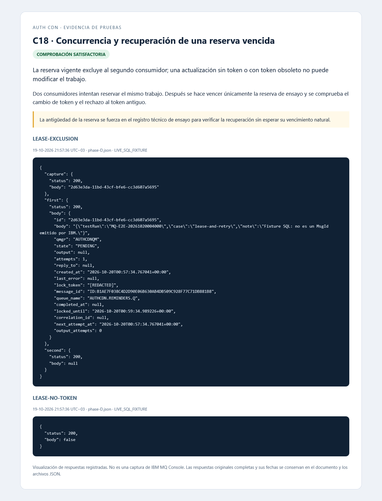

*Vista generada de las respuestas registradas; no es una fotografía de consola.*


**Registro `LEASE-EXCLUSION` · 19-10-2026 21:57:36 UTC−03 · LIVE_SQL_FIXTURE.** [JSON original](respuestas/phase-D.json).

<details>
<summary>Ver petición, respuesta y estado completo registrados</summary>

```json
{
  "capture": {
    "status": 200,
    "body": "2d63e3da-11bd-43cf-bfe6-cc3d607a5695"
  },
  "first": {
    "status": 200,
    "body": {
      "id": "2d63e3da-11bd-43cf-bfe6-cc3d607a5695",
      "body": "{\"testRun\":\"MQ-E2E-20261020004000\",\"case\":\"lease-and-retry\",\"note\":\"Fixture SQL: no es un MsgId emitido por IBM.\"}",
      "qmgr": "AUTHCDNQM",
      "state": "PENDING",
      "output": null,
      "attempts": 1,
      "reply_to": null,
      "created_at": "2026-10-20T00:57:34.767041+00:00",
      "last_error": null,
      "lock_token": "[REDACTED]",
      "message_id": "ID:B1AE7F038C4D2D90E06B630AB4DB509C928F77C71DB881B8",
      "queue_name": "AUTHCDN.REMINDERS.Q",
      "completed_at": null,
      "locked_until": "2026-10-20T00:59:34.989226+00:00",
      "correlation_id": null,
      "next_attempt_at": "2026-10-20T00:57:34.767041+00:00",
      "output_attempts": 0
    }
  },
  "second": {
    "status": 200,
    "body": null
  }
}
```

</details>


**Registro `LEASE-NO-TOKEN` · 19-10-2026 21:57:36 UTC−03 · LIVE_SQL_FIXTURE.** [JSON original](respuestas/phase-D.json).

<details>
<summary>Ver petición, respuesta y estado completo registrados</summary>

```json
{
  "status": 200,
  "body": false
}
```

</details>


**Registro `LEASE-RECOVERY` · 19-10-2026 21:57:37 UTC−03 · LIVE_SQL_FIXTURE.** [JSON original](respuestas/phase-D.json).

<details>
<summary>Ver petición, respuesta y estado completo registrados</summary>

```json
{
  "reclaimed": {
    "status": 200,
    "body": {
      "id": "2d63e3da-11bd-43cf-bfe6-cc3d607a5695",
      "body": "{\"testRun\":\"MQ-E2E-20261020004000\",\"case\":\"lease-and-retry\",\"note\":\"Fixture SQL: no es un MsgId emitido por IBM.\"}",
      "qmgr": "AUTHCDNQM",
      "state": "PENDING",
      "output": null,
      "attempts": 2,
      "reply_to": null,
      "created_at": "2026-10-20T00:57:34.767041+00:00",
      "last_error": null,
      "lock_token": "[REDACTED]",
      "message_id": "ID:B1AE7F038C4D2D90E06B630AB4DB509C928F77C71DB881B8",
      "queue_name": "AUTHCDN.REMINDERS.Q",
      "completed_at": null,
      "locked_until": "2026-10-20T00:59:36.219918+00:00",
      "correlation_id": null,
      "next_attempt_at": "2026-10-20T00:57:34.767041+00:00",
      "output_attempts": 0
    }
  },
  "staleUpdate": {
    "status": 200,
    "body": false
  },
  "tokenChanged": true
}
```

</details>


<a id="c19"></a>

## C19 · Colisión de MsgId con cuerpo diferente

**Cómo funciona y cómo se probó.** Se intenta capturar otra carga usando el mismo identificador de mensaje ya registrado.

**Resultado observado.** La captura se rechaza y no sobrescribe el cuerpo durable original.

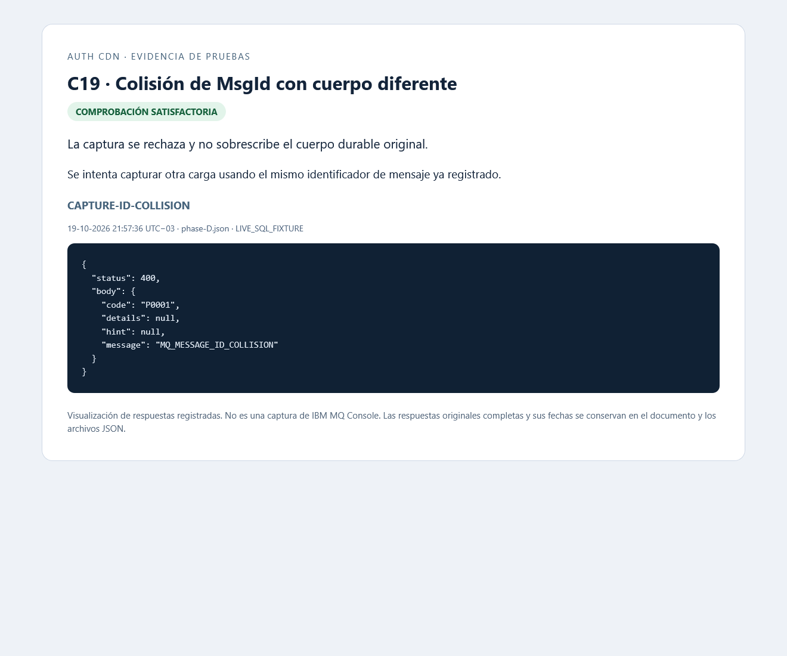

*Vista generada de las respuestas registradas; no es una fotografía de consola.*


**Registro `CAPTURE-ID-COLLISION` · 19-10-2026 21:57:36 UTC−03 · LIVE_SQL_FIXTURE.** [JSON original](respuestas/phase-D.json).

<details>
<summary>Ver petición, respuesta y estado completo registrados</summary>

```json
{
  "status": 400,
  "body": {
    "code": "P0001",
    "details": null,
    "hint": null,
    "message": "MQ_MESSAGE_ID_COLLISION"
  }
}
```

</details>


<a id="c20"></a>

## C20 · Evento atrasado de una versión anterior

**Cómo funciona y cómo se probó.** Una reprogramación incrementa scheduleVersion. Se reproduce la llegada de un evento válido de la versión cancelada.

**Resultado observado.** La versión anterior queda CANCELLED; el mensaje se consume y termina DONE sin crear un aviso.

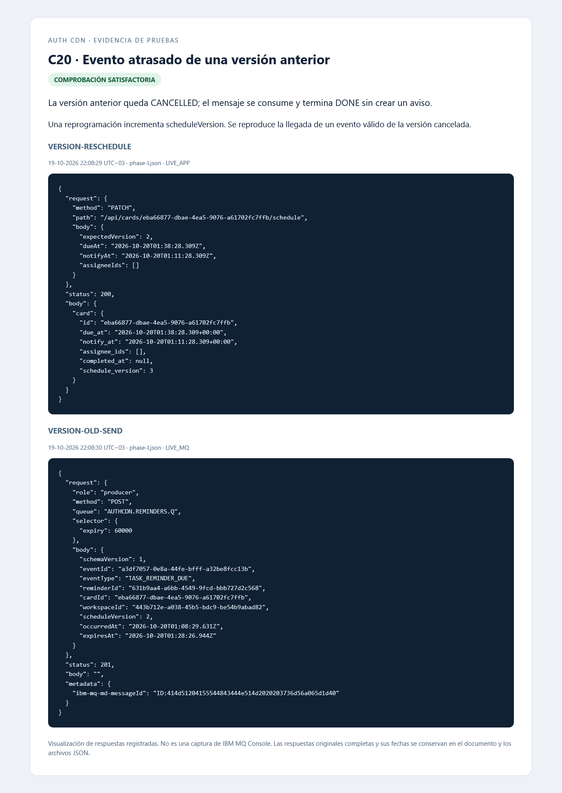

*Vista generada de las respuestas registradas; no es una fotografía de consola.*


**Registro `VERSION-RESCHEDULE` · 19-10-2026 22:08:29 UTC−03 · LIVE_APP.** [JSON original](respuestas/phase-I.json).

<details>
<summary>Ver petición, respuesta y estado completo registrados</summary>

```json
{
  "request": {
    "method": "PATCH",
    "path": "/api/cards/eba66877-dbae-4ea5-9076-a61702fc7ffb/schedule",
    "body": {
      "expectedVersion": 2,
      "dueAt": "2026-10-20T01:38:28.309Z",
      "notifyAt": "2026-10-20T01:11:28.309Z",
      "assigneeIds": []
    }
  },
  "status": 200,
  "body": {
    "card": {
      "id": "eba66877-dbae-4ea5-9076-a61702fc7ffb",
      "due_at": "2026-10-20T01:38:28.309+00:00",
      "notify_at": "2026-10-20T01:11:28.309+00:00",
      "assignee_ids": [],
      "completed_at": null,
      "schedule_version": 3
    }
  }
}
```

</details>


**Registro `VERSION-OLD-SEND` · 19-10-2026 22:08:30 UTC−03 · LIVE_MQ.** [JSON original](respuestas/phase-I.json).

<details>
<summary>Ver petición, respuesta y estado completo registrados</summary>

```json
{
  "request": {
    "role": "producer",
    "method": "POST",
    "queue": "AUTHCDN.REMINDERS.Q",
    "selector": {
      "expiry": 60000
    },
    "body": {
      "schemaVersion": 1,
      "eventId": "a3df7057-0e8a-44fe-bfff-a32be8fcc13b",
      "eventType": "TASK_REMINDER_DUE",
      "reminderId": "631b9aa4-a6bb-4549-9fcd-bbb727d2c568",
      "cardId": "eba66877-dbae-4ea5-9076-a61702fc7ffb",
      "workspaceId": "443b712e-a038-45b5-bdc9-be54b9abad82",
      "scheduleVersion": 2,
      "occurredAt": "2026-10-20T01:08:29.631Z",
      "expiresAt": "2026-10-20T01:28:26.944Z"
    }
  },
  "status": 201,
  "body": "",
  "metadata": {
    "ibm-mq-md-messageId": "ID:414d51204155544843444e514d2020203736d56a065d1d40"
  }
}
```

</details>


**Registro `VERSION-OLD-DISCARD` · 19-10-2026 22:08:37 UTC−03 · LIVE_SQL.** [JSON original](respuestas/phase-I.json).

<details>
<summary>Ver petición, respuesta y estado completo registrados</summary>

```json
{
  "inbox": {
    "status": 200,
    "body": [
      {
        "id": "4d732abb-b0f1-43b7-ba41-1e08c9ffa40a",
        "queue_name": "AUTHCDN.REMINDERS.Q",
        "message_id": "ID:414D51204155544843444E514D2020203736D56A065D1D40",
        "correlation_id": null,
        "reply_to": null,
        "body": "{\"schemaVersion\":1,\"eventId\":\"a3df7057-0e8a-44fe-bfff-a32be8fcc13b\",\"eventType\":\"TASK_REMINDER_DUE\",\"reminderId\":\"631b9aa4-a6bb-4549-9fcd-bbb727d2c568\",\"cardId\":\"eba66877-dbae-4ea5-9076-a61702fc7ffb\",\"workspaceId\":\"443b712e-a038-45b5-bdc9-be54b9abad82\",\"scheduleVersion\":2,\"occurredAt\":\"2026-10-20T01:08:29.631Z\",\"expiresAt\":\"2026-10-20T01:28:26.944Z\"}",
        "state": "DONE",
        "attempts": 1,
        "output_attempts": 0,
        "output": null,
        "next_attempt_at": "2026-10-20T01:08:31.41774+00:00",
        "last_error": null
      }
    ]
  },
  "reminder": {
    "status": 200,
    "body": [
      {
        "id": "631b9aa4-a6bb-4549-9fcd-bbb727d2c568",
        "status": "CANCELLED",
        "schedule_version": 2
      }
    ]
  },
  "notifications": {
    "status": 200,
    "body": []
  }
}
```

</details>


<a id="c21"></a>

## C21 · BOQ: JSON mal formado

**Cómo funciona y cómo se probó.** Un mensaje real con JSON inválido llega a la cola principal. El consumidor conserva el original en una salida persistente a BOQ.

**Resultado observado.** Cuarentena MALFORMED_JSON terminada y detalle visible en IBM Console.

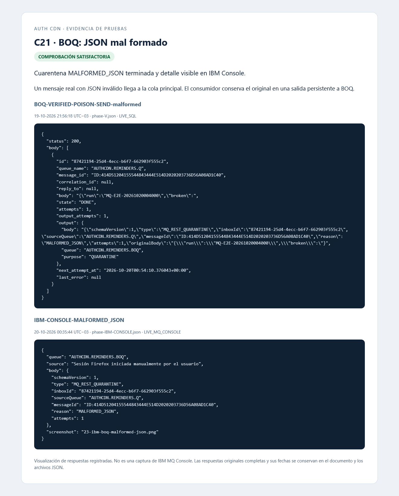

*Vista generada de las respuestas registradas; no es una fotografía de consola.*


*Captura real: 23-ibm-boq-malformed-json.png. Corresponde a su momento de prueba; no es un contador en vivo.*


**Registro `BOQ-VERIFIED-POISON-SEND-malformed` · 19-10-2026 21:56:18 UTC−03 · LIVE_SQL.** [JSON original](respuestas/phase-V.json).

<details>
<summary>Ver petición, respuesta y estado completo registrados</summary>

```json
{
  "status": 200,
  "body": [
    {
      "id": "87421194-25d4-4ecc-b6f7-662903f555c2",
      "queue_name": "AUTHCDN.REMINDERS.Q",
      "message_id": "ID:414D51204155544843444E514D2020203736D56A08AD1C40",
      "correlation_id": null,
      "reply_to": null,
      "body": "{\"run\":\"MQ-E2E-20261020004000\",\"broken\":",
      "state": "DONE",
      "attempts": 1,
      "output_attempts": 1,
      "output": {
        "body": "{\"schemaVersion\":1,\"type\":\"MQ_REST_QUARANTINE\",\"inboxId\":\"87421194-25d4-4ecc-b6f7-662903f555c2\",\"sourceQueue\":\"AUTHCDN.REMINDERS.Q\",\"messageId\":\"ID:414D51204155544843444E514D2020203736D56A08AD1C40\",\"reason\":\"MALFORMED_JSON\",\"attempts\":1,\"originalBody\":\"{\\\"run\\\":\\\"MQ-E2E-20261020004000\\\",\\\"broken\\\":\"}",
        "queue": "AUTHCDN.REMINDERS.BOQ",
        "purpose": "QUARANTINE"
      },
      "next_attempt_at": "2026-10-20T00:54:10.376043+00:00",
      "last_error": null
    }
  ]
}
```

</details>


**Registro `IBM-CONSOLE-MALFORMED_JSON` · 20-10-2026 00:35:44 UTC−03 · LIVE_MQ_CONSOLE.** [JSON original](respuestas/phase-IBM-CONSOLE.json).

<details>
<summary>Ver petición, respuesta y estado completo registrados</summary>

```json
{
  "queue": "AUTHCDN.REMINDERS.BOQ",
  "source": "Sesión Firefox iniciada manualmente por el usuario",
  "body": {
    "schemaVersion": 1,
    "type": "MQ_REST_QUARANTINE",
    "inboxId": "87421194-25d4-4ecc-b6f7-662903f555c2",
    "sourceQueue": "AUTHCDN.REMINDERS.Q",
    "messageId": "ID:414D51204155544843444E514D2020203736D56A08AD1C40",
    "reason": "MALFORMED_JSON",
    "attempts": 1,
    "originalBody": "{\"run\":\"MQ-E2E-20261020004000\",\"broken\":"
  },
  "identifiers": "Skip to main content\nIBM\n MQ\nLogout\nHome\nManage\nLearning resources\nSettings\nToggle opening or closing the side navigation\nManage\nAUTHCDNQM\nQueues\nLocal Queue: AUTHCDN.REMINDERS.BOQ messages\nActions\nMessage details\nClose\nGeneral\nContext\nIdentifiers\nData\nMessage ID\tID:414d51204155544843444e514d2020203736d56a0cad1c40\nClose\nDownload\n",
  "screenshot": "23-ibm-boq-malformed-json.png"
}
```

</details>


<a id="c22"></a>

## C22 · BOQ: contrato de recordatorio inválido

**Cómo funciona y cómo se probó.** Se publica un evento con schemaVersion no admitida. El consumidor lo rechaza sin generar un aviso de negocio.

**Resultado observado.** Cuarentena INVALID_REMINDER visible en BOQ.

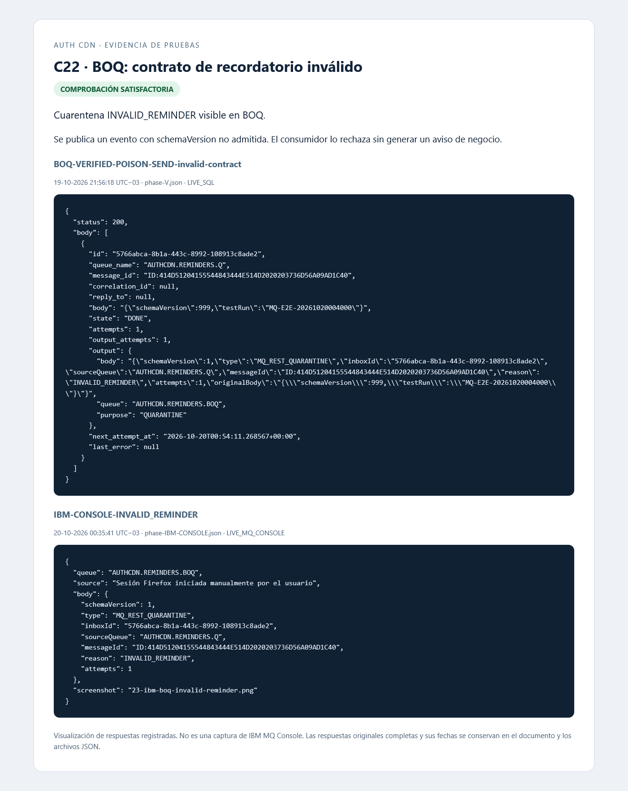

*Vista generada de las respuestas registradas; no es una fotografía de consola.*

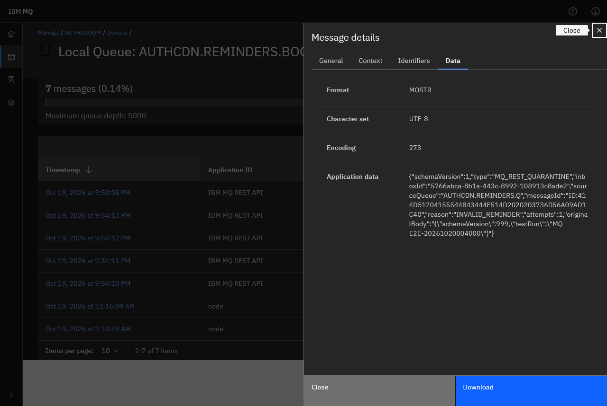

*Captura real: 23-ibm-boq-invalid-reminder.png. Corresponde a su momento de prueba; no es un contador en vivo.*


**Registro `BOQ-VERIFIED-POISON-SEND-invalid-contract` · 19-10-2026 21:56:18 UTC−03 · LIVE_SQL.** [JSON original](respuestas/phase-V.json).

<details>
<summary>Ver petición, respuesta y estado completo registrados</summary>

```json
{
  "status": 200,
  "body": [
    {
      "id": "5766abca-8b1a-443c-8992-108913c8ade2",
      "queue_name": "AUTHCDN.REMINDERS.Q",
      "message_id": "ID:414D51204155544843444E514D2020203736D56A09AD1C40",
      "correlation_id": null,
      "reply_to": null,
      "body": "{\"schemaVersion\":999,\"testRun\":\"MQ-E2E-20261020004000\"}",
      "state": "DONE",
      "attempts": 1,
      "output_attempts": 1,
      "output": {
        "body": "{\"schemaVersion\":1,\"type\":\"MQ_REST_QUARANTINE\",\"inboxId\":\"5766abca-8b1a-443c-8992-108913c8ade2\",\"sourceQueue\":\"AUTHCDN.REMINDERS.Q\",\"messageId\":\"ID:414D51204155544843444E514D2020203736D56A09AD1C40\",\"reason\":\"INVALID_REMINDER\",\"attempts\":1,\"originalBody\":\"{\\\"schemaVersion\\\":999,\\\"testRun\\\":\\\"MQ-E2E-20261020004000\\\"}\"}",
        "queue": "AUTHCDN.REMINDERS.BOQ",
        "purpose": "QUARANTINE"
      },
      "next_attempt_at": "2026-10-20T00:54:11.268567+00:00",
      "last_error": null
    }
  ]
}
```

</details>


**Registro `IBM-CONSOLE-INVALID_REMINDER` · 20-10-2026 00:35:41 UTC−03 · LIVE_MQ_CONSOLE.** [JSON original](respuestas/phase-IBM-CONSOLE.json).

<details>
<summary>Ver petición, respuesta y estado completo registrados</summary>

```json
{
  "queue": "AUTHCDN.REMINDERS.BOQ",
  "source": "Sesión Firefox iniciada manualmente por el usuario",
  "body": {
    "schemaVersion": 1,
    "type": "MQ_REST_QUARANTINE",
    "inboxId": "5766abca-8b1a-443c-8992-108913c8ade2",
    "sourceQueue": "AUTHCDN.REMINDERS.Q",
    "messageId": "ID:414D51204155544843444E514D2020203736D56A09AD1C40",
    "reason": "INVALID_REMINDER",
    "attempts": 1,
    "originalBody": "{\"schemaVersion\":999,\"testRun\":\"MQ-E2E-20261020004000\"}"
  },
  "identifiers": "Skip to main content\nIBM\n MQ\nLogout\nHome\nManage\nLearning resources\nSettings\nToggle opening or closing the side navigation\nManage\nAUTHCDNQM\nQueues\nLocal Queue: AUTHCDN.REMINDERS.BOQ messages\nActions\nMessage details\nClose\nGeneral\nContext\nIdentifiers\nData\nMessage ID\tID:414d51204155544843444e514d2020203736d56a0ead1c40\nClose\nDownload\n",
  "screenshot": "23-ibm-boq-invalid-reminder.png"
}
```

</details>


<a id="c23"></a>

## C23 · BOQ: error permanente de correspondencia

**Cómo funciona y cómo se probó.** Se publica un evento con referencias inconsistentes con el recordatorio real. El error permanente no se reintenta como si fuera transitorio.

**Resultado observado.** Cuarentena PERMANENT_ERROR con cuerpo original conservado.

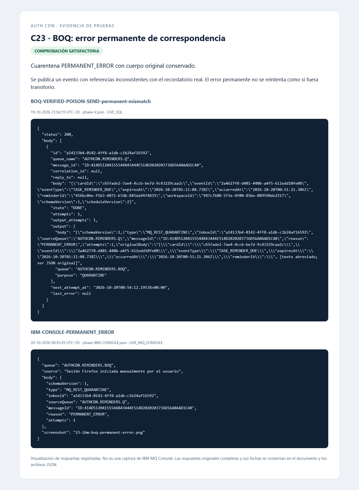

*Vista generada de las respuestas registradas; no es una fotografía de consola.*

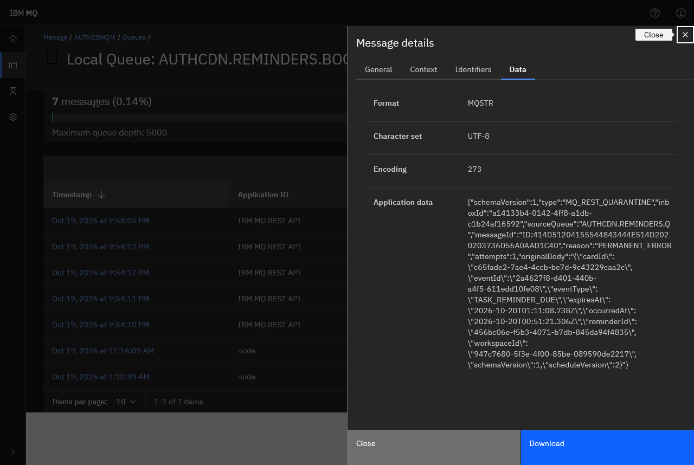

*Captura real: 23-ibm-boq-permanent-error.png. Corresponde a su momento de prueba; no es un contador en vivo.*


**Registro `BOQ-VERIFIED-POISON-SEND-permanent-mismatch` · 19-10-2026 21:56:19 UTC−03 · LIVE_SQL.** [JSON original](respuestas/phase-V.json).

<details>
<summary>Ver petición, respuesta y estado completo registrados</summary>

```json
{
  "status": 200,
  "body": [
    {
      "id": "a14133b4-0142-4ff8-a1db-c1b24af16592",
      "queue_name": "AUTHCDN.REMINDERS.Q",
      "message_id": "ID:414D51204155544843444E514D2020203736D56A0AAD1C40",
      "correlation_id": null,
      "reply_to": null,
      "body": "{\"cardId\":\"c65fade2-7ae4-4ccb-be7d-9c43229caa2c\",\"eventId\":\"2a4627f8-d401-440b-a4f5-611edd10fe08\",\"eventType\":\"TASK_REMINDER_DUE\",\"expiresAt\":\"2026-10-20T01:11:08.738Z\",\"occurredAt\":\"2026-10-20T00:51:21.306Z\",\"reminderId\":\"456bc06e-f5b3-4071-b7db-845da94f4835\",\"workspaceId\":\"947c7680-5f3e-4f00-85be-089590de2217\",\"schemaVersion\":1,\"scheduleVersion\":2}",
      "state": "DONE",
      "attempts": 1,
      "output_attempts": 1,
      "output": {
        "body": "{\"schemaVersion\":1,\"type\":\"MQ_REST_QUARANTINE\",\"inboxId\":\"a14133b4-0142-4ff8-a1db-c1b24af16592\",\"sourceQueue\":\"AUTHCDN.REMINDERS.Q\",\"messageId\":\"ID:414D51204155544843444E514D2020203736D56A0AAD1C40\",\"reason\":\"PERMANENT_ERROR\",\"attempts\":1,\"originalBody\":\"{\\\"cardId\\\":\\\"c65fade2-7ae4-4ccb-be7d-9c43229caa2c\\\",\\\"eventId\\\":\\\"2a4627f8-d401-440b-a4f5-611edd10fe08\\\",\\\"eventType\\\":\\\"TASK_REMINDER_DUE\\\",\\\"expiresAt\\\":\\\"2026-10-20T01:11:08.738Z\\\",\\\"occurredAt\\\":\\\"2026-10-20T00:51:21.306Z\\\",\\\"reminderId\\\":\\\"456bc06e-f5b3-4071-b7db-845da94f4835\\\",\\\"workspaceId\\\":\\\"947c7680-5f3e-4f00-85be-089590de2217\\\",\\\"schemaVersion\\\":1,\\\"scheduleVersion\\\":2}\"}",
        "queue": "AUTHCDN.REMINDERS.BOQ",
        "purpose": "QUARANTINE"
      },
      "next_attempt_at": "2026-10-20T00:54:12.19538+00:00",
      "last_error": null
    }
  ]
}
```

</details>


**Registro `IBM-CONSOLE-PERMANENT_ERROR` · 20-10-2026 00:35:39 UTC−03 · LIVE_MQ_CONSOLE.** [JSON original](respuestas/phase-IBM-CONSOLE.json).

<details>
<summary>Ver petición, respuesta y estado completo registrados</summary>

```json
{
  "queue": "AUTHCDN.REMINDERS.BOQ",
  "source": "Sesión Firefox iniciada manualmente por el usuario",
  "body": {
    "schemaVersion": 1,
    "type": "MQ_REST_QUARANTINE",
    "inboxId": "a14133b4-0142-4ff8-a1db-c1b24af16592",
    "sourceQueue": "AUTHCDN.REMINDERS.Q",
    "messageId": "ID:414D51204155544843444E514D2020203736D56A0AAD1C40",
    "reason": "PERMANENT_ERROR",
    "attempts": 1,
    "originalBody": "{\"cardId\":\"c65fade2-7ae4-4ccb-be7d-9c43229caa2c\",\"eventId\":\"2a4627f8-d401-440b-a4f5-611edd10fe08\",\"eventType\":\"TASK_REMINDER_DUE\",\"expiresAt\":\"2026-10-20T01:11:08.738Z\",\"occurredAt\":\"2026-10-20T00:51:21.306Z\",\"reminderId\":\"456bc06e-f5b3-4071-b7db-845da94f4835\",\"workspaceId\":\"947c7680-5f3e-4f00-85be-089590de2217\",\"schemaVersion\":1,\"scheduleVersion\":2}"
  },
  "identifiers": "Skip to main content\nIBM\n MQ\nLogout\nHome\nManage\nLearning resources\nSettings\nToggle opening or closing the side navigation\nManage\nAUTHCDNQM\nQueues\nLocal Queue: AUTHCDN.REMINDERS.BOQ messages\nActions\nMessage details\nClose\nGeneral\nContext\nIdentifiers\nData\nMessage ID\tID:414d51204155544843444e514d2020203736d56a0fad1c40\nClose\nDownload\n",
  "screenshot": "23-ibm-boq-permanent-error.png"
}
```

</details>


<a id="c24"></a>

## C24 · BOQ: ReplyTo fuera de la lista permitida

**Cómo funciona y cómo se probó.** Una solicitud indica una cola de respuesta no permitida. El servidor aplica la lista de destinos autorizados antes de publicar la respuesta.

**Resultado observado.** Cuarentena INVALID_REPLY_DESTINATION; no se envía la respuesta al destino indicado por el atacante.

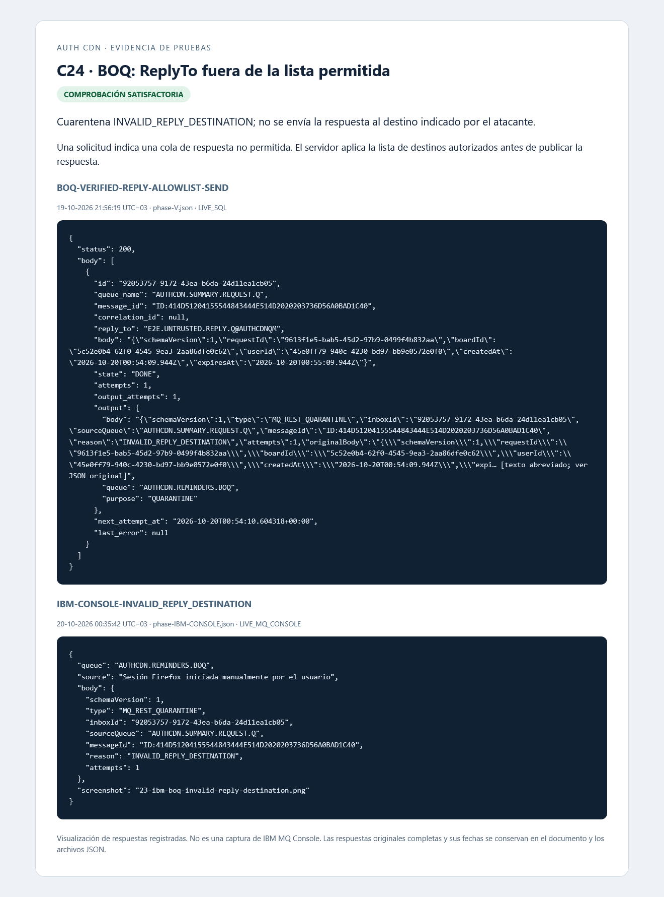

*Vista generada de las respuestas registradas; no es una fotografía de consola.*

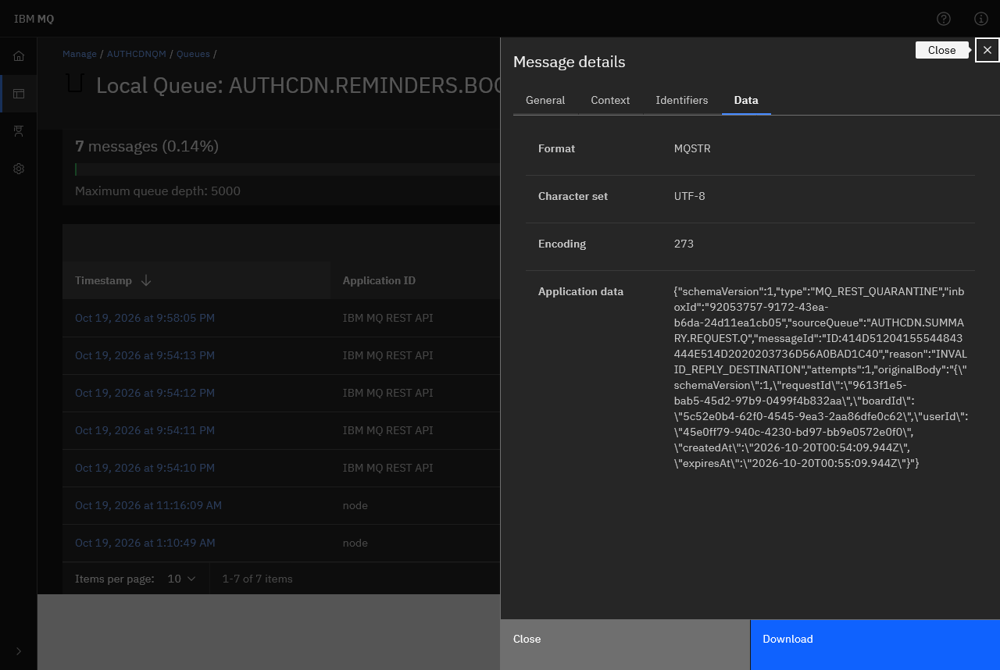

*Captura real: 23-ibm-boq-invalid-reply-destination.png. Corresponde a su momento de prueba; no es un contador en vivo.*


**Registro `BOQ-VERIFIED-REPLY-ALLOWLIST-SEND` · 19-10-2026 21:56:19 UTC−03 · LIVE_SQL.** [JSON original](respuestas/phase-V.json).

<details>
<summary>Ver petición, respuesta y estado completo registrados</summary>

```json
{
  "status": 200,
  "body": [
    {
      "id": "92053757-9172-43ea-b6da-24d11ea1cb05",
      "queue_name": "AUTHCDN.SUMMARY.REQUEST.Q",
      "message_id": "ID:414D51204155544843444E514D2020203736D56A0BAD1C40",
      "correlation_id": null,
      "reply_to": "E2E.UNTRUSTED.REPLY.Q@AUTHCDNQM",
      "body": "{\"schemaVersion\":1,\"requestId\":\"9613f1e5-bab5-45d2-97b9-0499f4b832aa\",\"boardId\":\"5c52e0b4-62f0-4545-9ea3-2aa86dfe0c62\",\"userId\":\"45e0ff79-940c-4230-bd97-bb9e0572e0f0\",\"createdAt\":\"2026-10-20T00:54:09.944Z\",\"expiresAt\":\"2026-10-20T00:55:09.944Z\"}",
      "state": "DONE",
      "attempts": 1,
      "output_attempts": 1,
      "output": {
        "body": "{\"schemaVersion\":1,\"type\":\"MQ_REST_QUARANTINE\",\"inboxId\":\"92053757-9172-43ea-b6da-24d11ea1cb05\",\"sourceQueue\":\"AUTHCDN.SUMMARY.REQUEST.Q\",\"messageId\":\"ID:414D51204155544843444E514D2020203736D56A0BAD1C40\",\"reason\":\"INVALID_REPLY_DESTINATION\",\"attempts\":1,\"originalBody\":\"{\\\"schemaVersion\\\":1,\\\"requestId\\\":\\\"9613f1e5-bab5-45d2-97b9-0499f4b832aa\\\",\\\"boardId\\\":\\\"5c52e0b4-62f0-4545-9ea3-2aa86dfe0c62\\\",\\\"userId\\\":\\\"45e0ff79-940c-4230-bd97-bb9e0572e0f0\\\",\\\"createdAt\\\":\\\"2026-10-20T00:54:09.944Z\\\",\\\"expiresAt\\\":\\\"2026-10-20T00:55:09.944Z\\\"}\"}",
        "queue": "AUTHCDN.REMINDERS.BOQ",
        "purpose": "QUARANTINE"
      },
      "next_attempt_at": "2026-10-20T00:54:10.604318+00:00",
      "last_error": null
    }
  ]
}
```

</details>


**Registro `IBM-CONSOLE-INVALID_REPLY_DESTINATION` · 20-10-2026 00:35:42 UTC−03 · LIVE_MQ_CONSOLE.** [JSON original](respuestas/phase-IBM-CONSOLE.json).

<details>
<summary>Ver petición, respuesta y estado completo registrados</summary>

```json
{
  "queue": "AUTHCDN.REMINDERS.BOQ",
  "source": "Sesión Firefox iniciada manualmente por el usuario",
  "body": {
    "schemaVersion": 1,
    "type": "MQ_REST_QUARANTINE",
    "inboxId": "92053757-9172-43ea-b6da-24d11ea1cb05",
    "sourceQueue": "AUTHCDN.SUMMARY.REQUEST.Q",
    "messageId": "ID:414D51204155544843444E514D2020203736D56A0BAD1C40",
    "reason": "INVALID_REPLY_DESTINATION",
    "attempts": 1,
    "originalBody": "{\"schemaVersion\":1,\"requestId\":\"9613f1e5-bab5-45d2-97b9-0499f4b832aa\",\"boardId\":\"5c52e0b4-62f0-4545-9ea3-2aa86dfe0c62\",\"userId\":\"45e0ff79-940c-4230-bd97-bb9e0572e0f0\",\"createdAt\":\"2026-10-20T00:54:09.944Z\",\"expiresAt\":\"2026-10-20T00:55:09.944Z\"}"
  },
  "identifiers": "Skip to main content\nIBM\n MQ\nLogout\nHome\nManage\nLearning resources\nSettings\nToggle opening or closing the side navigation\nManage\nAUTHCDNQM\nQueues\nLocal Queue: AUTHCDN.REMINDERS.BOQ messages\nActions\nMessage details\nClose\nGeneral\nContext\nIdentifiers\nData\nMessage ID\tID:414d51204155544843444e514d2020203736d56a0dad1c40\nClose\nDownload\n",
  "screenshot": "23-ibm-boq-invalid-reply-destination.png"
}
```

</details>


<a id="c25"></a>

## C25 · Consumidor: cinco fallos y paso a BOQ

**Cómo funciona y cómo se probó.** Una condición SQL temporal lanza P0001 solo al insertar el aviso de una tarjeta de ensayo. El consumidor realiza sus reintentos reales y, al agotarlos, publica la cuarentena.

**Resultado observado.** Cinco fallos RPC medidos, attempts=5, cero avisos y salida QUARANTINE a BOQ terminada con RETRIES_EXHAUSTED.

**Alcance.** Se inyecta un error SQL acotado para ejercitar la política de reintentos. No es una interrupción de red ni una indisponibilidad general de Supabase.

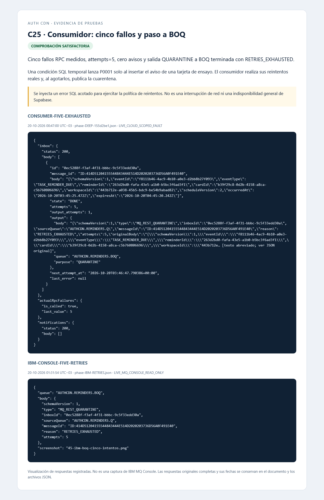

*Vista generada de las respuestas registradas; no es una fotografía de consola.*

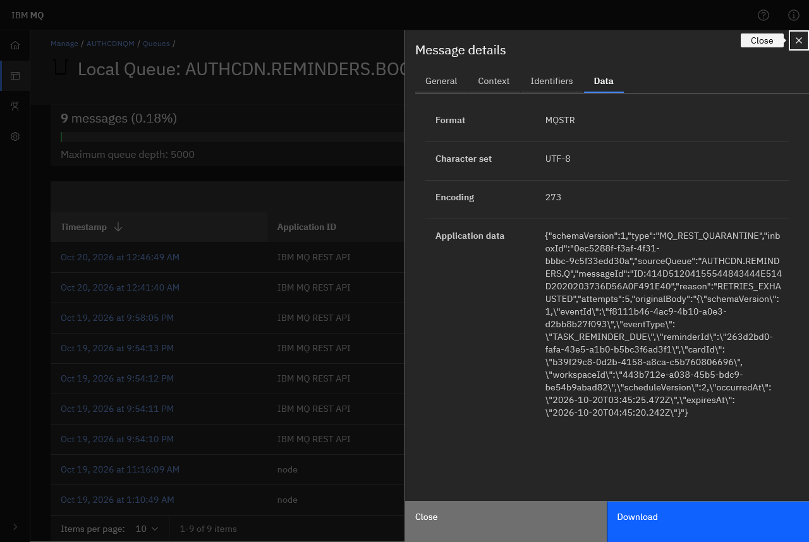

*Captura real: 45-ibm-boq-cinco-intentos.png. Corresponde a su momento de prueba; no es un contador en vivo.*


**Registro `CONSUMER-FIVE-EXHAUSTED` · 20-10-2026 00:47:00 UTC−03 · LIVE_CLOUD_SCOPED_FAULT.** [JSON original](respuestas/phase-DEEP-155d2be1.json).

<details>
<summary>Ver petición, respuesta y estado completo registrados</summary>

```json
{
  "inbox": {
    "status": 200,
    "body": [
      {
        "id": "0ec5288f-f3af-4f31-bbbc-9c5f33edd30a",
        "message_id": "ID:414D51204155544843444E514D2020203736D56A0F491E40",
        "body": "{\"schemaVersion\":1,\"eventId\":\"f8111b46-4ac9-4b10-a0e3-d2bb8b27f093\",\"eventType\":\"TASK_REMINDER_DUE\",\"reminderId\":\"263d2bd0-fafa-43e5-a1b0-b5bc3f6ad3f1\",\"cardId\":\"b39f29c8-0d2b-4158-a8ca-c5b760806696\",\"workspaceId\":\"443b712e-a038-45b5-bdc9-be54b9abad82\",\"scheduleVersion\":2,\"occurredAt\":\"2026-10-20T03:45:25.472Z\",\"expiresAt\":\"2026-10-20T04:45:20.242Z\"}",
        "state": "DONE",
        "attempts": 5,
        "output_attempts": 1,
        "output": {
          "body": "{\"schemaVersion\":1,\"type\":\"MQ_REST_QUARANTINE\",\"inboxId\":\"0ec5288f-f3af-4f31-bbbc-9c5f33edd30a\",\"sourceQueue\":\"AUTHCDN.REMINDERS.Q\",\"messageId\":\"ID:414D51204155544843444E514D2020203736D56A0F491E40\",\"reason\":\"RETRIES_EXHAUSTED\",\"attempts\":5,\"originalBody\":\"{\\\"schemaVersion\\\":1,\\\"eventId\\\":\\\"f8111b46-4ac9-4b10-a0e3-d2bb8b27f093\\\",\\\"eventType\\\":\\\"TASK_REMINDER_DUE\\\",\\\"reminderId\\\":\\\"263d2bd0-fafa-43e5-a1b0-b5bc3f6ad3f1\\\",\\\"cardId\\\":\\\"b39f29c8-0d2b-4158-a8ca-c5b760806696\\\",\\\"workspaceId\\\":\\\"443b712e-a038-45b5-bdc9-be54b9abad82\\\",\\\"scheduleVersion\\\":2,\\\"occurredAt\\\":\\\"2026-10-20T03:45:25.472Z\\\",\\\"expiresAt\\\":\\\"2026-10-20T04:45:20.242Z\\\"}\"}",
          "queue": "AUTHCDN.REMINDERS.BOQ",
          "purpose": "QUARANTINE"
        },
        "next_attempt_at": "2026-10-20T03:46:47.790386+00:00",
        "last_error": null
      }
    ]
  },
  "actualRpcFailures": {
    "is_called": true,
    "last_value": 5
  },
  "notifications": {
    "status": 200,
    "body": []
  }
}
```

</details>


**Registro `IBM-CONSOLE-FIVE-RETRIES` · 20-10-2026 01:31:54 UTC−03 · LIVE_MQ_CONSOLE_READ_ONLY.** [JSON original](respuestas/phase-IBM-RETRIES.json).

<details>
<summary>Ver petición, respuesta y estado completo registrados</summary>

```json
{
  "queue": "AUTHCDN.REMINDERS.BOQ",
  "body": {
    "schemaVersion": 1,
    "type": "MQ_REST_QUARANTINE",
    "inboxId": "0ec5288f-f3af-4f31-bbbc-9c5f33edd30a",
    "sourceQueue": "AUTHCDN.REMINDERS.Q",
    "messageId": "ID:414D51204155544843444E514D2020203736D56A0F491E40",
    "reason": "RETRIES_EXHAUSTED",
    "attempts": 5,
    "originalBody": "{\"schemaVersion\":1,\"eventId\":\"f8111b46-4ac9-4b10-a0e3-d2bb8b27f093\",\"eventType\":\"TASK_REMINDER_DUE\",\"reminderId\":\"263d2bd0-fafa-43e5-a1b0-b5bc3f6ad3f1\",\"cardId\":\"b39f29c8-0d2b-4158-a8ca-c5b760806696\",\"workspaceId\":\"443b712e-a038-45b5-bdc9-be54b9abad82\",\"scheduleVersion\":2,\"occurredAt\":\"2026-10-20T03:45:25.472Z\",\"expiresAt\":\"2026-10-20T04:45:20.242Z\"}"
  },
  "screenshot": "45-ibm-boq-cinco-intentos.png"
}
```

</details>


<a id="c26"></a>

## C26 · Salida a BOQ: cinco fallos conservan el cuerpo y recuperación posterior

**Cómo funciona y cómo se probó.** Se introduce un destino inválido únicamente en la salida técnica de un fixture. Cinco ciclos de Vercel fallan. Al restaurar el destino, se reintenta la entrega pendiente.

**Resultado observado.** Los ciclos fallidos devuelven 502, conservan el payload y aumentan output_attempts; tras corregir, DONE con sexto intento de salida.

**Alcance.** La salida pendiente no se descarta al quinto error. El límite de procesamiento y la recuperación de una salida durable son mecanismos distintos.

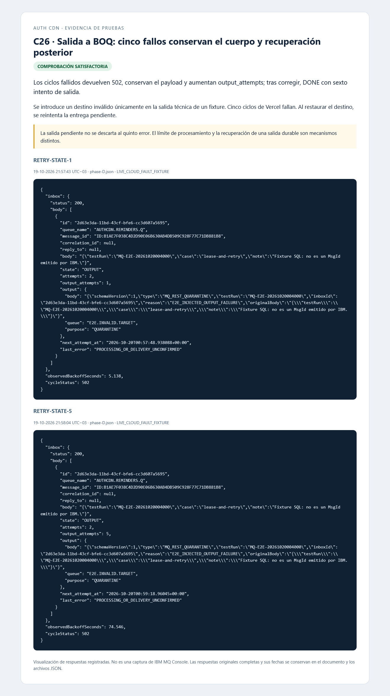

*Vista generada de las respuestas registradas; no es una fotografía de consola.*

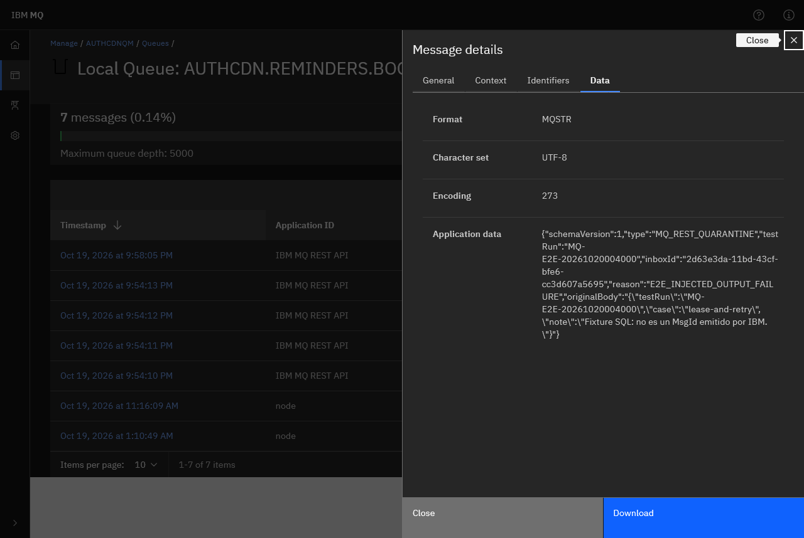

*Captura real: 23-ibm-boq-e2e-injected-output-failure.png. Corresponde a su momento de prueba; no es un contador en vivo.*


**Registro `RETRY-STATE-1` · 19-10-2026 21:57:43 UTC−03 · LIVE_CLOUD_FAULT_FIXTURE.** [JSON original](respuestas/phase-D.json).

<details>
<summary>Ver petición, respuesta y estado completo registrados</summary>

```json
{
  "inbox": {
    "status": 200,
    "body": [
      {
        "id": "2d63e3da-11bd-43cf-bfe6-cc3d607a5695",
        "queue_name": "AUTHCDN.REMINDERS.Q",
        "message_id": "ID:B1AE7F038C4D2D90E06B630AB4DB509C928F77C71DB881B8",
        "correlation_id": null,
        "reply_to": null,
        "body": "{\"testRun\":\"MQ-E2E-20261020004000\",\"case\":\"lease-and-retry\",\"note\":\"Fixture SQL: no es un MsgId emitido por IBM.\"}",
        "state": "OUTPUT",
        "attempts": 2,
        "output_attempts": 1,
        "output": {
          "body": "{\"schemaVersion\":1,\"type\":\"MQ_REST_QUARANTINE\",\"testRun\":\"MQ-E2E-20261020004000\",\"inboxId\":\"2d63e3da-11bd-43cf-bfe6-cc3d607a5695\",\"reason\":\"E2E_INJECTED_OUTPUT_FAILURE\",\"originalBody\":\"{\\\"testRun\\\":\\\"MQ-E2E-20261020004000\\\",\\\"case\\\":\\\"lease-and-retry\\\",\\\"note\\\":\\\"Fixture SQL: no es un MsgId emitido por IBM.\\\"}\"}",
          "queue": "E2E.INVALID.TARGET",
          "purpose": "QUARANTINE"
        },
        "next_attempt_at": "2026-10-20T00:57:48.938088+00:00",
        "last_error": "PROCESSING_OR_DELIVERY_UNCONFIRMED"
      }
    ]
  },
  "observedBackoffSeconds": 5.138,
  "cycleStatus": 502
}
```

</details>


**Registro `RETRY-STATE-5` · 19-10-2026 21:58:04 UTC−03 · LIVE_CLOUD_FAULT_FIXTURE.** [JSON original](respuestas/phase-D.json).

<details>
<summary>Ver petición, respuesta y estado completo registrados</summary>

```json
{
  "inbox": {
    "status": 200,
    "body": [
      {
        "id": "2d63e3da-11bd-43cf-bfe6-cc3d607a5695",
        "queue_name": "AUTHCDN.REMINDERS.Q",
        "message_id": "ID:B1AE7F038C4D2D90E06B630AB4DB509C928F77C71DB881B8",
        "correlation_id": null,
        "reply_to": null,
        "body": "{\"testRun\":\"MQ-E2E-20261020004000\",\"case\":\"lease-and-retry\",\"note\":\"Fixture SQL: no es un MsgId emitido por IBM.\"}",
        "state": "OUTPUT",
        "attempts": 2,
        "output_attempts": 5,
        "output": {
          "body": "{\"schemaVersion\":1,\"type\":\"MQ_REST_QUARANTINE\",\"testRun\":\"MQ-E2E-20261020004000\",\"inboxId\":\"2d63e3da-11bd-43cf-bfe6-cc3d607a5695\",\"reason\":\"E2E_INJECTED_OUTPUT_FAILURE\",\"originalBody\":\"{\\\"testRun\\\":\\\"MQ-E2E-20261020004000\\\",\\\"case\\\":\\\"lease-and-retry\\\",\\\"note\\\":\\\"Fixture SQL: no es un MsgId emitido por IBM.\\\"}\"}",
          "queue": "E2E.INVALID.TARGET",
          "purpose": "QUARANTINE"
        },
        "next_attempt_at": "2026-10-20T00:59:18.96045+00:00",
        "last_error": "PROCESSING_OR_DELIVERY_UNCONFIRMED"
      }
    ]
  },
  "observedBackoffSeconds": 74.546,
  "cycleStatus": 502
}
```

</details>


**Registro `RETRY-NO-LOSS` · 19-10-2026 21:58:04 UTC−03 · LIVE_CLOUD_FAULT_FIXTURE.** [JSON original](respuestas/phase-D.json).

<details>
<summary>Ver petición, respuesta y estado completo registrados</summary>

```json
{
  "counts": [
    1,
    2,
    3,
    4,
    5
  ],
  "note": "Se aceleró next_attempt_at únicamente en este fixture; las esperas calculadas quedaron registradas. Es fallo de salida, no cinco fallos de la RPC de negocio."
}
```

</details>


**Registro `RETRY-RECOVERED` · 19-10-2026 21:58:10 UTC−03 · LIVE_CLOUD_FAULT_FIXTURE.** [JSON original](respuestas/phase-D.json).

<details>
<summary>Ver petición, respuesta y estado completo registrados</summary>

```json
{
  "status": 200,
  "body": [
    {
      "id": "2d63e3da-11bd-43cf-bfe6-cc3d607a5695",
      "queue_name": "AUTHCDN.REMINDERS.Q",
      "message_id": "ID:B1AE7F038C4D2D90E06B630AB4DB509C928F77C71DB881B8",
      "correlation_id": null,
      "reply_to": null,
      "body": "{\"testRun\":\"MQ-E2E-20261020004000\",\"case\":\"lease-and-retry\",\"note\":\"Fixture SQL: no es un MsgId emitido por IBM.\"}",
      "state": "DONE",
      "attempts": 2,
      "output_attempts": 6,
      "output": {
        "body": "{\"schemaVersion\":1,\"type\":\"MQ_REST_QUARANTINE\",\"testRun\":\"MQ-E2E-20261020004000\",\"inboxId\":\"2d63e3da-11bd-43cf-bfe6-cc3d607a5695\",\"reason\":\"E2E_INJECTED_OUTPUT_FAILURE\",\"originalBody\":\"{\\\"testRun\\\":\\\"MQ-E2E-20261020004000\\\",\\\"case\\\":\\\"lease-and-retry\\\",\\\"note\\\":\\\"Fixture SQL: no es un MsgId emitido por IBM.\\\"}\"}",
        "queue": "AUTHCDN.REMINDERS.BOQ",
        "purpose": "QUARANTINE"
      },
      "next_attempt_at": "2026-10-20T00:58:03.796+00:00",
      "last_error": null
    }
  ]
}
```

</details>


**Registro `IBM-CONSOLE-E2E_INJECTED_OUTPUT_FAILURE` · 20-10-2026 00:35:38 UTC−03 · LIVE_MQ_CONSOLE.** [JSON original](respuestas/phase-IBM-CONSOLE.json).

<details>
<summary>Ver petición, respuesta y estado completo registrados</summary>

```json
{
  "queue": "AUTHCDN.REMINDERS.BOQ",
  "source": "Sesión Firefox iniciada manualmente por el usuario",
  "body": {
    "schemaVersion": 1,
    "type": "MQ_REST_QUARANTINE",
    "testRun": "MQ-E2E-20261020004000",
    "inboxId": "2d63e3da-11bd-43cf-bfe6-cc3d607a5695",
    "reason": "E2E_INJECTED_OUTPUT_FAILURE",
    "originalBody": "{\"testRun\":\"MQ-E2E-20261020004000\",\"case\":\"lease-and-retry\",\"note\":\"Fixture SQL: no es un MsgId emitido por IBM.\"}"
  },
  "identifiers": "Skip to main content\nIBM\n MQ\nLogout\nHome\nManage\nLearning resources\nSettings\nToggle opening or closing the side navigation\nManage\nAUTHCDNQM\nQueues\nLocal Queue: AUTHCDN.REMINDERS.BOQ messages\nActions\nMessage details\nClose\nGeneral\nContext\nIdentifiers\nData\nMessage ID\tID:414d51204155544843444e514d2020203736d56a08ae1c40\nClose\nDownload\n",
  "screenshot": "23-ibm-boq-e2e-injected-output-failure.png"
}
```

</details>


<a id="c27"></a>

## C27 · Productor: cinco intentos reales hasta FAILED

**Cómo funciona y cómo se probó.** Se prepara un evento de ensayo válido cuyo TTL ya venció, manteniendo futuro el vencimiento del recordatorio SQL. El productor ejecuta su política normal de intentos.

**Resultado observado.** Outbox alcanza FAILED con attempts=5 y MQ_PUBLICATION_UNCONFIRMED.

**Alcance.** El transporte de Vercel rechaza el TTL antes de contactar IBM por HTTP. Esta prueba valida los reintentos del productor; no demuestra una caída del broker ni cinco peticiones HTTP rechazadas por IBM.

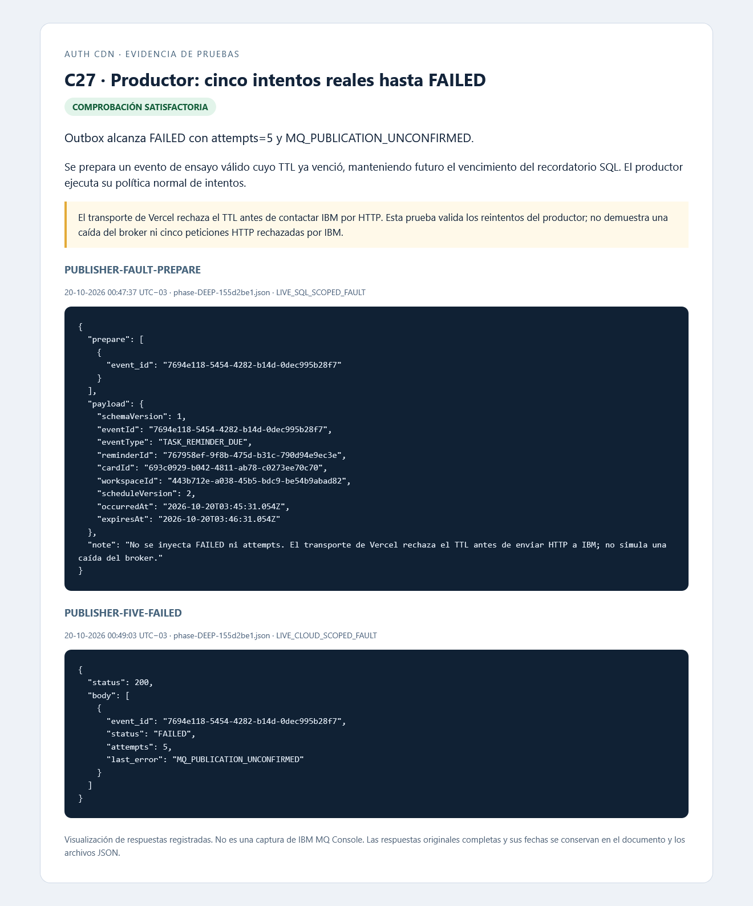

*Vista generada de las respuestas registradas; no es una fotografía de consola.*


**Registro `PUBLISHER-FAULT-PREPARE` · 20-10-2026 00:47:37 UTC−03 · LIVE_SQL_SCOPED_FAULT.** [JSON original](respuestas/phase-DEEP-155d2be1.json).

<details>
<summary>Ver petición, respuesta y estado completo registrados</summary>

```json
{
  "prepare": [
    {
      "event_id": "7694e118-5454-4282-b14d-0dec995b28f7"
    }
  ],
  "payload": {
    "schemaVersion": 1,
    "eventId": "7694e118-5454-4282-b14d-0dec995b28f7",
    "eventType": "TASK_REMINDER_DUE",
    "reminderId": "767958ef-9f8b-475d-b31c-790d94e9ec3e",
    "cardId": "693c0929-b042-4811-ab78-c0273ee70c70",
    "workspaceId": "443b712e-a038-45b5-bdc9-be54b9abad82",
    "scheduleVersion": 2,
    "occurredAt": "2026-10-20T03:45:31.054Z",
    "expiresAt": "2026-10-20T03:46:31.054Z"
  },
  "note": "No se inyecta FAILED ni attempts. El transporte de Vercel rechaza el TTL antes de enviar HTTP a IBM; no simula una caída del broker."
}
```

</details>


**Registro `PUBLISHER-FIVE-FAILED` · 20-10-2026 00:49:03 UTC−03 · LIVE_CLOUD_SCOPED_FAULT.** [JSON original](respuestas/phase-DEEP-155d2be1.json).

<details>
<summary>Ver petición, respuesta y estado completo registrados</summary>

```json
{
  "status": 200,
  "body": [
    {
      "event_id": "7694e118-5454-4282-b14d-0dec995b28f7",
      "status": "FAILED",
      "attempts": 5,
      "last_error": "MQ_PUBLICATION_UNCONFIRMED"
    }
  ]
}
```

</details>


<a id="c28"></a>

## C28 · Alerta efectiva después de agotar los reintentos

**Cómo funciona y cómo se probó.** A partir del FAILED real del caso anterior, Cron de mantenimiento genera un aviso para el responsable. Se ejecutan más ciclos para comprobar deduplicación.

**Resultado observado.** Una alerta creada automáticamente y ninguna duplicada; aparece al usuario en la aplicación.

**Alcance.** La alerta es interna de la aplicación; no se configuró correo ni SMS. Los estados FAILED de esta ronda proceden de los intentos reales, no se insertaron como resultado final.

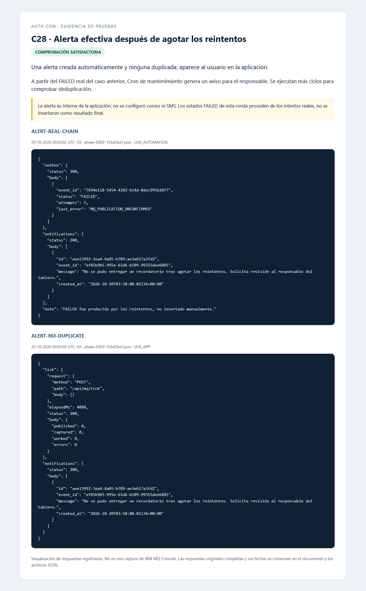

*Vista generada de las respuestas registradas; no es una fotografía de consola.*


*Captura real: 43-avisos-finales-firefox.png. Corresponde a su momento de prueba; no es un contador en vivo.*


**Registro `ALERT-REAL-CHAIN` · 20-10-2026 00:50:02 UTC−03 · LIVE_AUTOMATION.** [JSON original](respuestas/phase-DEEP-155d2be1.json).

<details>
<summary>Ver petición, respuesta y estado completo registrados</summary>

```json
{
  "outbox": {
    "status": 200,
    "body": [
      {
        "event_id": "7694e118-5454-4282-b14d-0dec995b28f7",
        "status": "FAILED",
        "attempts": 5,
        "last_error": "MQ_PUBLICATION_UNCONFIRMED"
      }
    ]
  },
  "notifications": {
    "status": 200,
    "body": [
      {
        "id": "aee13992-3ea4-4a05-b789-ae3e617a3fd2",
        "event_id": "ef85b9b5-995e-61d6-b109-99355dee6885",
        "message": "No se pudo entregar un recordatorio tras agotar los reintentos. Solicita revisión al responsable del tablero.",
        "created_at": "2026-10-20T03:50:00.02134+00:00"
      }
    ]
  },
  "note": "FAILED fue producido por los reintentos, no insertado manualmente."
}
```

</details>


**Registro `ALERT-NO-DUPLICATE` · 20-10-2026 00:50:06 UTC−03 · LIVE_APP.** [JSON original](respuestas/phase-DEEP-155d2be1.json).

<details>
<summary>Ver petición, respuesta y estado completo registrados</summary>

```json
{
  "tick": {
    "request": {
      "method": "POST",
      "path": "/api/mq/tick",
      "body": {}
    },
    "elapsedMs": 4088,
    "status": 200,
    "body": {
      "published": 0,
      "captured": 0,
      "worked": 0,
      "errors": 0
    }
  },
  "notifications": {
    "status": 200,
    "body": [
      {
        "id": "aee13992-3ea4-4a05-b789-ae3e617a3fd2",
        "event_id": "ef85b9b5-995e-61d6-b109-99355dee6885",
        "message": "No se pudo entregar un recordatorio tras agotar los reintentos. Solicita revisión al responsable del tablero.",
        "created_at": "2026-10-20T03:50:00.02134+00:00"
      }
    ]
  }
}
```

</details>


<a id="c29"></a>

## C29 · TTL de IBM: expiración sin consumidor

**Cómo funciona y cómo se probó.** Se publica un mensaje persistente de ensayo con TTL=1200 ms en la cola de respuestas, se hace GET antes y después de vencer y no se ejecuta DELETE.

**Resultado observado.** GET inicial 200 con expiración restante; GET posterior 204 sin contenido.

**Alcance.** 204 significa que el selector no encuentra un mensaje disponible. En este ensayo controlado no hubo retirada por DELETE; el TTL es la causa comprobada.

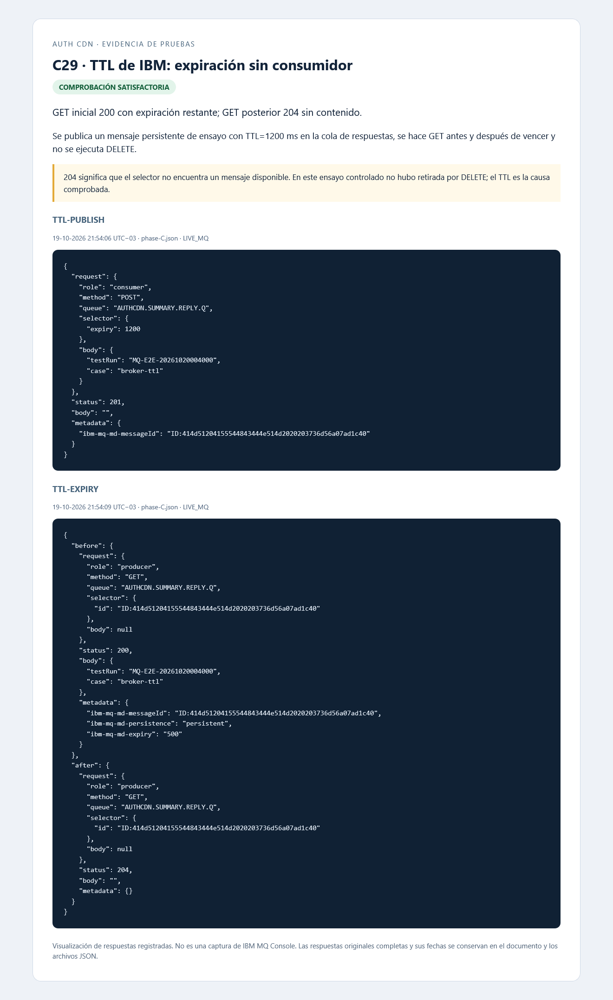

*Vista generada de las respuestas registradas; no es una fotografía de consola.*


**Registro `TTL-PUBLISH` · 19-10-2026 21:54:06 UTC−03 · LIVE_MQ.** [JSON original](respuestas/phase-C.json).

<details>
<summary>Ver petición, respuesta y estado completo registrados</summary>

```json
{
  "request": {
    "role": "consumer",
    "method": "POST",
    "queue": "AUTHCDN.SUMMARY.REPLY.Q",
    "selector": {
      "expiry": 1200
    },
    "body": {
      "testRun": "MQ-E2E-20261020004000",
      "case": "broker-ttl"
    }
  },
  "status": 201,
  "body": "",
  "metadata": {
    "ibm-mq-md-messageId": "ID:414d51204155544843444e514d2020203736d56a07ad1c40"
  }
}
```

</details>


**Registro `TTL-EXPIRY` · 19-10-2026 21:54:09 UTC−03 · LIVE_MQ.** [JSON original](respuestas/phase-C.json).

<details>
<summary>Ver petición, respuesta y estado completo registrados</summary>

```json
{
  "before": {
    "request": {
      "role": "producer",
      "method": "GET",
      "queue": "AUTHCDN.SUMMARY.REPLY.Q",
      "selector": {
        "id": "ID:414d51204155544843444e514d2020203736d56a07ad1c40"
      },
      "body": null
    },
    "status": 200,
    "body": {
      "testRun": "MQ-E2E-20261020004000",
      "case": "broker-ttl"
    },
    "metadata": {
      "ibm-mq-md-messageId": "ID:414d51204155544843444e514d2020203736d56a07ad1c40",
      "ibm-mq-md-persistence": "persistent",
      "ibm-mq-md-expiry": "500"
    }
  },
  "after": {
    "request": {
      "role": "producer",
      "method": "GET",
      "queue": "AUTHCDN.SUMMARY.REPLY.Q",
      "selector": {
        "id": "ID:414d51204155544843444e514d2020203736d56a07ad1c40"
      },
      "body": null
    },
    "status": 204,
    "body": "",
    "metadata": {}
  }
}
```

</details>


<a id="c30"></a>

## C30 · Reconciliación SQL de mensajes expirados

**Cómo funciona y cómo se probó.** Se fuerza un vencimiento pasado solo en un recordatorio propio y se ejecuta mantenimiento. La entrega histórica se conserva separada de la vigencia del recordatorio.

**Resultado observado.** Recordatorio EXPIRED; outbox conserva PUBLISHED.

**Alcance.** La fecha vencida se prepara por SQL; no se espera durante todo el plazo de retención real.

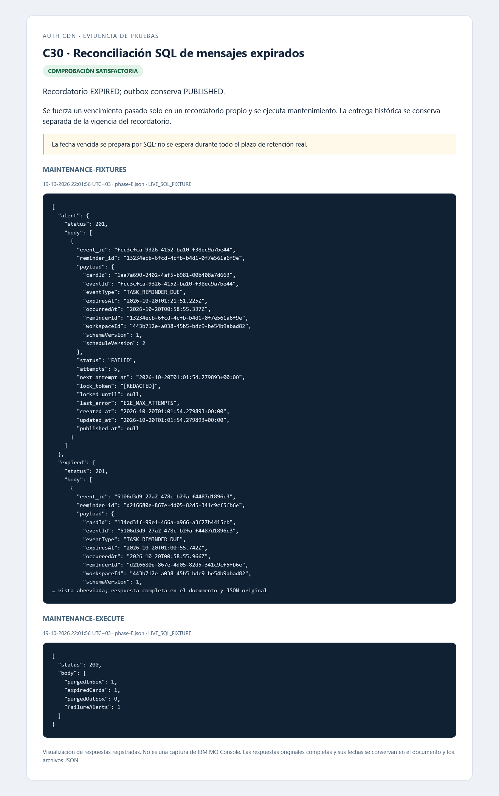

*Vista generada de las respuestas registradas; no es una fotografía de consola.*


**Registro `MAINTENANCE-FIXTURES` · 19-10-2026 22:01:56 UTC−03 · LIVE_SQL_FIXTURE.** [JSON original](respuestas/phase-E.json).

<details>
<summary>Ver petición, respuesta y estado completo registrados</summary>

```json
{
  "alert": {
    "status": 201,
    "body": [
      {
        "event_id": "fcc3cfca-9326-4152-ba10-f38ec9a7be44",
        "reminder_id": "13234ecb-6fcd-4cfb-b4d1-0f7e561a6f9e",
        "payload": {
          "cardId": "1aa7a690-2402-4af5-b981-00b408a7d663",
          "eventId": "fcc3cfca-9326-4152-ba10-f38ec9a7be44",
          "eventType": "TASK_REMINDER_DUE",
          "expiresAt": "2026-10-20T01:21:51.225Z",
          "occurredAt": "2026-10-20T00:58:55.337Z",
          "reminderId": "13234ecb-6fcd-4cfb-b4d1-0f7e561a6f9e",
          "workspaceId": "443b712e-a038-45b5-bdc9-be54b9abad82",
          "schemaVersion": 1,
          "scheduleVersion": 2
        },
        "status": "FAILED",
        "attempts": 5,
        "next_attempt_at": "2026-10-20T01:01:54.279893+00:00",
        "lock_token": "[REDACTED]",
        "locked_until": null,
        "last_error": "E2E_MAX_ATTEMPTS",
        "created_at": "2026-10-20T01:01:54.279893+00:00",
        "updated_at": "2026-10-20T01:01:54.279893+00:00",
        "published_at": null
      }
    ]
  },
  "expired": {
    "status": 201,
    "body": [
      {
        "event_id": "5106d3d9-27a2-478c-b2fa-f4487d1896c3",
        "reminder_id": "d216680e-867e-4d05-82d5-341c9cf5fb6e",
        "payload": {
          "cardId": "134ed31f-99e1-466a-a966-a3f27b4415cb",
          "eventId": "5106d3d9-27a2-478c-b2fa-f4487d1896c3",
          "eventType": "TASK_REMINDER_DUE",
          "expiresAt": "2026-10-20T01:00:55.742Z",
          "occurredAt": "2026-10-20T00:58:55.966Z",
          "reminderId": "d216680e-867e-4d05-82d5-341c9cf5fb6e",
          "workspaceId": "443b712e-a038-45b5-bdc9-be54b9abad82",
          "schemaVersion": 1,
          "scheduleVersion": 2
        },
        "status": "PUBLISHED",
        "attempts": 0,
        "next_attempt_at": "2026-10-20T01:01:54.897928+00:00",
        "lock_token": "[REDACTED]",
        "locked_until": null,
        "last_error": null,
        "created_at": "2026-10-20T01:01:54.897928+00:00",
        "updated_at": "2026-10-20T01:01:54.897928+00:00",
        "published_at": "2026-10-20T01:01:55.966+00:00"
      }
    ]
  },
  "note": "Estados inyectados solo en tarjetas de ensayo. No representan cinco publicaciones fallidas reales ni una publicación MQ de este fixture."
}
```

</details>


**Registro `MAINTENANCE-EXECUTE` · 19-10-2026 22:01:56 UTC−03 · LIVE_SQL_FIXTURE.** [JSON original](respuestas/phase-E.json).

<details>
<summary>Ver petición, respuesta y estado completo registrados</summary>

```json
{
  "status": 200,
  "body": {
    "purgedInbox": 1,
    "expiredCards": 1,
    "purgedOutbox": 0,
    "failureAlerts": 1
  }
}
```

</details>


**Registro `EXPIRY-RECONCILIATION` · 19-10-2026 22:01:56 UTC−03 · LIVE_SQL_FIXTURE.** [JSON original](respuestas/phase-E.json).

<details>
<summary>Ver petición, respuesta y estado completo registrados</summary>

```json
{
  "reminder": {
    "status": 200,
    "body": [
      {
        "id": "d216680e-867e-4d05-82d5-341c9cf5fb6e",
        "status": "EXPIRED",
        "expires_at": "2026-10-20T01:00:55.742+00:00"
      }
    ]
  },
  "outbox": {
    "status": 200,
    "body": [
      {
        "event_id": "5106d3d9-27a2-478c-b2fa-f4487d1896c3",
        "status": "PUBLISHED",
        "published_at": "2026-10-20T01:01:55.966+00:00"
      }
    ]
  }
}
```

</details>


<a id="c31"></a>

## C31 · Retención de registros técnicos terminados

**Cómo funciona y cómo se probó.** Se asignan 40 días de antigüedad a tres registros propios y se ejecuta la política de mantenimiento de 30 días.

**Resultado observado.** Se purga DONE técnico ordinario antiguo; permanecen PENDING y cuarentena.

**Alcance.** Se simula la antigüedad; no se esperaron 40 días. Esta política no borra mensajes de BOQ/DLQ ni configura una retención global del broker. Esas colas requieren revisión y retirada administrativa explícita.

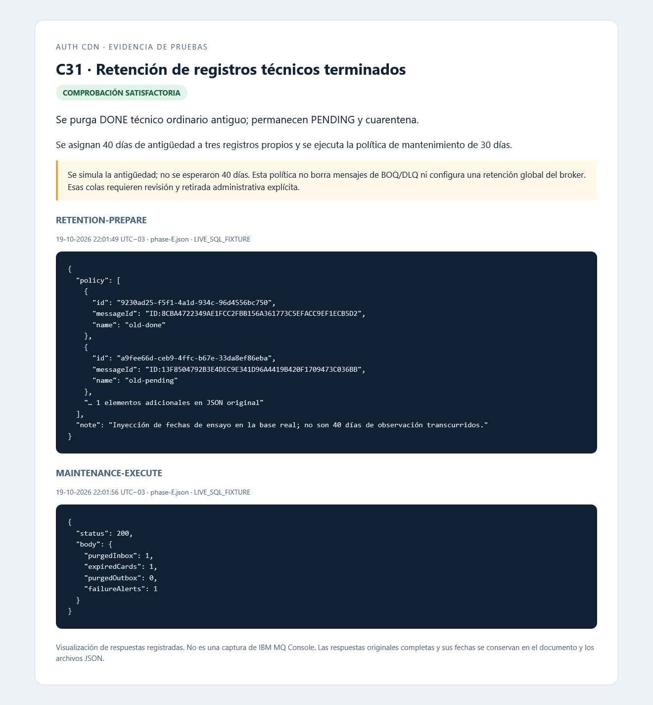

*Vista generada de las respuestas registradas; no es una fotografía de consola.*


**Registro `RETENTION-PREPARE` · 19-10-2026 22:01:49 UTC−03 · LIVE_SQL_FIXTURE.** [JSON original](respuestas/phase-E.json).

<details>
<summary>Ver petición, respuesta y estado completo registrados</summary>

```json
{
  "policy": [
    {
      "id": "9230ad25-f5f1-4a1d-934c-96d4556bc750",
      "messageId": "ID:8CBA4722349AE1FCC2FBB156A361773C5EFACC9EF1ECB5D2",
      "name": "old-done"
    },
    {
      "id": "a9fee66d-ceb9-4ffc-b67e-33da8ef86eba",
      "messageId": "ID:13F8504792B3E4DEC9E341D96A4419B420F1709473C036BB",
      "name": "old-pending"
    },
    {
      "id": "eb747938-e7a9-43b4-8619-73fa05205568",
      "messageId": "ID:96BD200966EE6F827768CD13161F4D1D2CBBE9DDCC78A70D",
      "name": "old-quarantine"
    }
  ],
  "note": "Inyección de fechas de ensayo en la base real; no son 40 días de observación transcurridos."
}
```

</details>


**Registro `MAINTENANCE-EXECUTE` · 19-10-2026 22:01:56 UTC−03 · LIVE_SQL_FIXTURE.** [JSON original](respuestas/phase-E.json).

<details>
<summary>Ver petición, respuesta y estado completo registrados</summary>

```json
{
  "status": 200,
  "body": {
    "purgedInbox": 1,
    "expiredCards": 1,
    "purgedOutbox": 0,
    "failureAlerts": 1
  }
}
```

</details>


**Registro `RETENTION-RESULT` · 19-10-2026 22:01:56 UTC−03 · LIVE_SQL_FIXTURE.** [JSON original](respuestas/phase-E.json).

<details>
<summary>Ver petición, respuesta y estado completo registrados</summary>

```json
{
  "status": 200,
  "body": [
    {
      "id": "eb747938-e7a9-43b4-8619-73fa05205568",
      "state": "DONE",
      "created_at": "2026-09-10T01:01:48.983+00:00",
      "completed_at": "2026-09-10T01:01:48.983+00:00",
      "output": {
        "body": "{\"testRun\":\"MQ-E2E-20261020004000\"}",
        "queue": "AUTHCDN.REMINDERS.BOQ",
        "purpose": "QUARANTINE"
      }
    },
    {
      "id": "a9fee66d-ceb9-4ffc-b67e-33da8ef86eba",
      "state": "PENDING",
      "created_at": "2026-09-10T01:01:48.406+00:00",
      "completed_at": null,
      "output": null
    }
  ]
}
```

</details>


<a id="c32"></a>

## C32 · Supabase Cron autónomo y programación permanente

**Cómo funciona y cómo se probó.** Un recordatorio se programa por API y no se llama tick manualmente después. Supabase pg_cron usa pg_net para invocar Vercel con secreto desde Vault. Tras el ensayo temporal, se habilitan los dos trabajos permanentes autorizados.

**Resultado observado.** El ensayo autónomo produjo outbox PUBLISHED, inbox DONE y aviso. Procesamiento y mantenimiento siguen activos cada minuto; las últimas llamadas HTTP devuelven 200.

**Alcance.** El destino actual es el alias de Preview de la rama. No depende del navegador ni de un proceso local. Cambios futuros del alias o secretos requieren mantener alineados Vercel y Vault.

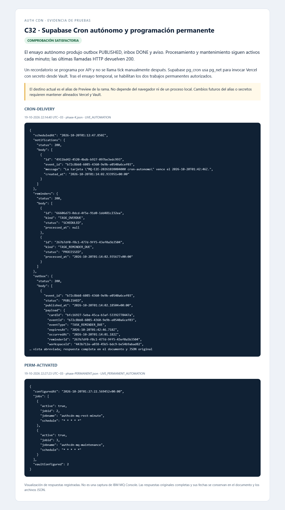

*Vista generada de las respuestas registradas; no es una fotografía de consola.*


*Captura real: 43-avisos-finales-firefox.png. Corresponde a su momento de prueba; no es un contador en vivo.*


**Registro `CRON-DELIVERY` · 19-10-2026 22:14:40 UTC−03 · LIVE_AUTOMATION.** [JSON original](respuestas/phase-K.json).

<details>
<summary>Ver petición, respuesta y estado completo registrados</summary>

```json
{
  "scheduledAt": "2026-10-20T01:12:47.850Z",
  "notifications": {
    "status": 200,
    "body": [
      {
        "id": "4911bd42-4520-4bdb-b927-097be3edc993",
        "event_id": "b72c8bb8-6085-4360-9e9b-e0540a6cef03",
        "message": "La tarjeta \"MQ-E2E-20261020004000 cron-autonomo\" vence el 2026-10-20T01:42:46Z.",
        "created_at": "2026-10-20T01:14:02.933951+00:00"
      }
    ]
  },
  "reminders": {
    "status": 200,
    "body": [
      {
        "id": "66606d73-0dcd-4f5e-91d0-1dd481c232ea",
        "kind": "TASK_OVERDUE",
        "status": "SCHEDULED",
        "processed_at": null
      },
      {
        "id": "267b7df0-f8c1-477d-9ff5-43ef0a5b3504",
        "kind": "TASK_REMINDER_DUE",
        "status": "PROCESSED",
        "processed_at": "2026-10-20T01:14:02.935677+00:00"
      }
    ]
  },
  "outbox": {
    "status": 200,
    "body": [
      {
        "event_id": "b72c8bb8-6085-4360-9e9b-e0540a6cef03",
        "status": "PUBLISHED",
        "published_at": "2026-10-20T01:14:02.18504+00:00",
        "payload": {
          "cardId": "bfc16927-5eba-45ca-b3af-53392778447a",
          "eventId": "b72c8bb8-6085-4360-9e9b-e0540a6cef03",
          "eventType": "TASK_REMINDER_DUE",
          "expiresAt": "2026-10-20T01:42:46.718Z",
          "occurredAt": "2026-10-20T01:14:01.182Z",
          "reminderId": "267b7df0-f8c1-477d-9ff5-43ef0a5b3504",
          "workspaceId": "443b712e-a038-45b5-bdc9-be54b9abad82",
          "schemaVersion": 1,
          "scheduleVersion": 2
        }
      }
    ]
  },
  "inbox": {
    "status": 200,
    "body": [
      {
        "id": "d60a867a-bb56-42d8-b37b-c33b5be88291",
        "message_id": "ID:414D51204155544843444E514D2020203736D56A06861D40",
        "state": "DONE",
        "attempts": 1,
        "body": "{\"schemaVersion\":1,\"eventId\":\"b72c8bb8-6085-4360-9e9b-e0540a6cef03\",\"eventType\":\"TASK_REMINDER_DUE\",\"reminderId\":\"267b7df0-f8c1-477d-9ff5-43ef0a5b3504\",\"cardId\":\"bfc16927-5eba-45ca-b3af-53392778447a\",\"workspaceId\":\"443b712e-a038-45b5-bdc9-be54b9abad82\",\"scheduleVersion\":2,\"occurredAt\":\"2026-10-20T01:14:01.182Z\",\"expiresAt\":\"2026-10-20T01:42:46.718Z\"}",
        "created_at": "2026-10-20T01:14:02.330116+00:00",
        "completed_at": "2026-10-20T01:14:03.086691+00:00"
      }
    ]
  }
}
```

</details>


**Registro `PERM-ACTIVATED` · 19-10-2026 22:27:23 UTC−03 · LIVE_PERMANENT_AUTOMATION.** [JSON original](respuestas/phase-PERMANENT.json).

<details>
<summary>Ver petición, respuesta y estado completo registrados</summary>

```json
{
  "configuredAt": "2026-10-20T01:27:22.569452+00:00",
  "jobs": [
    {
      "active": true,
      "jobid": 2,
      "jobname": "authcdn-mq-rest-minute",
      "schedule": "* * * * *"
    },
    {
      "active": true,
      "jobid": 3,
      "jobname": "authcdn-mq-maintenance",
      "schedule": "* * * * *"
    }
  ],
  "vaultConfigured": 2
}
```

</details>


**Registro `FINAL-CLOUD-CHECK` · 20-10-2026 01:25:34 UTC−03 · LIVE_CLOUD_READ_ONLY.** [JSON original](respuestas/phase-FINAL-20261020.json).

<details>
<summary>Ver petición, respuesta y estado completo registrados</summary>

```json
{
  "activeTestReminders": 0,
  "health": {
    "deliveryRetries": 0,
    "failedPublications": 0,
    "pendingInbox": 0,
    "quarantined": 7,
    "staleInbox": 0
  },
  "jobs": [
    {
      "active": true,
      "name": "authcdn-mq-rest-minute",
      "schedule": "* * * * *"
    },
    {
      "active": true,
      "name": "authcdn-mq-maintenance",
      "schedule": "* * * * *"
    }
  ],
  "recentCronRuns": [
    {
      "end_time": "2026-10-20T04:25:00.079953+00:00",
      "jobid": 3,
      "start_time": "2026-10-20T04:25:00.0668+00:00",
      "status": "succeeded"
    },
    {
      "end_time": "2026-10-20T04:25:00.091701+00:00",
      "jobid": 2,
      "start_time": "2026-10-20T04:25:00.06606+00:00",
      "status": "succeeded"
    },
    {
      "end_time": "2026-10-20T04:24:00.033081+00:00",
      "jobid": 3,
      "start_time": "2026-10-20T04:24:00.022764+00:00",
      "status": "succeeded"
    },
    {
      "end_time": "2026-10-20T04:24:00.026206+00:00",
      "jobid": 2,
      "start_time": "2026-10-20T04:24:00.021538+00:00",
      "status": "succeeded"
    },
    {
      "end_time": "2026-10-20T04:23:00.03409+00:00",
      "jobid": 3,
      "start_time": "2026-10-20T04:23:00.023261+00:00",
      "status": "succeeded"
    },
    {
      "end_time": "2026-10-20T04:23:00.026647+00:00",
      "jobid": 2,
      "start_time": "2026-10-20T04:23:00.022055+00:00",
      "status": "succeeded"
    }
  ],
  "recentHttpResponses": [
    {
      "created": "2026-10-20T04:25:00.091708+00:00",
      "error_msg": null,
      "id": 181,
      "status_code": 200,
      "timed_out": false
    },
    {
      "created": "2026-10-20T04:24:00.026413+00:00",
      "error_msg": null,
      "id": 180,
      "status_code": 200,
      "timed_out": false
    },
    {
      "created": "2026-10-20T04:23:00.026641+00:00",
      "error_msg": null,
      "id": 179,
      "status_code": 200,
      "timed_out": false
    }
  ],
  "temporaryFunctions": 0,
  "temporaryTriggers": 0
}
```

</details>


<a id="c33"></a>

## C33 · DLQ nativa asignada al queue manager

**Cómo funciona y cómo se probó.** En Firefox se abre AUTHCDNQM → View configuration → Properties → Extended. Se verifica el valor Dead-letter queue sin modificarlo.

**Resultado observado.** DEADQ corresponde a DEV.DEAD.LETTER.QUEUE.

**Alcance.** Las consultas REST administrativas de las identidades de aplicación devolvieron 403; la comprobación se resolvió visualmente con la sesión de consola del usuario. No fue necesario ampliar los permisos administrativos de esas identidades.

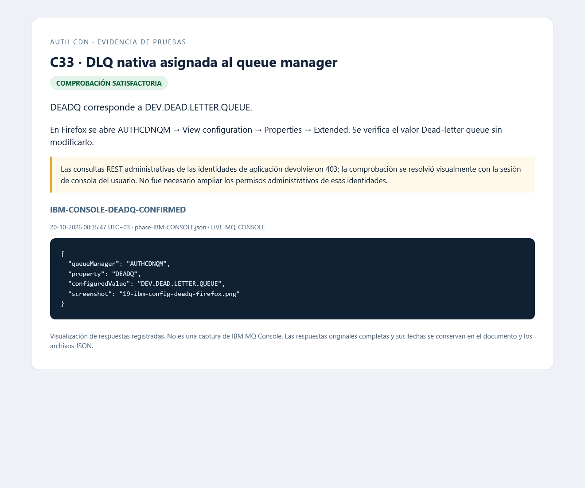

*Vista generada de las respuestas registradas; no es una fotografía de consola.*

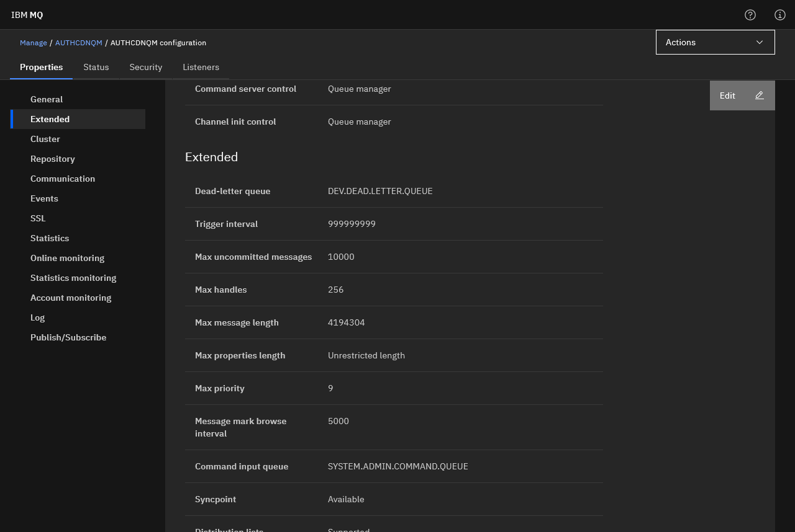

*Captura real: 19-ibm-config-deadq-firefox.png. Corresponde a su momento de prueba; no es un contador en vivo.*


**Registro `IBM-CONSOLE-DEADQ-CONFIRMED` · 20-10-2026 00:35:47 UTC−03 · LIVE_MQ_CONSOLE.** [JSON original](respuestas/phase-IBM-CONSOLE.json).

<details>
<summary>Ver petición, respuesta y estado completo registrados</summary>

```json
{
  "queueManager": "AUTHCDNQM",
  "property": "DEADQ",
  "configuredValue": "DEV.DEAD.LETTER.QUEUE",
  "screenshot": "19-ibm-config-deadq-firefox.png"
}
```

</details>


<a id="c34"></a>

## C34 · DLQ nativa: entrega automática rechazada por cola llena

**Cómo funciona y cómo se probó.** Se crean dos colas exclusivas AUTHCDN.E2E.*. La cola de iniciación de ensayo se llena hasta MAXDEPTH=2. Un nuevo disparo genera un mensaje MQTM que IBM no puede depositar allí y lo envía automáticamente a su DLQ.

**Resultado observado.** DEV.DEAD.LETTER.QUEUE pasa de cero a un mensaje. Application ID=AUTHCDNQM, cabecera MQDLH/MQTM, Reason=MQRC_Q_FULL y destino INIT de ensayo.

**Alcance.** Es un mensaje de control nativo no persistente generado por IBM, distinto del mensaje de aplicación persistente que disparó la condición. No se escribió un JSON manual en DLQ. La API REST devuelve 501 MQWB0309E al examinar este formato binario; la consola sí permite inspeccionarlo. Se conserva el mensaje y no se ejecuta DELETE sobre él.

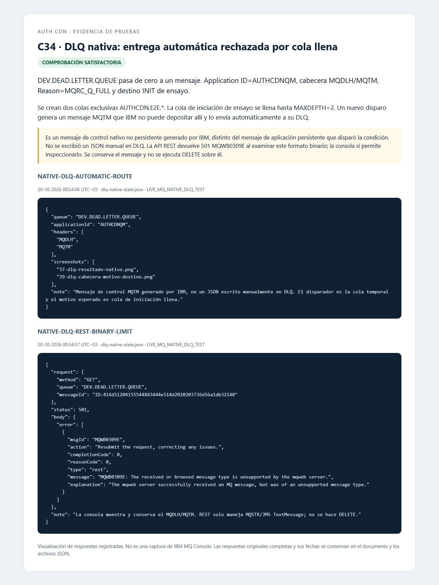

*Vista generada de las respuestas registradas; no es una fotografía de consola.*

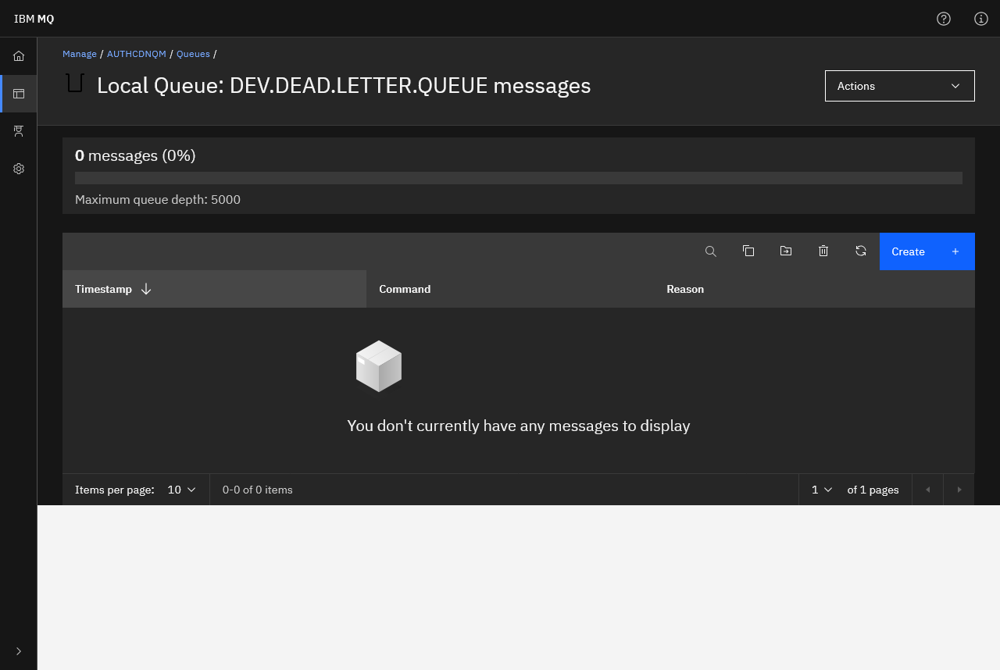

*Captura real: 24-ibm-dlq-vacia-firefox.png. Corresponde a su momento de prueba; no es un contador en vivo.*

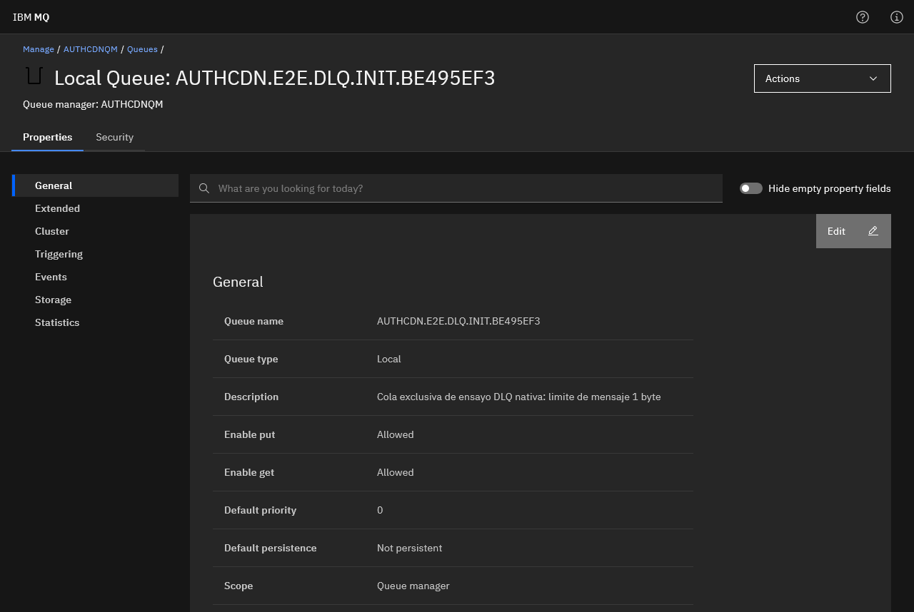

*Captura real: 36-dlq-init-profundidad-dos.png. Corresponde a su momento de prueba; no es un contador en vivo.*

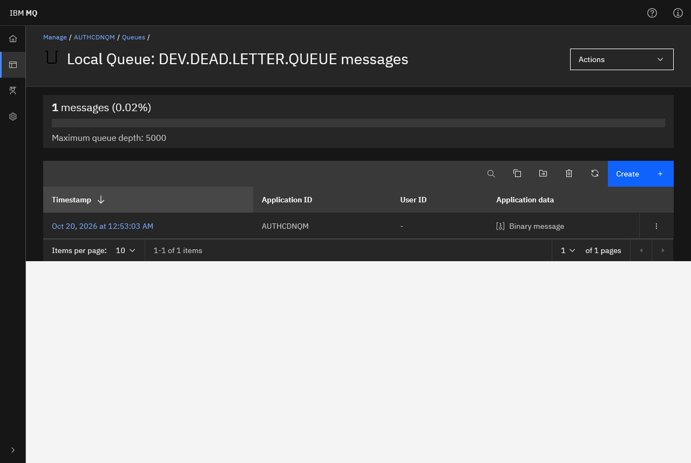

*Captura real: 37-dlq-resultado-nativo.png. Corresponde a su momento de prueba; no es un contador en vivo.*

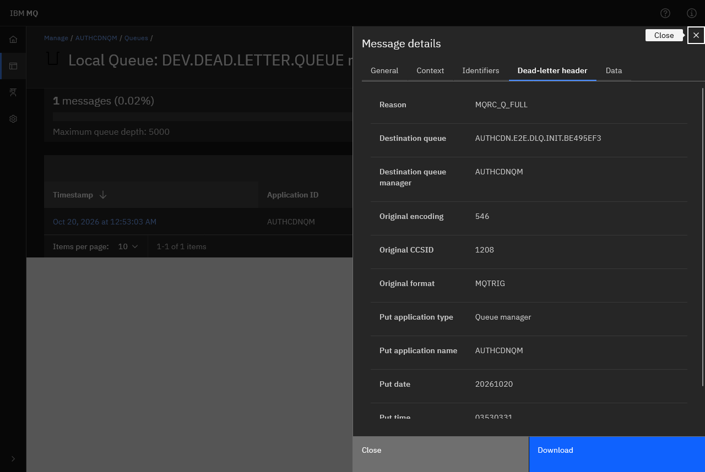

*Captura real: 39-dlq-cabecera-motivo-destino.png. Corresponde a su momento de prueba; no es un contador en vivo.*


**Registro `NATIVE-DLQ-AUTOMATIC-ROUTE` · 20-10-2026 00:54:06 UTC−03 · LIVE_MQ_NATIVE_DLQ_TEST.** [JSON original](respuestas/dlq-native-state.json).

<details>
<summary>Ver petición, respuesta y estado completo registrados</summary>

```json
{
  "queue": "DEV.DEAD.LETTER.QUEUE",
  "applicationId": "AUTHCDNQM",
  "headers": [
    "MQDLH",
    "MQTM"
  ],
  "nativeHeader": "Skip to main content\nIBM\n MQ\nLogout\nHome\nManage\nLearning resources\nSettings\nToggle opening or closing the side navigation\nManage\nAUTHCDNQM\nQueues\nLocal Queue: DEV.DEAD.LETTER.QUEUE messages\nActions\nMessage details\nClose\nGeneral\nContext\nIdentifiers\nDead-letter header\nData\nReason\tMQRC_Q_FULL\nDestination queue\tAUTHCDN.E2E.DLQ.INIT.BE495EF3\nDestination queue manager\tAUTHCDNQM\nOriginal encoding\t546\nOriginal CCSID\t1208\nOriginal format\tMQTRIG\nPut application type\tQueue manager\nPut application name\tAUTHCDNQM\nPut date\t20261020\nPut time\t03530331\nClose\nDownload\n",
  "identifiers": "Skip to main content\nIBM\n MQ\nLogout\nHome\nManage\nLearning resources\nSettings\nToggle opening or closing the side navigation\nManage\nAUTHCDNQM\nQueues\nLocal Queue: DEV.DEAD.LETTER.QUEUE messages\nActions\nMessage details\nClose\nGeneral\nContext\nIdentifiers\nDead-letter header\nData\nMessage ID\tID:414d51204155544843444e514d2020203736d56a1db32140\nClose\nDownload\n",
  "screenshots": [
    "37-dlq-resultado-nativo.png",
    "39-dlq-cabecera-motivo-destino.png"
  ],
  "note": "Mensaje de control MQTM generado por IBM, no un JSON escrito manualmente en DLQ. El disparador es la cola temporal y el motivo esperado es cola de iniciación llena."
}
```

</details>


**Registro `NATIVE-DLQ-REST-BINARY-LIMIT` · 20-10-2026 00:54:57 UTC−03 · LIVE_MQ_NATIVE_DLQ_TEST.** [JSON original](respuestas/dlq-native-state.json).

<details>
<summary>Ver petición, respuesta y estado completo registrados</summary>

```json
{
  "request": {
    "method": "GET",
    "queue": "DEV.DEAD.LETTER.QUEUE",
    "messageId": "ID:414d51204155544843444e514d2020203736d56a1db32140"
  },
  "status": 501,
  "body": {
    "error": [
      {
        "msgId": "MQWB0309E",
        "action": "Resubmit the request, correcting any issues.",
        "completionCode": 0,
        "reasonCode": 0,
        "type": "rest",
        "message": "MQWB0309E: The received or browsed message type is unsupported by the mqweb server.",
        "explanation": "The mqweb server successfully received an MQ message, but was of an unsupported message type."
      }
    ]
  },
  "note": "La consola muestra y conserva el MQDLH/MQTM. REST solo maneja MQSTR/JMS TextMessage; no se hace DELETE."
}
```

</details>


<a id="c35"></a>

## C35 · Limpieza del ensayo y estado final

**Cómo funciona y cómo se probó.** Se retiran las dos colas exclusivas de la prueba DLQ, se cancelan programaciones futuras propias y se eliminan todos los objetos SQL de inyección. Permanecen los avisos y los mensajes de evidencia.

**Resultado observado.** Ninguna cola temporal ni trigger/función de fallo. Cero recordatorios de ensayo activos; Cron permanente sigue activo; salud sin pendientes ni publicaciones fallidas.

**Alcance.** BOQ conserva nueve mensajes: siete publicados por REST durante los ensayos y dos node anteriores. DLQ conserva el mensaje nativo. El contador técnico quarantined=7 corresponde al inbox de aplicación y no tiene por qué coincidir con la profundidad total de BOQ.

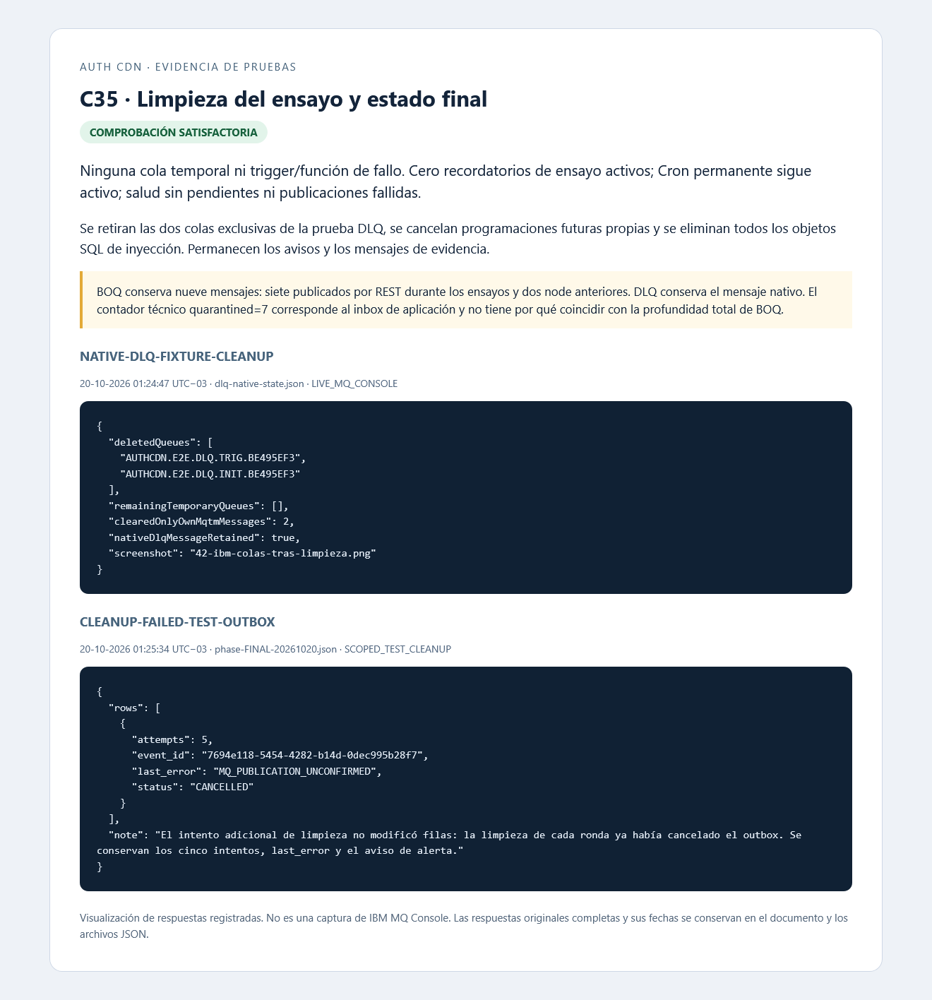

*Vista generada de las respuestas registradas; no es una fotografía de consola.*

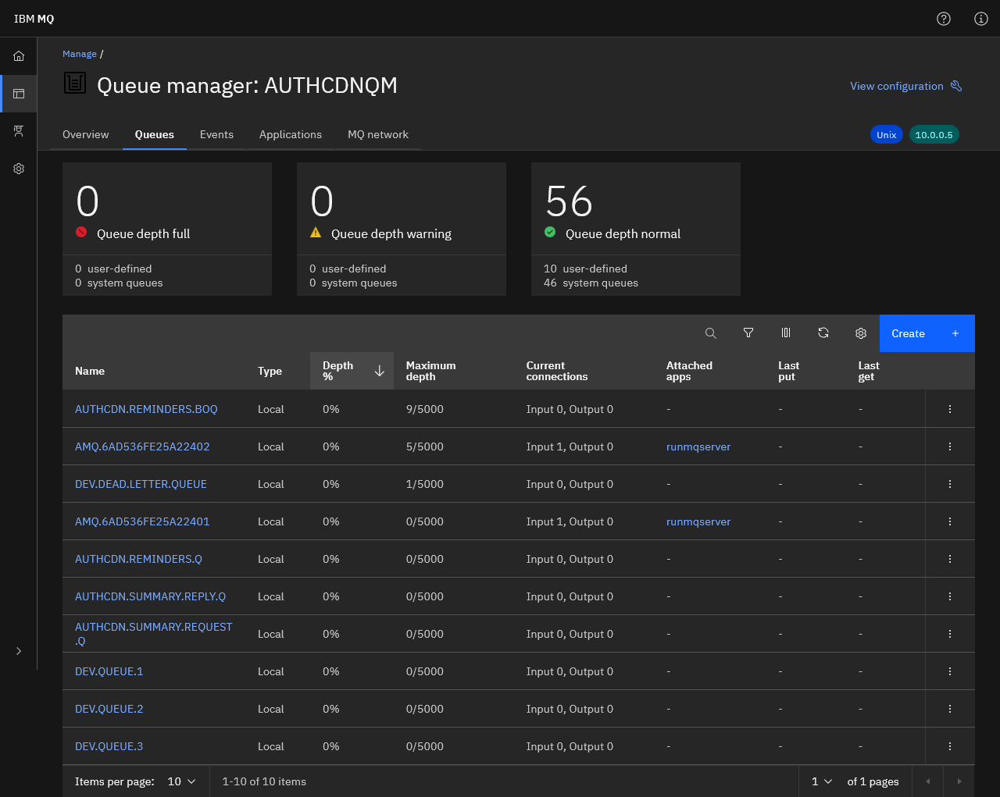

*Captura real: 42-ibm-colas-tras-limpieza.png. Corresponde a su momento de prueba; no es un contador en vivo.*


*Captura real: 44-ibm-boq-nueve-mensajes.png. Corresponde a su momento de prueba; no es un contador en vivo.*


**Registro `NATIVE-DLQ-FIXTURE-CLEANUP` · 20-10-2026 01:24:47 UTC−03 · LIVE_MQ_CONSOLE.** [JSON original](respuestas/dlq-native-state.json).

<details>
<summary>Ver petición, respuesta y estado completo registrados</summary>

```json
{
  "deletedQueues": [
    "AUTHCDN.E2E.DLQ.TRIG.BE495EF3",
    "AUTHCDN.E2E.DLQ.INIT.BE495EF3"
  ],
  "remainingTemporaryQueues": [],
  "clearedOnlyOwnMqtmMessages": 2,
  "nativeDlqMessageRetained": true,
  "screenshot": "42-ibm-colas-tras-limpieza.png"
}
```

</details>


**Registro `CLEANUP-FAILED-TEST-OUTBOX` · 20-10-2026 01:25:34 UTC−03 · SCOPED_TEST_CLEANUP.** [JSON original](respuestas/phase-FINAL-20261020.json).

<details>
<summary>Ver petición, respuesta y estado completo registrados</summary>

```json
{
  "rows": [
    {
      "attempts": 5,
      "event_id": "7694e118-5454-4282-b14d-0dec995b28f7",
      "last_error": "MQ_PUBLICATION_UNCONFIRMED",
      "status": "CANCELLED"
    }
  ],
  "note": "El intento adicional de limpieza no modificó filas: la limpieza de cada ronda ya había cancelado el outbox. Se conservan los cinco intentos, last_error y el aviso de alerta."
}
```

</details>


**Registro `FINAL-CLOUD-CHECK` · 20-10-2026 01:25:34 UTC−03 · LIVE_CLOUD_READ_ONLY.** [JSON original](respuestas/phase-FINAL-20261020.json).

<details>
<summary>Ver petición, respuesta y estado completo registrados</summary>

```json
{
  "activeTestReminders": 0,
  "health": {
    "deliveryRetries": 0,
    "failedPublications": 0,
    "pendingInbox": 0,
    "quarantined": 7,
    "staleInbox": 0
  },
  "jobs": [
    {
      "active": true,
      "name": "authcdn-mq-rest-minute",
      "schedule": "* * * * *"
    },
    {
      "active": true,
      "name": "authcdn-mq-maintenance",
      "schedule": "* * * * *"
    }
  ],
  "recentCronRuns": [
    {
      "end_time": "2026-10-20T04:25:00.079953+00:00",
      "jobid": 3,
      "start_time": "2026-10-20T04:25:00.0668+00:00",
      "status": "succeeded"
    },
    {
      "end_time": "2026-10-20T04:25:00.091701+00:00",
      "jobid": 2,
      "start_time": "2026-10-20T04:25:00.06606+00:00",
      "status": "succeeded"
    },
    {
      "end_time": "2026-10-20T04:24:00.033081+00:00",
      "jobid": 3,
      "start_time": "2026-10-20T04:24:00.022764+00:00",
      "status": "succeeded"
    },
    {
      "end_time": "2026-10-20T04:24:00.026206+00:00",
      "jobid": 2,
      "start_time": "2026-10-20T04:24:00.021538+00:00",
      "status": "succeeded"
    },
    {
      "end_time": "2026-10-20T04:23:00.03409+00:00",
      "jobid": 3,
      "start_time": "2026-10-20T04:23:00.023261+00:00",
      "status": "succeeded"
    },
    {
      "end_time": "2026-10-20T04:23:00.026647+00:00",
      "jobid": 2,
      "start_time": "2026-10-20T04:23:00.022055+00:00",
      "status": "succeeded"
    }
  ],
  "recentHttpResponses": [
    {
      "created": "2026-10-20T04:25:00.091708+00:00",
      "error_msg": null,
      "id": 181,
      "status_code": 200,
      "timed_out": false
    },
    {
      "created": "2026-10-20T04:24:00.026413+00:00",
      "error_msg": null,
      "id": 180,
      "status_code": 200,
      "timed_out": false
    },
    {
      "created": "2026-10-20T04:23:00.026641+00:00",
      "error_msg": null,
      "id": 179,
      "status_code": 200,
      "timed_out": false
    }
  ],
  "temporaryFunctions": 0,
  "temporaryTriggers": 0
}
```

</details>


## Validación local y límites de la evidencia

La suite local registró **251 pruebas aprobadas y 3 omitidas de 254**. Las tres omitidas corresponden a diagnósticos nativos no aplicables a Windows; no son evidencia de ejecución REST en cloud. También se ejecutaron comprobación de tipos, lint y build en la ronda de implementación. [Salida estructurada de la suite](respuestas/unit-results.json).

La ronda reforzada `155d2be1` tiene **36 comprobaciones PASS**, incluida la limpieza. La primera ronda exploratoria `ffea3cca` se conserva como diagnóstico: sus verificaciones de cinco intentos e interrupción no aislaron correctamente los replays de la conexión, y el primer evento de alerta tenía un contrato temporal inválido. Se corrigió el montaje del ensayo y se repitió; los casos actuales se apoyan en `155d2be1`, no en esos resultados históricos. [Diagnóstico exploratorio](respuestas/phase-DEEP-ffea3cca.json).

La primera ronda también contenía consultas de MsgId con sensibilidad a mayúsculas y restricciones de acceso administrativo/BOQ. Las verificaciones actuales usan la fase V y las capturas reales de consola. Los archivos históricos no se borran ni se presentan como resultados actuales satisfactorios.

No se reinició IBM Cloud ni se apagó Vercel, ni se provocó una partición de red general. La persistencia del mensaje y la recuperación SQL observadas no equivalen a demostrar una transacción distribuida exactamente una vez. Los mensajes de BOQ/DLQ quedan conservados para revisión; no se activó un manejador que borre o reenvíe automáticamente mensajes nativos binarios.

El procesamiento es global: durante los ticks también pudo procesarse trabajo ordinario ya vencido del owner. El aviso previo “Prueba TASK_OVERDUE” aparece en las capturas; su tarjeta no fue modificada por el ensayo. Las pruebas de alertas generaron avisos intencionales que se conservan.

## Evidencia administrativa y cierre

Las dos colas temporales `AUTHCDN.E2E.DLQ.INIT.BE495EF3` y `AUTHCDN.E2E.DLQ.TRIG.BE495EF3` se retiraron. El vaciado se limitó a dos MQTM creados en INIT por este ensayo. Se conserva el mensaje nativo DLQ y la BOQ; las colas funcionales no se eliminaron ni purgaron. Permanecen los dos Cron autorizados cada minuto. La verificación final de salud está fechada en su JSON y no garantiza disponibilidad futura.

[Informe previo con secuencia completa y pruebas locales](informe-pruebas-mq-rest.md) · [Configuración de Cron permanente](cron-permanente-y-dlq.md) · [Manifest de integridad SHA-256](sha256.txt).

## Referencias oficiales

- [IBM MQ: mensajería mediante REST](https://www.ibm.com/docs/en/ibm-mq/9.3.x?topic=mq-messaging-using-rest-api).
- [IBM MQ: cabecera nativa MQDLH](https://www.ibm.com/docs/en/ibm-mq/10.0.x?topic=mqi-mqdlh-dead-letter-header).
- [IBM MQ: campos de la cabecera DLQ](https://www.ibm.com/docs/en/ibm-mq/10.0.x?topic=header-field-details-mqdlh).
- [IBM MQ: cuando el triggering no funciona](https://www.ibm.com/docs/en/ibm-mq/10.0.x?topic=triggers-when-triggering-does-not-work).
- [Supabase: invocaciones programadas con pg_cron, pg_net y Vault](https://supabase.com/docs/guides/functions/schedule-functions).
