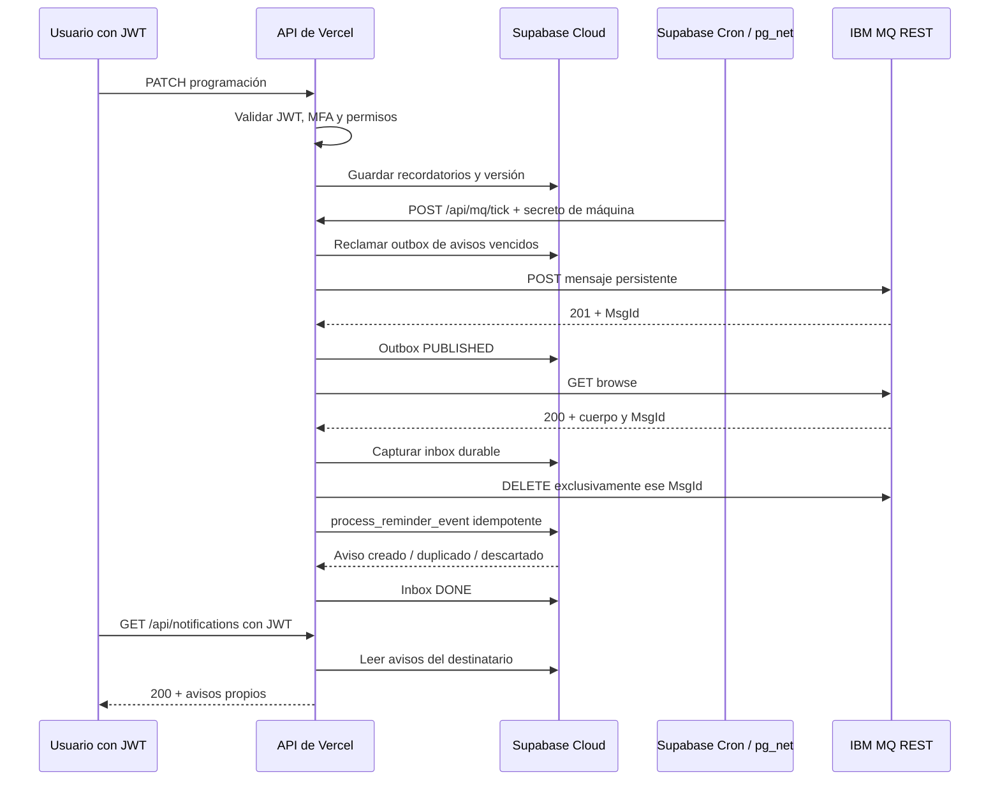
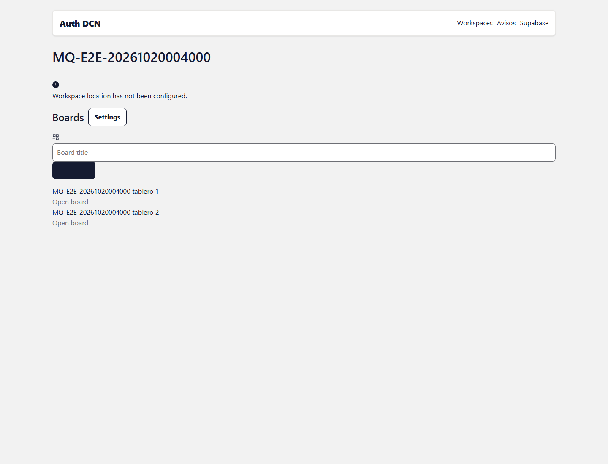
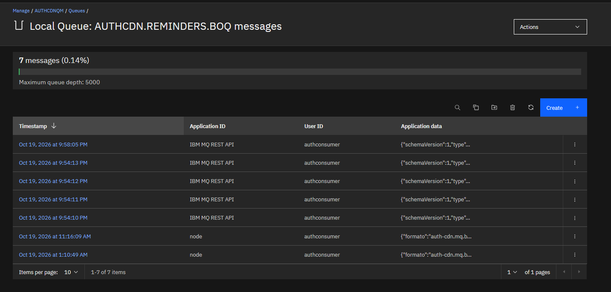

# Informe de pruebas: IBM MQ REST, Vercel y Supabase Cloud

<!-- permanent-cron-update -->
> **Estado actualizado el 20-10-2026:** el [documento visual de 35 casos](casos-mq-rest-con-imagenes.md) contiene las respuestas completas y las nuevas capturas de Firefox. Los dos Cron permanentes siguen activos cada minuto. Se confirmó DEADQ en la consola y se probó una entrega nativa a DLQ con MQDLH/MQRC_Q_FULL. También se comprobaron cinco fallos reales del consumidor, recuperación tras interrumpir una RPC SQL y alerta tras cinco fallos del productor.

**Este archivo conserva la ronda inicial como historial.** Sus referencias a un Cron temporal detenido, una DLQ pendiente o fallos todavía no provocados describen aquel momento. El resultado vigente y los límites de las nuevas pruebas están en el documento visual.

Fecha: **19 de octubre de 2026**, zona horaria America/Santiago (UTC−03). Los archivos JSON conservan las fechas UTC originales del 20 de octubre.

**El flujo real de recordatorios y Request/Reply funcionó. El ensayo autónomo de Supabase Cron publicó, capturó y procesó un aviso mediante Vercel sin un trabajador local.** La programación fue temporal: se detuvo automáticamente y se retiraron sus secretos de ensayo. **En esa ronda aún no se había activado el Cron permanente; su activación posterior y estado actual están documentados arriba.**

Este documento reúne qué hace cada mecanismo, cómo se probó, qué devolvió y cómo llegó el resultado. La cobertura y las limitaciones se indican expresamente; una inyección SQL controlada no se presenta como una interrupción real del proveedor.

- Rama local verificada: `feature/mq-consumidor`.
- Revisión local al cerrar las pruebas: `951ebddeec31682251623bacded4a80fc8d0a0bf`. Este hash identifica el checkout local; no se consultó un hash de build desde Vercel para afirmar su equivalencia exacta.
- Preview probado: [https://auth-cdn-git-feature-mq-consumidor-anthonys-projects-0d8acba7.vercel.app](https://auth-cdn-git-feature-mq-consumidor-anthonys-projects-0d8acba7.vercel.app).
- Supabase: `vqeusrctsfqykzwwrucn`; queue manager: `AUTHCDNQM`.
- Ensayo: `MQ-E2E-20261020004000`; workspace: `443b712e-a038-45b5-bdc9-be54b9abad82`.
- No se incluyen contraseñas, JWT, cookies, certificados ni secretos de Cron. No se realizaron commits, push, merges ni despliegues por parte del agente durante esta validación.

## Lectura rápida de resultados

Los estados PASS indican que se obtuvo la respuesta esperada. Un 401, 403, 404 o 502 puede ser PASS cuando se está probando un rechazo o un fallo provocado. OBSERVATION es una lectura intermedia del ensayo. LIMITED señala una restricción de comprobación, no un mensaje perdido.

|Requisito|Resultado y alcance|Evidencia / límite|
|---|---|---|
|IBM MQ como broker|Validado real|POST REST 201, MsgId de IBM, GET 200 y persistence=persistent. Cron confirmó publicación y procesamiento.|
|Mensajería asíncrona|Validada real|Aviso normal y aviso autónomo; outbox PUBLISHED → inbox DONE → recordatorio PROCESSED → notifications.|
|Mensajería síncrona / Request/Reply|Validada real|Dos tableros y solicitudes simultáneas; requestId distintos y correlación entre colas. Respuesta HTTP 200 con estadísticas.|
|ACK / confirmaciones|Validado para REST|Confirmación HTTP de publicación/retirada y estado durable. No se demuestra MQCMIT/MQBACK nativo.|
|Durabilidad y recuperación|Validada con pausa controlada|Mensaje persistente real; después de capturar y retirar por MsgId se pausa el ensayo; otro ciclo recupera PENDING y crea un solo aviso. No se reinició IBM/Vercel.|
|Idempotencia|Validada real|Dos MsgId para el mismo eventId no duplican notifications; descartes de programación cancelada o versión antigua.|
|BOQ / mensajes fallidos|Validada con trazas y foto de consola|Cuatro mensajes inválidos reales y una salida artificial recuperada terminan en BOQ. Foto del usuario: cinco entradas IBM MQ REST API, además de dos node anteriores.|
|DLQ nativa|Comprobación parcial|GET no destructivo de DEV.DEAD.LETTER.QUEUE correcto; no se verificó AUTHCDNQM.DEADQ ni se forzó un fallo de routing.|
|Reintentos|Validación controlada|Cinco fallos de salida del fixture en Vercel conservan payload y contador; recuperación posterior. Cinco fallos transitorios de la lógica de negocio no se provocaron contra el servicio real.|
|Retención|Validada con fechas inyectadas|Fixture de 40 días: purga DONE técnico; conserva pendiente y cuarentena. No se esperaron 40 días ni se configuró retención administrativa del broker.|
|Expiración|Validada real y por fixture SQL|TTL MQ de 1200 ms: 200 → 204 sin DELETE. SQL reconcilia QUEUED expirado → EXPIRED conservando PUBLISHED histórico.|
|Alertas de fallos|Validada en aplicación con fixture|FAILED/attempts=5 inyectado genera un aviso visible y no duplicado. No se configuró entrega de alertas por correo/SMS.|
|JWT, MFA y permisos|Validados reales|No autenticado 401; JWT alterado 401; ajeno/revocado 404; viewer escritura 403; AAL1 con MFA 403 y AAL2 200; funciones técnicas restringidas.|
|Ejecución cloud autónoma|Ensayo real aprobado|pg_cron + pg_net invocaron Vercel tres veces con HTTP 200; el primer ciclo publicó/capturó/procesó un aviso. Job temporal retirado; programación permanente pendiente.|

## Cómo funciona el flujo y dónde se observa

### Envío y recepción con la capa de autenticación

El usuario inicia sesión en Supabase. Su sesión contiene el JWT que Vercel valida junto con MFA y permisos del workspace. Programar o consultar un recordatorio requiere esa sesión. El navegador no recibe las claves de IBM y no consume directamente las colas.

El servidor usa las identidades privadas de productor y consumidor para autenticarse en IBM MQ REST por HTTPS. Por separado, el ciclo automático exige MQ_CRON_SECRET: no usa un JWT personal que caduque ni acepta el JWT del owner como sustituto. Cuando el usuario lee sus avisos, la API vuelve a comprobar su JWT y solo devuelve sus notificaciones.



La confirmación del transporte y el procesamiento son pasos distintos. REST no ofrece las transacciones distribuidas de MQI: primero se conserva el cuerpo en Supabase y después se retira el mensaje por su identificador exacto. Si el proceso se interrumpe, otra invocación recupera el inbox pendiente. Si se repite la entrega, eventId y las restricciones de base de datos evitan duplicar el aviso. [Documentación oficial de mensajería REST de IBM MQ](https://www.ibm.com/docs/en/ibm-mq/9.3.x?topic=mq-messaging-using-rest-api).

### Qué significa ver la cola vacía

`AUTHCDN.REMINDERS.Q` muestra mensajes que siguen pendientes, no un historial de avisos entregados. Un ciclo puede publicar y consumir el mismo mensaje en segundos: la profundidad vuelve a cero. La evidencia de entrega se obtiene relacionando MsgId, inbox, eventId y notifications. En cambio, `AUTHCDN.REMINDERS.BOQ` conserva los mensajes que requieren revisión; no se vacía automáticamente como parte del consumo normal.

### Request/Reply

Al pulsar Resumen del tablero, Vercel valida el usuario, publica la solicitud en `AUTHCDN.SUMMARY.REQUEST.Q` y el responder cloud publica el resultado en `AUTHCDN.SUMMARY.REPLY.Q`. El CorrelId de la respuesta coincide con el MsgId de la solicitud. También se comprueban requestId y boardId antes de mostrar los datos. El llamador espera un tiempo acotado; el ciclo periódico puede recuperar trabajo pendiente. No interviene un puente localhost. La prueba real incluyó dos solicitudes simultáneas para comprobar su separación; el timeout por ausencia de respuesta tiene cobertura local y no se forzó en este despliegue.

### Reintentos, cuarentena, expiración y conservación

Una reserva con token impide que dos invocaciones procesen el mismo registro simultáneamente. La reserva caducada puede reclamarse con otro token y el anterior deja de servir. Los fallos reprograman next_attempt_at con backoff. Una salida de reply o de cuarentena se conserva antes de publicarse: una confirmación incierta no autoriza a borrar esa carga.

Un JSON roto, un contrato inválido o una relación de datos permanentemente errónea se envían a BOQ en un sobre que conserva reason, messageId, inboxId y originalBody. Un ReplyTo no permitido se rechaza para evitar publicar resultados en un destino arbitrario. BOQ es una cuarentena de aplicación; la DLQ nativa del queue manager cumple otra función y su configuración administrativa no fue verificada aquí.

TTL limita cuánto tiempo espera un mensaje en IBM; expiresAt y el mantenimiento SQL controlan el estado de negocio si el aviso ya no es útil. La retención técnica elimina registros terminados antiguos, conserva pendientes/cuarentenas y no borra las notificaciones del usuario por limpiar el outbox. Las alertas de fallo aparecen en Avisos bajo el JWT del destinatario.

## Ensayo autónomo: resultado concreto

Con autorización del usuario se habilitaron pg_cron y pg_net en el proyecto indicado. Ya existía supabase_vault. Se creó `authcdn-mq-rest-e2e-temporary`, cada minuto, con límite de tres minutos y dos secretos de Vault exclusivos del ensayo. El comando programado leía el secreto de máquina desde Vault; no guardaba su valor en cron.job.command. [Programación cloud y uso de Vault documentados por Supabase](https://supabase.com/docs/guides/functions/schedule-functions).

Antes de retirar la protección del preview, las llamadas sin cookie de Vercel recibían 401/307 aunque el secreto de Cron fuera correcto. El enlace compartible no funcionó como bypass de automatización. El usuario retiró esa protección: /login respondió 200, /api/notifications sin JWT siguió en 401 y /api/mq/tick sin secreto siguió en 401. [Protección y bypass de automatización de Vercel](https://vercel.com/docs/deployment-protection/methods-to-bypass-deployment-protection/protection-bypass-automation).

La tarjeta `cron-autonomo` se programó a las 22:12:47 de Chile. No se invocó tick manualmente desde su creación hasta comprobar su entrega. Las lecturas de auditoría desde el equipo no ejecutaban el procesamiento.

|Inicio de pg_cron, Chile|Estado SQL|Resultado del comando|
|---|---|---|
|19-10-2026 22:14:00 UTC−03|succeeded|DO|
|19-10-2026 22:15:00 UTC−03|succeeded|DO|
|19-10-2026 22:16:00 UTC−03|succeeded|DO|
|19-10-2026 22:17:00 UTC−03|succeeded|DO|

|Petición pg_net|HTTP|Timeout|Respuesta de Vercel|
|---|---|---|---|
|1|200|False|{"published":1,"captured":1,"worked":1,"errors":0}|
|2|200|False|{"published":0,"captured":0,"worked":0,"errors":0}|
|3|200|False|{"published":0,"captured":0,"worked":1,"errors":0}|

El primer ciclo automático publicó 1, capturó 1 y procesó 1, con 0 errores. El mensaje real quedó en inbox DONE con MsgId `ID:414D51204155544843444E514D2020203736D56A06861D40`. El aviso `4911bd42-4520-4bdb-b927-097be3edc993` se creó a las **19-10-2026 22:14:02 UTC−03**, para eventId `b72c8bb8-6085-4360-9e9b-e0540a6cef03`. El primer ciclo tardó segundos en retirar el mensaje: no era esperable encontrarlo acumulado después en la cola principal.

La cuarta ejecución del comando, a las 22:17:00, solo se desprogramó por superar el límite: no generó una cuarta petición HTTP. La consulta posterior mostró cero jobs del ensayo y se retiraron sus dos entradas exclusivas de Vault. **Las extensiones permanecen habilitadas; el procesamiento periódico permanente y el mantenimiento periódico no quedaron activados.**

```json
{
  "extensions": [
    "supabase_vault",
    "pg_cron",
    "pg_net"
  ],
  "remainingTestJobs": 0,
  "remainingTestSecrets": 0
}
```

## Evidencia de cuarentena y capturas

La imagen de IBM Console fue aportada por el usuario desde su navegador. El agente no controló esa sesión administrativa. La captura muestra siete mensajes en AUTHCDN.REMINDERS.BOQ: cinco entradas con Application ID `IBM MQ REST API` entre las 21:54:10 y 21:58:05, y dos entradas anteriores con Application ID `node`. Las cinco entradas REST coinciden en cantidad y horario con las salidas de este ensayo. El listado no muestra el cuerpo completo ni el MsgId propio de cada mensaje BOQ; esos detalles deben contrastarse abriendo cada entrada. Los identificadores de la siguiente tabla son del mensaje original dentro del sobre, no el nuevo MsgId que IBM asigna a la publicación BOQ.

|Caso|reason del sobre|inboxId|MsgId original|
|---|---|---|---|
|POISON-SEND-malformed|MALFORMED_JSON|87421194-25d4-4ecc-b6f7-662903f555c2|ID:414D51204155544843444E514D2020203736D56A08AD1C40|
|POISON-SEND-invalid-contract|INVALID_REMINDER|5766abca-8b1a-443c-8992-108913c8ade2|ID:414D51204155544843444E514D2020203736D56A09AD1C40|
|POISON-SEND-permanent-mismatch|PERMANENT_ERROR|a14133b4-0142-4ff8-a1db-c1b24af16592|ID:414D51204155544843444E514D2020203736D56A0AAD1C40|
|REPLY-ALLOWLIST-SEND|INVALID_REPLY_DESTINATION|92053757-9172-43ea-b6da-24d11ea1cb05|ID:414D51204155544843444E514D2020203736D56A0BAD1C40|
|retry-recovery|E2E_INJECTED_OUTPUT_FAILURE|2d63e3da-11bd-43cf-bfe6-cc3d607a5695|ID:B1AE7F038C4D2D90E06B630AB4DB509C928F77C71DB881B8|

### Avisos cargados: normal, vencimiento, alerta y Cron autónomo


### Resumen final: 8 tarjetas activas, 6 pendientes, 1 completada y 1 vencida


### Workspace aislado con dos tableros



### IBM MQ Console: captura aportada por el usuario; cinco entradas REST y dos entradas node anteriores



Las capturas de aplicación esperaron respuestas HTTP y elementos visibles antes de guardarse. Se excluyeron imágenes transitorias que solo mostraban la pantalla cargando; la prueba de MFA está documentada con respuestas API, sin presentar una captura vacía como evidencia.

En la captura del resumen persiste un texto antiguo que menciona un worker independiente. La implementación validada usa el responder cloud de Vercel; esa redacción de interfaz merece actualizarse. La advertencia de ubicación pertenece al workspace de ensayo, que no se configuró con localización.

## Mensaje temporal para fotografiar la cola principal

Después de detenerse el Cron se dejó una repetición controlada de un evento ya procesado en `AUTHCDN.REMINDERS.Q`. IBM confirmó POST 201 y GET no destructivo 200, con persistence=persistent.

- Publicado: **19-10-2026 22:18:15 UTC−03**.
- MsgId: `ID:414d51204155544843444e514d2020203736d56a08871d40`.
- TTL del broker: 600000 ms, aproximadamente hasta las 22:28:15 de Chile si nadie lo consume antes.
- No se creó una nueva programación SQL: el evento ya estaba procesado y su expiresAt de negocio estaba pasado. Sirve para fotografiar un mensaje pendiente y no debe generar un nuevo aviso.

La expiración futura de este mensaje de diez minutos no se presenta como observada al redactar; la prueba independiente de expiración real ya se hizo con TTL de 1200 ms. El diagnóstico de salud de Supabase cuenta su inbox, no mide la profundidad actual del broker.

## Cómo repetir y fotografiar los casos

1. Ingresar al preview con una cuenta autorizada y abrir el workspace `MQ-E2E-20261020004000`. Conservar JWT, claves, códigos MFA y cookies fuera de las capturas.
2. Para un aviso normal nuevo, crear otra tarjeta de prueba y usar Fechas y responsables: notifyAt anterior a dueAt. Se guardan recordatorios primero; su mensaje se publica cuando llega notifyAt y se ejecuta el ciclo. La programación permanente debe estar activada o debe invocarse el endpoint protegido por un operador autorizado.
3. Ver el resultado en Avisos. Completar o quitar las fechas antes de notifyAt permite repetir los casos de cancelación. Reprogramar cambia schedule_version y permite distinguir una llegada antigua de una vigente.
4. En IBM Console: `AUTHCDNQM → Queues → AUTHCDN.REMINDERS.Q → Messages → Refresh`. El mensaje temporal permite ver un pendiente; los avisos consumidos ya no aparecen en este listado. Abrir sus propiedades y fotografiar MsgId, Persistence y Expiry si la consola los muestra.
5. En `AUTHCDN.REMINDERS.BOQ → Messages`, abrir las entradas IBM MQ REST API. Fotografiar el sobre y comparar reason/inboxId/messageId con la tabla anterior. Usar visualización/browse, sin borrar ni mover mensajes. No atribuir al ensayo las dos entradas node previas.
6. Para Request/Reply, pulsar Resumen del tablero y fotografiar las estadísticas. Las colas REQUEST/REPLY pueden volver a cero muy rápido; la traza de correlación en este documento conserva ambas partes.
7. Para la DLQ nativa, fotografiar su existencia y, con permisos administrativos, la propiedad DEADQ de AUTHCDNQM. Que la cola exista por sí solo no demuestra que sea la DLQ configurada.
8. Si se agregan fotos administrativas, guardarlas junto a este informe en capturas, sin contraseñas, claves ni certificados. Este documento identifica cuáles capturas ya están incluidas y cuáles comprobaciones administrativas siguen pendientes.

## Alcance de las pruebas y pendientes

- Las pruebas manuales iniciales invocaron el endpoint cloud desde un equipo como controlador del ensayo; el procesamiento se ejecutó en Vercel. La prueba Cron posterior sí demostró inicio periódico desde Supabase Cloud sin un proceso local que produjera o consumiera mensajes.
- Se validaron fallos controlados en datos exclusivos del ensayo. No se cortó la red, no se reinició el queue manager y no se apagó una función de Vercel a la fuerza. La recuperación probada es una pausa en una frontera conocida de entrega.
- Los cinco fallos observados en vivo corresponden a salida de inbox hacia un destino inválido inyectado. El contador alcanzó cinco fallos y se completó al corregir el destino. El registro de alerta FAILED/attempts=5 se inyectó por separado: no prueba cinco publicaciones realmente fallidas. La suite local cubre otras ramas de reintento/timeout; no se atribuyen esas simulaciones al broker real.
- Los permisos de aplicación permitieron publicar en BOQ, pero su GET administrativo recibió 403/2035. El usuario aportó la foto que demuestra las entradas REST en la consola. Queda pendiente inspeccionar los cuerpos administrativos y la asignación DEADQ si se requiere evidencia adicional.
- La retención se comprobó con fechas SQL inyectadas; una política administrativa de retención del broker y la permanencia durante meses no se validaron. La cuarentena se conserva para revisión y requiere una política operativa de archivo/reproceso.
- Se comprobó JWT alterado, aislamiento, revocación de membresía y MFA. No se esperó la caducidad natural de un JWT ni se rotaron claves durante el ensayo.
- Las alertas verificadas son avisos internos en la aplicación, no un canal externo de correo o SMS.
- Falta activar una programación **permanente** de procesamiento y mantenimiento para la operación habitual. El archivo de configuración permanente del proyecto puede revisarse antes de ejecutarlo; este ensayo solo autorizó el trabajo temporal.

## Datos conservados y efectos del ensayo

Se conservaron el workspace y sus ocho tarjetas, los avisos y las cinco cuarentenas para revisión y fotografías. Se cancelaron las programaciones futuras propias y se comprobaron cero pendientes SCHEDULED/QUEUED. Las identidades temporales de seguridad se eliminaron. Los registros artificiales usados solo para retención/alerta se retiraron según sus IDs; el registro de reintentos quedó DONE para auditoría.

El endpoint tick procesa el proyecto completo, no solo el workspace de ensayo. En los ciclos iniciales también se entregó un recordatorio preexistente del owner, visible como «Prueba TASK_OVERDUE». No se modificó esa tarjeta ni se borró su aviso: fue un efecto normal del procesamiento de trabajo ya pendiente. Las alteraciones de fechas, destinos y estados usadas para provocar fallos se limitaron a los fixtures propios.

El mensaje temporal de diez minutos es la única carga dejada deliberadamente pendiente de consumo en la cola principal. No representa trabajo SQL futuro. No se retiraron mensajes anteriores de BOQ ni se alteraron sus permisos.

## Diferencias entre evidencias reales y simuladas

LIVE_APP: petición a Vercel y respuesta de aplicación. LIVE_MQ: operación real sobre IBM MQ REST. LIVE_SQL: consulta/función en Supabase remoto. LIVE_SQL_FIXTURE: prueba remota con estados o fechas preparados artificialmente. LIVE_CLOUD_FAULT_FIXTURE: fallo inyectado en un único registro y procesado realmente en Vercel. LIVE_AUTOMATION: programación/ejecución desde Supabase Cloud. La suite local se informa por separado.

Los JSON registran los cuerpos capturados y campos seleccionados de auditoría. Se omiten cabeceras de autorización, cookies y tokens; las respuestas HTML de diagnóstico se registraron de forma abreviada, no como un volcado íntegro de la página. En los cuerpos de MQ se registran las cabeceras de metadatos relevantes, como MsgId, CorrelId, persistence y expiry.

## Catálogo de comprobaciones con explicación y respuesta

Cada caso incluye cómo funciona y el cuerpo efectivamente registrado. La fase C conserva cinco FAIL iniciales de auditoría: una búsqueda por MsgId distinguía mayúsculas hexadecimales y no encontraba las filas. La fase V corrigió la búsqueda y confirmó los cinco resultados. No se corrigió el código de negocio para obtenerlos. Los errores de configuración del primer despliegue se conservan en el historial y no se presentan como fallos finales aún abiertos.

### A. Validaciones y Request/Reply con configuración REST completa

Fuente: [respuestas/phase-A-configured.json](respuestas/phase-A-configured.json).

|ID|Resultado|Tipo|Fecha Chile|
|---|---|---|---|
|AUTH-PASSWORD|PASS|LIVE_APP|19-10-2026 21:49:38 UTC−03|
|AUTH-OWNER|PASS|LIVE_APP|19-10-2026 21:49:40 UTC−03|
|VALIDATION-DATES|PASS|LIVE_APP|19-10-2026 21:49:42 UTC−03|
|VALIDATION-ID|PASS|LIVE_APP|19-10-2026 21:49:43 UTC−03|
|AUTH-UNKNOWN-BOARD|PASS|LIVE_APP|19-10-2026 21:49:44 UTC−03|
|AUTH-TAMPERED|PASS|LIVE_APP|19-10-2026 21:49:45 UTC−03|
|SUMMARY-5c52e0b4-62f0-4545-9ea3-2aa86dfe0c62|PASS|LIVE_APP|19-10-2026 21:49:49 UTC−03|
|SUMMARY-5a84c92c-f774-4613-90b6-b37d7a79ec04|PASS|LIVE_APP|19-10-2026 21:49:52 UTC−03|
|SUMMARY-CONCURRENT|PASS|LIVE_APP|19-10-2026 21:49:56 UTC−03|
|CRON-CONFIG|PASS|LIVE_APP|19-10-2026 21:50:01 UTC−03|
|SUMMARY-SQL-TRACE|PASS|LIVE_SQL|19-10-2026 21:50:01 UTC−03|

#### AUTH-PASSWORD — Autenticación con Supabase Auth

Resultado: **PASS**. Cómo funciona: Supabase valida las credenciales y entrega la sesión. La API de Vercel verifica el JWT, el estado de MFA y los permisos; el informe conserva el estado HTTP y la identidad, sin guardar tokens.

```json
{
  "status": 200,
  "projectHost": "vqeusrctsfqykzwwrucn.supabase.co"
}
```

#### AUTH-OWNER — Sesión de cuenta proporcionada

Resultado: **PASS**. Cómo funciona: Supabase valida las credenciales y entrega la sesión. La API de Vercel verifica el JWT, el estado de MFA y los permisos; el informe conserva el estado HTTP y la identidad, sin guardar tokens.

```json
{
  "request": {
    "method": "GET",
    "path": "/api/auth/session",
    "body": null
  },
  "status": 200,
  "body": {
    "user": {
      "id": "45e0ff79-940c-4230-bd97-bb9e0572e0f0",
      "email": "owner@example.com",
      "name": "Demo Owner"
    }
  }
}
```

#### VALIDATION-DATES — Rechazar aviso posterior al vencimiento

Resultado: **PASS**. Cómo funciona: La API valida identificadores y fechas antes de producir mensajes. Una entrada inválida debe recibir 400 y no crear un evento válido para IBM MQ.

```json
{
  "request": {
    "method": "PATCH",
    "path": "/api/cards/c65fade2-7ae4-4ccb-be7d-9c43229caa2c/schedule",
    "body": {
      "expectedVersion": 1,
      "dueAt": "2026-10-20T00:59:41.527Z",
      "notifyAt": "2026-10-20T01:01:21.527Z",
      "assigneeIds": []
    }
  },
  "status": 400,
  "body": {
    "error": {
      "code": "BAD_REQUEST",
      "message": "Revisa los datos de la tarjeta.",
      "details": {
        "formErrors": [],
        "fieldErrors": {
          "notifyAt": [
            "El aviso debe ser anterior al vencimiento."
          ]
        }
      }
    }
  }
}
```

#### VALIDATION-ID — Rechazar boardId inválido

Resultado: **PASS**. Cómo funciona: La API valida identificadores y fechas antes de producir mensajes. Una entrada inválida debe recibir 400 y no crear un evento válido para IBM MQ.

```json
{
  "request": {
    "method": "POST",
    "path": "/api/boards/not-a-uuid/summary",
    "body": null
  },
  "status": 400,
  "body": {
    "error": {
      "code": "BAD_REQUEST",
      "message": "Board id is invalid.",
      "details": {}
    }
  }
}
```

#### AUTH-UNKNOWN-BOARD — Rechazar tablero inexistente

Resultado: **PASS**. Cómo funciona: Un tablero inexistente o inaccesible debe recibir 404 sin revelar contenido ni iniciar un resumen autorizado.

```json
{
  "request": {
    "method": "POST",
    "path": "/api/boards/9769ac59-1e5e-4fdc-8429-5b738825f7e6/summary",
    "body": null
  },
  "status": 404,
  "body": {
    "error": {
      "code": "NOT_FOUND",
      "message": "Board not found.",
      "details": {}
    }
  }
}
```

#### AUTH-TAMPERED — JWT manipulado no entrega avisos

Resultado: **PASS**. Cómo funciona: Supabase valida las credenciales y entrega la sesión. La API de Vercel verifica el JWT, el estado de MFA y los permisos; el informe conserva el estado HTTP y la identidad, sin guardar tokens.

```json
{
  "request": {
    "method": "GET",
    "path": "/api/notifications",
    "body": null
  },
  "status": 401,
  "body": {
    "error": {
      "code": "UNAUTHENTICATED",
      "message": "Sign in to continue.",
      "details": {}
    }
  }
}
```

#### SUMMARY-5c52e0b4-62f0-4545-9ea3-2aa86dfe0c62 — Request/Reply de resumen

Resultado: **PASS**. Cómo funciona: El usuario solicita el resumen mediante POST autenticado. Vercel publica una solicitud persistente en SUMMARY.REQUEST.Q; el responder cloud genera la respuesta en SUMMARY.REPLY.Q. Se relacionan requestId, boardId y CorrelId igual al MsgId de la solicitud. La API devuelve las estadísticas al solicitante.

```json
{
  "request": {
    "method": "POST",
    "path": "/api/boards/5c52e0b4-62f0-4545-9ea3-2aa86dfe0c62/summary",
    "body": null
  },
  "status": 200,
  "body": {
    "summary": {
      "totalActive": 3,
      "pending": 3,
      "completed": 0,
      "overdue": 0
    },
    "requestId": "ff224fd3-8447-43af-846c-a6e99c2d3d3c",
    "generatedAt": "2026-10-20T00:49:46.985Z"
  }
}
```

#### SUMMARY-5a84c92c-f774-4613-90b6-b37d7a79ec04 — Request/Reply de resumen

Resultado: **PASS**. Cómo funciona: El usuario solicita el resumen mediante POST autenticado. Vercel publica una solicitud persistente en SUMMARY.REQUEST.Q; el responder cloud genera la respuesta en SUMMARY.REPLY.Q. Se relacionan requestId, boardId y CorrelId igual al MsgId de la solicitud. La API devuelve las estadísticas al solicitante.

```json
{
  "request": {
    "method": "POST",
    "path": "/api/boards/5a84c92c-f774-4613-90b6-b37d7a79ec04/summary",
    "body": null
  },
  "status": 200,
  "body": {
    "summary": {
      "totalActive": 0,
      "pending": 0,
      "completed": 0,
      "overdue": 0
    },
    "requestId": "f1bdb7f5-2e6b-4306-a45f-6f5b3de6d6b2",
    "generatedAt": "2026-10-20T00:49:50.341Z"
  }
}
```

#### SUMMARY-CONCURRENT — Dos solicitudes simultáneas con requestId distintos

Resultado: **PASS**. Cómo funciona: El usuario solicita el resumen mediante POST autenticado. Vercel publica una solicitud persistente en SUMMARY.REQUEST.Q; el responder cloud genera la respuesta en SUMMARY.REPLY.Q. Se relacionan requestId, boardId y CorrelId igual al MsgId de la solicitud. La API devuelve las estadísticas al solicitante.

```json
[
  {
    "request": {
      "method": "POST",
      "path": "/api/boards/5c52e0b4-62f0-4545-9ea3-2aa86dfe0c62/summary",
      "body": null
    },
    "status": 200,
    "body": {
      "summary": {
        "totalActive": 3,
        "pending": 3,
        "completed": 0,
        "overdue": 0
      },
      "requestId": "2a126144-da81-4319-a8ad-145ce48ea3c4",
      "generatedAt": "2026-10-20T00:49:53.524Z"
    }
  },
  {
    "request": {
      "method": "POST",
      "path": "/api/boards/5a84c92c-f774-4613-90b6-b37d7a79ec04/summary",
      "body": null
    },
    "status": 200,
    "body": {
      "summary": {
        "totalActive": 0,
        "pending": 0,
        "completed": 0,
        "overdue": 0
      },
      "requestId": "c254fd28-693c-4d60-baa0-0900a792dbdf",
      "generatedAt": "2026-10-20T00:49:53.963Z"
    }
  }
]
```

#### CRON-CONFIG — Ciclo protegido con secreto local

Resultado: **PASS**. Cómo funciona: Se prueba el endpoint privado usando el secreto local ya configurado en Vercel; debe responder 200 con los contadores del ciclo.

```json
{
  "request": {
    "method": "POST",
    "path": "/api/mq/tick",
    "body": {}
  },
  "status": 200,
  "body": {
    "published": 1,
    "captured": 1,
    "worked": 5,
    "errors": 0
  }
}
```

#### SUMMARY-SQL-TRACE — Traza de solicitudes y respuestas de los tableros de ensayo

Resultado: **PASS**. Cómo funciona: El usuario solicita el resumen mediante POST autenticado. Vercel publica una solicitud persistente en SUMMARY.REQUEST.Q; el responder cloud genera la respuesta en SUMMARY.REPLY.Q. Se relacionan requestId, boardId y CorrelId igual al MsgId de la solicitud. La API devuelve las estadísticas al solicitante.

```json
{
  "status": 200,
  "body": [
    {
      "id": "b61c942d-62ae-4631-a6a9-e495f4823b34",
      "queue_name": "AUTHCDN.SUMMARY.REPLY.Q",
      "message_id": "ID:414D51204155544843444E514D2020203736D56A156A1C40",
      "correlation_id": "ID:414D51204155544843444E514D2020203736D56A136A1C40",
      "reply_to": null,
      "state": "DONE",
      "attempts": 1,
      "output_attempts": 0,
      "body": "{\"schemaVersion\":1,\"requestId\":\"c254fd28-693c-4d60-baa0-0900a792dbdf\",\"boardId\":\"5a84c92c-f774-4613-90b6-b37d7a79ec04\",\"generatedAt\":\"2026-10-20T00:49:53.963Z\",\"status\":\"OK\",\"stats\":{\"totalActive\":0,\"pending\":0,\"completed\":0,\"overdue\":0}}",
      "output": null,
      "created_at": "2026-10-20T00:49:54.290631+00:00"
    },
    {
      "id": "a9f18544-a5f7-488e-bd06-2d25fcaea80c",
      "queue_name": "AUTHCDN.SUMMARY.REPLY.Q",
      "message_id": "ID:414D51204155544843444E514D2020203736D56A146A1C40",
      "correlation_id": "ID:414D51204155544843444E514D2020203736D56A126A1C40",
      "reply_to": null,
      "state": "DONE",
      "attempts": 1,
      "output_attempts": 0,
      "body": "{\"schemaVersion\":1,\"requestId\":\"2a126144-da81-4319-a8ad-145ce48ea3c4\",\"boardId\":\"5c52e0b4-62f0-4545-9ea3-2aa86dfe0c62\",\"generatedAt\":\"2026-10-20T00:49:53.524Z\",\"status\":\"OK\",\"stats\":{\"totalActive\":3,\"pending\":3,\"completed\":0,\"overdue\":0}}",
      "output": null,
      "created_at": "2026-10-20T00:49:54.043914+00:00"
    },
    {
      "id": "18200de9-fddc-4b77-bbea-5891a359a7a8",
      "queue_name": "AUTHCDN.SUMMARY.REQUEST.Q",
      "message_id": "ID:414D51204155544843444E514D2020203736D56A136A1C40",
      "correlation_id": null,
      "reply_to": "AUTHCDN.SUMMARY.REPLY.Q@AUTHCDNQM",
      "state": "DONE",
      "attempts": 1,
      "output_attempts": 1,
      "body": "{\"schemaVersion\":1,\"requestId\":\"c254fd28-693c-4d60-baa0-0900a792dbdf\",\"boardId\":\"5a84c92c-f774-4613-90b6-b37d7a79ec04\",\"userId\":\"45e0ff79-940c-4230-bd97-bb9e0572e0f0\",\"createdAt\":\"2026-10-20T00:49:53.103Z\",\"expiresAt\":\"2026-10-20T00:50:23.103Z\"}",
      "output": {
        "body": "{\"schemaVersion\":1,\"requestId\":\"c254fd28-693c-4d60-baa0-0900a792dbdf\",\"boardId\":\"5a84c92c-f774-4613-90b6-b37d7a79ec04\",\"generatedAt\":\"2026-10-20T00:49:53.963Z\",\"status\":\"OK\",\"stats\":{\"totalActive\":0,\"pending\":0,\"completed\":0,\"overdue\":0}}",
        "queue": "AUTHCDN.SUMMARY.REPLY.Q",
        "expiresAt": "2026-10-20T00:50:53.963Z",
        "correlationId": "ID:414D51204155544843444E514D2020203736D56A136A1C40"
      },
      "created_at": "2026-10-20T00:49:53.221116+00:00"
    },
    {
      "id": "76ae4d38-cd9c-47b1-b320-566ce0301b1f",
      "queue_name": "AUTHCDN.SUMMARY.REQUEST.Q",
      "message_id": "ID:414D51204155544843444E514D2020203736D56A126A1C40",
      "correlation_id": null,
      "reply_to": "AUTHCDN.SUMMARY.REPLY.Q@AUTHCDNQM",
      "state": "DONE",
      "attempts": 1,
      "output_attempts": 1,
      "body": "{\"schemaVersion\":1,\"requestId\":\"2a126144-da81-4319-a8ad-145ce48ea3c4\",\"boardId\":\"5c52e0b4-62f0-4545-9ea3-2aa86dfe0c62\",\"userId\":\"45e0ff79-940c-4230-bd97-bb9e0572e0f0\",\"createdAt\":\"2026-10-20T00:49:52.720Z\",\"expiresAt\":\"2026-10-20T00:50:22.720Z\"}",
      "output": {
        "body": "{\"schemaVersion\":1,\"requestId\":\"2a126144-da81-4319-a8ad-145ce48ea3c4\",\"boardId\":\"5c52e0b4-62f0-4545-9ea3-2aa86dfe0c62\",\"generatedAt\":\"2026-10-20T00:49:53.524Z\",\"status\":\"OK\",\"stats\":{\"totalActive\":3,\"pending\":3,\"completed\":0,\"overdue\":0}}",
        "queue": "AUTHCDN.SUMMARY.REPLY.Q",
        "expiresAt": "2026-10-20T00:50:53.524Z",
        "correlationId": "ID:414D51204155544843444E514D2020203736D56A126A1C40"
      },
      "created_at": "2026-10-20T00:49:52.840421+00:00"
    },
    {
      "id": "95d51ae7-397c-4c2a-931f-08c1b2e01159",
      "queue_name": "AUTHCDN.SUMMARY.REPLY.Q",
      "message_id": "ID:414D51204155544843444E514D2020203736D56A116A1C40",
      "correlation_id": "ID:414D51204155544843444E514D2020203736D56A106A1C40",
      "reply_to": null,
      "state": "DONE",
      "attempts": 1,
      "output_attempts": 0,
      "body": "{\"schemaVersion\":1,\"requestId\":\"f1bdb7f5-2e6b-4306-a45f-6f5b3de6d6b2\",\"boardId\":\"5a84c92c-f774-4613-90b6-b37d7a79ec04\",\"generatedAt\":\"2026-10-20T00:49:50.341Z\",\"status\":\"OK\",\"stats\":{\"totalActive\":0,\"pending\":0,\"completed\":0,\"overdue\":0}}",
      "output": null,
      "created_at": "2026-10-20T00:49:50.71831+00:00"
    },
    {
      "id": "25216ec4-5b72-46c1-a245-ba968ea5392d",
      "queue_name": "AUTHCDN.SUMMARY.REQUEST.Q",
      "message_id": "ID:414D51204155544843444E514D2020203736D56A106A1C40",
      "correlation_id": null,
      "reply_to": "AUTHCDN.SUMMARY.REPLY.Q@AUTHCDNQM",
      "state": "DONE",
      "attempts": 1,
      "output_attempts": 1,
      "body": "{\"schemaVersion\":1,\"requestId\":\"f1bdb7f5-2e6b-4306-a45f-6f5b3de6d6b2\",\"boardId\":\"5a84c92c-f774-4613-90b6-b37d7a79ec04\",\"userId\":\"45e0ff79-940c-4230-bd97-bb9e0572e0f0\",\"createdAt\":\"2026-10-20T00:49:49.675Z\",\"expiresAt\":\"2026-10-20T00:50:19.675Z\"}",
      "output": {
        "body": "{\"schemaVersion\":1,\"requestId\":\"f1bdb7f5-2e6b-4306-a45f-6f5b3de6d6b2\",\"boardId\":\"5a84c92c-f774-4613-90b6-b37d7a79ec04\",\"generatedAt\":\"2026-10-20T00:49:50.341Z\",\"status\":\"OK\",\"stats\":{\"totalActive\":0,\"pending\":0,\"completed\":0,\"overdue\":0}}",
        "queue": "AUTHCDN.SUMMARY.REPLY.Q",
        "expiresAt": "2026-10-20T00:50:50.341Z",
        "correlationId": "ID:414D51204155544843444E514D2020203736D56A106A1C40"
      },
      "created_at": "2026-10-20T00:49:49.784075+00:00"
    },
    {
      "id": "aa748a00-5d44-4ac4-919c-9ece4ddcc62d",
      "queue_name": "AUTHCDN.SUMMARY.REPLY.Q",
      "message_id": "ID:414D51204155544843444E514D2020203736D56A0F6A1C40",
      "correlation_id": "ID:414D51204155544843444E514D2020203736D56A0E6A1C40",
      "reply_to": null,
      "state": "DONE",
      "attempts": 1,
      "output_attempts": 0,
      "body": "{\"schemaVersion\":1,\"requestId\":\"ff224fd3-8447-43af-846c-a6e99c2d3d3c\",\"boardId\":\"5c52e0b4-62f0-4545-9ea3-2aa86dfe0c62\",\"generatedAt\":\"2026-10-20T00:49:46.985Z\",\"status\":\"OK\",\"stats\":{\"totalActive\":3,\"pending\":3,\"completed\":0,\"overdue\":0}}",
      "output": null,
      "created_at": "2026-10-20T00:49:47.308335+00:00"
    },
    {
      "id": "499c307b-cd4d-429a-9541-58325a4b99f1",
      "queue_name": "AUTHCDN.SUMMARY.REQUEST.Q",
      "message_id": "ID:414D51204155544843444E514D2020203736D56A0E6A1C40",
      "correlation_id": null,
      "reply_to": "AUTHCDN.SUMMARY.REPLY.Q@AUTHCDNQM",
      "state": "DONE",
      "attempts": 1,
      "output_attempts": 1,
      "body": "{\"schemaVersion\":1,\"requestId\":\"ff224fd3-8447-43af-846c-a6e99c2d3d3c\",\"boardId\":\"5c52e0b4-62f0-4545-9ea3-2aa86dfe0c62\",\"userId\":\"45e0ff79-940c-4230-bd97-bb9e0572e0f0\",\"createdAt\":\"2026-10-20T00:49:45.861Z\",\"expiresAt\":\"2026-10-20T00:50:15.861Z\"}",
      "output": {
        "body": "{\"schemaVersion\":1,\"requestId\":\"ff224fd3-8447-43af-846c-a6e99c2d3d3c\",\"boardId\":\"5c52e0b4-62f0-4545-9ea3-2aa86dfe0c62\",\"generatedAt\":\"2026-10-20T00:49:46.985Z\",\"status\":\"OK\",\"stats\":{\"totalActive\":3,\"pending\":3,\"completed\":0,\"overdue\":0}}",
        "queue": "AUTHCDN.SUMMARY.REPLY.Q",
        "expiresAt": "2026-10-20T00:50:46.985Z",
        "correlationId": "ID:414D51204155544843444E514D2020203736D56A0E6A1C40"
      },
      "created_at": "2026-10-20T00:49:46.272551+00:00"
    }
  ]
}
```

### B. Recordatorios, completar, cancelar y lectura de avisos

Fuente: [respuestas/phase-B.json](respuestas/phase-B.json).

|ID|Resultado|Tipo|Fecha Chile|
|---|---|---|---|
|AUTH-PASSWORD|PASS|LIVE_APP|19-10-2026 21:51:05 UTC−03|
|AUTH-OWNER|PASS|LIVE_APP|19-10-2026 21:51:07 UTC−03|
|SCHEDULE-normal|PASS|LIVE_APP|19-10-2026 21:51:09 UTC−03|
|SCHEDULE-completar|PASS|LIVE_APP|19-10-2026 21:51:11 UTC−03|
|SCHEDULE-cancelar|PASS|LIVE_APP|19-10-2026 21:51:12 UTC−03|
|COMPLETE-BEFORE-PUBLISH|PASS|LIVE_APP|19-10-2026 21:51:13 UTC−03|
|CANCEL-SCHEDULE|PASS|LIVE_APP|19-10-2026 21:51:14 UTC−03|
|TICK-0|PASS|LIVE_APP|19-10-2026 21:51:26 UTC−03|
|TICK-1|PASS|LIVE_APP|19-10-2026 21:51:30 UTC−03|
|TICK-2|PASS|LIVE_APP|19-10-2026 21:51:34 UTC−03|
|REMINDERS-STATE|PASS|LIVE_SQL|19-10-2026 21:51:35 UTC−03|
|NOTIFICATIONS-DELIVERY|PASS|LIVE_APP|19-10-2026 21:51:36 UTC−03|
|NOTIFICATIONS-READ|PASS|LIVE_APP|19-10-2026 21:51:37 UTC−03|

#### AUTH-PASSWORD — Autenticación con Supabase Auth

Resultado: **PASS**. Cómo funciona: Supabase valida las credenciales y entrega la sesión. La API de Vercel verifica el JWT, el estado de MFA y los permisos; el informe conserva el estado HTTP y la identidad, sin guardar tokens.

```json
{
  "status": 200,
  "projectHost": "vqeusrctsfqykzwwrucn.supabase.co"
}
```

#### AUTH-OWNER — Sesión de cuenta proporcionada

Resultado: **PASS**. Cómo funciona: Supabase valida las credenciales y entrega la sesión. La API de Vercel verifica el JWT, el estado de MFA y los permisos; el informe conserva el estado HTTP y la identidad, sin guardar tokens.

```json
{
  "request": {
    "method": "GET",
    "path": "/api/auth/session",
    "body": null
  },
  "status": 200,
  "body": {
    "user": {
      "id": "45e0ff79-940c-4230-bd97-bb9e0572e0f0",
      "email": "owner@example.com",
      "name": "Demo Owner"
    }
  }
}
```

#### SCHEDULE-normal — Programar normal

Resultado: **PASS**. Cómo funciona: El usuario programa notifyAt y dueAt mediante PATCH con JWT y expectedVersion. Supabase crea los recordatorios; el productor los publica al llegar notifyAt. Programar la tarjeta no implica que el mensaje ya esté esperando en MQ.

```json
{
  "request": {
    "method": "PATCH",
    "path": "/api/cards/c65fade2-7ae4-4ccb-be7d-9c43229caa2c/schedule",
    "body": {
      "expectedVersion": 1,
      "dueAt": "2026-10-20T01:11:08.738Z",
      "notifyAt": "2026-10-20T00:51:14.738Z",
      "assigneeIds": []
    }
  },
  "status": 200,
  "body": {
    "card": {
      "id": "c65fade2-7ae4-4ccb-be7d-9c43229caa2c",
      "due_at": "2026-10-20T01:11:08.738+00:00",
      "notify_at": "2026-10-20T00:51:14.738+00:00",
      "assignee_ids": [],
      "completed_at": null,
      "schedule_version": 2
    }
  }
}
```

#### SCHEDULE-completar — Programar completar

Resultado: **PASS**. Cómo funciona: El usuario programa notifyAt y dueAt mediante PATCH con JWT y expectedVersion. Supabase crea los recordatorios; el productor los publica al llegar notifyAt. Programar la tarjeta no implica que el mensaje ya esté esperando en MQ.

```json
{
  "request": {
    "method": "PATCH",
    "path": "/api/cards/76807d3a-e01c-4607-a895-df6bf59887b7/schedule",
    "body": {
      "expectedVersion": 1,
      "dueAt": "2026-10-20T01:11:09.854Z",
      "notifyAt": "2026-10-20T00:51:15.854Z",
      "assigneeIds": []
    }
  },
  "status": 200,
  "body": {
    "card": {
      "id": "76807d3a-e01c-4607-a895-df6bf59887b7",
      "due_at": "2026-10-20T01:11:09.854+00:00",
      "notify_at": "2026-10-20T00:51:15.854+00:00",
      "assignee_ids": [],
      "completed_at": null,
      "schedule_version": 2
    }
  }
}
```

#### SCHEDULE-cancelar — Programar cancelar

Resultado: **PASS**. Cómo funciona: El usuario programa notifyAt y dueAt mediante PATCH con JWT y expectedVersion. Supabase crea los recordatorios; el productor los publica al llegar notifyAt. Programar la tarjeta no implica que el mensaje ya esté esperando en MQ.

```json
{
  "request": {
    "method": "PATCH",
    "path": "/api/cards/194b233c-158a-45bd-b77f-cb42adfea1b7/schedule",
    "body": {
      "expectedVersion": 1,
      "dueAt": "2026-10-20T01:11:11.185Z",
      "notifyAt": "2026-10-20T00:51:17.185Z",
      "assigneeIds": []
    }
  },
  "status": 200,
  "body": {
    "card": {
      "id": "194b233c-158a-45bd-b77f-cb42adfea1b7",
      "due_at": "2026-10-20T01:11:11.185+00:00",
      "notify_at": "2026-10-20T00:51:17.185+00:00",
      "assignee_ids": [],
      "completed_at": null,
      "schedule_version": 2
    }
  }
}
```

#### COMPLETE-BEFORE-PUBLISH — Completar antes del aviso

Resultado: **PASS**. Cómo funciona: Completar la tarjeta antes de notifyAt cancela sus recordatorios pendientes. Los siguientes ciclos no deben publicar ni entregar ese aviso.

```json
{
  "request": {
    "method": "POST",
    "path": "/api/cards/76807d3a-e01c-4607-a895-df6bf59887b7/complete",
    "body": {
      "expectedVersion": 2
    }
  },
  "status": 200,
  "body": {
    "card": {
      "id": "76807d3a-e01c-4607-a895-df6bf59887b7",
      "due_at": "2026-10-20T01:11:09.854+00:00",
      "notify_at": "2026-10-20T00:51:15.854+00:00",
      "completed_at": "2026-10-20T00:51:12.057187+00:00",
      "schedule_version": 3
    }
  }
}
```

#### CANCEL-SCHEDULE — Cancelar programación antes del aviso

Resultado: **PASS**. Cómo funciona: Quitar las fechas cancela la programación. Después del procesamiento no debe aparecer un aviso de esa programación.

```json
{
  "request": {
    "method": "PATCH",
    "path": "/api/cards/194b233c-158a-45bd-b77f-cb42adfea1b7/schedule",
    "body": {
      "expectedVersion": 2,
      "dueAt": null,
      "notifyAt": null,
      "assigneeIds": []
    }
  },
  "status": 200,
  "body": {
    "card": {
      "id": "194b233c-158a-45bd-b77f-cb42adfea1b7",
      "due_at": null,
      "notify_at": null,
      "assignee_ids": [],
      "completed_at": null,
      "schedule_version": 3
    }
  }
}
```

#### TICK-0 — Procesar ciclo cloud 0

Resultado: **PASS**. Cómo funciona: Se invoca el ciclo cloud con el secreto de máquina. Publica outbox pendiente, captura mensajes en inbox, retira por MsgId y procesa el trabajo persistido. Los contadores published/captured/worked/errors describen ese ciclo.

```json
{
  "request": {
    "method": "POST",
    "path": "/api/mq/tick",
    "body": {}
  },
  "status": 200,
  "body": {
    "published": 1,
    "captured": 1,
    "worked": 1,
    "errors": 0
  }
}
```

#### TICK-1 — Procesar ciclo cloud 1

Resultado: **PASS**. Cómo funciona: Se invoca el ciclo cloud con el secreto de máquina. Publica outbox pendiente, captura mensajes en inbox, retira por MsgId y procesa el trabajo persistido. Los contadores published/captured/worked/errors describen ese ciclo.

```json
{
  "request": {
    "method": "POST",
    "path": "/api/mq/tick",
    "body": {}
  },
  "status": 200,
  "body": {
    "published": 0,
    "captured": 0,
    "worked": 0,
    "errors": 0
  }
}
```

#### TICK-2 — Procesar ciclo cloud 2

Resultado: **PASS**. Cómo funciona: Se invoca el ciclo cloud con el secreto de máquina. Publica outbox pendiente, captura mensajes en inbox, retira por MsgId y procesa el trabajo persistido. Los contadores published/captured/worked/errors describen ese ciclo.

```json
{
  "request": {
    "method": "POST",
    "path": "/api/mq/tick",
    "body": {}
  },
  "status": 200,
  "body": {
    "published": 0,
    "captured": 0,
    "worked": 0,
    "errors": 0
  }
}
```

#### REMINDERS-STATE — Estados de recordatorios en Supabase

Resultado: **PASS**. Cómo funciona: Se consultan los recordatorios de las tarjetas aisladas y se comprueba PROCESSED para el aviso normal y CANCELLED para los casos completado/cancelado.

```json
{
  "status": 200,
  "body": [
    {
      "id": "58de68e2-983d-4ea9-a037-e7a5cf9bf1c5",
      "card_id": "194b233c-158a-45bd-b77f-cb42adfea1b7",
      "kind": "TASK_REMINDER_DUE",
      "status": "CANCELLED",
      "schedule_version": 2,
      "notify_at": "2026-10-20T00:51:17.185+00:00",
      "expires_at": "2026-10-20T01:11:11.185+00:00",
      "processed_at": null
    },
    {
      "id": "ee2e977b-ee58-4756-a5b4-493a4c153297",
      "card_id": "194b233c-158a-45bd-b77f-cb42adfea1b7",
      "kind": "TASK_OVERDUE",
      "status": "CANCELLED",
      "schedule_version": 2,
      "notify_at": "2026-10-20T01:11:11.185+00:00",
      "expires_at": "2026-10-21T01:11:11.185+00:00",
      "processed_at": null
    },
    {
      "id": "66b106ca-3272-45df-80a9-621bcd11eb01",
      "card_id": "76807d3a-e01c-4607-a895-df6bf59887b7",
      "kind": "TASK_REMINDER_DUE",
      "status": "CANCELLED",
      "schedule_version": 2,
      "notify_at": "2026-10-20T00:51:15.854+00:00",
      "expires_at": "2026-10-20T01:11:09.854+00:00",
      "processed_at": null
    },
    {
      "id": "6d96e05b-5ca4-4ee2-96ad-4d72afa6ab1a",
      "card_id": "76807d3a-e01c-4607-a895-df6bf59887b7",
      "kind": "TASK_OVERDUE",
      "status": "CANCELLED",
      "schedule_version": 2,
      "notify_at": "2026-10-20T01:11:09.854+00:00",
      "expires_at": "2026-10-21T01:11:09.854+00:00",
      "processed_at": null
    },
    {
      "id": "b5aecf37-3658-4b1f-9b88-36942dff5284",
      "card_id": "c65fade2-7ae4-4ccb-be7d-9c43229caa2c",
      "kind": "TASK_OVERDUE",
      "status": "SCHEDULED",
      "schedule_version": 2,
      "notify_at": "2026-10-20T01:11:08.738+00:00",
      "expires_at": "2026-10-21T01:11:08.738+00:00",
      "processed_at": null
    },
    {
      "id": "456bc06e-f5b3-4071-b7db-845da94f4835",
      "card_id": "c65fade2-7ae4-4ccb-be7d-9c43229caa2c",
      "kind": "TASK_REMINDER_DUE",
      "status": "PROCESSED",
      "schedule_version": 2,
      "notify_at": "2026-10-20T00:51:14.738+00:00",
      "expires_at": "2026-10-20T01:11:08.738+00:00",
      "processed_at": "2026-10-20T00:51:22.24936+00:00"
    }
  ]
}
```

#### NOTIFICATIONS-DELIVERY — Avisos visibles bajo JWT después del procesamiento

Resultado: **PASS**. Cómo funciona: GET /api/notifications con el JWT del destinatario muestra el aviso generado en Supabase. Se comprueba que no aparezcan avisos de las programaciones canceladas.

```json
{
  "request": {
    "method": "GET",
    "path": "/api/notifications",
    "body": null
  },
  "status": 200,
  "body": {
    "notifications": [
      {
        "id": "c54d9158-b6b2-4576-b479-dcaa8c7897b9",
        "card_id": "c65fade2-7ae4-4ccb-be7d-9c43229caa2c",
        "message": "La tarjeta \"MQ-E2E-20261020004000 normal\" vence el 2026-10-20T01:11:08Z.",
        "created_at": "2026-10-20T00:51:22.247911+00:00",
        "read_at": null
      }
    ]
  }
}
```

#### NOTIFICATIONS-READ — Marcar aviso propio como leído

Resultado: **PASS**. Cómo funciona: PATCH del aviso propio guarda read_at. La aplicación permite marcarlo como leído sin consumir de nuevo el mensaje de MQ.

```json
{
  "request": {
    "method": "PATCH",
    "path": "/api/notifications/c54d9158-b6b2-4576-b479-dcaa8c7897b9",
    "body": null
  },
  "status": 200,
  "body": {
    "notification": {
      "id": "c54d9158-b6b2-4576-b479-dcaa8c7897b9",
      "read_at": "2026-10-20T00:51:36.192+00:00"
    }
  }
}
```

### S. JWT, pertenencia, roles, aislamiento y MFA

Fuente: [respuestas/phase-S-complete.json](respuestas/phase-S-complete.json).

|ID|Resultado|Tipo|Fecha Chile|
|---|---|---|---|
|AUTH-PASSWORD|PASS|LIVE_APP|19-10-2026 21:58:53 UTC−03|
|AUTH-OWNER|PASS|LIVE_APP|19-10-2026 21:58:55 UTC−03|
|SECURITY-IDENTITY|PASS|LIVE_APP|19-10-2026 21:58:57 UTC−03|
|SECURITY-NONMEMBER|PASS|LIVE_APP|19-10-2026 21:58:59 UTC−03|
|SECURITY-OTHER-NOTICES|PASS|LIVE_APP|19-10-2026 21:59:00 UTC−03|
|SECURITY-OTHER-READ|PASS|LIVE_APP|19-10-2026 21:59:01 UTC−03|
|SECURITY-USER-NOT-WORKER|PASS|LIVE_APP|19-10-2026 21:59:02 UTC−03|
|SECURITY-VIEWER-FIXTURE|PASS|LIVE_SQL|19-10-2026 21:59:03 UTC−03|
|SECURITY-VIEWER-WRITE|PASS|LIVE_APP|19-10-2026 21:59:04 UTC−03|
|SECURITY-VIEWER-READ|PASS|LIVE_APP|19-10-2026 21:59:05 UTC−03|
|SECURITY-INBOX-RLS|PASS|LIVE_SQL|19-10-2026 21:59:06 UTC−03|
|SECURITY-WORKER-RPC|PASS|LIVE_SQL|19-10-2026 21:59:06 UTC−03|
|SECURITY-REMOVE-MEMBER|PASS|LIVE_APP|19-10-2026 21:59:08 UTC−03|
|SECURITY-REVOKED|PASS|LIVE_APP|19-10-2026 21:59:09 UTC−03|
|SECURITY-MFA-ENROLL|PASS|LIVE_APP|19-10-2026 21:59:10 UTC−03|
|SECURITY-MFA-PENDING|PASS|LIVE_APP|19-10-2026 21:59:11 UTC−03|
|SECURITY-MFA-VERIFIED|PASS|LIVE_APP|19-10-2026 21:59:15 UTC−03|
|SECURITY-CLEANUP|PASS|LIVE_APP|19-10-2026 21:59:15 UTC−03|

#### AUTH-PASSWORD — Autenticación con Supabase Auth

Resultado: **PASS**. Cómo funciona: Supabase valida las credenciales y entrega la sesión. La API de Vercel verifica el JWT, el estado de MFA y los permisos; el informe conserva el estado HTTP y la identidad, sin guardar tokens.

```json
{
  "status": 200,
  "projectHost": "vqeusrctsfqykzwwrucn.supabase.co"
}
```

#### AUTH-OWNER — Sesión de cuenta proporcionada

Resultado: **PASS**. Cómo funciona: Supabase valida las credenciales y entrega la sesión. La API de Vercel verifica el JWT, el estado de MFA y los permisos; el informe conserva el estado HTTP y la identidad, sin guardar tokens.

```json
{
  "request": {
    "method": "GET",
    "path": "/api/auth/session",
    "body": null
  },
  "status": 200,
  "body": {
    "user": {
      "id": "45e0ff79-940c-4230-bd97-bb9e0572e0f0",
      "email": "owner@example.com",
      "name": "Demo Owner"
    }
  }
}
```

#### SECURITY-IDENTITY — Crear identidad desechable sin enviar correo

Resultado: **PASS**. Cómo funciona: Se crea una identidad temporal confirmada para probar aislamiento sin enviar correo. Se elimina al terminar.

```json
{
  "userId": "ff0c9e9e-7ce3-4e28-97bd-07a398fcf25d",
  "email": "mq-e2e-6be488bd1ca5@example.com"
}
```

#### SECURITY-NONMEMBER — Usuario autenticado ajeno al workspace no obtiene resumen

Resultado: **PASS**. Cómo funciona: Un JWT válido no basta para acceder a un tablero ajeno: se comprueba la membresía activa y se rechaza con 404/403.

```json
{
  "request": {
    "method": "POST",
    "path": "/api/boards/5c52e0b4-62f0-4545-9ea3-2aa86dfe0c62/summary",
    "body": null
  },
  "status": 404,
  "body": {
    "error": {
      "code": "NOT_FOUND",
      "message": "Board not found.",
      "details": {}
    }
  }
}
```

#### SECURITY-OTHER-NOTICES — Otra identidad no recibe avisos del owner

Resultado: **PASS**. Cómo funciona: GET de avisos bajo otra identidad queda filtrado por usuario; los avisos del owner no deben aparecer.

```json
{
  "request": {
    "method": "GET",
    "path": "/api/notifications",
    "body": null
  },
  "status": 200,
  "body": {
    "notifications": []
  }
}
```

#### SECURITY-OTHER-READ — Otra identidad no marca el aviso del owner como leído

Resultado: **PASS**. Cómo funciona: El identificador de un aviso ajeno se usa en PATCH con otro JWT. La API debe responder 404 y no marcarlo como leído.

```json
{
  "request": {
    "method": "PATCH",
    "path": "/api/notifications/c54d9158-b6b2-4576-b479-dcaa8c7897b9",
    "body": null
  },
  "status": 404,
  "body": {
    "error": {
      "code": "NOT_FOUND",
      "message": "Notification not found.",
      "details": {}
    }
  }
}
```

#### SECURITY-USER-NOT-WORKER — JWT del owner no sustituye el secreto de Cron

Resultado: **PASS**. Cómo funciona: Se intenta ejecutar /api/mq/tick usando solamente la sesión del owner. Debe devolver 401: el JWT de usuario no sustituye MQ_CRON_SECRET.

```json
{
  "request": {
    "method": "POST",
    "path": "/api/mq/tick",
    "body": {}
  },
  "status": 401,
  "body": {
    "error": "UNAUTHORIZED"
  }
}
```

#### SECURITY-VIEWER-FIXTURE — Asignar viewer solo en workspace de ensayo

Resultado: **PASS**. Cómo funciona: Se concede el rol viewer únicamente en el workspace aislado para comprobar sus permisos reales.

```json
{
  "status": 201,
  "body": [
    {
      "id": "5fb834e3-aa65-4f83-b931-3d29083c8cda",
      "workspace_id": "443b712e-a038-45b5-bdc9-be54b9abad82",
      "user_id": "ff0c9e9e-7ce3-4e28-97bd-07a398fcf25d",
      "role": "viewer",
      "status": "active",
      "created_at": "2026-10-20T00:59:02.048909+00:00",
      "updated_at": "2026-10-20T00:59:02.048909+00:00"
    }
  ]
}
```

#### SECURITY-VIEWER-WRITE — Viewer no puede programar avisos

Resultado: **PASS**. Cómo funciona: Se intenta reprogramar una tarjeta como viewer. El permiso de lectura no autoriza escritura y la API debe responder 403.

```json
{
  "request": {
    "method": "PATCH",
    "path": "/api/cards/c65fade2-7ae4-4ccb-be7d-9c43229caa2c/schedule",
    "body": {
      "expectedVersion": 2,
      "dueAt": "2026-10-20T01:19:03.465Z",
      "notifyAt": "2026-10-20T01:00:03.465Z",
      "assigneeIds": []
    }
  },
  "status": 403,
  "body": {
    "error": {
      "code": "FORBIDDEN",
      "message": "No puedes realizar esta operación sobre la tarjeta.",
      "details": {}
    }
  }
}
```

#### SECURITY-VIEWER-READ — Viewer conserva lectura del tablero

Resultado: **PASS**. Cómo funciona: El viewer consulta el tablero por GET y recibe 200, conservando la funcionalidad de lectura.

```json
{
  "status": 200,
  "boardId": "5c52e0b4-62f0-4545-9ea3-2aa86dfe0c62"
}
```

#### SECURITY-INBOX-RLS — JWT de usuario no puede leer inbox interno

Resultado: **PASS**. Cómo funciona: Se intenta leer mq_rest_inbox directamente con JWT de usuario. El acceso técnico está reservado al servidor y debe ser denegado.

```json
{
  "error": {
    "code": "42501",
    "message": "permission denied for table mq_rest_inbox"
  }
}
```

#### SECURITY-WORKER-RPC — JWT de usuario no ejecuta funciones del worker

Resultado: **PASS**. Cómo funciona: Se intenta ejecutar mq_rest_claim con un JWT de usuario. Los privilegios SQL impiden usar funciones técnicas del procesador.

```json
{
  "error": {
    "code": "42501",
    "message": "permission denied for function mq_rest_claim"
  }
}
```

#### SECURITY-REMOVE-MEMBER — Retirar miembro de ensayo

Resultado: **PASS**. Cómo funciona: El owner retira la membresía temporal por la API del workspace de ensayo.

```json
{
  "request": {
    "method": "DELETE",
    "path": "/api/workspaces/443b712e-a038-45b5-bdc9-be54b9abad82/members/ff0c9e9e-7ce3-4e28-97bd-07a398fcf25d",
    "body": null
  },
  "status": 204,
  "body": ""
}
```

#### SECURITY-REVOKED — Membresía retirada invalida nuevas solicitudes

Resultado: **PASS**. Cómo funciona: Se reutiliza la sesión del miembro después de retirarlo. La API vuelve a comprobar los permisos y rechaza una nueva solicitud de resumen.

```json
{
  "request": {
    "method": "POST",
    "path": "/api/boards/5c52e0b4-62f0-4545-9ea3-2aa86dfe0c62/summary",
    "body": null
  },
  "status": 404,
  "body": {
    "error": {
      "code": "NOT_FOUND",
      "message": "Board not found.",
      "details": {}
    }
  }
}
```

#### SECURITY-MFA-ENROLL — MFA habilitado solo para la identidad desechable

Resultado: **PASS**. Cómo funciona: Se habilita TOTP solamente en una identidad desechable. La semilla y los códigos no se guardan en las evidencias.

```json
{
  "factorId": "4b7619f8-0e8d-4313-8f15-64b9be396f95"
}
```

#### SECURITY-MFA-PENDING — JWT AAL1 con MFA habilitado recibe 403

Resultado: **PASS**. Cómo funciona: La identidad con MFA activo vuelve a ingresar solo con contraseña: su JWT AAL1 recibe 403 hasta completar el segundo factor.

```json
{
  "request": {
    "method": "GET",
    "path": "/api/auth/session",
    "body": null
  },
  "status": 403,
  "body": {
    "error": {
      "code": "FORBIDDEN",
      "message": "Complete the two-factor challenge to continue.",
      "details": {
        "aal": "aal1"
      }
    }
  }
}
```

#### SECURITY-MFA-VERIFIED — JWT AAL2 después del desafío permite sesión

Resultado: **PASS**. Cómo funciona: Se verifica un desafío TOTP de la identidad temporal y se renueva la sesión a AAL2. La API de sesión debe permitir el acceso con 200.

```json
{
  "request": {
    "method": "GET",
    "path": "/api/auth/session",
    "body": null
  },
  "status": 200,
  "body": {
    "user": {
      "id": "ff0c9e9e-7ce3-4e28-97bd-07a398fcf25d",
      "email": "mq-e2e-6be488bd1ca5@example.com",
      "name": "MQ-E2E-20261020004000 seguridad"
    }
  }
}
```

#### SECURITY-CLEANUP — Eliminar únicamente identidad temporal de ensayo

Resultado: **PASS**. Cómo funciona: Se elimina la identidad temporal y su workspace personal vacío creado para el ensayo. El MFA y los datos del owner no se modifican.

```json
{
  "userId": "ff0c9e9e-7ce3-4e28-97bd-07a398fcf25d",
  "error": null
}
```

### C. Persistencia, duplicados, expiración, errores y recuperación

Fuente: [respuestas/phase-C.json](respuestas/phase-C.json).

|ID|Resultado|Tipo|Fecha Chile|
|---|---|---|---|
|AUTH-PASSWORD|PASS|LIVE_APP|19-10-2026 21:53:55 UTC−03|
|AUTH-OWNER|PASS|LIVE_APP|19-10-2026 21:53:57 UTC−03|
|BROKER-PUBLISH-ACK|PASS|LIVE_SQL|19-10-2026 21:53:58 UTC−03|
|DUPLICATE-SEND|PASS|LIVE_MQ|19-10-2026 21:53:59 UTC−03|
|BROKER-PERSISTENCE|PASS|LIVE_MQ|19-10-2026 21:54:00 UTC−03|
|DUPLICATE-TICK|PASS|LIVE_APP|19-10-2026 21:54:05 UTC−03|
|DUPLICATE-IDEMPOTENCY|CORREGIDO EN V|LIVE_SQL|19-10-2026 21:54:05 UTC−03|
|TTL-PUBLISH|PASS|LIVE_MQ|19-10-2026 21:54:06 UTC−03|
|TTL-EXPIRY|PASS|LIVE_MQ|19-10-2026 21:54:09 UTC−03|
|POISON-SEND-malformed|PASS|LIVE_MQ|19-10-2026 21:54:09 UTC−03|
|POISON-SEND-invalid-contract|PASS|LIVE_MQ|19-10-2026 21:54:09 UTC−03|
|POISON-SEND-permanent-mismatch|PASS|LIVE_MQ|19-10-2026 21:54:09 UTC−03|
|REPLY-ALLOWLIST-SEND|PASS|LIVE_MQ|19-10-2026 21:54:10 UTC−03|
|POISON-TICK-1|PASS|LIVE_APP|19-10-2026 21:54:17 UTC−03|
|POISON-TICK-2|PASS|LIVE_APP|19-10-2026 21:54:21 UTC−03|
|BOQ-malformed|CORREGIDO EN V|LIVE_SQL|19-10-2026 21:54:21 UTC−03|
|BOQ-invalid-contract|CORREGIDO EN V|LIVE_SQL|19-10-2026 21:54:21 UTC−03|
|BOQ-permanent-mismatch|CORREGIDO EN V|LIVE_SQL|19-10-2026 21:54:21 UTC−03|
|BOQ-invalid-reply-destination|CORREGIDO EN V|LIVE_SQL|19-10-2026 21:54:22 UTC−03|
|RECOVERY-CAPTURE|PASS|LIVE_HANDOFF|19-10-2026 21:54:23 UTC−03|
|RECOVERY-INTERRUPTION|PASS|LIVE_HANDOFF|19-10-2026 21:54:24 UTC−03|
|RECOVERY-TICK|PASS|LIVE_APP|19-10-2026 21:54:29 UTC−03|
|RECOVERY-RESUME|PASS|LIVE_HANDOFF|19-10-2026 21:54:30 UTC−03|
|RECOVERY-BROKER-EMPTY|PASS|LIVE_MQ|19-10-2026 21:54:31 UTC−03|
|OPS-HEALTH|PASS|LIVE_SQL|19-10-2026 21:54:31 UTC−03|

#### AUTH-PASSWORD — Autenticación con Supabase Auth

Resultado: **PASS**. Cómo funciona: Supabase valida las credenciales y entrega la sesión. La API de Vercel verifica el JWT, el estado de MFA y los permisos; el informe conserva el estado HTTP y la identidad, sin guardar tokens.

```json
{
  "status": 200,
  "projectHost": "vqeusrctsfqykzwwrucn.supabase.co"
}
```

#### AUTH-OWNER — Sesión de cuenta proporcionada

Resultado: **PASS**. Cómo funciona: Supabase valida las credenciales y entrega la sesión. La API de Vercel verifica el JWT, el estado de MFA y los permisos; el informe conserva el estado HTTP y la identidad, sin guardar tokens.

```json
{
  "request": {
    "method": "GET",
    "path": "/api/auth/session",
    "body": null
  },
  "status": 200,
  "body": {
    "user": {
      "id": "45e0ff79-940c-4230-bd97-bb9e0572e0f0",
      "email": "owner@example.com",
      "name": "Demo Owner"
    }
  }
}
```

#### BROKER-PUBLISH-ACK — Outbox confirmado tras publicación persistente

Resultado: **PASS**. Cómo funciona: Se consulta el outbox real: PUBLISHED y published_at registran que el productor recibió confirmación de publicación. No es un commit de una transacción MQI.

```json
{
  "status": 200,
  "body": [
    {
      "event_id": "2a4627f8-d401-440b-a4f5-611edd10fe08",
      "payload": {
        "cardId": "c65fade2-7ae4-4ccb-be7d-9c43229caa2c",
        "eventId": "2a4627f8-d401-440b-a4f5-611edd10fe08",
        "eventType": "TASK_REMINDER_DUE",
        "expiresAt": "2026-10-20T01:11:08.738Z",
        "occurredAt": "2026-10-20T00:51:21.306Z",
        "reminderId": "456bc06e-f5b3-4071-b7db-845da94f4835",
        "workspaceId": "443b712e-a038-45b5-bdc9-be54b9abad82",
        "schemaVersion": 1,
        "scheduleVersion": 2
      },
      "status": "PUBLISHED",
      "published_at": "2026-10-20T00:51:21.754193+00:00",
      "attempts": 1
    }
  ]
}
```

#### DUPLICATE-SEND — Publicar duplicado con el mismo eventId

Resultado: **PASS**. Cómo funciona: Se publica por REST otro mensaje con el mismo eventId de un aviso ya procesado. IBM asigna otro MsgId, pero la identidad de negocio sigue siendo la misma.

```json
{
  "request": {
    "role": "producer",
    "method": "POST",
    "queue": "AUTHCDN.REMINDERS.Q",
    "selector": {},
    "body": {
      "cardId": "c65fade2-7ae4-4ccb-be7d-9c43229caa2c",
      "eventId": "2a4627f8-d401-440b-a4f5-611edd10fe08",
      "eventType": "TASK_REMINDER_DUE",
      "expiresAt": "2026-10-20T01:11:08.738Z",
      "occurredAt": "2026-10-20T00:51:21.306Z",
      "reminderId": "456bc06e-f5b3-4071-b7db-845da94f4835",
      "workspaceId": "443b712e-a038-45b5-bdc9-be54b9abad82",
      "schemaVersion": 1,
      "scheduleVersion": 2
    }
  },
  "status": 201,
  "body": "",
  "metadata": {
    "ibm-mq-md-messageId": "ID:414d51204155544843444e514d2020203736d56a06ad1c40"
  }
}
```

#### BROKER-PERSISTENCE — Mensaje de prueba visible y persistente antes de consumir

Resultado: **PASS**. Cómo funciona: Se hace GET no destructivo con el MsgId concreto antes del consumo y se verifica ibm-mq-md-persistence=persistent en la respuesta real de IBM.

```json
{
  "request": {
    "role": "consumer",
    "method": "GET",
    "queue": "AUTHCDN.REMINDERS.Q",
    "selector": {
      "id": "ID:414d51204155544843444e514d2020203736d56a06ad1c40"
    },
    "body": null
  },
  "status": 200,
  "body": {
    "cardId": "c65fade2-7ae4-4ccb-be7d-9c43229caa2c",
    "eventId": "2a4627f8-d401-440b-a4f5-611edd10fe08",
    "eventType": "TASK_REMINDER_DUE",
    "expiresAt": "2026-10-20T01:11:08.738Z",
    "occurredAt": "2026-10-20T00:51:21.306Z",
    "reminderId": "456bc06e-f5b3-4071-b7db-845da94f4835",
    "workspaceId": "443b712e-a038-45b5-bdc9-be54b9abad82",
    "schemaVersion": 1,
    "scheduleVersion": 2
  },
  "metadata": {
    "ibm-mq-md-messageId": "ID:414d51204155544843444e514d2020203736d56a06ad1c40",
    "ibm-mq-md-persistence": "persistent",
    "ibm-mq-md-expiry": "unlimited"
  }
}
```

#### DUPLICATE-TICK — Ciclo cloud de recuperación

Resultado: **PASS**. Cómo funciona: El ciclo real consume el duplicado y vuelve a pasar por el procesamiento idempotente.

```json
{
  "request": {
    "method": "POST",
    "path": "/api/mq/tick",
    "body": {}
  },
  "status": 200,
  "body": {
    "published": 0,
    "captured": 1,
    "worked": 1,
    "errors": 0
  }
}
```

#### DUPLICATE-IDEMPOTENCY — Duplicado consumido sin duplicar aviso

Resultado: **CORREGIDO EN V**. Cómo funciona: Se cuentan los avisos por eventId y se consulta el inbox por MsgId. La primera consulta de auditoría distinguía mayúsculas hexadecimales y devolvió vacío: la comprobación corregida está en DUPLICATE-VERIFIED.

```json
{
  "inbox": {
    "status": 200,
    "body": []
  },
  "notifications": {
    "status": 200,
    "body": [
      {
        "id": "c54d9158-b6b2-4576-b479-dcaa8c7897b9",
        "event_id": "2a4627f8-d401-440b-a4f5-611edd10fe08",
        "card_id": "c65fade2-7ae4-4ccb-be7d-9c43229caa2c",
        "message": "La tarjeta \"MQ-E2E-20261020004000 normal\" vence el 2026-10-20T01:11:08Z."
      }
    ]
  }
}
```

#### TTL-PUBLISH — Publicar mensaje de ensayo con TTL de 1200 ms

Resultado: **PASS**. Cómo funciona: Se publica un mensaje real con TTL de 1200 ms en SUMMARY.REPLY.Q. Primero GET por MsgId responde 200; después de 1600 ms responde 204 sin haber hecho DELETE. Así se comprueba expiración del broker sin confundirla con consumo.

```json
{
  "request": {
    "role": "consumer",
    "method": "POST",
    "queue": "AUTHCDN.SUMMARY.REPLY.Q",
    "selector": {
      "expiry": 1200
    },
    "body": {
      "testRun": "MQ-E2E-20261020004000",
      "case": "broker-ttl"
    }
  },
  "status": 201,
  "body": "",
  "metadata": {
    "ibm-mq-md-messageId": "ID:414d51204155544843444e514d2020203736d56a07ad1c40"
  }
}
```

#### TTL-EXPIRY — IBM elimina por expiración un mensaje que nadie consume

Resultado: **PASS**. Cómo funciona: Se publica un mensaje real con TTL de 1200 ms en SUMMARY.REPLY.Q. Primero GET por MsgId responde 200; después de 1600 ms responde 204 sin haber hecho DELETE. Así se comprueba expiración del broker sin confundirla con consumo.

```json
{
  "before": {
    "request": {
      "role": "producer",
      "method": "GET",
      "queue": "AUTHCDN.SUMMARY.REPLY.Q",
      "selector": {
        "id": "ID:414d51204155544843444e514d2020203736d56a07ad1c40"
      },
      "body": null
    },
    "status": 200,
    "body": {
      "testRun": "MQ-E2E-20261020004000",
      "case": "broker-ttl"
    },
    "metadata": {
      "ibm-mq-md-messageId": "ID:414d51204155544843444e514d2020203736d56a07ad1c40",
      "ibm-mq-md-persistence": "persistent",
      "ibm-mq-md-expiry": "500"
    }
  },
  "after": {
    "request": {
      "role": "producer",
      "method": "GET",
      "queue": "AUTHCDN.SUMMARY.REPLY.Q",
      "selector": {
        "id": "ID:414d51204155544843444e514d2020203736d56a07ad1c40"
      },
      "body": null
    },
    "status": 204,
    "body": "",
    "metadata": {}
  }
}
```

#### POISON-SEND-malformed — Enviar ensayo malformed

Resultado: **PASS**. Cómo funciona: Se publica deliberadamente un JSON incompleto. El consumidor lo captura de forma durable, detecta MALFORMED_JSON y conserva el original en un sobre de cuarentena para BOQ.

```json
{
  "request": {
    "role": "producer",
    "method": "POST",
    "queue": "AUTHCDN.REMINDERS.Q",
    "selector": {},
    "body": "{\"run\":\"MQ-E2E-20261020004000\",\"broken\":"
  },
  "status": 201,
  "body": "",
  "metadata": {
    "ibm-mq-md-messageId": "ID:414d51204155544843444e514d2020203736d56a08ad1c40"
  }
}
```

#### POISON-SEND-invalid-contract — Enviar ensayo invalid-contract

Resultado: **PASS**. Cómo funciona: Se publica schemaVersion=999. El consumidor rechaza el contrato y publica un sobre de cuarentena con reason=INVALID_REMINDER.

```json
{
  "request": {
    "role": "producer",
    "method": "POST",
    "queue": "AUTHCDN.REMINDERS.Q",
    "selector": {},
    "body": {
      "schemaVersion": 999,
      "testRun": "MQ-E2E-20261020004000"
    }
  },
  "status": 201,
  "body": "",
  "metadata": {
    "ibm-mq-md-messageId": "ID:414d51204155544843444e514d2020203736d56a09ad1c40"
  }
}
```

#### POISON-SEND-permanent-mismatch — Enviar ensayo permanent-mismatch

Resultado: **PASS**. Cómo funciona: Se altera el workspaceId de un evento de ensayo para provocar un error permanente de relación. El mensaje no se aplica a otro workspace y se envía a BOQ con reason=PERMANENT_ERROR.

```json
{
  "request": {
    "role": "producer",
    "method": "POST",
    "queue": "AUTHCDN.REMINDERS.Q",
    "selector": {},
    "body": {
      "cardId": "c65fade2-7ae4-4ccb-be7d-9c43229caa2c",
      "eventId": "2a4627f8-d401-440b-a4f5-611edd10fe08",
      "eventType": "TASK_REMINDER_DUE",
      "expiresAt": "2026-10-20T01:11:08.738Z",
      "occurredAt": "2026-10-20T00:51:21.306Z",
      "reminderId": "456bc06e-f5b3-4071-b7db-845da94f4835",
      "workspaceId": "947c7680-5f3e-4f00-85be-089590de2217",
      "schemaVersion": 1,
      "scheduleVersion": 2
    }
  },
  "status": 201,
  "body": "",
  "metadata": {
    "ibm-mq-md-messageId": "ID:414d51204155544843444e514d2020203736d56a0aad1c40"
  }
}
```

#### REPLY-ALLOWLIST-SEND — Solicitud con destino ReplyTo no permitido

Resultado: **PASS**. Cómo funciona: Se envía una solicitud con ReplyTo fuera de los destinos permitidos. El responder no publica en ese destino; conserva el original en BOQ con INVALID_REPLY_DESTINATION.

```json
{
  "request": {
    "role": "producer",
    "method": "POST",
    "queue": "AUTHCDN.SUMMARY.REQUEST.Q",
    "selector": {
      "replyTo": "E2E.UNTRUSTED.REPLY.Q",
      "expiry": 60000
    },
    "body": {
      "schemaVersion": 1,
      "requestId": "9613f1e5-bab5-45d2-97b9-0499f4b832aa",
      "boardId": "5c52e0b4-62f0-4545-9ea3-2aa86dfe0c62",
      "userId": "45e0ff79-940c-4230-bd97-bb9e0572e0f0",
      "createdAt": "2026-10-20T00:54:09.944Z",
      "expiresAt": "2026-10-20T00:55:09.944Z"
    }
  },
  "status": 201,
  "body": "",
  "metadata": {
    "ibm-mq-md-messageId": "ID:414d51204155544843444e514d2020203736d56a0bad1c40"
  }
}
```

#### POISON-TICK-1 — Ciclo cloud de recuperación

Resultado: **PASS**. Cómo funciona: El ciclo real captura y procesa los mensajes inválidos; la salida hacia BOQ se guarda antes de intentar su publicación.

```json
{
  "request": {
    "method": "POST",
    "path": "/api/mq/tick",
    "body": {}
  },
  "status": 200,
  "body": {
    "published": 0,
    "captured": 4,
    "worked": 4,
    "errors": 0
  }
}
```

#### POISON-TICK-2 — Ciclo cloud de recuperación

Resultado: **PASS**. Cómo funciona: El ciclo real captura y procesa los mensajes inválidos; la salida hacia BOQ se guarda antes de intentar su publicación.

```json
{
  "request": {
    "method": "POST",
    "path": "/api/mq/tick",
    "body": {}
  },
  "status": 200,
  "body": {
    "published": 0,
    "captured": 0,
    "worked": 0,
    "errors": 0
  }
}
```

#### BOQ-malformed — Cuarentena de malformed

Resultado: **CORREGIDO EN V**. Cómo funciona: Se verifica que el mensaje inválido tenga salida de cuarentena persistida y completada. En la fase C la consulta inicial usó el formato hexadecimal con distinta capitalización; consultar la fase V para el resultado corregido.

```json
{
  "status": 200,
  "body": []
}
```

#### BOQ-invalid-contract — Cuarentena de invalid-contract

Resultado: **CORREGIDO EN V**. Cómo funciona: Se verifica que el mensaje inválido tenga salida de cuarentena persistida y completada. En la fase C la consulta inicial usó el formato hexadecimal con distinta capitalización; consultar la fase V para el resultado corregido.

```json
{
  "status": 200,
  "body": []
}
```

#### BOQ-permanent-mismatch — Cuarentena de permanent-mismatch

Resultado: **CORREGIDO EN V**. Cómo funciona: Se verifica que el mensaje inválido tenga salida de cuarentena persistida y completada. En la fase C la consulta inicial usó el formato hexadecimal con distinta capitalización; consultar la fase V para el resultado corregido.

```json
{
  "status": 200,
  "body": []
}
```

#### BOQ-invalid-reply-destination — Cuarentena de invalid-reply-destination

Resultado: **CORREGIDO EN V**. Cómo funciona: Se verifica que el mensaje inválido tenga salida de cuarentena persistida y completada. En la fase C la consulta inicial usó el formato hexadecimal con distinta capitalización; consultar la fase V para el resultado corregido.

```json
{
  "status": 200,
  "body": []
}
```

#### RECOVERY-CAPTURE — Persistir antes de retirada y pausar antes del procesamiento

Resultado: **PASS**. Cómo funciona: Se registra en inbox un mensaje real antes de retirarlo de IBM. El payload queda PENDING en almacenamiento durable.

```json
{
  "read": {
    "request": {
      "role": "consumer",
      "method": "GET",
      "queue": "AUTHCDN.REMINDERS.Q",
      "selector": {
        "id": "ID:414d51204155544843444e514d2020203736d56a10ad1c40"
      },
      "body": null
    },
    "status": 200,
    "body": {
      "cardId": "c65fade2-7ae4-4ccb-be7d-9c43229caa2c",
      "eventId": "2a4627f8-d401-440b-a4f5-611edd10fe08",
      "eventType": "TASK_REMINDER_DUE",
      "expiresAt": "2026-10-20T01:11:08.738Z",
      "occurredAt": "2026-10-20T00:51:21.306Z",
      "reminderId": "456bc06e-f5b3-4071-b7db-845da94f4835",
      "workspaceId": "443b712e-a038-45b5-bdc9-be54b9abad82",
      "schemaVersion": 1,
      "scheduleVersion": 2
    },
    "metadata": {
      "ibm-mq-md-messageId": "ID:414d51204155544843444e514d2020203736d56a10ad1c40",
      "ibm-mq-md-persistence": "persistent",
      "ibm-mq-md-expiry": "unlimited"
    }
  },
  "captured": {
    "status": 200,
    "body": "cb89c973-cac0-4cd0-bf32-17f49eb9ecc5"
  }
}
```

#### RECOVERY-INTERRUPTION — Mensaje ya retirado de MQ, payload sigue PENDING en Supabase

Resultado: **PASS**. Cómo funciona: Se retira exclusivamente ese MsgId de MQ y se pausa el ensayo antes de procesarlo. El inbox conserva el cuerpo PENDING: es una pausa controlada en la frontera de entrega, no una caída provocada de Vercel.

```json
{
  "removed": {
    "request": {
      "role": "consumer",
      "method": "DELETE",
      "queue": "AUTHCDN.REMINDERS.Q",
      "selector": {
        "id": "ID:414d51204155544843444e514d2020203736d56a10ad1c40"
      },
      "body": null
    },
    "status": 200,
    "body": {
      "cardId": "c65fade2-7ae4-4ccb-be7d-9c43229caa2c",
      "eventId": "2a4627f8-d401-440b-a4f5-611edd10fe08",
      "eventType": "TASK_REMINDER_DUE",
      "expiresAt": "2026-10-20T01:11:08.738Z",
      "occurredAt": "2026-10-20T00:51:21.306Z",
      "reminderId": "456bc06e-f5b3-4071-b7db-845da94f4835",
      "workspaceId": "443b712e-a038-45b5-bdc9-be54b9abad82",
      "schemaVersion": 1,
      "scheduleVersion": 2
    },
    "metadata": {
      "ibm-mq-md-messageId": "ID:414d51204155544843444e514d2020203736d56a10ad1c40",
      "ibm-mq-md-persistence": "persistent",
      "ibm-mq-md-expiry": "unlimited"
    }
  },
  "pending": {
    "status": 200,
    "body": [
      {
        "id": "cb89c973-cac0-4cd0-bf32-17f49eb9ecc5",
        "queue_name": "AUTHCDN.REMINDERS.Q",
        "message_id": "ID:414d51204155544843444e514d2020203736d56a10ad1c40",
        "correlation_id": null,
        "reply_to": null,
        "body": "{\"cardId\":\"c65fade2-7ae4-4ccb-be7d-9c43229caa2c\",\"eventId\":\"2a4627f8-d401-440b-a4f5-611edd10fe08\",\"eventType\":\"TASK_REMINDER_DUE\",\"expiresAt\":\"2026-10-20T01:11:08.738Z\",\"occurredAt\":\"2026-10-20T00:51:21.306Z\",\"reminderId\":\"456bc06e-f5b3-4071-b7db-845da94f4835\",\"workspaceId\":\"443b712e-a038-45b5-bdc9-be54b9abad82\",\"schemaVersion\":1,\"scheduleVersion\":2}",
        "state": "PENDING",
        "attempts": 0,
        "output_attempts": 0,
        "output": null,
        "next_attempt_at": "2026-10-20T00:54:22.609284+00:00",
        "last_error": null
      }
    ]
  }
}
```

#### RECOVERY-TICK — Ciclo cloud de recuperación

Resultado: **PASS**. Cómo funciona: Una nueva invocación del endpoint cloud reanuda el trabajo desde Supabase, aunque el mensaje original ya no esté en la cola.

```json
{
  "request": {
    "method": "POST",
    "path": "/api/mq/tick",
    "body": {}
  },
  "status": 200,
  "body": {
    "published": 0,
    "captured": 0,
    "worked": 1,
    "errors": 0
  }
}
```

#### RECOVERY-RESUME — Vercel recupera el mensaje persistido y conserva un aviso

Resultado: **PASS**. Cómo funciona: Se verifica inbox DONE y exactamente un aviso. El procesamiento recuperado conserva la idempotencia.

```json
{
  "inbox": {
    "status": 200,
    "body": [
      {
        "id": "cb89c973-cac0-4cd0-bf32-17f49eb9ecc5",
        "queue_name": "AUTHCDN.REMINDERS.Q",
        "message_id": "ID:414d51204155544843444e514d2020203736d56a10ad1c40",
        "correlation_id": null,
        "reply_to": null,
        "body": "{\"cardId\":\"c65fade2-7ae4-4ccb-be7d-9c43229caa2c\",\"eventId\":\"2a4627f8-d401-440b-a4f5-611edd10fe08\",\"eventType\":\"TASK_REMINDER_DUE\",\"expiresAt\":\"2026-10-20T01:11:08.738Z\",\"occurredAt\":\"2026-10-20T00:51:21.306Z\",\"reminderId\":\"456bc06e-f5b3-4071-b7db-845da94f4835\",\"workspaceId\":\"443b712e-a038-45b5-bdc9-be54b9abad82\",\"schemaVersion\":1,\"scheduleVersion\":2}",
        "state": "DONE",
        "attempts": 1,
        "output_attempts": 0,
        "output": null,
        "next_attempt_at": "2026-10-20T00:54:22.609284+00:00",
        "last_error": null
      }
    ]
  },
  "notifications": {
    "status": 200,
    "body": [
      {
        "id": "c54d9158-b6b2-4576-b479-dcaa8c7897b9",
        "event_id": "2a4627f8-d401-440b-a4f5-611edd10fe08",
        "card_id": "c65fade2-7ae4-4ccb-be7d-9c43229caa2c"
      }
    ]
  }
}
```

#### RECOVERY-BROKER-EMPTY — El MsgId recuperado ya no está en IBM MQ

Resultado: **PASS**. Cómo funciona: GET por el MsgId ya retirado debe devolver 204. Se distingue ausencia en el broker de pérdida de la carga, que sigue registrada en Supabase.

```json
{
  "request": {
    "role": "consumer",
    "method": "GET",
    "queue": "AUTHCDN.REMINDERS.Q",
    "selector": {
      "id": "ID:414d51204155544843444e514d2020203736d56a10ad1c40"
    },
    "body": null
  },
  "status": 204,
  "body": "",
  "metadata": {}
}
```

#### OPS-HEALTH — Diagnóstico de pendientes y cuarentenas

Resultado: **PASS**. Cómo funciona: La función de diagnóstico cuenta pendientes, trabajo antiguo, cuarentenas, publicaciones fallidas y reintentos de salida.

```json
{
  "status": 200,
  "body": {
    "staleInbox": 0,
    "quarantined": 4,
    "pendingInbox": 0,
    "deliveryRetries": 0,
    "failedPublications": 0
  }
}
```

### V. Comprobación corregida de MsgId y salidas a BOQ

Fuente: [respuestas/phase-V.json](respuestas/phase-V.json).

|ID|Resultado|Tipo|Fecha Chile|
|---|---|---|---|
|AUTH-PASSWORD|PASS|LIVE_APP|19-10-2026 21:56:13 UTC−03|
|AUTH-OWNER|PASS|LIVE_APP|19-10-2026 21:56:15 UTC−03|
|DUPLICATE-VERIFIED|PASS|LIVE_SQL|19-10-2026 21:56:18 UTC−03|
|BOQ-VERIFIED-POISON-SEND-malformed|PASS|LIVE_SQL|19-10-2026 21:56:18 UTC−03|
|BOQ-VERIFIED-POISON-SEND-invalid-contract|PASS|LIVE_SQL|19-10-2026 21:56:18 UTC−03|
|BOQ-VERIFIED-POISON-SEND-permanent-mismatch|PASS|LIVE_SQL|19-10-2026 21:56:19 UTC−03|
|BOQ-VERIFIED-REPLY-ALLOWLIST-SEND|PASS|LIVE_SQL|19-10-2026 21:56:19 UTC−03|
|BOQ-BROWSE-PERMISSION|LIMITED|LIVE_MQ|19-10-2026 21:56:20 UTC−03|

#### AUTH-PASSWORD — Autenticación con Supabase Auth

Resultado: **PASS**. Cómo funciona: Supabase valida las credenciales y entrega la sesión. La API de Vercel verifica el JWT, el estado de MFA y los permisos; el informe conserva el estado HTTP y la identidad, sin guardar tokens.

```json
{
  "status": 200,
  "projectHost": "vqeusrctsfqykzwwrucn.supabase.co"
}
```

#### AUTH-OWNER — Sesión de cuenta proporcionada

Resultado: **PASS**. Cómo funciona: Supabase valida las credenciales y entrega la sesión. La API de Vercel verifica el JWT, el estado de MFA y los permisos; el informe conserva el estado HTTP y la identidad, sin guardar tokens.

```json
{
  "request": {
    "method": "GET",
    "path": "/api/auth/session",
    "body": null
  },
  "status": 200,
  "body": {
    "user": {
      "id": "45e0ff79-940c-4230-bd97-bb9e0572e0f0",
      "email": "owner@example.com",
      "name": "Demo Owner"
    }
  }
}
```

#### DUPLICATE-VERIFIED — Verificación del MsgId sin distinguir mayúsculas hexadecimales

Resultado: **PASS**. Cómo funciona: Se busca el mismo MsgId sin distinguir mayúsculas hexadecimales: el inbox está DONE y existe exactamente un aviso para el eventId. Se corrige la consulta de auditoría, sin cambiar la aplicación.

```json
{
  "inbox": {
    "status": 200,
    "body": [
      {
        "id": "eb7fd085-6355-4cdb-9cec-3260776ab1bf",
        "queue_name": "AUTHCDN.REMINDERS.Q",
        "message_id": "ID:414D51204155544843444E514D2020203736D56A06AD1C40",
        "correlation_id": null,
        "reply_to": null,
        "body": "{\"cardId\":\"c65fade2-7ae4-4ccb-be7d-9c43229caa2c\",\"eventId\":\"2a4627f8-d401-440b-a4f5-611edd10fe08\",\"eventType\":\"TASK_REMINDER_DUE\",\"expiresAt\":\"2026-10-20T01:11:08.738Z\",\"occurredAt\":\"2026-10-20T00:51:21.306Z\",\"reminderId\":\"456bc06e-f5b3-4071-b7db-845da94f4835\",\"workspaceId\":\"443b712e-a038-45b5-bdc9-be54b9abad82\",\"schemaVersion\":1,\"scheduleVersion\":2}",
        "state": "DONE",
        "attempts": 1,
        "output_attempts": 0,
        "output": null,
        "next_attempt_at": "2026-10-20T00:54:00.727719+00:00",
        "last_error": null
      }
    ]
  },
  "notifications": {
    "status": 200,
    "body": [
      {
        "id": "c54d9158-b6b2-4576-b479-dcaa8c7897b9",
        "event_id": "2a4627f8-d401-440b-a4f5-611edd10fe08",
        "card_id": "c65fade2-7ae4-4ccb-be7d-9c43229caa2c"
      }
    ]
  },
  "note": "La verificación anterior usó igualdad de texto sensible a mayúsculas; el adaptador normaliza los MsgId."
}
```

#### BOQ-VERIFIED-POISON-SEND-malformed — Verificar salida de cuarentena persistida y completada

Resultado: **PASS**. Cómo funciona: Se consulta el inbox del MsgId original: output.queue apunta a AUTHCDN.REMINDERS.BOQ, purpose=QUARANTINE y state=DONE. DONE indica que la salida REST fue confirmada. La captura de consola complementa esta traza.

```json
{
  "status": 200,
  "body": [
    {
      "id": "87421194-25d4-4ecc-b6f7-662903f555c2",
      "queue_name": "AUTHCDN.REMINDERS.Q",
      "message_id": "ID:414D51204155544843444E514D2020203736D56A08AD1C40",
      "correlation_id": null,
      "reply_to": null,
      "body": "{\"run\":\"MQ-E2E-20261020004000\",\"broken\":",
      "state": "DONE",
      "attempts": 1,
      "output_attempts": 1,
      "output": {
        "body": "{\"schemaVersion\":1,\"type\":\"MQ_REST_QUARANTINE\",\"inboxId\":\"87421194-25d4-4ecc-b6f7-662903f555c2\",\"sourceQueue\":\"AUTHCDN.REMINDERS.Q\",\"messageId\":\"ID:414D51204155544843444E514D2020203736D56A08AD1C40\",\"reason\":\"MALFORMED_JSON\",\"attempts\":1,\"originalBody\":\"{\\\"run\\\":\\\"MQ-E2E-20261020004000\\\",\\\"broken\\\":\"}",
        "queue": "AUTHCDN.REMINDERS.BOQ",
        "purpose": "QUARANTINE"
      },
      "next_attempt_at": "2026-10-20T00:54:10.376043+00:00",
      "last_error": null
    }
  ]
}
```

#### BOQ-VERIFIED-POISON-SEND-invalid-contract — Verificar salida de cuarentena persistida y completada

Resultado: **PASS**. Cómo funciona: Se consulta el inbox del MsgId original: output.queue apunta a AUTHCDN.REMINDERS.BOQ, purpose=QUARANTINE y state=DONE. DONE indica que la salida REST fue confirmada. La captura de consola complementa esta traza.

```json
{
  "status": 200,
  "body": [
    {
      "id": "5766abca-8b1a-443c-8992-108913c8ade2",
      "queue_name": "AUTHCDN.REMINDERS.Q",
      "message_id": "ID:414D51204155544843444E514D2020203736D56A09AD1C40",
      "correlation_id": null,
      "reply_to": null,
      "body": "{\"schemaVersion\":999,\"testRun\":\"MQ-E2E-20261020004000\"}",
      "state": "DONE",
      "attempts": 1,
      "output_attempts": 1,
      "output": {
        "body": "{\"schemaVersion\":1,\"type\":\"MQ_REST_QUARANTINE\",\"inboxId\":\"5766abca-8b1a-443c-8992-108913c8ade2\",\"sourceQueue\":\"AUTHCDN.REMINDERS.Q\",\"messageId\":\"ID:414D51204155544843444E514D2020203736D56A09AD1C40\",\"reason\":\"INVALID_REMINDER\",\"attempts\":1,\"originalBody\":\"{\\\"schemaVersion\\\":999,\\\"testRun\\\":\\\"MQ-E2E-20261020004000\\\"}\"}",
        "queue": "AUTHCDN.REMINDERS.BOQ",
        "purpose": "QUARANTINE"
      },
      "next_attempt_at": "2026-10-20T00:54:11.268567+00:00",
      "last_error": null
    }
  ]
}
```

#### BOQ-VERIFIED-POISON-SEND-permanent-mismatch — Verificar salida de cuarentena persistida y completada

Resultado: **PASS**. Cómo funciona: Se consulta el inbox del MsgId original: output.queue apunta a AUTHCDN.REMINDERS.BOQ, purpose=QUARANTINE y state=DONE. DONE indica que la salida REST fue confirmada. La captura de consola complementa esta traza.

```json
{
  "status": 200,
  "body": [
    {
      "id": "a14133b4-0142-4ff8-a1db-c1b24af16592",
      "queue_name": "AUTHCDN.REMINDERS.Q",
      "message_id": "ID:414D51204155544843444E514D2020203736D56A0AAD1C40",
      "correlation_id": null,
      "reply_to": null,
      "body": "{\"cardId\":\"c65fade2-7ae4-4ccb-be7d-9c43229caa2c\",\"eventId\":\"2a4627f8-d401-440b-a4f5-611edd10fe08\",\"eventType\":\"TASK_REMINDER_DUE\",\"expiresAt\":\"2026-10-20T01:11:08.738Z\",\"occurredAt\":\"2026-10-20T00:51:21.306Z\",\"reminderId\":\"456bc06e-f5b3-4071-b7db-845da94f4835\",\"workspaceId\":\"947c7680-5f3e-4f00-85be-089590de2217\",\"schemaVersion\":1,\"scheduleVersion\":2}",
      "state": "DONE",
      "attempts": 1,
      "output_attempts": 1,
      "output": {
        "body": "{\"schemaVersion\":1,\"type\":\"MQ_REST_QUARANTINE\",\"inboxId\":\"a14133b4-0142-4ff8-a1db-c1b24af16592\",\"sourceQueue\":\"AUTHCDN.REMINDERS.Q\",\"messageId\":\"ID:414D51204155544843444E514D2020203736D56A0AAD1C40\",\"reason\":\"PERMANENT_ERROR\",\"attempts\":1,\"originalBody\":\"{\\\"cardId\\\":\\\"c65fade2-7ae4-4ccb-be7d-9c43229caa2c\\\",\\\"eventId\\\":\\\"2a4627f8-d401-440b-a4f5-611edd10fe08\\\",\\\"eventType\\\":\\\"TASK_REMINDER_DUE\\\",\\\"expiresAt\\\":\\\"2026-10-20T01:11:08.738Z\\\",\\\"occurredAt\\\":\\\"2026-10-20T00:51:21.306Z\\\",\\\"reminderId\\\":\\\"456bc06e-f5b3-4071-b7db-845da94f4835\\\",\\\"workspaceId\\\":\\\"947c7680-5f3e-4f00-85be-089590de2217\\\",\\\"schemaVersion\\\":1,\\\"scheduleVersion\\\":2}\"}",
        "queue": "AUTHCDN.REMINDERS.BOQ",
        "purpose": "QUARANTINE"
      },
      "next_attempt_at": "2026-10-20T00:54:12.19538+00:00",
      "last_error": null
    }
  ]
}
```

#### BOQ-VERIFIED-REPLY-ALLOWLIST-SEND — Verificar salida de cuarentena persistida y completada

Resultado: **PASS**. Cómo funciona: Se consulta el inbox del MsgId original: output.queue apunta a AUTHCDN.REMINDERS.BOQ, purpose=QUARANTINE y state=DONE. DONE indica que la salida REST fue confirmada. La captura de consola complementa esta traza.

```json
{
  "status": 200,
  "body": [
    {
      "id": "92053757-9172-43ea-b6da-24d11ea1cb05",
      "queue_name": "AUTHCDN.SUMMARY.REQUEST.Q",
      "message_id": "ID:414D51204155544843444E514D2020203736D56A0BAD1C40",
      "correlation_id": null,
      "reply_to": "E2E.UNTRUSTED.REPLY.Q@AUTHCDNQM",
      "body": "{\"schemaVersion\":1,\"requestId\":\"9613f1e5-bab5-45d2-97b9-0499f4b832aa\",\"boardId\":\"5c52e0b4-62f0-4545-9ea3-2aa86dfe0c62\",\"userId\":\"45e0ff79-940c-4230-bd97-bb9e0572e0f0\",\"createdAt\":\"2026-10-20T00:54:09.944Z\",\"expiresAt\":\"2026-10-20T00:55:09.944Z\"}",
      "state": "DONE",
      "attempts": 1,
      "output_attempts": 1,
      "output": {
        "body": "{\"schemaVersion\":1,\"type\":\"MQ_REST_QUARANTINE\",\"inboxId\":\"92053757-9172-43ea-b6da-24d11ea1cb05\",\"sourceQueue\":\"AUTHCDN.SUMMARY.REQUEST.Q\",\"messageId\":\"ID:414D51204155544843444E514D2020203736D56A0BAD1C40\",\"reason\":\"INVALID_REPLY_DESTINATION\",\"attempts\":1,\"originalBody\":\"{\\\"schemaVersion\\\":1,\\\"requestId\\\":\\\"9613f1e5-bab5-45d2-97b9-0499f4b832aa\\\",\\\"boardId\\\":\\\"5c52e0b4-62f0-4545-9ea3-2aa86dfe0c62\\\",\\\"userId\\\":\\\"45e0ff79-940c-4230-bd97-bb9e0572e0f0\\\",\\\"createdAt\\\":\\\"2026-10-20T00:54:09.944Z\\\",\\\"expiresAt\\\":\\\"2026-10-20T00:55:09.944Z\\\"}\"}",
        "queue": "AUTHCDN.REMINDERS.BOQ",
        "purpose": "QUARANTINE"
      },
      "next_attempt_at": "2026-10-20T00:54:10.604318+00:00",
      "last_error": null
    }
  ]
}
```

#### BOQ-BROWSE-PERMISSION — Comprobación de permiso de lectura BOQ para evidencia

Resultado: **LIMITED**. Cómo funciona: Se intenta GET no destructivo en BOQ con la identidad de aplicación. IBM responde 403/2035 porque esa identidad puede publicar la cuarentena, pero no examinarla. La lectura administrativa se aporta mediante la captura del usuario.

```json
{
  "status": 403,
  "body": {
    "error": [
      {
        "msgId": "MQWB0103E",
        "action": "Obtain the necessary authorization to perform the operation and resubmit the request.",
        "completionCode": 2,
        "reasonCode": 2035,
        "type": "rest",
        "message": "MQWB0103E: Not authorized to browse from 'AUTHCDN.REMINDERS.BOQ'.",
        "explanation": "The authenticated principal is not authorized to perform the requested REST API operation."
      }
    ]
  },
  "note": "El consumidor requiere PUT en BOQ; GET/BROWSE no es necesario para el traslado. Si recibe 403, comprobar profundidad/cuerpo desde consola administrativa."
}
```

### D. Reservas, recuperación y cinco fallos controlados de salida

Fuente: [respuestas/phase-D.json](respuestas/phase-D.json).

|ID|Resultado|Tipo|Fecha Chile|
|---|---|---|---|
|AUTH-PASSWORD|PASS|LIVE_APP|19-10-2026 21:57:32 UTC−03|
|AUTH-OWNER|PASS|LIVE_APP|19-10-2026 21:57:34 UTC−03|
|LEASE-EXCLUSION|PASS|LIVE_SQL_FIXTURE|19-10-2026 21:57:36 UTC−03|
|CAPTURE-ID-COLLISION|PASS|LIVE_SQL_FIXTURE|19-10-2026 21:57:36 UTC−03|
|LEASE-NO-TOKEN|PASS|LIVE_SQL_FIXTURE|19-10-2026 21:57:36 UTC−03|
|LEASE-RECOVERY|PASS|LIVE_SQL_FIXTURE|19-10-2026 21:57:37 UTC−03|
|RETRY-PREPARE|PASS|LIVE_SQL_FIXTURE|19-10-2026 21:57:37 UTC−03|
|RETRY-CLOUD-1|PASS|LIVE_APP|19-10-2026 21:57:43 UTC−03|
|RETRY-STATE-1|PASS|LIVE_CLOUD_FAULT_FIXTURE|19-10-2026 21:57:43 UTC−03|
|RETRY-CLOUD-2|PASS|LIVE_APP|19-10-2026 21:57:48 UTC−03|
|RETRY-STATE-2|PASS|LIVE_CLOUD_FAULT_FIXTURE|19-10-2026 21:57:48 UTC−03|
|RETRY-CLOUD-3|PASS|LIVE_APP|19-10-2026 21:57:53 UTC−03|
|RETRY-STATE-3|PASS|LIVE_CLOUD_FAULT_FIXTURE|19-10-2026 21:57:53 UTC−03|
|RETRY-CLOUD-4|PASS|LIVE_APP|19-10-2026 21:57:58 UTC−03|
|RETRY-STATE-4|PASS|LIVE_CLOUD_FAULT_FIXTURE|19-10-2026 21:57:58 UTC−03|
|RETRY-CLOUD-5|PASS|LIVE_APP|19-10-2026 21:58:03 UTC−03|
|RETRY-STATE-5|PASS|LIVE_CLOUD_FAULT_FIXTURE|19-10-2026 21:58:04 UTC−03|
|RETRY-NO-LOSS|PASS|LIVE_CLOUD_FAULT_FIXTURE|19-10-2026 21:58:04 UTC−03|
|RETRY-RECOVERED-CLOUD|PASS|LIVE_APP|19-10-2026 21:58:10 UTC−03|
|RETRY-RECOVERED|PASS|LIVE_CLOUD_FAULT_FIXTURE|19-10-2026 21:58:10 UTC−03|

#### AUTH-PASSWORD — Autenticación con Supabase Auth

Resultado: **PASS**. Cómo funciona: Supabase valida las credenciales y entrega la sesión. La API de Vercel verifica el JWT, el estado de MFA y los permisos; el informe conserva el estado HTTP y la identidad, sin guardar tokens.

```json
{
  "status": 200,
  "projectHost": "vqeusrctsfqykzwwrucn.supabase.co"
}
```

#### AUTH-OWNER — Sesión de cuenta proporcionada

Resultado: **PASS**. Cómo funciona: Supabase valida las credenciales y entrega la sesión. La API de Vercel verifica el JWT, el estado de MFA y los permisos; el informe conserva el estado HTTP y la identidad, sin guardar tokens.

```json
{
  "request": {
    "method": "GET",
    "path": "/api/auth/session",
    "body": null
  },
  "status": 200,
  "body": {
    "user": {
      "id": "45e0ff79-940c-4230-bd97-bb9e0572e0f0",
      "email": "owner@example.com",
      "name": "Demo Owner"
    }
  }
}
```

#### LEASE-EXCLUSION — Reserva vigente excluye al segundo worker

Resultado: **PASS**. Cómo funciona: Dos intentos de reserva sobre el mismo registro no deben obtener una reserva activa simultáneamente. El segundo recibe null.

```json
{
  "capture": {
    "status": 200,
    "body": "2d63e3da-11bd-43cf-bfe6-cc3d607a5695"
  },
  "first": {
    "status": 200,
    "body": {
      "id": "2d63e3da-11bd-43cf-bfe6-cc3d607a5695",
      "body": "{\"testRun\":\"MQ-E2E-20261020004000\",\"case\":\"lease-and-retry\",\"note\":\"Fixture SQL: no es un MsgId emitido por IBM.\"}",
      "qmgr": "AUTHCDNQM",
      "state": "PENDING",
      "output": null,
      "attempts": 1,
      "reply_to": null,
      "created_at": "2026-10-20T00:57:34.767041+00:00",
      "last_error": null,
      "lock_token": "[REDACTED]",
      "message_id": "ID:B1AE7F038C4D2D90E06B630AB4DB509C928F77C71DB881B8",
      "queue_name": "AUTHCDN.REMINDERS.Q",
      "completed_at": null,
      "locked_until": "2026-10-20T00:59:34.989226+00:00",
      "correlation_id": null,
      "next_attempt_at": "2026-10-20T00:57:34.767041+00:00",
      "output_attempts": 0
    }
  },
  "second": {
    "status": 200,
    "body": null
  }
}
```

#### CAPTURE-ID-COLLISION — Reutilizar MsgId con cuerpo distinto se rechaza

Resultado: **PASS**. Cómo funciona: Se intenta capturar el mismo MsgId con otro cuerpo. La función rechaza la colisión en vez de reemplazar el payload ya persistido.

```json
{
  "status": 400,
  "body": {
    "code": "P0001",
    "details": null,
    "hint": null,
    "message": "MQ_MESSAGE_ID_COLLISION"
  }
}
```

#### LEASE-NO-TOKEN — No se modifica trabajo sin token de reserva

Resultado: **PASS**. Cómo funciona: Se intenta cambiar el trabajo sin un token de reserva válido y la función devuelve false.

```json
{
  "status": 200,
  "body": false
}
```

#### LEASE-RECOVERY — Reserva vencida cambia token y rechaza el anterior

Resultado: **PASS**. Cómo funciona: Se vence únicamente la reserva del fixture y se reclama de nuevo. Se obtiene otro token; el token anterior ya no puede modificarlo.

```json
{
  "reclaimed": {
    "status": 200,
    "body": {
      "id": "2d63e3da-11bd-43cf-bfe6-cc3d607a5695",
      "body": "{\"testRun\":\"MQ-E2E-20261020004000\",\"case\":\"lease-and-retry\",\"note\":\"Fixture SQL: no es un MsgId emitido por IBM.\"}",
      "qmgr": "AUTHCDNQM",
      "state": "PENDING",
      "output": null,
      "attempts": 2,
      "reply_to": null,
      "created_at": "2026-10-20T00:57:34.767041+00:00",
      "last_error": null,
      "lock_token": "[REDACTED]",
      "message_id": "ID:B1AE7F038C4D2D90E06B630AB4DB509C928F77C71DB881B8",
      "queue_name": "AUTHCDN.REMINDERS.Q",
      "completed_at": null,
      "locked_until": "2026-10-20T00:59:36.219918+00:00",
      "correlation_id": null,
      "next_attempt_at": "2026-10-20T00:57:34.767041+00:00",
      "output_attempts": 0
    }
  },
  "staleUpdate": {
    "status": 200,
    "body": false
  },
  "tokenChanged": true
}
```

#### RETRY-PREPARE — Inyectar destino inválido solo en salida del fixture

Resultado: **PASS**. Cómo funciona: Se inyecta E2E.INVALID.TARGET en la salida de un único registro técnico artificial. No se cambian credenciales, colas reales ni configuración global.

```json
{
  "result": {
    "status": 200,
    "body": true
  },
  "note": "No se alteran credenciales, colas ni conectividad global. El adaptador rechaza la cola fuera de allowlist."
}
```

#### RETRY-CLOUD-1 — Ciclo cloud de recuperación

Resultado: **PASS**. Cómo funciona: Se invoca el ciclo cloud con el fixture apuntando a un destino no permitido. El resultado esperado es 502; el cuerpo de salida debe seguir persistido para recuperación.

```json
{
  "request": {
    "method": "POST",
    "path": "/api/mq/tick",
    "body": {}
  },
  "status": 502,
  "body": {
    "published": 0,
    "captured": 0,
    "worked": 1,
    "errors": 1
  }
}
```

#### RETRY-STATE-1 — Intento fallido de salida 1

Resultado: **PASS**. Cómo funciona: Después del fallo se leen output_attempts, next_attempt_at y last_error. Se registra el backoff calculado. Solo se adelanta la fecha del fixture para acelerar el ensayo, sin esperar cada intervalo completo.

```json
{
  "inbox": {
    "status": 200,
    "body": [
      {
        "id": "2d63e3da-11bd-43cf-bfe6-cc3d607a5695",
        "queue_name": "AUTHCDN.REMINDERS.Q",
        "message_id": "ID:B1AE7F038C4D2D90E06B630AB4DB509C928F77C71DB881B8",
        "correlation_id": null,
        "reply_to": null,
        "body": "{\"testRun\":\"MQ-E2E-20261020004000\",\"case\":\"lease-and-retry\",\"note\":\"Fixture SQL: no es un MsgId emitido por IBM.\"}",
        "state": "OUTPUT",
        "attempts": 2,
        "output_attempts": 1,
        "output": {
          "body": "{\"schemaVersion\":1,\"type\":\"MQ_REST_QUARANTINE\",\"testRun\":\"MQ-E2E-20261020004000\",\"inboxId\":\"2d63e3da-11bd-43cf-bfe6-cc3d607a5695\",\"reason\":\"E2E_INJECTED_OUTPUT_FAILURE\",\"originalBody\":\"{\\\"testRun\\\":\\\"MQ-E2E-20261020004000\\\",\\\"case\\\":\\\"lease-and-retry\\\",\\\"note\\\":\\\"Fixture SQL: no es un MsgId emitido por IBM.\\\"}\"}",
          "queue": "E2E.INVALID.TARGET",
          "purpose": "QUARANTINE"
        },
        "next_attempt_at": "2026-10-20T00:57:48.938088+00:00",
        "last_error": "PROCESSING_OR_DELIVERY_UNCONFIRMED"
      }
    ]
  },
  "observedBackoffSeconds": 5.138,
  "cycleStatus": 502
}
```

#### RETRY-CLOUD-2 — Ciclo cloud de recuperación

Resultado: **PASS**. Cómo funciona: Se invoca el ciclo cloud con el fixture apuntando a un destino no permitido. El resultado esperado es 502; el cuerpo de salida debe seguir persistido para recuperación.

```json
{
  "request": {
    "method": "POST",
    "path": "/api/mq/tick",
    "body": {}
  },
  "status": 502,
  "body": {
    "published": 0,
    "captured": 0,
    "worked": 1,
    "errors": 1
  }
}
```

#### RETRY-STATE-2 — Intento fallido de salida 2

Resultado: **PASS**. Cómo funciona: Después del fallo se leen output_attempts, next_attempt_at y last_error. Se registra el backoff calculado. Solo se adelanta la fecha del fixture para acelerar el ensayo, sin esperar cada intervalo completo.

```json
{
  "inbox": {
    "status": 200,
    "body": [
      {
        "id": "2d63e3da-11bd-43cf-bfe6-cc3d607a5695",
        "queue_name": "AUTHCDN.REMINDERS.Q",
        "message_id": "ID:B1AE7F038C4D2D90E06B630AB4DB509C928F77C71DB881B8",
        "correlation_id": null,
        "reply_to": null,
        "body": "{\"testRun\":\"MQ-E2E-20261020004000\",\"case\":\"lease-and-retry\",\"note\":\"Fixture SQL: no es un MsgId emitido por IBM.\"}",
        "state": "OUTPUT",
        "attempts": 2,
        "output_attempts": 2,
        "output": {
          "body": "{\"schemaVersion\":1,\"type\":\"MQ_REST_QUARANTINE\",\"testRun\":\"MQ-E2E-20261020004000\",\"inboxId\":\"2d63e3da-11bd-43cf-bfe6-cc3d607a5695\",\"reason\":\"E2E_INJECTED_OUTPUT_FAILURE\",\"originalBody\":\"{\\\"testRun\\\":\\\"MQ-E2E-20261020004000\\\",\\\"case\\\":\\\"lease-and-retry\\\",\\\"note\\\":\\\"Fixture SQL: no es un MsgId emitido por IBM.\\\"}\"}",
          "queue": "E2E.INVALID.TARGET",
          "purpose": "QUARANTINE"
        },
        "next_attempt_at": "2026-10-20T00:57:53.979402+00:00",
        "last_error": "PROCESSING_OR_DELIVERY_UNCONFIRMED"
      }
    ]
  },
  "observedBackoffSeconds": 5.316,
  "cycleStatus": 502
}
```

#### RETRY-CLOUD-3 — Ciclo cloud de recuperación

Resultado: **PASS**. Cómo funciona: Se invoca el ciclo cloud con el fixture apuntando a un destino no permitido. El resultado esperado es 502; el cuerpo de salida debe seguir persistido para recuperación.

```json
{
  "request": {
    "method": "POST",
    "path": "/api/mq/tick",
    "body": {}
  },
  "status": 502,
  "body": {
    "published": 0,
    "captured": 0,
    "worked": 1,
    "errors": 1
  }
}
```

#### RETRY-STATE-3 — Intento fallido de salida 3

Resultado: **PASS**. Cómo funciona: Después del fallo se leen output_attempts, next_attempt_at y last_error. Se registra el backoff calculado. Solo se adelanta la fecha del fixture para acelerar el ensayo, sin esperar cada intervalo completo.

```json
{
  "inbox": {
    "status": 200,
    "body": [
      {
        "id": "2d63e3da-11bd-43cf-bfe6-cc3d607a5695",
        "queue_name": "AUTHCDN.REMINDERS.Q",
        "message_id": "ID:B1AE7F038C4D2D90E06B630AB4DB509C928F77C71DB881B8",
        "correlation_id": null,
        "reply_to": null,
        "body": "{\"testRun\":\"MQ-E2E-20261020004000\",\"case\":\"lease-and-retry\",\"note\":\"Fixture SQL: no es un MsgId emitido por IBM.\"}",
        "state": "OUTPUT",
        "attempts": 2,
        "output_attempts": 3,
        "output": {
          "body": "{\"schemaVersion\":1,\"type\":\"MQ_REST_QUARANTINE\",\"testRun\":\"MQ-E2E-20261020004000\",\"inboxId\":\"2d63e3da-11bd-43cf-bfe6-cc3d607a5695\",\"reason\":\"E2E_INJECTED_OUTPUT_FAILURE\",\"originalBody\":\"{\\\"testRun\\\":\\\"MQ-E2E-20261020004000\\\",\\\"case\\\":\\\"lease-and-retry\\\",\\\"note\\\":\\\"Fixture SQL: no es un MsgId emitido por IBM.\\\"}\"}",
          "queue": "E2E.INVALID.TARGET",
          "purpose": "QUARANTINE"
        },
        "next_attempt_at": "2026-10-20T00:58:08.864735+00:00",
        "last_error": "PROCESSING_OR_DELIVERY_UNCONFIRMED"
      }
    ]
  },
  "observedBackoffSeconds": 15.573,
  "cycleStatus": 502
}
```

#### RETRY-CLOUD-4 — Ciclo cloud de recuperación

Resultado: **PASS**. Cómo funciona: Se invoca el ciclo cloud con el fixture apuntando a un destino no permitido. El resultado esperado es 502; el cuerpo de salida debe seguir persistido para recuperación.

```json
{
  "request": {
    "method": "POST",
    "path": "/api/mq/tick",
    "body": {}
  },
  "status": 502,
  "body": {
    "published": 0,
    "captured": 0,
    "worked": 1,
    "errors": 1
  }
}
```

#### RETRY-STATE-4 — Intento fallido de salida 4

Resultado: **PASS**. Cómo funciona: Después del fallo se leen output_attempts, next_attempt_at y last_error. Se registra el backoff calculado. Solo se adelanta la fecha del fixture para acelerar el ensayo, sin esperar cada intervalo completo.

```json
{
  "inbox": {
    "status": 200,
    "body": [
      {
        "id": "2d63e3da-11bd-43cf-bfe6-cc3d607a5695",
        "queue_name": "AUTHCDN.REMINDERS.Q",
        "message_id": "ID:B1AE7F038C4D2D90E06B630AB4DB509C928F77C71DB881B8",
        "correlation_id": null,
        "reply_to": null,
        "body": "{\"testRun\":\"MQ-E2E-20261020004000\",\"case\":\"lease-and-retry\",\"note\":\"Fixture SQL: no es un MsgId emitido por IBM.\"}",
        "state": "OUTPUT",
        "attempts": 2,
        "output_attempts": 4,
        "output": {
          "body": "{\"schemaVersion\":1,\"type\":\"MQ_REST_QUARANTINE\",\"testRun\":\"MQ-E2E-20261020004000\",\"inboxId\":\"2d63e3da-11bd-43cf-bfe6-cc3d607a5695\",\"reason\":\"E2E_INJECTED_OUTPUT_FAILURE\",\"originalBody\":\"{\\\"testRun\\\":\\\"MQ-E2E-20261020004000\\\",\\\"case\\\":\\\"lease-and-retry\\\",\\\"note\\\":\\\"Fixture SQL: no es un MsgId emitido por IBM.\\\"}\"}",
          "queue": "E2E.INVALID.TARGET",
          "purpose": "QUARANTINE"
        },
        "next_attempt_at": "2026-10-20T00:58:33.501439+00:00",
        "last_error": "PROCESSING_OR_DELIVERY_UNCONFIRMED"
      }
    ]
  },
  "observedBackoffSeconds": 34.987,
  "cycleStatus": 502
}
```

#### RETRY-CLOUD-5 — Ciclo cloud de recuperación

Resultado: **PASS**. Cómo funciona: Se invoca el ciclo cloud con el fixture apuntando a un destino no permitido. El resultado esperado es 502; el cuerpo de salida debe seguir persistido para recuperación.

```json
{
  "request": {
    "method": "POST",
    "path": "/api/mq/tick",
    "body": {}
  },
  "status": 502,
  "body": {
    "published": 0,
    "captured": 0,
    "worked": 1,
    "errors": 1
  }
}
```

#### RETRY-STATE-5 — Intento fallido de salida 5

Resultado: **PASS**. Cómo funciona: Después del fallo se leen output_attempts, next_attempt_at y last_error. Se registra el backoff calculado. Solo se adelanta la fecha del fixture para acelerar el ensayo, sin esperar cada intervalo completo.

```json
{
  "inbox": {
    "status": 200,
    "body": [
      {
        "id": "2d63e3da-11bd-43cf-bfe6-cc3d607a5695",
        "queue_name": "AUTHCDN.REMINDERS.Q",
        "message_id": "ID:B1AE7F038C4D2D90E06B630AB4DB509C928F77C71DB881B8",
        "correlation_id": null,
        "reply_to": null,
        "body": "{\"testRun\":\"MQ-E2E-20261020004000\",\"case\":\"lease-and-retry\",\"note\":\"Fixture SQL: no es un MsgId emitido por IBM.\"}",
        "state": "OUTPUT",
        "attempts": 2,
        "output_attempts": 5,
        "output": {
          "body": "{\"schemaVersion\":1,\"type\":\"MQ_REST_QUARANTINE\",\"testRun\":\"MQ-E2E-20261020004000\",\"inboxId\":\"2d63e3da-11bd-43cf-bfe6-cc3d607a5695\",\"reason\":\"E2E_INJECTED_OUTPUT_FAILURE\",\"originalBody\":\"{\\\"testRun\\\":\\\"MQ-E2E-20261020004000\\\",\\\"case\\\":\\\"lease-and-retry\\\",\\\"note\\\":\\\"Fixture SQL: no es un MsgId emitido por IBM.\\\"}\"}",
          "queue": "E2E.INVALID.TARGET",
          "purpose": "QUARANTINE"
        },
        "next_attempt_at": "2026-10-20T00:59:18.96045+00:00",
        "last_error": "PROCESSING_OR_DELIVERY_UNCONFIRMED"
      }
    ]
  },
  "observedBackoffSeconds": 74.546,
  "cycleStatus": 502
}
```

#### RETRY-NO-LOSS — Cinco ciclos fallidos conservan payload y contador persistente

Resultado: **PASS**. Cómo funciona: Tras cinco fallos controlados de entrega se comprueba que el contador y el cuerpo permanecen. Esta prueba no representa cinco fallos reales de process_reminder_event ni una caída de IBM.

```json
{
  "counts": [
    1,
    2,
    3,
    4,
    5
  ],
  "note": "Se aceleró next_attempt_at únicamente en este fixture; las esperas calculadas quedaron registradas. Es fallo de salida, no cinco fallos de la RPC de negocio."
}
```

#### RETRY-RECOVERED-CLOUD — Ciclo cloud de recuperación

Resultado: **PASS**. Cómo funciona: Se restituye el destino permitido del fixture a BOQ. La siguiente ejecución publica la salida persistida y termina en DONE sin reconstruir ni perder el cuerpo.

```json
{
  "request": {
    "method": "POST",
    "path": "/api/mq/tick",
    "body": {}
  },
  "status": 200,
  "body": {
    "published": 0,
    "captured": 0,
    "worked": 1,
    "errors": 0
  }
}
```

#### RETRY-RECOVERED — Corregir salida permite terminar sin perder cuerpo

Resultado: **PASS**. Cómo funciona: Se restituye el destino permitido del fixture a BOQ. La siguiente ejecución publica la salida persistida y termina en DONE sin reconstruir ni perder el cuerpo.

```json
{
  "status": 200,
  "body": [
    {
      "id": "2d63e3da-11bd-43cf-bfe6-cc3d607a5695",
      "queue_name": "AUTHCDN.REMINDERS.Q",
      "message_id": "ID:B1AE7F038C4D2D90E06B630AB4DB509C928F77C71DB881B8",
      "correlation_id": null,
      "reply_to": null,
      "body": "{\"testRun\":\"MQ-E2E-20261020004000\",\"case\":\"lease-and-retry\",\"note\":\"Fixture SQL: no es un MsgId emitido por IBM.\"}",
      "state": "DONE",
      "attempts": 2,
      "output_attempts": 6,
      "output": {
        "body": "{\"schemaVersion\":1,\"type\":\"MQ_REST_QUARANTINE\",\"testRun\":\"MQ-E2E-20261020004000\",\"inboxId\":\"2d63e3da-11bd-43cf-bfe6-cc3d607a5695\",\"reason\":\"E2E_INJECTED_OUTPUT_FAILURE\",\"originalBody\":\"{\\\"testRun\\\":\\\"MQ-E2E-20261020004000\\\",\\\"case\\\":\\\"lease-and-retry\\\",\\\"note\\\":\\\"Fixture SQL: no es un MsgId emitido por IBM.\\\"}\"}",
        "queue": "AUTHCDN.REMINDERS.BOQ",
        "purpose": "QUARANTINE"
      },
      "next_attempt_at": "2026-10-20T00:58:03.796+00:00",
      "last_error": null
    }
  ]
}
```

### E. Retención, reconciliación de expiración y alerta

Fuente: [respuestas/phase-E.json](respuestas/phase-E.json).

|ID|Resultado|Tipo|Fecha Chile|
|---|---|---|---|
|AUTH-PASSWORD|PASS|LIVE_APP|19-10-2026 22:01:43 UTC−03|
|AUTH-OWNER|PASS|LIVE_APP|19-10-2026 22:01:45 UTC−03|
|MAINTENANCE-SAFETY|PASS|LIVE_SQL|19-10-2026 22:01:47 UTC−03|
|RETENTION-PREPARE|PASS|LIVE_SQL_FIXTURE|19-10-2026 22:01:49 UTC−03|
|CARD-alerta|PASS|LIVE_APP|19-10-2026 22:01:51 UTC−03|
|SCHEDULE-alerta|PASS|LIVE_APP|19-10-2026 22:01:52 UTC−03|
|CARD-expiracion-sql|PASS|LIVE_APP|19-10-2026 22:01:54 UTC−03|
|SCHEDULE-expiracion-sql|PASS|LIVE_APP|19-10-2026 22:01:55 UTC−03|
|MAINTENANCE-FIXTURES|PASS|LIVE_SQL_FIXTURE|19-10-2026 22:01:56 UTC−03|
|MAINTENANCE-EXECUTE|PASS|LIVE_SQL_FIXTURE|19-10-2026 22:01:56 UTC−03|
|RETENTION-RESULT|PASS|LIVE_SQL_FIXTURE|19-10-2026 22:01:56 UTC−03|
|EXPIRY-RECONCILIATION|PASS|LIVE_SQL_FIXTURE|19-10-2026 22:01:56 UTC−03|
|ALERT-DELIVERY|PASS|LIVE_SQL_FIXTURE|19-10-2026 22:01:59 UTC−03|
|MAINTENANCE-CLEANUP|PASS|LIVE_SQL_FIXTURE|19-10-2026 22:02:03 UTC−03|

#### AUTH-PASSWORD — Autenticación con Supabase Auth

Resultado: **PASS**. Cómo funciona: Supabase valida las credenciales y entrega la sesión. La API de Vercel verifica el JWT, el estado de MFA y los permisos; el informe conserva el estado HTTP y la identidad, sin guardar tokens.

```json
{
  "status": 200,
  "projectHost": "vqeusrctsfqykzwwrucn.supabase.co"
}
```

#### AUTH-OWNER — Sesión de cuenta proporcionada

Resultado: **PASS**. Cómo funciona: Supabase valida las credenciales y entrega la sesión. La API de Vercel verifica el JWT, el estado de MFA y los permisos; el informe conserva el estado HTTP y la identidad, sin guardar tokens.

```json
{
  "request": {
    "method": "GET",
    "path": "/api/auth/session",
    "body": null
  },
  "status": 200,
  "body": {
    "user": {
      "id": "45e0ff79-940c-4230-bd97-bb9e0572e0f0",
      "email": "owner@example.com",
      "name": "Demo Owner"
    }
  }
}
```

#### MAINTENANCE-SAFETY — Precondición: mantenimiento no afectará registros ajenos

Resultado: **PASS**. Cómo funciona: Antes de mantenimiento se exige que no existan otros candidatos a purga, expiración o alertas. Si los hubiera, el ensayo se omitiría para preservar datos ajenos.

```json
{
  "counts": [
    {
      "status": 200,
      "count": 0
    },
    {
      "status": 200,
      "count": 0
    },
    {
      "status": 200,
      "count": 0
    },
    {
      "status": 200,
      "count": 0
    }
  ],
  "note": "Se exige ausencia de candidatos previos a purga, fallos o expiración; si hay alguno se omite esta prueba."
}
```

#### RETENTION-PREPARE — Antigüedad de 40 días simulada solo en tres registros propios

Resultado: **PASS**. Cómo funciona: Se crean tres registros propios con fechas de hace 40 días: DONE ordinario, PENDING y DONE de cuarentena. Es una inyección de fechas, no una observación de 40 días transcurridos.

```json
{
  "policy": [
    {
      "id": "9230ad25-f5f1-4a1d-934c-96d4556bc750",
      "messageId": "ID:8CBA4722349AE1FCC2FBB156A361773C5EFACC9EF1ECB5D2",
      "name": "old-done"
    },
    {
      "id": "a9fee66d-ceb9-4ffc-b67e-33da8ef86eba",
      "messageId": "ID:13F8504792B3E4DEC9E341D96A4419B420F1709473C036BB",
      "name": "old-pending"
    },
    {
      "id": "eb747938-e7a9-43b4-8619-73fa05205568",
      "messageId": "ID:96BD200966EE6F827768CD13161F4D1D2CBBE9DDCC78A70D",
      "name": "old-quarantine"
    }
  ],
  "note": "Inyección de fechas de ensayo en la base real; no son 40 días de observación transcurridos."
}
```

#### CARD-alerta — Crear tarjeta de ensayo alerta

Resultado: **PASS**. Cómo funciona: Se crea una tarjeta identificada con el prefijo del ensayo dentro del workspace aislado. Sirve para asociar los avisos y los cambios únicamente a datos propios de prueba.

```json
{
  "request": {
    "method": "POST",
    "path": "/api/lists/e573b468-11eb-4233-98f1-1cb201ff0292/cards",
    "body": {
      "title": "MQ-E2E-20261020004000 alerta",
      "description": "Datos aislados para evidencia de mensajería REST."
    }
  },
  "status": 201,
  "body": {
    "card": {
      "id": "1aa7a690-2402-4af5-b981-00b408a7d663",
      "title": "MQ-E2E-20261020004000 alerta",
      "description": "Datos aislados para evidencia de mensajería REST.",
      "position": 3,
      "list_id": "e573b468-11eb-4233-98f1-1cb201ff0292",
      "created_by_user_id": "45e0ff79-940c-4230-bd97-bb9e0572e0f0",
      "due_at": null,
      "notify_at": null,
      "completed_at": null,
      "schedule_version": 1
    }
  }
}
```

#### SCHEDULE-alerta — Programar alerta

Resultado: **PASS**. Cómo funciona: El usuario programa notifyAt y dueAt mediante PATCH con JWT y expectedVersion. Supabase crea los recordatorios; el productor los publica al llegar notifyAt. Programar la tarjeta no implica que el mensaje ya esté esperando en MQ.

```json
{
  "request": {
    "method": "PATCH",
    "path": "/api/cards/1aa7a690-2402-4af5-b981-00b408a7d663/schedule",
    "body": {
      "expectedVersion": 1,
      "dueAt": "2026-10-20T01:21:51.225Z",
      "notifyAt": "2026-10-20T01:03:51.225Z",
      "assigneeIds": []
    }
  },
  "status": 200,
  "body": {
    "card": {
      "id": "1aa7a690-2402-4af5-b981-00b408a7d663",
      "due_at": "2026-10-20T01:21:51.225+00:00",
      "notify_at": "2026-10-20T01:03:51.225+00:00",
      "assignee_ids": [],
      "completed_at": null,
      "schedule_version": 2
    }
  }
}
```

#### CARD-expiracion-sql — Crear tarjeta de ensayo expiracion-sql

Resultado: **PASS**. Cómo funciona: Se crea una tarjeta identificada con el prefijo del ensayo dentro del workspace aislado. Sirve para asociar los avisos y los cambios únicamente a datos propios de prueba.

```json
{
  "request": {
    "method": "POST",
    "path": "/api/lists/e573b468-11eb-4233-98f1-1cb201ff0292/cards",
    "body": {
      "title": "MQ-E2E-20261020004000 expiracion-sql",
      "description": "Datos aislados para evidencia de mensajería REST."
    }
  },
  "status": 201,
  "body": {
    "card": {
      "id": "134ed31f-99e1-466a-a966-a3f27b4415cb",
      "title": "MQ-E2E-20261020004000 expiracion-sql",
      "description": "Datos aislados para evidencia de mensajería REST.",
      "position": 4,
      "list_id": "e573b468-11eb-4233-98f1-1cb201ff0292",
      "created_by_user_id": "45e0ff79-940c-4230-bd97-bb9e0572e0f0",
      "due_at": null,
      "notify_at": null,
      "completed_at": null,
      "schedule_version": 1
    }
  }
}
```

#### SCHEDULE-expiracion-sql — Programar expiracion-sql

Resultado: **PASS**. Cómo funciona: El usuario programa notifyAt y dueAt mediante PATCH con JWT y expectedVersion. Supabase crea los recordatorios; el productor los publica al llegar notifyAt. Programar la tarjeta no implica que el mensaje ya esté esperando en MQ.

```json
{
  "request": {
    "method": "PATCH",
    "path": "/api/cards/134ed31f-99e1-466a-a966-a3f27b4415cb/schedule",
    "body": {
      "expectedVersion": 1,
      "dueAt": "2026-10-20T01:21:54.023Z",
      "notifyAt": "2026-10-20T01:03:54.023Z",
      "assigneeIds": []
    }
  },
  "status": 200,
  "body": {
    "card": {
      "id": "134ed31f-99e1-466a-a966-a3f27b4415cb",
      "due_at": "2026-10-20T01:21:54.023+00:00",
      "notify_at": "2026-10-20T01:03:54.023+00:00",
      "assignee_ids": [],
      "completed_at": null,
      "schedule_version": 2
    }
  }
}
```

#### MAINTENANCE-FIXTURES — Preparar FAILED y expiración para funciones de mantenimiento

Resultado: **PASS**. Cómo funciona: Se preparan estados de prueba: una publicación FAILED con attempts=5 y un recordatorio QUEUED ya expirado con outbox PUBLISHED. Son estados SQL inyectados y no fallos de publicación realmente repetidos.

```json
{
  "alert": {
    "status": 201,
    "body": [
      {
        "event_id": "fcc3cfca-9326-4152-ba10-f38ec9a7be44",
        "reminder_id": "13234ecb-6fcd-4cfb-b4d1-0f7e561a6f9e",
        "payload": {
          "cardId": "1aa7a690-2402-4af5-b981-00b408a7d663",
          "eventId": "fcc3cfca-9326-4152-ba10-f38ec9a7be44",
          "eventType": "TASK_REMINDER_DUE",
          "expiresAt": "2026-10-20T01:21:51.225Z",
          "occurredAt": "2026-10-20T00:58:55.337Z",
          "reminderId": "13234ecb-6fcd-4cfb-b4d1-0f7e561a6f9e",
          "workspaceId": "443b712e-a038-45b5-bdc9-be54b9abad82",
          "schemaVersion": 1,
          "scheduleVersion": 2
        },
        "status": "FAILED",
        "attempts": 5,
        "next_attempt_at": "2026-10-20T01:01:54.279893+00:00",
        "lock_token": "[REDACTED]",
        "locked_until": null,
        "last_error": "E2E_MAX_ATTEMPTS",
        "created_at": "2026-10-20T01:01:54.279893+00:00",
        "updated_at": "2026-10-20T01:01:54.279893+00:00",
        "published_at": null
      }
    ]
  },
  "expired": {
    "status": 201,
    "body": [
      {
        "event_id": "5106d3d9-27a2-478c-b2fa-f4487d1896c3",
        "reminder_id": "d216680e-867e-4d05-82d5-341c9cf5fb6e",
        "payload": {
          "cardId": "134ed31f-99e1-466a-a966-a3f27b4415cb",
          "eventId": "5106d3d9-27a2-478c-b2fa-f4487d1896c3",
          "eventType": "TASK_REMINDER_DUE",
          "expiresAt": "2026-10-20T01:00:55.742Z",
          "occurredAt": "2026-10-20T00:58:55.966Z",
          "reminderId": "d216680e-867e-4d05-82d5-341c9cf5fb6e",
          "workspaceId": "443b712e-a038-45b5-bdc9-be54b9abad82",
          "schemaVersion": 1,
          "scheduleVersion": 2
        },
        "status": "PUBLISHED",
        "attempts": 0,
        "next_attempt_at": "2026-10-20T01:01:54.897928+00:00",
        "lock_token": "[REDACTED]",
        "locked_until": null,
        "last_error": null,
        "created_at": "2026-10-20T01:01:54.897928+00:00",
        "updated_at": "2026-10-20T01:01:54.897928+00:00",
        "published_at": "2026-10-20T01:01:55.966+00:00"
      }
    ]
  },
  "note": "Estados inyectados solo en tarjetas de ensayo. No representan cinco publicaciones fallidas reales ni una publicación MQ de este fixture."
}
```

#### MAINTENANCE-EXECUTE — Ejecutar mantenimiento con candidatos exclusivos del ensayo

Resultado: **PASS**. Cómo funciona: La función de mantenimiento reconcilia expiraciones, genera alertas de publicaciones fallidas y aplica la retención técnica. Se ejecuta con candidatos exclusivos del ensayo.

```json
{
  "status": 200,
  "body": {
    "purgedInbox": 1,
    "expiredCards": 1,
    "purgedOutbox": 0,
    "failureAlerts": 1
  }
}
```

#### RETENTION-RESULT — Purga DONE antiguo y conserva pendiente y cuarentena

Resultado: **PASS**. Cómo funciona: El mantenimiento elimina el DONE técnico antiguo y conserva el PENDING y la cuarentena, según la política implementada.

```json
{
  "status": 200,
  "body": [
    {
      "id": "eb747938-e7a9-43b4-8619-73fa05205568",
      "state": "DONE",
      "created_at": "2026-09-10T01:01:48.983+00:00",
      "completed_at": "2026-09-10T01:01:48.983+00:00",
      "output": {
        "body": "{\"testRun\":\"MQ-E2E-20261020004000\"}",
        "queue": "AUTHCDN.REMINDERS.BOQ",
        "purpose": "QUARANTINE"
      }
    },
    {
      "id": "a9fee66d-ceb9-4ffc-b67e-33da8ef86eba",
      "state": "PENDING",
      "created_at": "2026-09-10T01:01:48.406+00:00",
      "completed_at": null,
      "output": null
    }
  ]
}
```

#### EXPIRY-RECONCILIATION — SQL marca EXPIRED y conserva hecho PUBLISHED

Resultado: **PASS**. Cómo funciona: Un recordatorio expirado pasa a EXPIRED; el outbox mantiene PUBLISHED como hecho histórico de publicación. No se modifica ese hecho para aparentar una publicación que no ocurrió.

```json
{
  "reminder": {
    "status": 200,
    "body": [
      {
        "id": "d216680e-867e-4d05-82d5-341c9cf5fb6e",
        "status": "EXPIRED",
        "expires_at": "2026-10-20T01:00:55.742+00:00"
      }
    ]
  },
  "outbox": {
    "status": 200,
    "body": [
      {
        "event_id": "5106d3d9-27a2-478c-b2fa-f4487d1896c3",
        "status": "PUBLISHED",
        "published_at": "2026-10-20T01:01:55.966+00:00"
      }
    ]
  }
}
```

#### ALERT-DELIVERY — Fallo agotado genera alerta bajo JWT sin duplicación

Resultado: **PASS**. Cómo funciona: El estado FAILED de ensayo genera una alerta en notifications. El destinatario la ve por JWT; ejecutar mantenimiento otra vez conserva un solo aviso.

```json
{
  "first": {
    "status": 200,
    "body": {
      "notifications": [
        {
          "id": "25f6608b-cb48-4721-916f-c83a76a4b336",
          "card_id": "1aa7a690-2402-4af5-b981-00b408a7d663",
          "message": "No se pudo entregar un recordatorio tras agotar los reintentos. Solicita revisión al responsable del tablero.",
          "created_at": "2026-10-20T01:01:55.075413+00:00",
          "read_at": null
        }
      ]
    }
  },
  "repeatMaintenance": {
    "status": 200,
    "body": {
      "purgedInbox": 0,
      "expiredCards": 0,
      "purgedOutbox": 0,
      "failureAlerts": 0
    }
  },
  "second": {
    "status": 200,
    "body": {
      "notifications": [
        {
          "id": "25f6608b-cb48-4721-916f-c83a76a4b336",
          "card_id": "1aa7a690-2402-4af5-b981-00b408a7d663",
          "message": "No se pudo entregar un recordatorio tras agotar los reintentos. Solicita revisión al responsable del tablero.",
          "created_at": "2026-10-20T01:01:55.075413+00:00",
          "read_at": null
        }
      ]
    }
  }
}
```

#### MAINTENANCE-CLEANUP — Retirar solo estados técnicos artificiales del ensayo

Resultado: **PASS**. Cómo funciona: Se eliminan solo los registros técnicos artificiales de retención y outbox usados por el ensayo. La alerta visible se conserva para evidencia.

```json
{
  "policyIds": [
    "9230ad25-f5f1-4a1d-934c-96d4556bc750",
    "a9fee66d-ceb9-4ffc-b67e-33da8ef86eba",
    "eb747938-e7a9-43b4-8619-73fa05205568"
  ],
  "outboxEventIds": [
    "fcc3cfca-9326-4152-ba10-f38ec9a7be44",
    "5106d3d9-27a2-478c-b2fa-f4487d1896c3"
  ],
  "note": "Se conserva la alerta visible para las capturas."
}
```

### F. Aviso preventivo y vencimiento con reloj real

Fuente: [respuestas/phase-F.json](respuestas/phase-F.json).

|ID|Resultado|Tipo|Fecha Chile|
|---|---|---|---|
|AUTH-PASSWORD|PASS|LIVE_APP|19-10-2026 22:02:45 UTC−03|
|AUTH-OWNER|PASS|LIVE_APP|19-10-2026 22:02:47 UTC−03|
|CARD-vencimiento|PASS|LIVE_APP|19-10-2026 22:02:50 UTC−03|
|SCHEDULE-vencimiento|PASS|LIVE_APP|19-10-2026 22:02:51 UTC−03|
|OVERDUE-EARLY-TICK|PASS|LIVE_APP|19-10-2026 22:03:02 UTC−03|
|OVERDUE-PREVENTIVE|PASS|LIVE_SQL|19-10-2026 22:03:03 UTC−03|
|OVERDUE-DUE-TICK|PASS|LIVE_APP|19-10-2026 22:03:27 UTC−03|
|OVERDUE-DELIVERY|PASS|LIVE_SQL|19-10-2026 22:03:28 UTC−03|
|SUMMARY-AFTER-OVERDUE|PASS|LIVE_APP|19-10-2026 22:03:31 UTC−03|

#### AUTH-PASSWORD — Autenticación con Supabase Auth

Resultado: **PASS**. Cómo funciona: Supabase valida las credenciales y entrega la sesión. La API de Vercel verifica el JWT, el estado de MFA y los permisos; el informe conserva el estado HTTP y la identidad, sin guardar tokens.

```json
{
  "status": 200,
  "projectHost": "vqeusrctsfqykzwwrucn.supabase.co"
}
```

#### AUTH-OWNER — Sesión de cuenta proporcionada

Resultado: **PASS**. Cómo funciona: Supabase valida las credenciales y entrega la sesión. La API de Vercel verifica el JWT, el estado de MFA y los permisos; el informe conserva el estado HTTP y la identidad, sin guardar tokens.

```json
{
  "request": {
    "method": "GET",
    "path": "/api/auth/session",
    "body": null
  },
  "status": 200,
  "body": {
    "user": {
      "id": "45e0ff79-940c-4230-bd97-bb9e0572e0f0",
      "email": "owner@example.com",
      "name": "Demo Owner"
    }
  }
}
```

#### CARD-vencimiento — Crear tarjeta de ensayo vencimiento

Resultado: **PASS**. Cómo funciona: Se crea una tarjeta identificada con el prefijo del ensayo dentro del workspace aislado. Sirve para asociar los avisos y los cambios únicamente a datos propios de prueba.

```json
{
  "request": {
    "method": "POST",
    "path": "/api/lists/e573b468-11eb-4233-98f1-1cb201ff0292/cards",
    "body": {
      "title": "MQ-E2E-20261020004000 vencimiento",
      "description": "Datos aislados para evidencia de mensajería REST."
    }
  },
  "status": 201,
  "body": {
    "card": {
      "id": "a49a239e-193f-484b-a654-cd05e03c8166",
      "title": "MQ-E2E-20261020004000 vencimiento",
      "description": "Datos aislados para evidencia de mensajería REST.",
      "position": 5,
      "list_id": "e573b468-11eb-4233-98f1-1cb201ff0292",
      "created_by_user_id": "45e0ff79-940c-4230-bd97-bb9e0572e0f0",
      "due_at": null,
      "notify_at": null,
      "completed_at": null,
      "schedule_version": 1
    }
  }
}
```

#### SCHEDULE-vencimiento — Programar vencimiento

Resultado: **PASS**. Cómo funciona: El usuario programa notifyAt y dueAt mediante PATCH con JWT y expectedVersion. Supabase crea los recordatorios; el productor los publica al llegar notifyAt. Programar la tarjeta no implica que el mensaje ya esté esperando en MQ.

```json
{
  "request": {
    "method": "PATCH",
    "path": "/api/cards/a49a239e-193f-484b-a654-cd05e03c8166/schedule",
    "body": {
      "expectedVersion": 1,
      "dueAt": "2026-10-20T01:03:20.267Z",
      "notifyAt": "2026-10-20T01:02:55.267Z",
      "assigneeIds": []
    }
  },
  "status": 200,
  "body": {
    "card": {
      "id": "a49a239e-193f-484b-a654-cd05e03c8166",
      "due_at": "2026-10-20T01:03:20.267+00:00",
      "notify_at": "2026-10-20T01:02:55.267+00:00",
      "assignee_ids": [],
      "completed_at": null,
      "schedule_version": 2
    }
  }
}
```

#### OVERDUE-EARLY-TICK — Ciclo cloud de recuperación

Resultado: **PASS**. Cómo funciona: Se programa un aviso a cinco segundos y vencimiento a treinta segundos. El primer ciclo llega antes de dueAt y produce el aviso preventivo.

```json
{
  "request": {
    "method": "POST",
    "path": "/api/mq/tick",
    "body": {}
  },
  "status": 200,
  "body": {
    "published": 1,
    "captured": 1,
    "worked": 1,
    "errors": 0
  }
}
```

#### OVERDUE-PREVENTIVE — Aviso preventivo antes del vencimiento

Resultado: **PASS**. Cómo funciona: Se comprueba exactamente un aviso antes de la fecha límite usando el reloj real.

```json
{
  "status": 200,
  "body": [
    {
      "id": "9b61c9f9-bf72-4bf7-b04e-c1fb15d37ac2",
      "event_id": "5cf092fc-07ff-4b93-9094-12179368b93b",
      "message": "La tarjeta \"MQ-E2E-20261020004000 vencimiento\" vence el 2026-10-20T01:03:20Z.",
      "created_at": "2026-10-20T01:02:58.666063+00:00"
    }
  ]
}
```

#### OVERDUE-DUE-TICK — Ciclo cloud de recuperación

Resultado: **PASS**. Cómo funciona: Se espera hasta después del vencimiento y se ejecuta otro ciclo cloud.

```json
{
  "request": {
    "method": "POST",
    "path": "/api/mq/tick",
    "body": {}
  },
  "status": 200,
  "body": {
    "published": 1,
    "captured": 1,
    "worked": 1,
    "errors": 0
  }
}
```

#### OVERDUE-DELIVERY — Un aviso preventivo y otro vencido, sin duplicados

Resultado: **PASS**. Cómo funciona: Después del vencimiento se observan dos avisos diferentes: preventivo y vencido; ambos recordatorios quedan PROCESSED. No son duplicados del mismo evento.

```json
{
  "notifications": {
    "status": 200,
    "body": [
      {
        "id": "9b61c9f9-bf72-4bf7-b04e-c1fb15d37ac2",
        "event_id": "5cf092fc-07ff-4b93-9094-12179368b93b",
        "message": "La tarjeta \"MQ-E2E-20261020004000 vencimiento\" vence el 2026-10-20T01:03:20Z.",
        "created_at": "2026-10-20T01:02:58.666063+00:00"
      },
      {
        "id": "b844a3ae-2014-44a8-9e0d-436e50d2586a",
        "event_id": "65980e1c-f51b-43ba-aa4d-040f49025cfd",
        "message": "La tarjeta \"MQ-E2E-20261020004000 vencimiento\" está vencida.",
        "created_at": "2026-10-20T01:03:23.398854+00:00"
      }
    ]
  },
  "reminders": {
    "status": 200,
    "body": [
      {
        "id": "bc28bf9b-4c39-42e0-aa92-6e8d764db8b8",
        "kind": "TASK_REMINDER_DUE",
        "status": "PROCESSED",
        "due_at": "2026-10-20T01:03:20.267+00:00",
        "expires_at": "2026-10-20T01:03:20.267+00:00",
        "processed_at": "2026-10-20T01:02:58.66763+00:00"
      },
      {
        "id": "306f9a11-2fd1-461f-8b3e-2655f94b4581",
        "kind": "TASK_OVERDUE",
        "status": "PROCESSED",
        "due_at": "2026-10-20T01:03:20.267+00:00",
        "expires_at": "2026-10-21T01:03:20.267+00:00",
        "processed_at": "2026-10-20T01:03:23.400196+00:00"
      }
    ]
  }
}
```

#### SUMMARY-AFTER-OVERDUE — Resumen refleja la tarjeta vencida

Resultado: **PASS**. Cómo funciona: El usuario solicita el resumen mediante POST autenticado. Vercel publica una solicitud persistente en SUMMARY.REQUEST.Q; el responder cloud genera la respuesta en SUMMARY.REPLY.Q. Se relacionan requestId, boardId y CorrelId igual al MsgId de la solicitud. La API devuelve las estadísticas al solicitante.

```json
{
  "request": {
    "method": "POST",
    "path": "/api/boards/5c52e0b4-62f0-4545-9ea3-2aa86dfe0c62/summary",
    "body": null
  },
  "status": 200,
  "body": {
    "summary": {
      "totalActive": 6,
      "pending": 4,
      "completed": 1,
      "overdue": 1
    },
    "requestId": "e45adba4-5d0e-4ac0-ae7a-1aed778e05ee",
    "generatedAt": "2026-10-20T01:03:29.056Z"
  }
}
```

### I. Versión antigua, DLQ nativa y limpieza de programaciones

Fuente: [respuestas/phase-I.json](respuestas/phase-I.json).

|ID|Resultado|Tipo|Fecha Chile|
|---|---|---|---|
|AUTH-PASSWORD|PASS|LIVE_APP|19-10-2026 22:08:22 UTC−03|
|AUTH-OWNER|PASS|LIVE_APP|19-10-2026 22:08:24 UTC−03|
|CARD-version-antigua|PASS|LIVE_APP|19-10-2026 22:08:26 UTC−03|
|SCHEDULE-version-antigua|PASS|LIVE_APP|19-10-2026 22:08:28 UTC−03|
|VERSION-RESCHEDULE|PASS|LIVE_APP|19-10-2026 22:08:29 UTC−03|
|VERSION-OLD-SEND|PASS|LIVE_MQ|19-10-2026 22:08:30 UTC−03|
|VERSION-CLOUD|PASS|LIVE_APP|19-10-2026 22:08:36 UTC−03|
|VERSION-OLD-DISCARD|PASS|LIVE_SQL|19-10-2026 22:08:37 UTC−03|
|NATIVE-DLQ-READ|PASS|LIVE_MQ|19-10-2026 22:08:38 UTC−03|
|IBM-REST-AUTH|PASS|LIVE_MQ|19-10-2026 22:08:39 UTC−03|
|CLEANUP-SCHEDULE-1aa7a690-2402-4af5-b981-00b408a7d663|PASS|LIVE_APP|19-10-2026 22:08:40 UTC−03|
|CLEANUP-SCHEDULE-134ed31f-99e1-466a-a966-a3f27b4415cb|PASS|LIVE_APP|19-10-2026 22:08:41 UTC−03|
|CLEANUP-SCHEDULE-c65fade2-7ae4-4ccb-be7d-9c43229caa2c|PASS|LIVE_APP|19-10-2026 22:08:42 UTC−03|
|CLEANUP-SCHEDULE-eba66877-dbae-4ea5-9076-a61702fc7ffb|PASS|LIVE_APP|19-10-2026 22:08:44 UTC−03|
|CLEANUP-PENDING|PASS|LIVE_SQL|19-10-2026 22:08:44 UTC−03|
|FINAL-HEALTH|PASS|LIVE_SQL|19-10-2026 22:08:44 UTC−03|
|FINAL-SUMMARY|PASS|LIVE_APP|19-10-2026 22:08:48 UTC−03|

#### AUTH-PASSWORD — Autenticación con Supabase Auth

Resultado: **PASS**. Cómo funciona: Supabase valida las credenciales y entrega la sesión. La API de Vercel verifica el JWT, el estado de MFA y los permisos; el informe conserva el estado HTTP y la identidad, sin guardar tokens.

```json
{
  "status": 200,
  "projectHost": "vqeusrctsfqykzwwrucn.supabase.co"
}
```

#### AUTH-OWNER — Sesión de cuenta proporcionada

Resultado: **PASS**. Cómo funciona: Supabase valida las credenciales y entrega la sesión. La API de Vercel verifica el JWT, el estado de MFA y los permisos; el informe conserva el estado HTTP y la identidad, sin guardar tokens.

```json
{
  "request": {
    "method": "GET",
    "path": "/api/auth/session",
    "body": null
  },
  "status": 200,
  "body": {
    "user": {
      "id": "45e0ff79-940c-4230-bd97-bb9e0572e0f0",
      "email": "owner@example.com",
      "name": "Demo Owner"
    }
  }
}
```

#### CARD-version-antigua — Crear tarjeta de ensayo version-antigua

Resultado: **PASS**. Cómo funciona: Se crea una tarjeta identificada con el prefijo del ensayo dentro del workspace aislado. Sirve para asociar los avisos y los cambios únicamente a datos propios de prueba.

```json
{
  "request": {
    "method": "POST",
    "path": "/api/lists/e573b468-11eb-4233-98f1-1cb201ff0292/cards",
    "body": {
      "title": "MQ-E2E-20261020004000 version-antigua",
      "description": "Datos aislados para evidencia de mensajería REST."
    }
  },
  "status": 201,
  "body": {
    "card": {
      "id": "eba66877-dbae-4ea5-9076-a61702fc7ffb",
      "title": "MQ-E2E-20261020004000 version-antigua",
      "description": "Datos aislados para evidencia de mensajería REST.",
      "position": 6,
      "list_id": "e573b468-11eb-4233-98f1-1cb201ff0292",
      "created_by_user_id": "45e0ff79-940c-4230-bd97-bb9e0572e0f0",
      "due_at": null,
      "notify_at": null,
      "completed_at": null,
      "schedule_version": 1
    }
  }
}
```

#### SCHEDULE-version-antigua — Programar version-antigua

Resultado: **PASS**. Cómo funciona: El usuario programa notifyAt y dueAt mediante PATCH con JWT y expectedVersion. Supabase crea los recordatorios; el productor los publica al llegar notifyAt. Programar la tarjeta no implica que el mensaje ya esté esperando en MQ.

```json
{
  "request": {
    "method": "PATCH",
    "path": "/api/cards/eba66877-dbae-4ea5-9076-a61702fc7ffb/schedule",
    "body": {
      "expectedVersion": 1,
      "dueAt": "2026-10-20T01:28:26.944Z",
      "notifyAt": "2026-10-20T01:10:26.944Z",
      "assigneeIds": []
    }
  },
  "status": 200,
  "body": {
    "card": {
      "id": "eba66877-dbae-4ea5-9076-a61702fc7ffb",
      "due_at": "2026-10-20T01:28:26.944+00:00",
      "notify_at": "2026-10-20T01:10:26.944+00:00",
      "assignee_ids": [],
      "completed_at": null,
      "schedule_version": 2
    }
  }
}
```

#### VERSION-RESCHEDULE — Reprogramación incrementa versión y cancela la anterior

Resultado: **PASS**. Cómo funciona: Reprogramar incrementa schedule_version y cancela la versión anterior para evitar que un mensaje tardío reactive fechas viejas.

```json
{
  "request": {
    "method": "PATCH",
    "path": "/api/cards/eba66877-dbae-4ea5-9076-a61702fc7ffb/schedule",
    "body": {
      "expectedVersion": 2,
      "dueAt": "2026-10-20T01:38:28.309Z",
      "notifyAt": "2026-10-20T01:11:28.309Z",
      "assigneeIds": []
    }
  },
  "status": 200,
  "body": {
    "card": {
      "id": "eba66877-dbae-4ea5-9076-a61702fc7ffb",
      "due_at": "2026-10-20T01:38:28.309+00:00",
      "notify_at": "2026-10-20T01:11:28.309+00:00",
      "assignee_ids": [],
      "completed_at": null,
      "schedule_version": 3
    }
  }
}
```

#### VERSION-OLD-SEND — Reproducir llegada tardía de un evento de versión antigua

Resultado: **PASS**. Cómo funciona: Se vuelve a publicar por MQ un evento de la versión anterior para representar una llegada tardía.

```json
{
  "request": {
    "role": "producer",
    "method": "POST",
    "queue": "AUTHCDN.REMINDERS.Q",
    "selector": {
      "expiry": 60000
    },
    "body": {
      "schemaVersion": 1,
      "eventId": "a3df7057-0e8a-44fe-bfff-a32be8fcc13b",
      "eventType": "TASK_REMINDER_DUE",
      "reminderId": "631b9aa4-a6bb-4549-9fcd-bbb727d2c568",
      "cardId": "eba66877-dbae-4ea5-9076-a61702fc7ffb",
      "workspaceId": "443b712e-a038-45b5-bdc9-be54b9abad82",
      "scheduleVersion": 2,
      "occurredAt": "2026-10-20T01:08:29.631Z",
      "expiresAt": "2026-10-20T01:28:26.944Z"
    }
  },
  "status": 201,
  "body": "",
  "metadata": {
    "ibm-mq-md-messageId": "ID:414d51204155544843444e514d2020203736d56a065d1d40"
  }
}
```

#### VERSION-CLOUD — Ciclo cloud de recuperación

Resultado: **PASS**. Cómo funciona: El consumidor recibe el evento antiguo mediante el ciclo real de Vercel.

```json
{
  "request": {
    "method": "POST",
    "path": "/api/mq/tick",
    "body": {}
  },
  "status": 200,
  "body": {
    "published": 0,
    "captured": 1,
    "worked": 3,
    "errors": 0
  }
}
```

#### VERSION-OLD-DISCARD — Evento antiguo se descarta sin generar aviso

Resultado: **PASS**. Cómo funciona: Se verifica que la versión antigua quede descartada, con inbox DONE, recordatorio CANCELLED y ningún aviso adicional.

```json
{
  "inbox": {
    "status": 200,
    "body": [
      {
        "id": "4d732abb-b0f1-43b7-ba41-1e08c9ffa40a",
        "queue_name": "AUTHCDN.REMINDERS.Q",
        "message_id": "ID:414D51204155544843444E514D2020203736D56A065D1D40",
        "correlation_id": null,
        "reply_to": null,
        "body": "{\"schemaVersion\":1,\"eventId\":\"a3df7057-0e8a-44fe-bfff-a32be8fcc13b\",\"eventType\":\"TASK_REMINDER_DUE\",\"reminderId\":\"631b9aa4-a6bb-4549-9fcd-bbb727d2c568\",\"cardId\":\"eba66877-dbae-4ea5-9076-a61702fc7ffb\",\"workspaceId\":\"443b712e-a038-45b5-bdc9-be54b9abad82\",\"scheduleVersion\":2,\"occurredAt\":\"2026-10-20T01:08:29.631Z\",\"expiresAt\":\"2026-10-20T01:28:26.944Z\"}",
        "state": "DONE",
        "attempts": 1,
        "output_attempts": 0,
        "output": null,
        "next_attempt_at": "2026-10-20T01:08:31.41774+00:00",
        "last_error": null
      }
    ]
  },
  "reminder": {
    "status": 200,
    "body": [
      {
        "id": "631b9aa4-a6bb-4549-9fcd-bbb727d2c568",
        "status": "CANCELLED",
        "schedule_version": 2
      }
    ]
  },
  "notifications": {
    "status": 200,
    "body": []
  }
}
```

#### NATIVE-DLQ-READ — Existencia y lectura no destructiva de DLQ nativa

Resultado: **PASS**. Cómo funciona: Se comprueba con GET no destructivo la existencia/acceso a DEV.DEAD.LETTER.QUEUE. No se fuerza un error de routing ni se verifica administrativamente la propiedad DEADQ del queue manager.

```json
{
  "status": 204,
  "note": "No se publica ni retira de esta cola. Esto no certifica que AUTHCDNQM.DEADQ apunte a ella."
}
```

#### IBM-REST-AUTH — IBM MQ REST exige credenciales además del JWT de nuestra API

Resultado: **PASS**. Cómo funciona: Se invoca IBM MQ REST sin credenciales. IBM responde 401; sus credenciales privadas son una capa distinta del JWT validado en Vercel.

```json
{
  "status": 401,
  "body": {
    "error": [
      {
        "msgId": "MQWB0104E",
        "action": "Provide credentials using a client certificate, LTPA security token, or username and password via HTTP basic authentication header. On z/OS, if the mqweb server has been configured for SAF authentication, check the messages.log file for messages indicating that SAF authentication is not available. Start the Liberty angel process if it is not already running. You might need to restart the mqweb server for any changes to take effect.",
        "completionCode": 0,
        "reasonCode": 0,
        "type": "rest",
        "message": "MQWB0104E: The REST API request to 'v3/messaging/qmgr/AUTHCDNQM/queue/AUTHCDN.REMINDERS.Q/message' is not authenticated.",
        "explanation": "The REST API request cannot be completed because credentials were omitted from the request. On z/OS, if the mqweb server has been configured for SAF authentication, this can be caused by the Liberty angel process not being active."
      }
    ]
  }
}
```

#### CLEANUP-SCHEDULE-1aa7a690-2402-4af5-b981-00b408a7d663 — Cancelar únicamente programaciones futuras de ensayo

Resultado: **PASS**. Cómo funciona: Se cancelan únicamente las programaciones futuras de las tarjetas identificadas como propias del ensayo y se comprueba que no queden activas.

```json
{
  "request": {
    "method": "PATCH",
    "path": "/api/cards/1aa7a690-2402-4af5-b981-00b408a7d663/schedule",
    "body": {
      "expectedVersion": 2,
      "dueAt": null,
      "notifyAt": null,
      "assigneeIds": []
    }
  },
  "status": 200,
  "body": {
    "card": {
      "id": "1aa7a690-2402-4af5-b981-00b408a7d663",
      "due_at": null,
      "notify_at": null,
      "assignee_ids": [],
      "completed_at": null,
      "schedule_version": 3
    }
  }
}
```

#### CLEANUP-SCHEDULE-134ed31f-99e1-466a-a966-a3f27b4415cb — Cancelar únicamente programaciones futuras de ensayo

Resultado: **PASS**. Cómo funciona: Se cancelan únicamente las programaciones futuras de las tarjetas identificadas como propias del ensayo y se comprueba que no queden activas.

```json
{
  "request": {
    "method": "PATCH",
    "path": "/api/cards/134ed31f-99e1-466a-a966-a3f27b4415cb/schedule",
    "body": {
      "expectedVersion": 2,
      "dueAt": null,
      "notifyAt": null,
      "assigneeIds": []
    }
  },
  "status": 200,
  "body": {
    "card": {
      "id": "134ed31f-99e1-466a-a966-a3f27b4415cb",
      "due_at": null,
      "notify_at": null,
      "assignee_ids": [],
      "completed_at": null,
      "schedule_version": 3
    }
  }
}
```

#### CLEANUP-SCHEDULE-c65fade2-7ae4-4ccb-be7d-9c43229caa2c — Cancelar únicamente programaciones futuras de ensayo

Resultado: **PASS**. Cómo funciona: Se cancelan únicamente las programaciones futuras de las tarjetas identificadas como propias del ensayo y se comprueba que no queden activas.

```json
{
  "request": {
    "method": "PATCH",
    "path": "/api/cards/c65fade2-7ae4-4ccb-be7d-9c43229caa2c/schedule",
    "body": {
      "expectedVersion": 2,
      "dueAt": null,
      "notifyAt": null,
      "assigneeIds": []
    }
  },
  "status": 200,
  "body": {
    "card": {
      "id": "c65fade2-7ae4-4ccb-be7d-9c43229caa2c",
      "due_at": null,
      "notify_at": null,
      "assignee_ids": [],
      "completed_at": null,
      "schedule_version": 3
    }
  }
}
```

#### CLEANUP-SCHEDULE-eba66877-dbae-4ea5-9076-a61702fc7ffb — Cancelar únicamente programaciones futuras de ensayo

Resultado: **PASS**. Cómo funciona: Se cancelan únicamente las programaciones futuras de las tarjetas identificadas como propias del ensayo y se comprueba que no queden activas.

```json
{
  "request": {
    "method": "PATCH",
    "path": "/api/cards/eba66877-dbae-4ea5-9076-a61702fc7ffb/schedule",
    "body": {
      "expectedVersion": 3,
      "dueAt": null,
      "notifyAt": null,
      "assigneeIds": []
    }
  },
  "status": 200,
  "body": {
    "card": {
      "id": "eba66877-dbae-4ea5-9076-a61702fc7ffb",
      "due_at": null,
      "notify_at": null,
      "assignee_ids": [],
      "completed_at": null,
      "schedule_version": 4
    }
  }
}
```

#### CLEANUP-PENDING — El ensayo no deja recordatorios futuros activos

Resultado: **PASS**. Cómo funciona: Se cancelan únicamente las programaciones futuras de las tarjetas identificadas como propias del ensayo y se comprueba que no queden activas.

```json
{
  "status": 200,
  "body": []
}
```

#### FINAL-HEALTH — Estado operativo después de recuperar fallos y limpiar fixtures

Resultado: **PASS**. Cómo funciona: Se consulta el estado operativo o el resumen final y se verifica que las pruebas no dejen trabajo pendiente o programaciones futuras propias. La cuarentena se conserva para inspección.

```json
{
  "status": 200,
  "body": {
    "staleInbox": 0,
    "quarantined": 5,
    "pendingInbox": 0,
    "deliveryRetries": 0,
    "failedPublications": 0
  }
}
```

#### FINAL-SUMMARY — Resumen final sigue disponible

Resultado: **PASS**. Cómo funciona: Se consulta el estado operativo o el resumen final y se verifica que las pruebas no dejen trabajo pendiente o programaciones futuras propias. La cuarentena se conserva para inspección.

```json
{
  "request": {
    "method": "POST",
    "path": "/api/boards/5c52e0b4-62f0-4545-9ea3-2aa86dfe0c62/summary",
    "body": null
  },
  "status": 200,
  "body": {
    "summary": {
      "totalActive": 7,
      "pending": 5,
      "completed": 1,
      "overdue": 1
    },
    "requestId": "e59ba614-588e-437e-b4ee-fceeedf5cd30",
    "generatedAt": "2026-10-20T01:08:45.979Z"
  }
}
```

### J1. Preview accesible conservando seguridad de la aplicación

Fuente: [respuestas/phase-J-access.json](respuestas/phase-J-access.json).

|ID|Resultado|Tipo|Fecha Chile|
|---|---|---|---|
|PREVIEW-PUBLIC|PASS|LIVE_AUTOMATION_PREFLIGHT|19-10-2026 22:12:12 UTC−03|
|JWT-STILL-REQUIRED|PASS|LIVE_AUTOMATION_PREFLIGHT|19-10-2026 22:12:12 UTC−03|
|CRON-STILL-PRIVATE|PASS|LIVE_AUTOMATION_PREFLIGHT|19-10-2026 22:12:13 UTC−03|
|CRON-SERVER-ACCESS|PASS|LIVE_AUTOMATION_PREFLIGHT|19-10-2026 22:12:18 UTC−03|

#### PREVIEW-PUBLIC — PREVIEW-PUBLIC

Resultado: **PASS**. Cómo funciona: Se solicita /login sin cookies de Vercel. Debe responder 200 tras retirar la protección del despliegue de ensayo.

```json
{
  "request": {
    "method": "GET",
    "path": "/login",
    "authenticatedMachine": false,
    "cookies": false
  },
  "status": 200,
  "body": {
    "contentType": "text/html; charset=utf-8",
    "length": 14951
  }
}
```

#### JWT-STILL-REQUIRED — JWT-STILL-REQUIRED

Resultado: **PASS**. Cómo funciona: Se solicita /api/notifications sin sesión. Debe seguir devolviendo 401 aunque el despliegue sea públicamente accesible.

```json
{
  "request": {
    "method": "GET",
    "path": "/api/notifications",
    "authenticatedMachine": false,
    "cookies": false
  },
  "status": 401,
  "body": {
    "error": {
      "code": "UNAUTHENTICATED",
      "message": "Sign in to continue.",
      "details": {}
    }
  }
}
```

#### CRON-STILL-PRIVATE — CRON-STILL-PRIVATE

Resultado: **PASS**. Cómo funciona: Se solicita /api/mq/tick sin secreto de máquina. La aplicación conserva 401.

```json
{
  "request": {
    "method": "POST",
    "path": "/api/mq/tick",
    "authenticatedMachine": false,
    "cookies": false
  },
  "status": 401,
  "body": {
    "error": "UNAUTHORIZED"
  }
}
```

#### CRON-SERVER-ACCESS — CRON-SERVER-ACCESS

Resultado: **PASS**. Cómo funciona: Un POST desde un cliente sin cookies ni JWT de usuario incluye solo el secreto de máquina. El endpoint debe responder 200 para poder ser invocado por Supabase Cron.

```json
{
  "request": {
    "method": "POST",
    "path": "/api/mq/tick",
    "authenticatedMachine": true,
    "cookies": false
  },
  "status": 200,
  "body": {
    "published": 0,
    "captured": 0,
    "worked": 1,
    "errors": 0
  }
}
```

### J2. Creación del recordatorio para Cron autónomo

Fuente: [respuestas/phase-J.json](respuestas/phase-J.json).

|ID|Resultado|Tipo|Fecha Chile|
|---|---|---|---|
|AUTH-PASSWORD|PASS|LIVE_APP|19-10-2026 22:12:42 UTC−03|
|AUTH-OWNER|PASS|LIVE_APP|19-10-2026 22:12:44 UTC−03|
|CARD-cron-autonomo|PASS|LIVE_APP|19-10-2026 22:12:46 UTC−03|
|SCHEDULE-cron-autonomo|PASS|LIVE_APP|19-10-2026 22:12:47 UTC−03|
|CRON-FIXTURE|PASS|LIVE_AUTOMATION|19-10-2026 22:12:47 UTC−03|

#### AUTH-PASSWORD — Autenticación con Supabase Auth

Resultado: **PASS**. Cómo funciona: Supabase valida las credenciales y entrega la sesión. La API de Vercel verifica el JWT, el estado de MFA y los permisos; el informe conserva el estado HTTP y la identidad, sin guardar tokens.

```json
{
  "status": 200,
  "projectHost": "vqeusrctsfqykzwwrucn.supabase.co"
}
```

#### AUTH-OWNER — Sesión de cuenta proporcionada

Resultado: **PASS**. Cómo funciona: Supabase valida las credenciales y entrega la sesión. La API de Vercel verifica el JWT, el estado de MFA y los permisos; el informe conserva el estado HTTP y la identidad, sin guardar tokens.

```json
{
  "request": {
    "method": "GET",
    "path": "/api/auth/session",
    "body": null
  },
  "status": 200,
  "body": {
    "user": {
      "id": "45e0ff79-940c-4230-bd97-bb9e0572e0f0",
      "email": "owner@example.com",
      "name": "Demo Owner"
    }
  }
}
```

#### CARD-cron-autonomo — Crear tarjeta de ensayo cron-autonomo

Resultado: **PASS**. Cómo funciona: Se crea una tarjeta identificada con el prefijo del ensayo dentro del workspace aislado. Sirve para asociar los avisos y los cambios únicamente a datos propios de prueba.

```json
{
  "request": {
    "method": "POST",
    "path": "/api/lists/e573b468-11eb-4233-98f1-1cb201ff0292/cards",
    "body": {
      "title": "MQ-E2E-20261020004000 cron-autonomo",
      "description": "Datos aislados para evidencia de mensajería REST."
    }
  },
  "status": 201,
  "body": {
    "card": {
      "id": "bfc16927-5eba-45ca-b3af-53392778447a",
      "title": "MQ-E2E-20261020004000 cron-autonomo",
      "description": "Datos aislados para evidencia de mensajería REST.",
      "position": 7,
      "list_id": "e573b468-11eb-4233-98f1-1cb201ff0292",
      "created_by_user_id": "45e0ff79-940c-4230-bd97-bb9e0572e0f0",
      "due_at": null,
      "notify_at": null,
      "completed_at": null,
      "schedule_version": 1
    }
  }
}
```

#### SCHEDULE-cron-autonomo — Programar cron-autonomo

Resultado: **PASS**. Cómo funciona: El usuario programa notifyAt y dueAt mediante PATCH con JWT y expectedVersion. Supabase crea los recordatorios; el productor los publica al llegar notifyAt. Programar la tarjeta no implica que el mensaje ya esté esperando en MQ.

```json
{
  "request": {
    "method": "PATCH",
    "path": "/api/cards/bfc16927-5eba-45ca-b3af-53392778447a/schedule",
    "body": {
      "expectedVersion": 1,
      "dueAt": "2026-10-20T01:42:46.718Z",
      "notifyAt": "2026-10-20T01:12:56.718Z",
      "assigneeIds": []
    }
  },
  "status": 200,
  "body": {
    "card": {
      "id": "bfc16927-5eba-45ca-b3af-53392778447a",
      "due_at": "2026-10-20T01:42:46.718+00:00",
      "notify_at": "2026-10-20T01:12:56.718+00:00",
      "assignee_ids": [],
      "completed_at": null,
      "schedule_version": 2
    }
  }
}
```

#### CRON-FIXTURE — Recordatorio pendiente: ninguna llamada manual a tick después de crearlo

Resultado: **PASS**. Cómo funciona: Se programa una tarjeta aislada para que quede lista antes de la siguiente ejecución por minuto. Desde su creación hasta la evidencia de entrega no se realiza ninguna llamada manual a tick.

```json
{
  "cardId": "bfc16927-5eba-45ca-b3af-53392778447a",
  "scheduledAt": "2026-10-20T01:12:47.850Z",
  "notifyAt": "2026-10-20T01:12:56.718+00:00"
}
```

### Cron. Ejecuciones cloud, parada automática y limpieza

Fuente: [respuestas/phase-CRON.json](respuestas/phase-CRON.json).

|ID|Resultado|Tipo|Fecha Chile|
|---|---|---|---|
|CRON-PRECONDITION|PASS|LIVE_AUTOMATION|19-10-2026 22:13:50 UTC−03|
|CRON-SCHEDULE|PASS|LIVE_AUTOMATION|19-10-2026 22:13:55 UTC−03|
|CRON-OBSERVE-3|PASS|LIVE_AUTOMATION|19-10-2026 22:14:15 UTC−03|
|CRON-OBSERVE-4|PASS|LIVE_AUTOMATION|19-10-2026 22:15:26 UTC−03|
|CRON-OBSERVE-5|PASS|LIVE_AUTOMATION|19-10-2026 22:15:46 UTC−03|
|CRON-OBSERVE-6|PASS|LIVE_AUTOMATION|19-10-2026 22:16:26 UTC−03|
|CRON-OBSERVE-7|PASS|LIVE_AUTOMATION|19-10-2026 22:16:52 UTC−03|
|CRON-OBSERVE-8|PASS|LIVE_AUTOMATION|19-10-2026 22:17:40 UTC−03|
|CRON-STOP|PASS|LIVE_AUTOMATION|19-10-2026 22:17:53 UTC−03|

#### CRON-PRECONDITION — Extensiones y ausencia de trabajos/secretos de ensayo previos

Resultado: **PASS**. Cómo funciona: Se comprueba que pg_cron y pg_net están habilitados y que no existen el job ni los nombres de Vault exclusivos de este ensayo.

```json
{
  "extensions": [
    "supabase_vault",
    "pg_cron",
    "pg_net"
  ],
  "jobs": [],
  "testVaultNames": []
}
```

#### CRON-SCHEDULE — Cron cloud cada minuto con límite automático de tres minutos

Resultado: **PASS**. Cómo funciona: pg_cron programa un comando cada minuto. pg_net hace POST HTTPS a Vercel usando MQ_CRON_SECRET leído de Vault. El comando se desprograma cuando supera el límite temporal de tres minutos.

```json
{
  "rows": [
    {
      "active": true,
      "jobid": 1,
      "jobname": "authcdn-mq-rest-e2e-temporary",
      "schedule": "* * * * *",
      "scheduled_at": "2026-10-20 01:13:53.430706+00"
    }
  ],
  "note": "Vault de ensayo con nombres exclusivos. No hay bypass de Vercel: el preview ahora es accesible. El secreto de Cron sigue siendo obligatorio."
}
```

#### CRON-OBSERVE-3 — Ejecuciones de pg_cron y respuestas de pg_net

Resultado: **PASS**. Cómo funciona: Se consultan cron.job_run_details y net._http_response mediante lecturas de auditoría. Consultar no ejecuta el procesador; las invocaciones del endpoint proceden del servicio cloud.

```json
{
  "httpResponses": [
    {
      "content": "{\"published\":1,\"captured\":1,\"worked\":1,\"errors\":0}",
      "created": "2026-10-20T01:14:00.118043+00:00",
      "error": null,
      "id": 1,
      "status": 200,
      "timedOut": false
    }
  ],
  "jobs": [
    {
      "active": true,
      "jobid": 1,
      "jobname": "authcdn-mq-rest-e2e-temporary"
    }
  ],
  "runs": [
    {
      "end_time": "2026-10-20T01:14:00.11442+00:00",
      "jobid": 1,
      "return_message": "DO",
      "start_time": "2026-10-20T01:14:00.087568+00:00",
      "status": "succeeded"
    }
  ]
}
```

#### CRON-OBSERVE-4 — Ejecuciones de pg_cron y respuestas de pg_net

Resultado: **PASS**. Cómo funciona: Se consultan cron.job_run_details y net._http_response mediante lecturas de auditoría. Consultar no ejecuta el procesador; las invocaciones del endpoint proceden del servicio cloud.

```json
{
  "httpResponses": [
    {
      "content": "{\"published\":1,\"captured\":1,\"worked\":1,\"errors\":0}",
      "created": "2026-10-20T01:14:00.118043+00:00",
      "error": null,
      "id": 1,
      "status": 200,
      "timedOut": false
    },
    {
      "content": "{\"published\":0,\"captured\":0,\"worked\":0,\"errors\":0}",
      "created": "2026-10-20T01:15:00.036591+00:00",
      "error": null,
      "id": 2,
      "status": 200,
      "timedOut": false
    }
  ],
  "jobs": [
    {
      "active": true,
      "jobid": 1,
      "jobname": "authcdn-mq-rest-e2e-temporary"
    }
  ],
  "runs": [
    {
      "end_time": "2026-10-20T01:14:00.11442+00:00",
      "jobid": 1,
      "return_message": "DO",
      "start_time": "2026-10-20T01:14:00.087568+00:00",
      "status": "succeeded"
    },
    {
      "end_time": "2026-10-20T01:15:00.036538+00:00",
      "jobid": 1,
      "return_message": "DO",
      "start_time": "2026-10-20T01:15:00.031115+00:00",
      "status": "succeeded"
    }
  ]
}
```

#### CRON-OBSERVE-5 — Ejecuciones de pg_cron y respuestas de pg_net

Resultado: **PASS**. Cómo funciona: Se consultan cron.job_run_details y net._http_response mediante lecturas de auditoría. Consultar no ejecuta el procesador; las invocaciones del endpoint proceden del servicio cloud.

```json
{
  "httpResponses": [
    {
      "content": "{\"published\":1,\"captured\":1,\"worked\":1,\"errors\":0}",
      "created": "2026-10-20T01:14:00.118043+00:00",
      "error": null,
      "id": 1,
      "status": 200,
      "timedOut": false
    },
    {
      "content": "{\"published\":0,\"captured\":0,\"worked\":0,\"errors\":0}",
      "created": "2026-10-20T01:15:00.036591+00:00",
      "error": null,
      "id": 2,
      "status": 200,
      "timedOut": false
    }
  ],
  "jobs": [
    {
      "active": true,
      "jobid": 1,
      "jobname": "authcdn-mq-rest-e2e-temporary"
    }
  ],
  "runs": [
    {
      "end_time": "2026-10-20T01:14:00.11442+00:00",
      "jobid": 1,
      "return_message": "DO",
      "start_time": "2026-10-20T01:14:00.087568+00:00",
      "status": "succeeded"
    },
    {
      "end_time": "2026-10-20T01:15:00.036538+00:00",
      "jobid": 1,
      "return_message": "DO",
      "start_time": "2026-10-20T01:15:00.031115+00:00",
      "status": "succeeded"
    }
  ]
}
```

#### CRON-OBSERVE-6 — Ejecuciones de pg_cron y respuestas de pg_net

Resultado: **PASS**. Cómo funciona: Se consultan cron.job_run_details y net._http_response mediante lecturas de auditoría. Consultar no ejecuta el procesador; las invocaciones del endpoint proceden del servicio cloud.

```json
{
  "httpResponses": [
    {
      "content": "{\"published\":1,\"captured\":1,\"worked\":1,\"errors\":0}",
      "created": "2026-10-20T01:14:00.118043+00:00",
      "error": null,
      "id": 1,
      "status": 200,
      "timedOut": false
    },
    {
      "content": "{\"published\":0,\"captured\":0,\"worked\":0,\"errors\":0}",
      "created": "2026-10-20T01:15:00.036591+00:00",
      "error": null,
      "id": 2,
      "status": 200,
      "timedOut": false
    },
    {
      "content": "{\"published\":0,\"captured\":0,\"worked\":1,\"errors\":0}",
      "created": "2026-10-20T01:16:00.018161+00:00",
      "error": null,
      "id": 3,
      "status": 200,
      "timedOut": false
    }
  ],
  "jobs": [
    {
      "active": true,
      "jobid": 1,
      "jobname": "authcdn-mq-rest-e2e-temporary"
    }
  ],
  "runs": [
    {
      "end_time": "2026-10-20T01:16:00.018178+00:00",
      "jobid": 1,
      "return_message": "DO",
      "start_time": "2026-10-20T01:16:00.01353+00:00",
      "status": "succeeded"
    },
    {
      "end_time": "2026-10-20T01:14:00.11442+00:00",
      "jobid": 1,
      "return_message": "DO",
      "start_time": "2026-10-20T01:14:00.087568+00:00",
      "status": "succeeded"
    },
    {
      "end_time": "2026-10-20T01:15:00.036538+00:00",
      "jobid": 1,
      "return_message": "DO",
      "start_time": "2026-10-20T01:15:00.031115+00:00",
      "status": "succeeded"
    }
  ]
}
```

#### CRON-OBSERVE-7 — Ejecuciones de pg_cron y respuestas de pg_net

Resultado: **PASS**. Cómo funciona: Se consultan cron.job_run_details y net._http_response mediante lecturas de auditoría. Consultar no ejecuta el procesador; las invocaciones del endpoint proceden del servicio cloud.

```json
{
  "httpResponses": [
    {
      "content": "{\"published\":1,\"captured\":1,\"worked\":1,\"errors\":0}",
      "created": "2026-10-20T01:14:00.118043+00:00",
      "error": null,
      "id": 1,
      "status": 200,
      "timedOut": false
    },
    {
      "content": "{\"published\":0,\"captured\":0,\"worked\":0,\"errors\":0}",
      "created": "2026-10-20T01:15:00.036591+00:00",
      "error": null,
      "id": 2,
      "status": 200,
      "timedOut": false
    },
    {
      "content": "{\"published\":0,\"captured\":0,\"worked\":1,\"errors\":0}",
      "created": "2026-10-20T01:16:00.018161+00:00",
      "error": null,
      "id": 3,
      "status": 200,
      "timedOut": false
    }
  ],
  "jobs": [
    {
      "active": true,
      "jobid": 1,
      "jobname": "authcdn-mq-rest-e2e-temporary"
    }
  ],
  "runs": [
    {
      "end_time": "2026-10-20T01:16:00.018178+00:00",
      "jobid": 1,
      "return_message": "DO",
      "start_time": "2026-10-20T01:16:00.01353+00:00",
      "status": "succeeded"
    },
    {
      "end_time": "2026-10-20T01:14:00.11442+00:00",
      "jobid": 1,
      "return_message": "DO",
      "start_time": "2026-10-20T01:14:00.087568+00:00",
      "status": "succeeded"
    },
    {
      "end_time": "2026-10-20T01:15:00.036538+00:00",
      "jobid": 1,
      "return_message": "DO",
      "start_time": "2026-10-20T01:15:00.031115+00:00",
      "status": "succeeded"
    }
  ]
}
```

#### CRON-OBSERVE-8 — Ejecuciones de pg_cron y respuestas de pg_net

Resultado: **PASS**. Cómo funciona: Se consultan cron.job_run_details y net._http_response mediante lecturas de auditoría. Consultar no ejecuta el procesador; las invocaciones del endpoint proceden del servicio cloud.

```json
{
  "httpResponses": [
    {
      "content": "{\"published\":1,\"captured\":1,\"worked\":1,\"errors\":0}",
      "created": "2026-10-20T01:14:00.118043+00:00",
      "error": null,
      "id": 1,
      "status": 200,
      "timedOut": false
    },
    {
      "content": "{\"published\":0,\"captured\":0,\"worked\":0,\"errors\":0}",
      "created": "2026-10-20T01:15:00.036591+00:00",
      "error": null,
      "id": 2,
      "status": 200,
      "timedOut": false
    },
    {
      "content": "{\"published\":0,\"captured\":0,\"worked\":1,\"errors\":0}",
      "created": "2026-10-20T01:16:00.018161+00:00",
      "error": null,
      "id": 3,
      "status": 200,
      "timedOut": false
    }
  ],
  "jobs": [],
  "runs": [
    {
      "end_time": "2026-10-20T01:16:00.018178+00:00",
      "jobid": 1,
      "return_message": "DO",
      "start_time": "2026-10-20T01:16:00.01353+00:00",
      "status": "succeeded"
    },
    {
      "end_time": "2026-10-20T01:14:00.11442+00:00",
      "jobid": 1,
      "return_message": "DO",
      "start_time": "2026-10-20T01:14:00.087568+00:00",
      "status": "succeeded"
    },
    {
      "end_time": "2026-10-20T01:15:00.036538+00:00",
      "jobid": 1,
      "return_message": "DO",
      "start_time": "2026-10-20T01:15:00.031115+00:00",
      "status": "succeeded"
    },
    {
      "end_time": "2026-10-20T01:17:00.028753+00:00",
      "jobid": 1,
      "return_message": "DO",
      "start_time": "2026-10-20T01:17:00.024811+00:00",
      "status": "succeeded"
    }
  ]
}
```

#### CRON-STOP — Trabajo temporal y secretos exclusivos retirados

Resultado: **PASS**. Cómo funciona: Se confirma ausencia del job temporal y se eliminan únicamente los dos secretos de Vault exclusivos del ensayo. Las extensiones autorizadas permanecen habilitadas.

```json
{
  "extensions": [
    "supabase_vault",
    "pg_cron",
    "pg_net"
  ],
  "remainingTestJobs": 0,
  "remainingTestSecrets": 0
}
```

### K. Entrega autónoma y trazabilidad completa

Fuente: [respuestas/phase-K.json](respuestas/phase-K.json).

|ID|Resultado|Tipo|Fecha Chile|
|---|---|---|---|
|AUTH-PASSWORD|PASS|LIVE_APP|19-10-2026 22:14:36 UTC−03|
|AUTH-OWNER|PASS|LIVE_APP|19-10-2026 22:14:38 UTC−03|
|CRON-DELIVERY|PASS|LIVE_AUTOMATION|19-10-2026 22:14:40 UTC−03|
|CRON-FIXTURE-CLEANUP|PASS|LIVE_APP|19-10-2026 22:14:42 UTC−03|
|CRON-NO-PENDING|PASS|LIVE_SQL|19-10-2026 22:14:42 UTC−03|

#### AUTH-PASSWORD — Autenticación con Supabase Auth

Resultado: **PASS**. Cómo funciona: Supabase valida las credenciales y entrega la sesión. La API de Vercel verifica el JWT, el estado de MFA y los permisos; el informe conserva el estado HTTP y la identidad, sin guardar tokens.

```json
{
  "status": 200,
  "projectHost": "vqeusrctsfqykzwwrucn.supabase.co"
}
```

#### AUTH-OWNER — Sesión de cuenta proporcionada

Resultado: **PASS**. Cómo funciona: Supabase valida las credenciales y entrega la sesión. La API de Vercel verifica el JWT, el estado de MFA y los permisos; el informe conserva el estado HTTP y la identidad, sin guardar tokens.

```json
{
  "request": {
    "method": "GET",
    "path": "/api/auth/session",
    "body": null
  },
  "status": 200,
  "body": {
    "user": {
      "id": "45e0ff79-940c-4230-bd97-bb9e0572e0f0",
      "email": "owner@example.com",
      "name": "Demo Owner"
    }
  }
}
```

#### CRON-DELIVERY — Aviso entregado por Supabase Cron sin tick manual

Resultado: **PASS**. Cómo funciona: Se relacionan el evento publicado, su MsgId de inbox DONE y el aviso creado durante el ciclo de Cron. No hubo tick manual entre la programación y esta entrega.

```json
{
  "scheduledAt": "2026-10-20T01:12:47.850Z",
  "notifications": {
    "status": 200,
    "body": [
      {
        "id": "4911bd42-4520-4bdb-b927-097be3edc993",
        "event_id": "b72c8bb8-6085-4360-9e9b-e0540a6cef03",
        "message": "La tarjeta \"MQ-E2E-20261020004000 cron-autonomo\" vence el 2026-10-20T01:42:46Z.",
        "created_at": "2026-10-20T01:14:02.933951+00:00"
      }
    ]
  },
  "reminders": {
    "status": 200,
    "body": [
      {
        "id": "66606d73-0dcd-4f5e-91d0-1dd481c232ea",
        "kind": "TASK_OVERDUE",
        "status": "SCHEDULED",
        "processed_at": null
      },
      {
        "id": "267b7df0-f8c1-477d-9ff5-43ef0a5b3504",
        "kind": "TASK_REMINDER_DUE",
        "status": "PROCESSED",
        "processed_at": "2026-10-20T01:14:02.935677+00:00"
      }
    ]
  },
  "outbox": {
    "status": 200,
    "body": [
      {
        "event_id": "b72c8bb8-6085-4360-9e9b-e0540a6cef03",
        "status": "PUBLISHED",
        "published_at": "2026-10-20T01:14:02.18504+00:00",
        "payload": {
          "cardId": "bfc16927-5eba-45ca-b3af-53392778447a",
          "eventId": "b72c8bb8-6085-4360-9e9b-e0540a6cef03",
          "eventType": "TASK_REMINDER_DUE",
          "expiresAt": "2026-10-20T01:42:46.718Z",
          "occurredAt": "2026-10-20T01:14:01.182Z",
          "reminderId": "267b7df0-f8c1-477d-9ff5-43ef0a5b3504",
          "workspaceId": "443b712e-a038-45b5-bdc9-be54b9abad82",
          "schemaVersion": 1,
          "scheduleVersion": 2
        }
      }
    ]
  },
  "inbox": {
    "status": 200,
    "body": [
      {
        "id": "d60a867a-bb56-42d8-b37b-c33b5be88291",
        "message_id": "ID:414D51204155544843444E514D2020203736D56A06861D40",
        "state": "DONE",
        "attempts": 1,
        "body": "{\"schemaVersion\":1,\"eventId\":\"b72c8bb8-6085-4360-9e9b-e0540a6cef03\",\"eventType\":\"TASK_REMINDER_DUE\",\"reminderId\":\"267b7df0-f8c1-477d-9ff5-43ef0a5b3504\",\"cardId\":\"bfc16927-5eba-45ca-b3af-53392778447a\",\"workspaceId\":\"443b712e-a038-45b5-bdc9-be54b9abad82\",\"scheduleVersion\":2,\"occurredAt\":\"2026-10-20T01:14:01.182Z\",\"expiresAt\":\"2026-10-20T01:42:46.718Z\"}",
        "created_at": "2026-10-20T01:14:02.330116+00:00",
        "completed_at": "2026-10-20T01:14:03.086691+00:00"
      }
    ]
  }
}
```

#### CRON-FIXTURE-CLEANUP — Cancelar vencimiento futuro solo de la tarjeta de Cron

Resultado: **PASS**. Cómo funciona: Después de comprobar la entrega autónoma se cancela el vencimiento futuro de la tarjeta Cron mediante la API autenticada.

```json
{
  "request": {
    "method": "PATCH",
    "path": "/api/cards/bfc16927-5eba-45ca-b3af-53392778447a/schedule",
    "body": {
      "expectedVersion": 2,
      "dueAt": null,
      "notifyAt": null,
      "assigneeIds": []
    }
  },
  "status": 200,
  "body": {
    "card": {
      "id": "bfc16927-5eba-45ca-b3af-53392778447a",
      "due_at": null,
      "notify_at": null,
      "assignee_ids": [],
      "completed_at": null,
      "schedule_version": 3
    }
  }
}
```

#### CRON-NO-PENDING — Tarjeta de Cron sin programaciones activas

Resultado: **PASS**. Cómo funciona: Se verifica que la tarjeta de Cron no deje recordatorios futuros SCHEDULED/QUEUED.

```json
{
  "status": 200,
  "body": []
}
```

### H. Capturas finales con datos realmente renderizados

Fuente: [respuestas/phase-H-final.json](respuestas/phase-H-final.json).

|ID|Resultado|Tipo|Fecha Chile|
|---|---|---|---|
|AUTH-PASSWORD|PASS|LIVE_APP|19-10-2026 22:15:01 UTC−03|
|AUTH-OWNER|PASS|LIVE_APP|19-10-2026 22:15:03 UTC−03|
|UI-NOTIFICATIONS|PASS|LIVE_APP|19-10-2026 22:15:07 UTC−03|
|UI-SUMMARY|PASS|LIVE_APP|19-10-2026 22:15:13 UTC−03|

#### AUTH-PASSWORD — Autenticación con Supabase Auth

Resultado: **PASS**. Cómo funciona: Supabase valida las credenciales y entrega la sesión. La API de Vercel verifica el JWT, el estado de MFA y los permisos; el informe conserva el estado HTTP y la identidad, sin guardar tokens.

```json
{
  "status": 200,
  "projectHost": "vqeusrctsfqykzwwrucn.supabase.co"
}
```

#### AUTH-OWNER — Sesión de cuenta proporcionada

Resultado: **PASS**. Cómo funciona: Supabase valida las credenciales y entrega la sesión. La API de Vercel verifica el JWT, el estado de MFA y los permisos; el informe conserva el estado HTTP y la identidad, sin guardar tokens.

```json
{
  "request": {
    "method": "GET",
    "path": "/api/auth/session",
    "body": null
  },
  "status": 200,
  "body": {
    "user": {
      "id": "45e0ff79-940c-4230-bd97-bb9e0572e0f0",
      "email": "owner@example.com",
      "name": "Demo Owner"
    }
  }
}
```

#### UI-NOTIFICATIONS — Avisos efectivamente renderizados en el navegador

Resultado: **PASS**. Cómo funciona: El navegador ingresa como owner, espera la respuesta de GET /api/notifications y espera elementos visibles antes de tomar la captura. Se evita confundir una pantalla cargando con ausencia de avisos.

```json
{
  "status": 200,
  "visibleItems": 8,
  "text": "Auth DCN\nWorkspaces\nAvisos\nSupabase\nAvisos\nActualizar\nLa tarjeta \"MQ-E2E-20261020004000 cron-autonomo\" vence el 2026-10-20T01:42:46Z.\n19-10-2026, 10:14:02 p. m.\nMarcar leído\nLa tarjeta \"MQ-E2E-20261020004000 vencimiento\" está vencida.\n19-10-2026, 10:03:23 p. m.\nMarcar leído\nLa tarjeta \"MQ-E2E-20261020004000 vencimiento\" vence el 2026-10-20T01:03:20Z.\n19-10-2026, 10:02:58 p. m.\nMarcar leído\nNo se pudo entregar un recordatorio tras agotar los reintentos. Solicita revisión al responsable del tablero.\n19-10-2026, 10:01:55 p. m.\nMarcar leído\nLa tarjeta \"MQ-E2E-20261020004000 normal\" vence el 2026-10-20T01:11:08Z.\n19-10-2026, 9:51:22 p. m.\nLa tarjeta \"Prueba TASK_OVERDUE\" está vencida.\n19-10-2026, 9:49:57 p. m.\nMarcar leído\nLa tarjeta \"Prueba TASK_OVERDUE\" está vencida.\n19-10-2026, 11:44:31 a. m.\nMarcar leído\nLa tarjeta \"Prueba recordatorio MQ\" vence el 2026-10-19T03:01:46Z.\n18-10-2026, 11:49:00 p. m.\nMarcar leído"
}
```

#### UI-SUMMARY — Botón de resumen ejecuta Request/Reply y muestra estadísticas

Resultado: **PASS**. Cómo funciona: Se pulsa Resumen del tablero, se espera el POST real y se comprueba que las estadísticas estén visibles antes de la captura.

```json
{
  "status": 200,
  "body": {
    "summary": {
      "totalActive": 8,
      "pending": 6,
      "completed": 1,
      "overdue": 1
    },
    "requestId": "cf25cf6b-b255-4714-89cc-761610a23e12",
    "generatedAt": "2026-10-20T01:15:10.907Z"
  }
}
```

### L. Mensaje visible temporalmente y salud final

Fuente: [respuestas/phase-L.json](respuestas/phase-L.json).

|ID|Resultado|Tipo|Fecha Chile|
|---|---|---|---|
|AUTH-PASSWORD|PASS|LIVE_APP|19-10-2026 22:18:11 UTC−03|
|AUTH-OWNER|PASS|LIVE_APP|19-10-2026 22:18:13 UTC−03|
|VISIBLE-PUBLISH|PASS|LIVE_MQ|19-10-2026 22:18:15 UTC−03|
|VISIBLE-BROWSE|PASS|LIVE_MQ|19-10-2026 22:18:16 UTC−03|
|VISIBLE-SAFETY|PASS|LIVE_MQ|19-10-2026 22:18:16 UTC−03|
|FINAL-CLOUD-HEALTH|PASS|LIVE_SQL|19-10-2026 22:18:16 UTC−03|
|FINAL-NO-SCHEDULES|PASS|LIVE_SQL|19-10-2026 22:18:16 UTC−03|
|VISIBLE-STILL-PENDING|PASS|LIVE_MQ|19-10-2026 22:23:28 UTC−03|

#### AUTH-PASSWORD — Autenticación con Supabase Auth

Resultado: **PASS**. Cómo funciona: Supabase valida las credenciales y entrega la sesión. La API de Vercel verifica el JWT, el estado de MFA y los permisos; el informe conserva el estado HTTP y la identidad, sin guardar tokens.

```json
{
  "status": 200,
  "projectHost": "vqeusrctsfqykzwwrucn.supabase.co"
}
```

#### AUTH-OWNER — Sesión de cuenta proporcionada

Resultado: **PASS**. Cómo funciona: Supabase valida las credenciales y entrega la sesión. La API de Vercel verifica el JWT, el estado de MFA y los permisos; el informe conserva el estado HTTP y la identidad, sin guardar tokens.

```json
{
  "request": {
    "method": "GET",
    "path": "/api/auth/session",
    "body": null
  },
  "status": 200,
  "body": {
    "user": {
      "id": "45e0ff79-940c-4230-bd97-bb9e0572e0f0",
      "email": "owner@example.com",
      "name": "Demo Owner"
    }
  }
}
```

#### VISIBLE-PUBLISH — Mensaje persistente visible durante un máximo de diez minutos

Resultado: **PASS**. Cómo funciona: Se repite por REST un evento ya procesado, con TTL del broker de diez minutos, únicamente para poder fotografiarlo en la cola principal con el Cron de ensayo detenido.

```json
{
  "request": {
    "role": "producer",
    "method": "POST",
    "queue": "AUTHCDN.REMINDERS.Q",
    "selector": {
      "expiry": 600000
    },
    "body": {
      "cardId": "c65fade2-7ae4-4ccb-be7d-9c43229caa2c",
      "eventId": "2a4627f8-d401-440b-a4f5-611edd10fe08",
      "eventType": "TASK_REMINDER_DUE",
      "expiresAt": "2026-10-20T01:11:08.738Z",
      "occurredAt": "2026-10-20T00:51:21.306Z",
      "reminderId": "456bc06e-f5b3-4071-b7db-845da94f4835",
      "workspaceId": "443b712e-a038-45b5-bdc9-be54b9abad82",
      "schemaVersion": 1,
      "scheduleVersion": 2
    }
  },
  "status": 201,
  "body": "",
  "metadata": {
    "ibm-mq-md-messageId": "ID:414d51204155544843444e514d2020203736d56a08871d40"
  }
}
```

#### VISIBLE-BROWSE — Lectura no destructiva confirma mensaje pendiente en AUTHCDN.REMINDERS.Q

Resultado: **PASS**. Cómo funciona: Un GET no destructivo por el nuevo MsgId devuelve 200 y persistence=persistent: confirma que el mensaje está pendiente de consumo en IBM.

```json
{
  "request": {
    "role": "consumer",
    "method": "GET",
    "queue": "AUTHCDN.REMINDERS.Q",
    "selector": {
      "id": "ID:414d51204155544843444e514d2020203736d56a08871d40"
    },
    "body": null
  },
  "status": 200,
  "body": {
    "cardId": "c65fade2-7ae4-4ccb-be7d-9c43229caa2c",
    "eventId": "2a4627f8-d401-440b-a4f5-611edd10fe08",
    "eventType": "TASK_REMINDER_DUE",
    "expiresAt": "2026-10-20T01:11:08.738Z",
    "occurredAt": "2026-10-20T00:51:21.306Z",
    "reminderId": "456bc06e-f5b3-4071-b7db-845da94f4835",
    "workspaceId": "443b712e-a038-45b5-bdc9-be54b9abad82",
    "schemaVersion": 1,
    "scheduleVersion": 2
  },
  "metadata": {
    "ibm-mq-md-messageId": "ID:414d51204155544843444e514d2020203736d56a08871d40",
    "ibm-mq-md-persistence": "persistent",
    "ibm-mq-md-expiry": "599300"
  }
}
```

#### VISIBLE-SAFETY — Finalidad y vencimiento de la evidencia

Resultado: **PASS**. Cómo funciona: El mensaje visible conserva un evento ya procesado y expiresAt pasado. No crea recordatorios futuros. Su TTL limita su permanencia; una lectura posterior no equivale a crear otro aviso.

```json
{
  "messageId": "ID:414d51204155544843444e514d2020203736d56a08871d40",
  "brokerTtlMilliseconds": 600000,
  "publishedAt": "2026-10-20T01:18:15.612Z",
  "note": "Repetición de un evento ya procesado y con expiresAt pasado. No crea una programación SQL nueva. Se deja para fotografía y expira en IBM MQ; una eventual ejecución del consumidor debe descartarlo sin un aviso adicional."
}
```

#### FINAL-CLOUD-HEALTH — Salud después del ensayo automático

Resultado: **PASS**. Cómo funciona: Se consulta el estado operativo o el resumen final y se verifica que las pruebas no dejen trabajo pendiente o programaciones futuras propias. La cuarentena se conserva para inspección.

```json
{
  "status": 200,
  "body": {
    "staleInbox": 0,
    "quarantined": 5,
    "pendingInbox": 0,
    "deliveryRetries": 0,
    "failedPublications": 0
  }
}
```

#### FINAL-NO-SCHEDULES — Ninguna programación futura del ensayo permanece activa

Resultado: **PASS**. Cómo funciona: Se consulta el estado operativo o el resumen final y se verifica que las pruebas no dejen trabajo pendiente o programaciones futuras propias. La cuarentena se conserva para inspección.

```json
{
  "status": 200,
  "body": []
}
```

#### VISIBLE-STILL-PENDING — Nueva lectura de IBM confirma permanencia sin un aviso adicional

Resultado: **PASS**. Cómo funciona: Se repite únicamente GET browse por MsgId minutos después de publicar. Se comprueba que sigue pendiente, su TTL restante disminuye y el evento mantiene un solo aviso histórico; no se llama al consumidor.

```json
{
  "request": {
    "method": "GET",
    "queue": "AUTHCDN.REMINDERS.Q",
    "messageId": "ID:414d51204155544843444e514d2020203736d56a08871d40",
    "destructive": false
  },
  "status": 200,
  "persistence": "persistent",
  "remainingExpiryMilliseconds": "287600",
  "notifications": {
    "status": 200,
    "body": [
      {
        "id": "c54d9158-b6b2-4576-b479-dcaa8c7897b9",
        "event_id": "2a4627f8-d401-440b-a4f5-611edd10fe08"
      }
    ]
  },
  "note": "Solo observación: no se invoca tick ni se retira el mensaje."
}
```

## Historial: respuestas anteriores a resolver configuración y acceso

La primera ejecución encontró variables REST/productor ausentes en el despliegue: los resúmenes devolvieron 503 y el tick 502. El usuario agregó las variables y redeplegó; la fase A-configured devolvió 200. Posteriormente la protección de Vercel bloqueó invocaciones de servidor a servidor; el usuario la retiró y J-access/Cron confirmaron el acceso correcto conservando JWT y secreto de máquina.

El preflight inicial también tuvo esperas insuficientes del controlador del navegador al ingresar. Las fases posteriores esperan la respuesta de Auth y consultan la sesión antes de continuar. Un error del controlador de pruebas no se atribuye a una autenticación fallida de la aplicación. Los reintentos del controlador y las comprobaciones repetidas de login no se contabilizan como funcionalidades diferentes.

### Preflight inicial

Archivo: [respuestas/preflight.json](respuestas/preflight.json).

#### Histórico P01 — Auth DCN

```json
{
  "id": "P01",
  "title": "Auth DCN",
  "at": "2026-10-20T00:37:02.149Z",
  "url": "https://auth-cdn-git-feature-mq-consumidor-anthonys-projects-0d8acba7.vercel.app/login",
  "ok": true
}
```

#### Histórico P02 — GET /api/auth/session sin sesión

```json
{
  "id": "P02",
  "title": "GET /api/auth/session sin sesión",
  "at": "2026-10-20T00:37:02.900Z",
  "status": 401,
  "body": {
    "error": {
      "code": "UNAUTHENTICATED",
      "message": "Sign in to continue.",
      "details": {}
    }
  },
  "ok": true
}
```

#### Histórico P03 — GET /api/notifications sin sesión

```json
{
  "id": "P03",
  "title": "GET /api/notifications sin sesión",
  "at": "2026-10-20T00:37:03.416Z",
  "status": 401,
  "body": {
    "error": {
      "code": "UNAUTHENTICATED",
      "message": "Sign in to continue.",
      "details": {}
    }
  },
  "ok": true
}
```

#### Histórico P04 — POST /api/boards/11111111-1111-4111-8111-111111111111/summary sin sesión

```json
{
  "id": "P04",
  "title": "POST /api/boards/11111111-1111-4111-8111-111111111111/summary sin sesión",
  "at": "2026-10-20T00:37:03.920Z",
  "status": 401,
  "body": {
    "error": {
      "code": "UNAUTHENTICATED",
      "message": "Sign in to continue.",
      "details": {}
    }
  },
  "ok": true
}
```

#### Histórico P05 — POST /api/mq/tick sin sesión

```json
{
  "id": "P05",
  "title": "POST /api/mq/tick sin sesión",
  "at": "2026-10-20T00:37:04.444Z",
  "status": 503,
  "body": {
    "error": "NOT_CONFIGURED"
  },
  "ok": true
}
```

#### Histórico P06 — GET /api/mq/poc sin sesión

```json
{
  "id": "P06",
  "title": "GET /api/mq/poc sin sesión",
  "at": "2026-10-20T00:37:04.963Z",
  "status": 401,
  "body": {
    "error": "UNAUTHORIZED"
  },
  "ok": true
}
```

#### Histórico AUTH — Respuesta de Supabase Auth

```json
{
  "id": "AUTH",
  "title": "Respuesta de Supabase Auth",
  "at": "2026-10-20T00:37:06.489Z",
  "status": 200,
  "projectHost": "vqeusrctsfqykzwwrucn.supabase.co",
  "body": {
    "userId": "45e0ff79-940c-4230-bd97-bb9e0572e0f0"
  },
  "ok": true
}
```

#### Histórico P07 — Ingreso por UI y comprobación de JWT

```json
{
  "id": "P07",
  "title": "Ingreso por UI y comprobación de JWT",
  "at": "2026-10-20T00:37:09.099Z",
  "initialPath": "/login",
  "status": 200,
  "body": {
    "user": {
      "id": "45e0ff79-940c-4230-bd97-bb9e0572e0f0",
      "email": "owner@example.com",
      "name": "Demo Owner"
    }
  },
  "ok": true
}
```

#### Histórico P07B — Navegación directa después del ingreso

```json
{
  "id": "P07B",
  "title": "Navegación directa después del ingreso",
  "at": "2026-10-20T00:37:10.413Z",
  "path": "/workspaces",
  "ok": true
}
```

#### Histórico P08 — Sesión JWT validada por Vercel

```json
{
  "id": "P08",
  "title": "Sesión JWT validada por Vercel",
  "at": "2026-10-20T00:37:11.991Z",
  "status": 200,
  "body": {
    "user": {
      "id": "45e0ff79-940c-4230-bd97-bb9e0572e0f0",
      "email": "owner@example.com",
      "name": "Demo Owner"
    }
  },
  "ok": true
}
```

#### Histórico P09 — Workspaces autorizados

```json
{
  "id": "P09",
  "title": "Workspaces autorizados",
  "at": "2026-10-20T00:37:13.359Z",
  "status": 200,
  "body": {
    "workspaces": [
      {
        "id": "c66d3f3b-04cc-467d-9f45-15b3ebe8cf7f",
        "name": "Demo Workspace",
        "role": "owner",
        "locationName": "Paris, France"
      },
      {
        "id": "fc92a355-b843-43ab-b1db-05f3a9a31218",
        "name": "Product Team",
        "role": "owner",
        "locationName": "Santiago, Santiago Metropolitan, Chile"
      },
      {
        "id": "6876fb39-68fc-451c-b17c-e3e9eb6da50f",
        "name": "Product Team",
        "role": "owner",
        "locationName": null
      },
      {
        "id": "2d06ff29-1fde-43e2-b391-d485817a9cab",
        "name": "hola",
        "role": "owner",
        "locationName": null
      },
      {
        "id": "bd76f758-75e5-4dcf-91d9-dc13a7f9b6d5",
        "name": "Prueba IBM MQ",
        "role": "owner",
        "locationName": "Santiago, Santiago Metropolitan, Chile"
      }
    ]
  },
  "ok": true
}
```

### Configuración remota incompleta

Archivo: [respuestas/phase-A.json](respuestas/phase-A.json).

#### Histórico AUTH-PASSWORD — Autenticación con Supabase Auth

```json
{
  "id": "AUTH-PASSWORD",
  "title": "Autenticación con Supabase Auth",
  "result": "PASS",
  "kind": "LIVE_APP",
  "at": "2026-10-20T00:40:28.564Z",
  "evidence": {
    "status": 200,
    "projectHost": "vqeusrctsfqykzwwrucn.supabase.co"
  }
}
```

#### Histórico AUTH-OWNER — Sesión de cuenta proporcionada

```json
{
  "id": "AUTH-OWNER",
  "title": "Sesión de cuenta proporcionada",
  "result": "PASS",
  "kind": "LIVE_APP",
  "at": "2026-10-20T00:40:30.531Z",
  "evidence": {
    "request": {
      "method": "GET",
      "path": "/api/auth/session",
      "body": null
    },
    "status": 200,
    "body": {
      "user": {
        "id": "45e0ff79-940c-4230-bd97-bb9e0572e0f0",
        "email": "owner@example.com",
        "name": "Demo Owner"
      }
    }
  }
}
```

#### Histórico FIXTURE-WS — Crear workspace aislado

```json
{
  "id": "FIXTURE-WS",
  "title": "Crear workspace aislado",
  "result": "PASS",
  "kind": "LIVE_APP",
  "at": "2026-10-20T00:40:33.247Z",
  "evidence": {
    "request": {
      "method": "POST",
      "path": "/api/workspaces",
      "body": {
        "name": "MQ-E2E-20261020004000"
      }
    },
    "status": 201,
    "body": {
      "workspace": {
        "id": "443b712e-a038-45b5-bdc9-be54b9abad82",
        "name": "MQ-E2E-20261020004000",
        "role": "owner"
      }
    }
  }
}
```

#### Histórico FIXTURE-BOARD-0 — Crear tablero aislado

```json
{
  "id": "FIXTURE-BOARD-0",
  "title": "Crear tablero aislado",
  "result": "PASS",
  "kind": "LIVE_APP",
  "at": "2026-10-20T00:40:35.174Z",
  "evidence": {
    "request": {
      "method": "POST",
      "path": "/api/workspaces/443b712e-a038-45b5-bdc9-be54b9abad82/boards",
      "body": {
        "title": "MQ-E2E-20261020004000 tablero 1"
      }
    },
    "status": 201,
    "body": {
      "board": {
        "id": "5c52e0b4-62f0-4545-9ea3-2aa86dfe0c62",
        "title": "MQ-E2E-20261020004000 tablero 1",
        "position": 0
      }
    }
  }
}
```

#### Histórico FIXTURE-BOARD-1 — Crear tablero aislado

```json
{
  "id": "FIXTURE-BOARD-1",
  "title": "Crear tablero aislado",
  "result": "PASS",
  "kind": "LIVE_APP",
  "at": "2026-10-20T00:40:36.409Z",
  "evidence": {
    "request": {
      "method": "POST",
      "path": "/api/workspaces/443b712e-a038-45b5-bdc9-be54b9abad82/boards",
      "body": {
        "title": "MQ-E2E-20261020004000 tablero 2"
      }
    },
    "status": 201,
    "body": {
      "board": {
        "id": "5a84c92c-f774-4613-90b6-b37d7a79ec04",
        "title": "MQ-E2E-20261020004000 tablero 2",
        "position": 1
      }
    }
  }
}
```

#### Histórico FIXTURE-LIST — Crear lista de ensayo

```json
{
  "id": "FIXTURE-LIST",
  "title": "Crear lista de ensayo",
  "result": "PASS",
  "kind": "LIVE_APP",
  "at": "2026-10-20T00:40:37.867Z",
  "evidence": {
    "request": {
      "method": "POST",
      "path": "/api/boards/5c52e0b4-62f0-4545-9ea3-2aa86dfe0c62/lists",
      "body": {
        "title": "Casos de mensajería REST"
      }
    },
    "status": 201,
    "body": {
      "list": {
        "id": "e573b468-11eb-4233-98f1-1cb201ff0292",
        "title": "Casos de mensajería REST",
        "position": 0
      }
    }
  }
}
```

#### Histórico CARD-normal — Crear tarjeta de ensayo normal

```json
{
  "id": "CARD-normal",
  "title": "Crear tarjeta de ensayo normal",
  "result": "PASS",
  "kind": "LIVE_APP",
  "at": "2026-10-20T00:40:39.956Z",
  "evidence": {
    "request": {
      "method": "POST",
      "path": "/api/lists/e573b468-11eb-4233-98f1-1cb201ff0292/cards",
      "body": {
        "title": "MQ-E2E-20261020004000 normal",
        "description": "Datos aislados para evidencia de mensajería REST."
      }
    },
    "status": 201,
    "body": {
      "card": {
        "id": "c65fade2-7ae4-4ccb-be7d-9c43229caa2c",
        "title": "MQ-E2E-20261020004000 normal",
        "description": "Datos aislados para evidencia de mensajería REST.",
        "position": 0,
        "list_id": "e573b468-11eb-4233-98f1-1cb201ff0292",
        "created_by_user_id": "45e0ff79-940c-4230-bd97-bb9e0572e0f0",
        "due_at": null,
        "notify_at": null,
        "completed_at": null,
        "schedule_version": 1
      }
    }
  }
}
```

#### Histórico CARD-completar — Crear tarjeta de ensayo completar

```json
{
  "id": "CARD-completar",
  "title": "Crear tarjeta de ensayo completar",
  "result": "PASS",
  "kind": "LIVE_APP",
  "at": "2026-10-20T00:40:41.501Z",
  "evidence": {
    "request": {
      "method": "POST",
      "path": "/api/lists/e573b468-11eb-4233-98f1-1cb201ff0292/cards",
      "body": {
        "title": "MQ-E2E-20261020004000 completar",
        "description": "Datos aislados para evidencia de mensajería REST."
      }
    },
    "status": 201,
    "body": {
      "card": {
        "id": "76807d3a-e01c-4607-a895-df6bf59887b7",
        "title": "MQ-E2E-20261020004000 completar",
        "description": "Datos aislados para evidencia de mensajería REST.",
        "position": 1,
        "list_id": "e573b468-11eb-4233-98f1-1cb201ff0292",
        "created_by_user_id": "45e0ff79-940c-4230-bd97-bb9e0572e0f0",
        "due_at": null,
        "notify_at": null,
        "completed_at": null,
        "schedule_version": 1
      }
    }
  }
}
```

#### Histórico CARD-cancelar — Crear tarjeta de ensayo cancelar

```json
{
  "id": "CARD-cancelar",
  "title": "Crear tarjeta de ensayo cancelar",
  "result": "PASS",
  "kind": "LIVE_APP",
  "at": "2026-10-20T00:40:43.131Z",
  "evidence": {
    "request": {
      "method": "POST",
      "path": "/api/lists/e573b468-11eb-4233-98f1-1cb201ff0292/cards",
      "body": {
        "title": "MQ-E2E-20261020004000 cancelar",
        "description": "Datos aislados para evidencia de mensajería REST."
      }
    },
    "status": 201,
    "body": {
      "card": {
        "id": "194b233c-158a-45bd-b77f-cb42adfea1b7",
        "title": "MQ-E2E-20261020004000 cancelar",
        "description": "Datos aislados para evidencia de mensajería REST.",
        "position": 2,
        "list_id": "e573b468-11eb-4233-98f1-1cb201ff0292",
        "created_by_user_id": "45e0ff79-940c-4230-bd97-bb9e0572e0f0",
        "due_at": null,
        "notify_at": null,
        "completed_at": null,
        "schedule_version": 1
      }
    }
  }
}
```

#### Histórico VALIDATION-DATES — Rechazar aviso posterior al vencimiento

```json
{
  "id": "VALIDATION-DATES",
  "title": "Rechazar aviso posterior al vencimiento",
  "result": "PASS",
  "kind": "LIVE_APP",
  "at": "2026-10-20T00:40:44.305Z",
  "evidence": {
    "request": {
      "method": "PATCH",
      "path": "/api/cards/c65fade2-7ae4-4ccb-be7d-9c43229caa2c/schedule",
      "body": {
        "expectedVersion": 1,
        "dueAt": "2026-10-20T00:50:43.134Z",
        "notifyAt": "2026-10-20T00:52:23.134Z",
        "assigneeIds": []
      }
    },
    "status": 400,
    "body": {
      "error": {
        "code": "BAD_REQUEST",
        "message": "Revisa los datos de la tarjeta.",
        "details": {
          "formErrors": [],
          "fieldErrors": {
            "notifyAt": [
              "El aviso debe ser anterior al vencimiento."
            ]
          }
        }
      }
    }
  }
}
```

#### Histórico VALIDATION-ID — Rechazar boardId inválido

```json
{
  "id": "VALIDATION-ID",
  "title": "Rechazar boardId inválido",
  "result": "PASS",
  "kind": "LIVE_APP",
  "at": "2026-10-20T00:40:45.608Z",
  "evidence": {
    "request": {
      "method": "POST",
      "path": "/api/boards/not-a-uuid/summary",
      "body": null
    },
    "status": 400,
    "body": {
      "error": {
        "code": "BAD_REQUEST",
        "message": "Board id is invalid.",
        "details": {}
      }
    }
  }
}
```

#### Histórico AUTH-UNKNOWN-BOARD — Rechazar tablero inexistente

```json
{
  "id": "AUTH-UNKNOWN-BOARD",
  "title": "Rechazar tablero inexistente",
  "result": "PASS",
  "kind": "LIVE_APP",
  "at": "2026-10-20T00:40:46.926Z",
  "evidence": {
    "request": {
      "method": "POST",
      "path": "/api/boards/9712c179-de64-4efd-a426-e4484a0eabee/summary",
      "body": null
    },
    "status": 404,
    "body": {
      "error": {
        "code": "NOT_FOUND",
        "message": "Board not found.",
        "details": {}
      }
    }
  }
}
```

#### Histórico AUTH-TAMPERED — JWT manipulado no entrega avisos

```json
{
  "id": "AUTH-TAMPERED",
  "title": "JWT manipulado no entrega avisos",
  "result": "PASS",
  "kind": "LIVE_APP",
  "at": "2026-10-20T00:40:47.601Z",
  "evidence": {
    "request": {
      "method": "GET",
      "path": "/api/notifications",
      "body": null
    },
    "status": 401,
    "body": {
      "error": {
        "code": "UNAUTHENTICATED",
        "message": "Sign in to continue.",
        "details": {}
      }
    }
  }
}
```

#### Histórico SUMMARY-5c52e0b4-62f0-4545-9ea3-2aa86dfe0c62 — Request/Reply de resumen

```json
{
  "id": "SUMMARY-5c52e0b4-62f0-4545-9ea3-2aa86dfe0c62",
  "title": "Request/Reply de resumen",
  "result": "FAIL",
  "kind": "LIVE_APP",
  "at": "2026-10-20T00:40:48.835Z",
  "evidence": {
    "request": {
      "method": "POST",
      "path": "/api/boards/5c52e0b4-62f0-4545-9ea3-2aa86dfe0c62/summary",
      "body": null
    },
    "status": 503,
    "body": {
      "error": {
        "code": "SERVICE_UNAVAILABLE",
        "message": "No se pudo completar el resumen mediante IBM MQ REST.",
        "details": {
          "code": "SERVICE_UNAVAILABLE"
        }
      }
    }
  }
}
```

#### Histórico SUMMARY-5a84c92c-f774-4613-90b6-b37d7a79ec04 — Request/Reply de resumen

```json
{
  "id": "SUMMARY-5a84c92c-f774-4613-90b6-b37d7a79ec04",
  "title": "Request/Reply de resumen",
  "result": "FAIL",
  "kind": "LIVE_APP",
  "at": "2026-10-20T00:40:50.509Z",
  "evidence": {
    "request": {
      "method": "POST",
      "path": "/api/boards/5a84c92c-f774-4613-90b6-b37d7a79ec04/summary",
      "body": null
    },
    "status": 503,
    "body": {
      "error": {
        "code": "SERVICE_UNAVAILABLE",
        "message": "No se pudo completar el resumen mediante IBM MQ REST.",
        "details": {
          "code": "SERVICE_UNAVAILABLE"
        }
      }
    }
  }
}
```

#### Histórico SUMMARY-CONCURRENT — Dos solicitudes simultáneas con requestId distintos

```json
{
  "id": "SUMMARY-CONCURRENT",
  "title": "Dos solicitudes simultáneas con requestId distintos",
  "result": "FAIL",
  "kind": "LIVE_APP",
  "at": "2026-10-20T00:40:52.153Z",
  "evidence": [
    {
      "request": {
        "method": "POST",
        "path": "/api/boards/5c52e0b4-62f0-4545-9ea3-2aa86dfe0c62/summary",
        "body": null
      },
      "status": 503,
      "body": {
        "error": {
          "code": "SERVICE_UNAVAILABLE",
          "message": "No se pudo completar el resumen mediante IBM MQ REST.",
          "details": {
            "code": "SERVICE_UNAVAILABLE"
          }
        }
      }
    },
    {
      "request": {
        "method": "POST",
        "path": "/api/boards/5a84c92c-f774-4613-90b6-b37d7a79ec04/summary",
        "body": null
      },
      "status": 503,
      "body": {
        "error": {
          "code": "SERVICE_UNAVAILABLE",
          "message": "No se pudo completar el resumen mediante IBM MQ REST.",
          "details": {
            "code": "SERVICE_UNAVAILABLE"
          }
        }
      }
    }
  ]
}
```

#### Histórico CRON-CONFIG — Ciclo protegido con secreto local

```json
{
  "id": "CRON-CONFIG",
  "title": "Ciclo protegido con secreto local",
  "result": "BLOCKED",
  "kind": "LIVE_APP",
  "at": "2026-10-20T00:40:53.087Z",
  "evidence": {
    "request": {
      "method": "POST",
      "path": "/api/mq/tick",
      "body": {}
    },
    "status": 502,
    "body": {
      "error": "MQ_CYCLE_FAILED"
    }
  }
}
```

#### Histórico SUMMARY-SQL-TRACE — Traza de solicitudes y respuestas de los tableros de ensayo

```json
{
  "id": "SUMMARY-SQL-TRACE",
  "title": "Traza de solicitudes y respuestas de los tableros de ensayo",
  "result": "PASS",
  "kind": "LIVE_SQL",
  "at": "2026-10-20T00:40:53.377Z",
  "evidence": {
    "status": 200,
    "body": []
  }
}
```

### Primera ejecución de seguridad

Archivo: [respuestas/phase-S.json](respuestas/phase-S.json).

#### Histórico AUTH-PASSWORD — Autenticación con Supabase Auth

```json
{
  "id": "AUTH-PASSWORD",
  "title": "Autenticación con Supabase Auth",
  "result": "PASS",
  "kind": "LIVE_APP",
  "at": "2026-10-20T00:52:37.678Z",
  "evidence": {
    "status": 200,
    "projectHost": "vqeusrctsfqykzwwrucn.supabase.co"
  }
}
```

#### Histórico AUTH-OWNER — Sesión de cuenta proporcionada

```json
{
  "id": "AUTH-OWNER",
  "title": "Sesión de cuenta proporcionada",
  "result": "PASS",
  "kind": "LIVE_APP",
  "at": "2026-10-20T00:52:39.540Z",
  "evidence": {
    "request": {
      "method": "GET",
      "path": "/api/auth/session",
      "body": null
    },
    "status": 200,
    "body": {
      "user": {
        "id": "45e0ff79-940c-4230-bd97-bb9e0572e0f0",
        "email": "owner@example.com",
        "name": "Demo Owner"
      }
    }
  }
}
```

#### Histórico SECURITY-IDENTITY — Crear identidad desechable sin enviar correo

```json
{
  "id": "SECURITY-IDENTITY",
  "title": "Crear identidad desechable sin enviar correo",
  "result": "PASS",
  "kind": "LIVE_APP",
  "at": "2026-10-20T00:52:41.264Z",
  "evidence": {
    "userId": "cf2ae60e-2e10-44b7-aeea-dbf19dcecd10",
    "email": "mq-e2e-e2c835cb14bb@example.com"
  }
}
```

#### Histórico SECURITY-NONMEMBER — Usuario autenticado ajeno al workspace no obtiene resumen

```json
{
  "id": "SECURITY-NONMEMBER",
  "title": "Usuario autenticado ajeno al workspace no obtiene resumen",
  "result": "PASS",
  "kind": "LIVE_APP",
  "at": "2026-10-20T00:52:43.250Z",
  "evidence": {
    "request": {
      "method": "POST",
      "path": "/api/boards/5c52e0b4-62f0-4545-9ea3-2aa86dfe0c62/summary",
      "body": null
    },
    "status": 404,
    "body": {
      "error": {
        "code": "NOT_FOUND",
        "message": "Board not found.",
        "details": {}
      }
    }
  }
}
```

#### Histórico SECURITY-VIEWER-FIXTURE — Asignar viewer solo en workspace de ensayo

```json
{
  "id": "SECURITY-VIEWER-FIXTURE",
  "title": "Asignar viewer solo en workspace de ensayo",
  "result": "PASS",
  "kind": "LIVE_SQL",
  "at": "2026-10-20T00:52:43.752Z",
  "evidence": {
    "status": 201,
    "body": [
      {
        "id": "66354926-15f7-4d49-90dc-52482f09fc12",
        "workspace_id": "443b712e-a038-45b5-bdc9-be54b9abad82",
        "user_id": "cf2ae60e-2e10-44b7-aeea-dbf19dcecd10",
        "role": "viewer",
        "status": "active",
        "created_at": "2026-10-20T00:52:42.506271+00:00",
        "updated_at": "2026-10-20T00:52:42.506271+00:00"
      }
    ]
  }
}
```

#### Histórico SECURITY-VIEWER-WRITE — Viewer no puede programar avisos

```json
{
  "id": "SECURITY-VIEWER-WRITE",
  "title": "Viewer no puede programar avisos",
  "result": "PASS",
  "kind": "LIVE_APP",
  "at": "2026-10-20T00:52:44.911Z",
  "evidence": {
    "request": {
      "method": "PATCH",
      "path": "/api/cards/c65fade2-7ae4-4ccb-be7d-9c43229caa2c/schedule",
      "body": {
        "expectedVersion": 2,
        "dueAt": "2026-10-20T01:12:43.754Z",
        "notifyAt": "2026-10-20T00:53:43.754Z",
        "assigneeIds": []
      }
    },
    "status": 403,
    "body": {
      "error": {
        "code": "FORBIDDEN",
        "message": "No puedes realizar esta operación sobre la tarjeta.",
        "details": {}
      }
    }
  }
}
```

#### Histórico SECURITY-VIEWER-READ — Viewer conserva lectura del tablero

```json
{
  "id": "SECURITY-VIEWER-READ",
  "title": "Viewer conserva lectura del tablero",
  "result": "PASS",
  "kind": "LIVE_APP",
  "at": "2026-10-20T00:52:46.459Z",
  "evidence": {
    "status": 200,
    "boardId": "5c52e0b4-62f0-4545-9ea3-2aa86dfe0c62"
  }
}
```

#### Histórico SECURITY-INBOX-RLS — JWT de usuario no puede leer inbox interno

```json
{
  "id": "SECURITY-INBOX-RLS",
  "title": "JWT de usuario no puede leer inbox interno",
  "result": "PASS",
  "kind": "LIVE_SQL",
  "at": "2026-10-20T00:52:46.676Z",
  "evidence": {
    "error": {
      "code": "42501",
      "message": "permission denied for table mq_rest_inbox"
    }
  }
}
```

#### Histórico SECURITY-WORKER-RPC — JWT de usuario no ejecuta funciones del worker

```json
{
  "id": "SECURITY-WORKER-RPC",
  "title": "JWT de usuario no ejecuta funciones del worker",
  "result": "PASS",
  "kind": "LIVE_SQL",
  "at": "2026-10-20T00:52:46.906Z",
  "evidence": {
    "error": {
      "code": "42501",
      "message": "permission denied for function mq_rest_claim"
    }
  }
}
```

#### Histórico SECURITY-REMOVE-MEMBER — Retirar miembro de ensayo

```json
{
  "id": "SECURITY-REMOVE-MEMBER",
  "title": "Retirar miembro de ensayo",
  "result": "PASS",
  "kind": "LIVE_APP",
  "at": "2026-10-20T00:52:48.270Z",
  "evidence": {
    "request": {
      "method": "DELETE",
      "path": "/api/workspaces/443b712e-a038-45b5-bdc9-be54b9abad82/members/cf2ae60e-2e10-44b7-aeea-dbf19dcecd10",
      "body": null
    },
    "status": 204,
    "body": ""
  }
}
```

#### Histórico SECURITY-REVOKED — Membresía retirada invalida nuevas solicitudes

```json
{
  "id": "SECURITY-REVOKED",
  "title": "Membresía retirada invalida nuevas solicitudes",
  "result": "PASS",
  "kind": "LIVE_APP",
  "at": "2026-10-20T00:52:50.058Z",
  "evidence": {
    "request": {
      "method": "POST",
      "path": "/api/boards/5c52e0b4-62f0-4545-9ea3-2aa86dfe0c62/summary",
      "body": null
    },
    "status": 404,
    "body": {
      "error": {
        "code": "NOT_FOUND",
        "message": "Board not found.",
        "details": {}
      }
    }
  }
}
```

#### Histórico SECURITY-MFA-ENROLL — MFA habilitado solo para la identidad desechable

```json
{
  "id": "SECURITY-MFA-ENROLL",
  "title": "MFA habilitado solo para la identidad desechable",
  "result": "PASS",
  "kind": "LIVE_APP",
  "at": "2026-10-20T00:52:50.902Z",
  "evidence": {
    "factorId": "4220b81b-dea6-4d94-91b8-132b1bb9e32f"
  }
}
```

#### Histórico SECURITY-MFA-PENDING — JWT AAL1 con MFA habilitado recibe 403

```json
{
  "id": "SECURITY-MFA-PENDING",
  "title": "JWT AAL1 con MFA habilitado recibe 403",
  "result": "PASS",
  "kind": "LIVE_APP",
  "at": "2026-10-20T00:52:52.302Z",
  "evidence": {
    "request": {
      "method": "GET",
      "path": "/api/auth/session",
      "body": null
    },
    "status": 403,
    "body": {
      "error": {
        "code": "FORBIDDEN",
        "message": "Complete the two-factor challenge to continue.",
        "details": {
          "aal": "aal1"
        }
      }
    }
  }
}
```

#### Histórico SECURITY-MFA-VERIFIED — JWT AAL2 después del desafío permite sesión

```json
{
  "id": "SECURITY-MFA-VERIFIED",
  "title": "JWT AAL2 después del desafío permite sesión",
  "result": "PASS",
  "kind": "LIVE_APP",
  "at": "2026-10-20T00:52:55.842Z",
  "evidence": {
    "request": {
      "method": "GET",
      "path": "/api/auth/session",
      "body": null
    },
    "status": 200,
    "body": {
      "user": {
        "id": "cf2ae60e-2e10-44b7-aeea-dbf19dcecd10",
        "email": "mq-e2e-e2c835cb14bb@example.com",
        "name": "MQ-E2E-20261020004000 seguridad"
      }
    }
  }
}
```

#### Histórico SECURITY-CLEANUP — Eliminar únicamente identidad temporal de ensayo

```json
{
  "id": "SECURITY-CLEANUP",
  "title": "Eliminar únicamente identidad temporal de ensayo",
  "result": "PASS",
  "kind": "LIVE_APP",
  "at": "2026-10-20T00:52:56.106Z",
  "evidence": {
    "userId": "cf2ae60e-2e10-44b7-aeea-dbf19dcecd10",
    "error": null
  }
}
```

### Acceso automático bloqueado antes de retirar protección de Vercel

Archivo: [respuestas/phase-HG.json](respuestas/phase-HG.json).

#### Histórico AUTH-PASSWORD — Autenticación con Supabase Auth

```json
{
  "id": "AUTH-PASSWORD",
  "title": "Autenticación con Supabase Auth",
  "result": "PASS",
  "kind": "LIVE_APP",
  "at": "2026-10-20T01:04:27.289Z",
  "evidence": {
    "status": 200,
    "projectHost": "vqeusrctsfqykzwwrucn.supabase.co"
  }
}
```

#### Histórico AUTH-OWNER — Sesión de cuenta proporcionada

```json
{
  "id": "AUTH-OWNER",
  "title": "Sesión de cuenta proporcionada",
  "result": "PASS",
  "kind": "LIVE_APP",
  "at": "2026-10-20T01:04:29.220Z",
  "evidence": {
    "request": {
      "method": "GET",
      "path": "/api/auth/session",
      "body": null
    },
    "status": 200,
    "body": {
      "user": {
        "id": "45e0ff79-940c-4230-bd97-bb9e0572e0f0",
        "email": "owner@example.com",
        "name": "Demo Owner"
      }
    }
  }
}
```

#### Histórico UI-NOTIFICATIONS — Avisos efectivamente renderizados en el navegador

```json
{
  "id": "UI-NOTIFICATIONS",
  "title": "Avisos efectivamente renderizados en el navegador",
  "result": "PASS",
  "kind": "LIVE_APP",
  "at": "2026-10-20T01:04:33.529Z",
  "evidence": {
    "status": 200,
    "visibleItems": 7,
    "text": "Auth DCN\nWorkspaces\nAvisos\nSupabase\nAvisos\nActualizar\nLa tarjeta \"MQ-E2E-20261020004000 vencimiento\" está vencida.\n19-10-2026, 10:03:23 p. m.\nMarcar leído\nLa tarjeta \"MQ-E2E-20261020004000 vencimiento\" vence el 2026-10-20T01:03:20Z.\n19-10-2026, 10:02:58 p. m.\nMarcar leído\nNo se pudo entregar un recordatorio tras agotar los reintentos. Solicita revisión al responsable del tablero.\n19-10-2026, 10:01:55 p. m.\nMarcar leído\nLa tarjeta \"MQ-E2E-20261020004000 normal\" vence el 2026-10-20T01:11:08Z.\n19-10-2026, 9:51:22 p. m.\nLa tarjeta \"Prueba TASK_OVERDUE\" está vencida.\n19-10-2026, 9:49:57 p. m.\nMarcar leído\nLa tarjeta \"Prueba TASK_OVERDUE\" está vencida.\n19-10-2026, 11:44:31 a. m.\nMarcar leído\nLa tarjeta \"Prueba recordatorio MQ\" vence el 2026-10-19T03:01:46Z.\n18-10-2026, 11:49:00 p. m.\nMarcar leído"
  }
}
```

#### Histórico UI-SUMMARY — Botón de resumen ejecuta Request/Reply y muestra estadísticas

```json
{
  "id": "UI-SUMMARY",
  "title": "Botón de resumen ejecuta Request/Reply y muestra estadísticas",
  "result": "PASS",
  "kind": "LIVE_APP",
  "at": "2026-10-20T01:04:39.023Z",
  "evidence": {
    "status": 200,
    "body": {
      "summary": {
        "totalActive": 6,
        "pending": 4,
        "completed": 1,
        "overdue": 1
      },
      "requestId": "016430b3-238e-4db3-a0d8-dcd5bc32490d",
      "generatedAt": "2026-10-20T01:04:36.676Z"
    }
  }
}
```

#### Histórico AUTOMATION-without-vercel-session — Invocación servidor a servidor: without-vercel-session

```json
{
  "id": "AUTOMATION-without-vercel-session",
  "title": "Invocación servidor a servidor: without-vercel-session",
  "result": "BLOCKED",
  "kind": "LIVE_AUTOMATION_PREFLIGHT",
  "at": "2026-10-20T01:04:41.438Z",
  "evidence": {
    "status": 401,
    "body": {
      "error": {
        "code": "401",
        "message": "Protected deployment"
      },
      "mcp": "With an authorized Vercel MCP connection (https://mcp.vercel.com), call web_fetch_vercel_url with url set to the full deployment URL.",
      "access": "vercel curl <deployment-url>",
      "protection": {
        "vercel_auth_enabled": true,
        "vercel_auth_callback": "https://vercel.com/sso-api?url=https%3A%2F%2Fauth-cdn-git-feature-mq-consumidor-anthonys-projects-0d8acba7.vercel.app%2Fapi%2Fmq%2Ftick&nonce=776fba134b296837631f1a1cd1c7c0e9fde4a8ff70716e7a20346d351f0166bf",
        "auto_vercel_auth_redirect": true,
        "password_enabled": false
      },
      "message": "Protected by Vercel Authentication"
    },
    "location": null,
    "note": "No se envían cookies de navegador ni JWT de usuario. El secreto de Cron sí se envía; el enlace compartible se omite de la evidencia."
  }
}
```

#### Histórico AUTOMATION-share-token-header — Invocación servidor a servidor: share-token-header

```json
{
  "id": "AUTOMATION-share-token-header",
  "title": "Invocación servidor a servidor: share-token-header",
  "result": "BLOCKED",
  "kind": "LIVE_AUTOMATION_PREFLIGHT",
  "at": "2026-10-20T01:04:41.628Z",
  "evidence": {
    "status": 401,
    "body": {
      "protection": {
        "password_enabled": false,
        "vercel_auth_enabled": true,
        "vercel_auth_callback": "https://vercel.com/sso-api?url=https%3A%2F%2Fauth-cdn-git-feature-mq-consumidor-anthonys-projects-0d8acba7.vercel.app%2Fapi%2Fmq%2Ftick&nonce=a4a02f6c33f762ae3de1291e4609504000763e7be2a1b0d2f1cdde6e9bc647a3",
        "auto_vercel_auth_redirect": true
      },
      "mcp": "With an authorized Vercel MCP connection (https://mcp.vercel.com), call web_fetch_vercel_url with url set to the full deployment URL.",
      "error": {
        "code": "401",
        "message": "Protected deployment"
      },
      "message": "Protected by Vercel Authentication",
      "access": "vercel curl <deployment-url>"
    },
    "location": null,
    "note": "No se envían cookies de navegador ni JWT de usuario. El secreto de Cron sí se envía; el enlace compartible se omite de la evidencia."
  }
}
```

#### Histórico AUTOMATION-share-token-query — Invocación servidor a servidor: share-token-query

```json
{
  "id": "AUTOMATION-share-token-query",
  "title": "Invocación servidor a servidor: share-token-query",
  "result": "BLOCKED",
  "kind": "LIVE_AUTOMATION_PREFLIGHT",
  "at": "2026-10-20T01:04:41.702Z",
  "evidence": {
    "status": 307,
    "body": "Redirecting...\n",
    "location": "https://auth-cdn-git-feature-mq-consumidor-anthonys-projects-0d8acba7.vercel.app/api/mq/tick",
    "note": "No se envían cookies de navegador ni JWT de usuario. El secreto de Cron sí se envía; el enlace compartible se omite de la evidencia."
  }
}
```

### Repetición del diagnóstico de protección de Vercel

Archivo: [respuestas/phase-G-final.json](respuestas/phase-G-final.json).

#### Histórico AUTH-PASSWORD — Autenticación con Supabase Auth

```json
{
  "id": "AUTH-PASSWORD",
  "title": "Autenticación con Supabase Auth",
  "result": "PASS",
  "kind": "LIVE_APP",
  "at": "2026-10-20T01:07:16.015Z",
  "evidence": {
    "status": 200,
    "projectHost": "vqeusrctsfqykzwwrucn.supabase.co"
  }
}
```

#### Histórico AUTH-OWNER — Sesión de cuenta proporcionada

```json
{
  "id": "AUTH-OWNER",
  "title": "Sesión de cuenta proporcionada",
  "result": "PASS",
  "kind": "LIVE_APP",
  "at": "2026-10-20T01:07:18.189Z",
  "evidence": {
    "request": {
      "method": "GET",
      "path": "/api/auth/session",
      "body": null
    },
    "status": 200,
    "body": {
      "user": {
        "id": "45e0ff79-940c-4230-bd97-bb9e0572e0f0",
        "email": "owner@example.com",
        "name": "Demo Owner"
      }
    }
  }
}
```

#### Histórico AUTOMATION-without-vercel-session — Invocación servidor a servidor: without-vercel-session

```json
{
  "id": "AUTOMATION-without-vercel-session",
  "title": "Invocación servidor a servidor: without-vercel-session",
  "result": "BLOCKED",
  "kind": "LIVE_AUTOMATION_PREFLIGHT",
  "at": "2026-10-20T01:07:19.930Z",
  "evidence": {
    "status": 401,
    "body": {
      "message": "Protected by Vercel Authentication",
      "protection": {
        "vercel_auth_callback": "https://vercel.com/sso-api?url=https%3A%2F%2Fauth-cdn-git-feature-mq-consumidor-anthonys-projects-0d8acba7.vercel.app%2Fapi%2Fmq%2Ftick&nonce=2fb3f21adfa0fca94695a954507843bb6285bbe1b09770e8448f9681a35db51d",
        "auto_vercel_auth_redirect": true,
        "password_enabled": false,
        "vercel_auth_enabled": true
      },
      "mcp": "With an authorized Vercel MCP connection (https://mcp.vercel.com), call web_fetch_vercel_url with url set to the full deployment URL.",
      "access": "vercel curl <deployment-url>",
      "error": {
        "code": "401",
        "message": "Protected deployment"
      }
    },
    "location": null,
    "note": "No se envían cookies de navegador ni JWT de usuario. El secreto de Cron sí se envía; el enlace compartible se omite de la evidencia."
  }
}
```

#### Histórico AUTOMATION-share-token-header — Invocación servidor a servidor: share-token-header

```json
{
  "id": "AUTOMATION-share-token-header",
  "title": "Invocación servidor a servidor: share-token-header",
  "result": "BLOCKED",
  "kind": "LIVE_AUTOMATION_PREFLIGHT",
  "at": "2026-10-20T01:07:20.105Z",
  "evidence": {
    "status": 401,
    "body": {
      "protection": {
        "password_enabled": false,
        "vercel_auth_enabled": true,
        "vercel_auth_callback": "https://vercel.com/sso-api?url=https%3A%2F%2Fauth-cdn-git-feature-mq-consumidor-anthonys-projects-0d8acba7.vercel.app%2Fapi%2Fmq%2Ftick&nonce=8738fa94e2941990d1974e89adfa1ea63fa596291987a8f431968421edd59d8b",
        "auto_vercel_auth_redirect": true
      },
      "error": {
        "message": "Protected deployment",
        "code": "401"
      },
      "message": "Protected by Vercel Authentication",
      "access": "vercel curl <deployment-url>",
      "mcp": "With an authorized Vercel MCP connection (https://mcp.vercel.com), call web_fetch_vercel_url with url set to the full deployment URL."
    },
    "location": null,
    "note": "No se envían cookies de navegador ni JWT de usuario. El secreto de Cron sí se envía; el enlace compartible se omite de la evidencia."
  }
}
```

#### Histórico AUTOMATION-share-token-query — Invocación servidor a servidor: share-token-query

```json
{
  "id": "AUTOMATION-share-token-query",
  "title": "Invocación servidor a servidor: share-token-query",
  "result": "BLOCKED",
  "kind": "LIVE_AUTOMATION_PREFLIGHT",
  "at": "2026-10-20T01:07:20.231Z",
  "evidence": {
    "status": 307,
    "body": "Redirecting...\n",
    "location": "https://auth-cdn-git-feature-mq-consumidor-anthonys-projects-0d8acba7.vercel.app/api/mq/tick",
    "note": "No se envían cookies de navegador ni JWT de usuario. El secreto de Cron sí se envía; el enlace compartible se omite de la evidencia."
  }
}
```

## Suite local automatizada

Se ejecutó la suite completa con Node.js 22 y dos workers: **251 pruebas aprobadas, 0 fallidas y 3 omitidas, sobre 254 en total**. Archivo íntegro: [respuestas/unit-results.json](respuestas/unit-results.json).

Son pruebas locales; algunas usan adaptadores simulados o una base de ensayo. Las pruebas históricas de MQI no certifican transacciones nativas de REST. Las tres pruebas omitidas corresponden al diagnóstico nativo que no se ejecuta en este Windows. El resultado de esta suite es distinto de las operaciones reales descritas arriba.

La tabla conserva el nombre de cada prueba para mostrar exactamente qué se verificó. El comando de ejecución fue:

```text
Node.js 22 → vitest run --maxWorkers=2 --minWorkers=1 --reporter=json
```

|Archivo de prueba|Caso|Resultado local|
|---|---|---|
|tests/integration/mq/base-datos.test.ts|migraciones MQ y programación atómica revierte 0005 y 0004 en ensayo conservando las tarjetas|passed|
|tests/integration/mq/base-datos.test.ts|migraciones MQ y programación atómica guarda creador y entrega al creador aunque otro editor programe|passed|
|tests/integration/mq/base-datos.test.ts|migraciones MQ y programación atómica crea dos tipos de aviso por responsable, sin añadir al creador|passed|
|tests/integration/mq/base-datos.test.ts|migraciones MQ y programación atómica repetir el guardado no duplica ni cambia la versión|passed|
|tests/integration/mq/base-datos.test.ts|migraciones MQ y programación atómica rechaza externos, duplicados y fechas incorrectas sin modificar nada|passed|
|tests/integration/mq/base-datos.test.ts|migraciones MQ y programación atómica reprograma, cancela eventos pendientes y conserva publicaciones confirmadas|passed|
|tests/integration/mq/base-datos.test.ts|migraciones MQ y programación atómica no vuelve a enviar un aviso procesado a un responsable que permanece|passed|
|tests/integration/mq/base-datos.test.ts|migraciones MQ y programación atómica quitar todos los responsables vuelve al creador y quitar las fechas cancela avisos|passed|
|tests/integration/mq/base-datos.test.ts|migraciones MQ y programación atómica completar cancela para todos y bloquea futuras programaciones|passed|
|tests/integration/mq/base-datos.test.ts|migraciones MQ y programación atómica archivar con la operación existente cancela los recordatorios|passed|
|tests/integration/mq/base-datos.test.ts|migraciones MQ y programación atómica impide escrituras directas de fechas, creador y responsables|passed|
|tests/integration/mq/base-datos.test.ts|migraciones MQ y programación atómica rechaza viewer, externos, anónimo y versión desactualizada|passed|
|tests/integration/mq/base-datos.test.ts|migraciones MQ y programación atómica comprueba MFA incluso al invocar directamente la función SQL|passed|
|tests/integration/mq/base-datos.test.ts|migraciones MQ y programación atómica rechaza programación dentro de workspaces archivado|passed|
|tests/integration/mq/base-datos.test.ts|migraciones MQ y programación atómica rechaza programación dentro de boards archivado|passed|
|tests/integration/mq/base-datos.test.ts|migraciones MQ y programación atómica rechaza programación dentro de lists archivado|passed|
|tests/integration/mq/base-datos.test.ts|migraciones MQ y programación atómica exige responsable cuando no hay creador conocido o ya no es miembro|passed|
|tests/integration/mq/base-datos.test.ts|migraciones MQ y programación atómica RLS aísla avisos y solo permite modificar su fecha de lectura|passed|
|tests/integration/mq/base-datos.test.ts|detector de avisos pendientes prepara un evento válido sin duplicarlo ni publicar antes de la fecha|passed|
|tests/integration/mq/base-datos.test.ts|detector de avisos pendientes no prepara avisos de tarjetas completadas|passed|
|tests/integration/mq/base-datos.test.ts|detector de avisos pendientes cancela si se archiva el tablero|passed|
|tests/integration/mq/base-datos.test.ts|detector de avisos pendientes cancela si el destinatario deja de ser miembro|passed|
|tests/integration/mq/base-datos.test.ts|detector de avisos pendientes marca expirados sin crear eventos|passed|
|tests/integration/mq/base-datos.test.ts|detector de avisos pendientes respeta el tamaño del lote con varios responsables|passed|
|tests/integration/mq/base-datos.test.ts|detector de avisos pendientes revierte el cambio de estado si falla la escritura del evento|passed|
|tests/integration/mq/base-datos.test.ts|detector de avisos pendientes rechaza llamadas del navegador y lotes inválidos|passed|
|tests/integration/mq/base-datos.test.ts|reservas y confirmaciones del productor reserva una vez y solo confirma con el token correcto|passed|
|tests/integration/mq/base-datos.test.ts|reservas y confirmaciones del productor recupera una reserva vencida con el mismo evento y otro token|passed|
|tests/integration/mq/base-datos.test.ts|reservas y confirmaciones del productor aplaza reintentos y se detiene tras cinco intentos|passed|
|tests/integration/mq/base-datos.test.ts|reservas y confirmaciones del productor no permite confirmar después de completar la tarjeta|passed|
|tests/integration/mq/base-datos.test.ts|reservas y confirmaciones del productor revalida el archivado y la expiración antes de reservar|passed|
|tests/integration/mq/base-datos.test.ts|reservas y confirmaciones del productor expira eventos que caducaron en outbox|passed|
|tests/integration/mq/base-datos.test.ts|reservas y confirmaciones del productor rechaza operaciones de usuarios y resultados inválidos|passed|
|tests/integration/mq/consumidor.test.ts|procesamiento de recordatorios del consumidor procesa un recordatorio vigente y registra una sola notificación|passed|
|tests/integration/mq/consumidor.test.ts|procesamiento de recordatorios del consumidor es idempotente ante entregas duplicadas del mismo evento|passed|
|tests/integration/mq/consumidor.test.ts|procesamiento de recordatorios del consumidor no duplica si una entrega concurrente ya insertó la notificación|passed|
|tests/integration/mq/consumidor.test.ts|procesamiento de recordatorios del consumidor cancela si la tarjeta fue completada|passed|
|tests/integration/mq/consumidor.test.ts|procesamiento de recordatorios del consumidor cancela si el tablero fue archivado|passed|
|tests/integration/mq/consumidor.test.ts|procesamiento de recordatorios del consumidor rechaza un evento con otra versión de programación|passed|
|tests/integration/mq/consumidor.test.ts|procesamiento de recordatorios del consumidor marca expirado un recordatorio cuya vigencia terminó|passed|
|tests/integration/mq/consumidor.test.ts|procesamiento de recordatorios del consumidor cancela si el destinatario deja de ser miembro activo|passed|
|tests/integration/mq/consumidor.test.ts|procesamiento de recordatorios del consumidor rechaza un evento que apunta a otra tarjeta|passed|
|tests/integration/mq/consumidor.test.ts|procesamiento de recordatorios del consumidor rechaza un eventId que no corresponde al recordatorio sin efectos secundarios|passed|
|tests/integration/mq/consumidor.test.ts|procesamiento de recordatorios del consumidor procesa el evento correcto tras rechazar un eventId ajeno|passed|
|tests/integration/mq/consumidor.test.ts|procesamiento de recordatorios del consumidor repetir un eventId ajeno no genera efectos secundarios|passed|
|tests/integration/mq/consumidor.test.ts|procesamiento de recordatorios del consumidor procesa un evento correcto aunque el outbox ya no exista|passed|
|tests/integration/mq/consumidor.test.ts|procesamiento de recordatorios del consumidor devuelve ALREADY_PROCESSED aunque el outbox haya sido eliminado|passed|
|tests/integration/mq/consumidor.test.ts|procesamiento de recordatorios del consumidor no pierde la notificación ante un eventId cruzado entre recordatorios del mismo usuario|passed|
|tests/integration/mq/consumidor.test.ts|procesamiento de recordatorios del consumidor solo permite invocarla desde service_role|passed|
|tests/integration/mq/consumidor.test.ts|procesamiento de recordatorios del consumidor reconcilia la expiración en Supabase conservando la confirmación de publicación|passed|
|tests/integration/mq/consumidor.test.ts|procesamiento de recordatorios del consumidor crea una alerta de fallo visible al destinatario sin duplicarla ni abrir acceso ajeno|passed|
|tests/integration/mq/consumidor.test.ts|procesamiento de recordatorios del consumidor retiene pendientes y cuarentenas y limpia solo los registros técnicos terminados de más de 30 días|passed|
|tests/integration/mq/rest-inbox.test.ts|REST inbox persistence, leases and access deduplicates captures, including after completion|passed|
|tests/integration/mq/rest-inbox.test.ts|REST inbox persistence, leases and access rejects an update without a live reservation token|passed|
|tests/integration/mq/rest-inbox.test.ts|REST inbox persistence, leases and access rejects a reused message ID with a different body|passed|
|tests/integration/mq/rest-inbox.test.ts|REST inbox persistence, leases and access excludes held leases and recovers an expired lease with a new token|passed|
|tests/integration/mq/rest-inbox.test.ts|REST inbox persistence, leases and access persists output across crashes without recalculating business state|passed|
|tests/integration/mq/rest-inbox.test.ts|REST inbox persistence, leases and access enforces retry delay and preserves payload after arbitrarily many output failures|passed|
|tests/integration/mq/rest-inbox.test.ts|REST inbox persistence, leases and access blocks anon from payloads and worker functions|passed|
|tests/integration/mq/rest-inbox.test.ts|REST inbox persistence, leases and access blocks authenticated from payloads and worker functions|passed|
|tests/integration/mq/rest-inbox.test.ts|REST inbox persistence, leases and access allows only service_role to capture and lease for a specific qmgr|passed|
|tests/unit/auth/mfa.test.ts|getMfaState does not require a challenge for users without factors|passed|
|tests/unit/auth/mfa.test.ts|getMfaState requires a challenge when a verified factor exists and the session is aal1|passed|
|tests/unit/auth/mfa.test.ts|getMfaState does not require a challenge once the session reaches aal2|passed|
|tests/unit/auth/mfa.test.ts|getMfaState ignores unverified factors|passed|
|tests/unit/auth/mfa.test.ts|getMfaState throws when the AAL lookup fails|passed|
|tests/unit/auth/mfa.test.ts|getMfaState throws when listing factors fails|passed|
|tests/unit/board/programacion-tarjeta.test.tsx|formulario de fechas y responsables informa el destinatario alternativo y conserva la precisión de las fechas guardadas|passed|
|tests/unit/board/programacion-tarjeta.test.tsx|formulario de fechas y responsables permite elegir varias personas y envía ambas|passed|
|tests/unit/board/programacion-tarjeta.test.tsx|formulario de fechas y responsables quitar fechas exige guardar y bloquea completar mientras hay cambios pendientes|passed|
|tests/unit/board/programacion-tarjeta.test.tsx|formulario de fechas y responsables valida el orden de fechas sin enviar una petición|passed|
|tests/unit/board/programacion-tarjeta.test.tsx|formulario de fechas y responsables conserva el borrador ante conflicto y solo lo reemplaza tras confirmar la recarga|passed|
|tests/unit/board/programacion-tarjeta.test.tsx|formulario de fechas y responsables permite reintentar tras un fallo de conexión sin perder fechas|passed|
|tests/unit/board/programacion-tarjeta.test.tsx|formulario de fechas y responsables completa solo tras confirmar y deshabilita la programación|passed|
|tests/unit/board/programacion-tarjeta.test.tsx|formulario de fechas y responsables explica que una tarjeta histórica necesita responsable|passed|
|tests/unit/board/programacion-tarjeta.test.tsx|formulario de fechas y responsables el viewer ve fechas y estado pero no acciones para modificar|passed|
|tests/unit/context/context.test.ts|workspace context returns unavailable when location is incomplete|passed|
|tests/unit/context/context.test.ts|workspace context returns a non-blocking fallback when provider fails|passed|
|tests/unit/rbac/permissions.test.ts|workspace permissions allows all active roles to read a workspace|passed|
|tests/unit/rbac/permissions.test.ts|workspace permissions limits content management to owners and editors|passed|
|tests/unit/rbac/permissions.test.ts|workspace permissions limits membership and location changes to owners|passed|
|tests/unit/rbac/permissions.test.ts|workspace permissions limits workspace deletion to owners|passed|
|tests/unit/rbac/permissions.test.ts|workspace permissions returns a clear denial message|passed|
|tests/unit/validation/domain.test.ts|domain validation trims board titles|passed|
|tests/unit/validation/domain.test.ts|domain validation rejects empty cards|passed|
|tests/unit/validation/domain.test.ts|domain validation accepts a location name without coordinates|passed|
|tests/unit/validation/domain.test.ts|domain validation validates latitude and longitude ranges when provided|passed|
|tests/unit/validation/fechas.test.ts|fechas del formulario conserva segundos, milisegundos y desplazamiento de una fecha sin cambios|passed|
|tests/unit/validation/fechas.test.ts|fechas del formulario convierte una edición local a un instante UTC|passed|
|tests/unit/validation/fechas.test.ts|fechas del formulario permite limpiar y rechaza fechas que JavaScript normalizaría silenciosamente|passed|
|tests/unit/validation/fechas.test.ts|fechas del formulario el resumen usa la zona explícita del workspace|passed|
|tests/unit/validation/programacion.test.ts|programación de tarjetas acepta varios responsables o ninguno|passed|
|tests/unit/validation/programacion.test.ts|programación de tarjetas rechaza responsables repetidos y campos de identidad falsificados|passed|
|tests/unit/validation/programacion.test.ts|programación de tarjetas exige las dos fechas, ordenadas y con zona horaria|passed|
|tests/unit/validation/programacion.test.ts|programación de tarjetas acepta eliminar fechas y fechas con desplazamiento horario|passed|
|tests/unit/validation/programacion.test.ts|programación de tarjetas finaliza con versión conocida y sin aceptar fecha de finalización enviada por cliente|passed|
|tests/unit/weather/geocoding.test.ts|geocoding builds a readable label for a place|passed|
|tests/unit/weather/geocoding.test.ts|geocoding maps and filters geocoding results|passed|
|tests/unit/weather/geocoding.test.ts|geocoding returns the first place from geocodePlace|passed|
|tests/unit/weather/geocoding.test.ts|geocoding returns null when no place matches|passed|
|tests/unit/mq/cloud.test.ts|cloud reminder and request/reply processing processes reminders through the existing idempotent RPC|passed|
|tests/unit/mq/cloud.test.ts|cloud reminder and request/reply processing routes malformed messages to the application BOQ with a stable diagnostic|passed|
|tests/unit/mq/cloud.test.ts|cloud reminder and request/reply processing publishes a correlated summary only after rechecking membership in Supabase|passed|
|tests/unit/mq/cloud.test.ts|cloud reminder and request/reply processing does not calculate or send to an arbitrary reply destination|passed|
|tests/unit/mq/cloud.test.ts|cloud reminder and request/reply processing does not mark PUBLISHED after an uncertain HTTP send|passed|
|tests/unit/mq/cloud.test.ts|cloud reminder and request/reply processing isolates two concurrent interactive summaries through MQ request/reply IDs|passed|
|tests/unit/mq/contrato.test.ts|contrato de recordatorios MQ acepta TASK_REMINDER_DUE|passed|
|tests/unit/mq/contrato.test.ts|contrato de recordatorios MQ acepta TASK_OVERDUE|passed|
|tests/unit/mq/contrato.test.ts|contrato de recordatorios MQ rechaza credenciales y destinatarios enviados fuera del contrato|passed|
|tests/unit/mq/contrato.test.ts|contrato de recordatorios MQ rechaza versión de programación inválida 0|passed|
|tests/unit/mq/contrato.test.ts|contrato de recordatorios MQ rechaza versión de programación inválida -1|passed|
|tests/unit/mq/contrato.test.ts|contrato de recordatorios MQ rechaza versión de programación inválida 1.5|passed|
|tests/unit/mq/contrato.test.ts|contrato de recordatorios MQ rechaza versión de programación inválida 2147483648|passed|
|tests/unit/mq/contrato.test.ts|contrato de recordatorios MQ rechaza contratos desconocidos e identificadores inválidos|passed|
|tests/unit/mq/contrato.test.ts|contrato de recordatorios MQ exige fechas UTC y una expiración posterior a la creación|passed|
|tests/unit/mq/endpoints-rest.test.ts|JWT, MFA, resource authorization and cloud service access rejects user messaging and notification access with session rejection 401|passed|
|tests/unit/mq/endpoints-rest.test.ts|JWT, MFA, resource authorization and cloud service access rejects user messaging and notification access with session rejection 403|passed|
|tests/unit/mq/endpoints-rest.test.ts|JWT, MFA, resource authorization and cloud service access does not contact MQ for a valid session without workspace membership|passed|
|tests/unit/mq/endpoints-rest.test.ts|JWT, MFA, resource authorization and cloud service access reads notices with the verified user's identity and session/RLS|passed|
|tests/unit/mq/endpoints-rest.test.ts|JWT, MFA, resource authorization and cloud service access requires an independent strong server credential for scheduled processing|passed|
|tests/unit/mq/endpoints-rest.test.ts|JWT, MFA, resource authorization and cloud service access fails closed when the service credential is absent or too short|passed|
|tests/unit/mq/inbox.test.ts|durable REST handoff and recovery persists before destructive receive|passed|
|tests/unit/mq/inbox.test.ts|durable REST handoff and recovery never removes when durable capture fails|passed|
|tests/unit/mq/inbox.test.ts|durable REST handoff and recovery retains a durable copy after an ambiguous destructive receive|passed|
|tests/unit/mq/inbox.test.ts|durable REST handoff and recovery persists exact output before publish and completion|passed|
|tests/unit/mq/inbox.test.ts|durable REST handoff and recovery a lost lease cannot publish output|passed|
|tests/unit/mq/inbox.test.ts|durable REST handoff and recovery retries business failure and quarantines on attempt five|passed|
|tests/unit/mq/inbox.test.ts|durable REST handoff and recovery resumes uncertain output delivery without rerunning business processing|passed|
|tests/unit/mq/inbox.test.ts|durable REST handoff and recovery does not republish an expired summary reply|passed|
|tests/unit/mq/operaciones.test.ts|endpoints de programación respeta el rechazo de sesión/MFA 401|passed|
|tests/unit/mq/operaciones.test.ts|endpoints de programación respeta el rechazo de sesión/MFA 403|passed|
|tests/unit/mq/operaciones.test.ts|endpoints de programación envía responsables y fechas a una única RPC|passed|
|tests/unit/mq/operaciones.test.ts|endpoints de programación rechaza JSON mal formado, identificadores y datos inválidos antes de escribir|passed|
|tests/unit/mq/operaciones.test.ts|endpoints de programación traduce 42501 a 403|passed|
|tests/unit/mq/operaciones.test.ts|endpoints de programación traduce 40001 a 409|passed|
|tests/unit/mq/operaciones.test.ts|endpoints de programación traduce 22023 a 400|passed|
|tests/unit/mq/operaciones.test.ts|endpoints de programación traduce XX000 a 500|passed|
|tests/unit/mq/operaciones.test.ts|endpoints de programación completa sin aceptar una fecha inventada por el navegador|passed|
|tests/unit/mq/productor.test.ts|publicación confirmada espera al broker antes de marcar PUBLISHED|passed|
|tests/unit/mq/productor.test.ts|publicación confirmada no publica si no hay evento|passed|
|tests/unit/mq/productor.test.ts|publicación confirmada rechaza un mensaje inválido sin enviarlo|passed|
|tests/unit/mq/productor.test.ts|publicación confirmada un fallo del broker registra RETRY|passed|
|tests/unit/mq/productor.test.ts|publicación confirmada si falla BD después del envío no lo registra como fallo MQ|passed|
|tests/unit/mq/productor.test.ts|publicación confirmada informa pérdida de reserva|passed|
|tests/unit/mq/productor.test.ts|publicación confirmada convierte TTL a décimas sin hacerlo ilimitado ni redondear hacia arriba|passed|
|tests/unit/mq/productor.test.ts|publicación confirmada requiere TLS y no filtra secretos en errores de configuración|passed|
|tests/unit/mq/rest.test.ts|IBM MQ REST v3 requires HTTPS, credentials and distinct queues|passed|
|tests/unit/mq/rest.test.ts|IBM MQ REST v3 publishes persistent text with TTL in milliseconds and private server authentication|passed|
|tests/unit/mq/rest.test.ts|IBM MQ REST v3 browses without removing and keeps v3 IDs for selectors|passed|
|tests/unit/mq/rest.test.ts|IBM MQ REST v3 deletes only the captured message ID|passed|
|tests/unit/mq/rest.test.ts|IBM MQ REST v3 treats 204 as empty and rejects arbitrary queues or reply destinations|passed|
|tests/unit/mq/rest.test.ts|IBM MQ REST v3 does not retry ambiguous POSTs or leak credentials/response bodies|passed|
|tests/unit/mq/rest.test.ts|IBM MQ REST v3 refuses expired publication before making a request|passed|
|tests/unit/mq/resumen-cliente.test.ts|cloud REST summary client uses the cloud responder without localhost or a bridge token|passed|
|tests/unit/mq/resumen-cliente.test.ts|cloud REST summary client maps an interactive timeout to 504|passed|
|tests/unit/mq/resumen-cliente.test.ts|cloud REST summary client does not expose underlying credentials or errors|passed|
|tests/unit/mq/resumen.test.ts|Contrato de resumen Request/Reply acepta una solicitud válida y no transporta credenciales|passed|
|tests/unit/mq/resumen.test.ts|Contrato de resumen Request/Reply rechaza identificadores inválidos y expiración no posterior|passed|
|tests/unit/mq/resumen.test.ts|Contrato de resumen Request/Reply acepta respuestas OK y ERROR coherentes|passed|
|tests/unit/mq/resumen.test.ts|Contrato de resumen Request/Reply clasifica tarjetas en categorías mutuamente excluyentes|passed|
|tests/unit/mq/resumen.test.ts|Contrato de resumen Request/Reply calcula la expiración MQ en décimas y rechaza una fecha ya vencida|passed|
|workers/mq-diagnostico/diagnostico-child.test.ts|MQCONNX en proceso hijo ejecuta el hijo en dry-run sin conectarse a MQ y sin modificar HOME del padre|skipped|
|workers/mq-diagnostico/diagnostico-child.test.ts|MQCONNX en proceso hijo extrae solo el Probe Id de un FDC con un patrón permitido|passed|
|workers/mq-diagnostico/diagnostico-directorios.test.ts|directorios HOME/.mqm y MQ_OVERRIDE_DATA_PATH describe un directorio existente y escribible|passed|
|workers/mq-diagnostico/diagnostico-directorios.test.ts|directorios HOME/.mqm y MQ_OVERRIDE_DATA_PATH describe un directorio inexistente|passed|
|workers/mq-diagnostico/diagnostico-directorios.test.ts|directorios HOME/.mqm y MQ_OVERRIDE_DATA_PATH describe una ruta no configurada|passed|
|workers/mq-diagnostico/diagnostico-directorios.test.ts|directorios HOME/.mqm y MQ_OVERRIDE_DATA_PATH prepara y confirma HOME/.mqm y MQ_OVERRIDE_DATA_PATH escribibles|skipped|
|workers/mq-diagnostico/diagnostico-directorios.test.ts|directorios HOME/.mqm y MQ_OVERRIDE_DATA_PATH lista nombres y tamaños de los artefactos sin leer contenido|passed|
|workers/mq-diagnostico/diagnostico-integridad.test.ts|integridad del keystore TLS compara bytes reconstruidos contra los SHA-256 originales|passed|
|workers/mq-diagnostico/diagnostico-integridad.test.ts|integridad del keystore TLS marca no-coincidencia cuando el hash difiere|passed|
|workers/mq-diagnostico/diagnostico-integridad.test.ts|integridad del keystore TLS ignora hashes esperados con formato inválido|passed|
|workers/mq-diagnostico/diagnostico-integridad.test.ts|integridad del keystore TLS reconstruye desde Base64 y compara de extremo a extremo sin ejecutar MQ|skipped|
|workers/mq-diagnostico/diagnostico-integridad.test.ts|integridad del keystore TLS devuelve error de entorno si no hay keystore configurado|passed|
|workers/mq-resumen/respondedor.test.ts|Respondedor de resúmenes calcula, correlaciona por MsgId y confirma después de publicar|passed|
|workers/mq-resumen/respondedor.test.ts|Respondedor de resúmenes responde un error controlado a un mensaje que no es JSON|passed|
|workers/mq-resumen/respondedor.test.ts|Respondedor de resúmenes conserva los identificadores válidos de una solicitud que no cumple el contrato|passed|
|workers/mq-resumen/respondedor.test.ts|Respondedor de resúmenes no consulta ni calcula una solicitud expirada|passed|
|workers/mq-resumen/respondedor.test.ts|Respondedor de resúmenes responde FORBIDDEN cuando el usuario perdió la membresía|passed|
|workers/mq-resumen/respondedor.test.ts|Respondedor de resúmenes responde NOT_FOUND cuando el tablero está archivado o no existe|passed|
|workers/mq-resumen/respondedor.test.ts|Respondedor de resúmenes revierte sin responder ante un fallo recuperable|passed|
|workers/mq-resumen/respondedor.test.ts|Respondedor de resúmenes responde INTERNAL_ERROR al agotar los intentos recuperables|passed|
|workers/mq-resumen/respondedor.test.ts|Respondedor de resúmenes no publica en un destino distinto de la cola de respuesta configurada|passed|
|workers/mq-resumen/respondedor.test.ts|Respondedor de resúmenes revierte si la publicación de la respuesta falla|passed|
|workers/mq-resumen/respondedor.test.ts|Respondedor de resúmenes no revierte cuando el COMMIT de la respuesta es incierto|passed|
|workers/mq-resumen/respondedor.test.ts|Respondedor de resúmenes no confirma ni revierte cuando la cola está vacía|passed|
|workers/mq-resumen/solicitante.test.ts|Solicitante IBM MQ Request/Reply publica con ReplyToQ, MsgId y luego lee por CorrelId|passed|
|workers/mq-resumen/solicitante.test.ts|Solicitante IBM MQ Request/Reply mantiene separadas las respuestas de solicitudes concurrentes|passed|
|workers/mq-resumen/solicitante.test.ts|Solicitante IBM MQ Request/Reply falla con timeout acotado si no llega la respuesta|passed|
|workers/mq-resumen/solicitante.test.ts|Solicitante IBM MQ Request/Reply descarta una respuesta que no cumple el contrato|passed|
|workers/mq-resumen/solicitante.test.ts|Solicitante IBM MQ Request/Reply ignora una respuesta con CorrelId correcto pero contenido ajeno|passed|
|workers/mq-resumen/solicitante.test.ts|Solicitante IBM MQ Request/Reply informa el fallo de conexión sin intentar publicar|passed|
|workers/mq-resumen/solicitante.test.ts|Solicitante IBM MQ Request/Reply revierte la publicación y falla si MQPUT no se confirma|passed|
|workers/mq-resumen/tablero.test.ts|Consulta de resumen en Supabase rechaza un tablero archivado sin consultar membresía|passed|
|workers/mq-resumen/tablero.test.ts|Consulta de resumen en Supabase rechaza un workspace archivado|passed|
|workers/mq-resumen/tablero.test.ts|Consulta de resumen en Supabase rechaza a un usuario sin membresía activa|passed|
|workers/mq-resumen/tablero.test.ts|Consulta de resumen en Supabase excluye tarjetas de listas archivadas|passed|
|workers/mq-resumen/tablero.test.ts|Consulta de resumen en Supabase propaga fallos transitorios de Supabase|passed|
|workers/mq-productor/ibm-mq.test.ts|Adaptador nativo IBM MQ (simulado) configura TLS, persistencia y commit después del envío|passed|
|workers/mq-productor/ibm-mq.test.ts|Adaptador nativo IBM MQ (simulado) utiliza las credenciales exclusivas del productor|passed|
|workers/mq-productor/ibm-mq.test.ts|Adaptador nativo IBM MQ (simulado) hace rollback si falla el envío|passed|
|workers/mq-productor/ibm-mq.test.ts|Adaptador nativo IBM MQ (simulado) un commit fallido no cuenta como publicación confirmada|passed|
|workers/mq-productor/ibm-mq.test.ts|Adaptador nativo IBM MQ (simulado) no reenvía por un error de limpieza posterior al commit|passed|
|workers/mq-productor/ibm-mq.test.ts|Adaptador nativo IBM MQ (simulado) no conecta para enviar un evento expirado|passed|
|workers/mq-consumidor/configuracion.test.ts|Configuración del consumidor reutiliza las variables de conexión y aplica valores por defecto|passed|
|workers/mq-consumidor/configuracion.test.ts|Configuración del consumidor convierte los tiempos numéricos indicados como texto|passed|
|workers/mq-consumidor/configuracion.test.ts|Configuración del consumidor exige las variables de conexión|passed|
|workers/mq-consumidor/configuracion.test.ts|Configuración del consumidor rechaza una identidad TLS con comodín|passed|
|workers/mq-consumidor/configuracion.test.ts|Configuración del consumidor acepta ANY_TLS12_OR_HIGHER y rechaza un CipherSpec no acordado|passed|
|workers/mq-consumidor/configuracion.test.ts|Configuración del consumidor exige un umbral de backout positivo|passed|
|workers/mq-consumidor/configuracion.test.ts|Configuración del consumidor exige una cola de backout distinta de la cola principal|passed|
|workers/mq-consumidor/consumidor.test.ts|Consumidor (validación y confirmación) procesa y confirma solo después del procesador|passed|
|workers/mq-consumidor/consumidor.test.ts|Consumidor (validación y confirmación) revierte sin confirmar un resultado recuperable devuelto por el procesador|passed|
|workers/mq-consumidor/consumidor.test.ts|Consumidor (validación y confirmación) revierte y no confirma si el procesamiento lanza un error temporal|passed|
|workers/mq-consumidor/consumidor.test.ts|Consumidor (validación y confirmación) deriva a la Backout Queue un error permanente devuelto por el procesador|passed|
|workers/mq-consumidor/consumidor.test.ts|Consumidor (validación y confirmación) confirma sin volver a notificar un evento ya procesado|passed|
|workers/mq-consumidor/consumidor.test.ts|Consumidor (validación y confirmación) envía a la Backout Queue un JSON inválido sin invocar al procesador|passed|
|workers/mq-consumidor/consumidor.test.ts|Consumidor (validación y confirmación) envía a la Backout Queue mensajes que no cumplen el contrato|passed|
|workers/mq-consumidor/consumidor.test.ts|Consumidor (validación y confirmación) envía a la Backout Queue tipos de evento no permitidos|passed|
|workers/mq-consumidor/consumidor.test.ts|Consumidor (validación y confirmación) descarta mensajes expirados sin invocar al procesador ni enviarlos a la BOQ|passed|
|workers/mq-consumidor/consumidor.test.ts|Consumidor (validación y confirmación) reintenta con rollback mientras no se alcanza el umbral|passed|
|workers/mq-consumidor/consumidor.test.ts|Consumidor (validación y confirmación) deriva a la Backout Queue al alcanzar el umbral de reintentos|passed|
|workers/mq-consumidor/consumidor.test.ts|Consumidor (validación y confirmación) deriva a la Backout Queue cuando el procesamiento lanza al alcanzar el umbral|passed|
|workers/mq-consumidor/consumidor.test.ts|Consumidor (validación y confirmación) no confirma ni revierte cuando la cola está vacía|passed|
|workers/mq-consumidor/ibm-mq.test.ts|Receptor IBM MQ (simulado) conecta con TLS y abre la cola para lectura transaccional|passed|
|workers/mq-consumidor/ibm-mq.test.ts|Receptor IBM MQ (simulado) devuelve el cuerpo del mensaje como texto UTF-8 y su BackoutCount|passed|
|workers/mq-consumidor/ibm-mq.test.ts|Receptor IBM MQ (simulado) trata 'sin mensaje' como cola vacía y conserva la conexión|passed|
|workers/mq-consumidor/ibm-mq.test.ts|Receptor IBM MQ (simulado) confirma con Cmit sobre la conexión abierta|passed|
|workers/mq-consumidor/ibm-mq.test.ts|Receptor IBM MQ (simulado) revierte con Back sin confirmar|passed|
|workers/mq-consumidor/ibm-mq.test.ts|Receptor IBM MQ (simulado) no permite confirmar ni revertir sin conexión|passed|
|workers/mq-consumidor/ibm-mq.test.ts|Receptor IBM MQ (simulado) descarta la conexión y reconecta tras un error de lectura|passed|
|workers/mq-consumidor/ibm-mq.test.ts|Receptor IBM MQ (simulado) traslada a la BOQ sobre la misma conexión y transacción con un único COMMIT|passed|
|workers/mq-consumidor/ibm-mq.test.ts|Receptor IBM MQ (simulado) no ejecuta COMMIT antes de completar el PUT en la BOQ|passed|
|workers/mq-consumidor/ibm-mq.test.ts|Receptor IBM MQ (simulado) publica un sobre JSON con el cuerpo recuperable y metadatos de diagnóstico|passed|
|workers/mq-consumidor/ibm-mq.test.ts|Receptor IBM MQ (simulado) omite el eventId del sobre cuando no es válido|passed|
|workers/mq-consumidor/ibm-mq.test.ts|Receptor IBM MQ (simulado) reintenta sin conversión y conserva los bytes crudos si MQGMO_CONVERT falla|passed|
|workers/mq-consumidor/ibm-mq.test.ts|Receptor IBM MQ (simulado) falla de forma acotada sin descartar un mensaje que excede el buffer|passed|
|workers/mq-consumidor/ibm-mq.test.ts|Receptor IBM MQ (simulado) marca incertidumbre y no revierte si el COMMIT del traslado falla|passed|
|workers/mq-consumidor/ibm-mq.test.ts|Receptor IBM MQ (simulado) revierte el original si falla la publicación en la BOQ y no confirma|passed|
|workers/mq-consumidor/ibm-mq.test.ts|Receptor IBM MQ (simulado) cierra la cola principal y la BOQ al finalizar|passed|
|workers/mq-consumidor/ibm-mq.test.ts|Receptor IBM MQ (simulado) cierra la cola y desconecta, y es idempotente|passed|
|workers/mq-consumidor/ibm-mq.test.ts|Receptor IBM MQ (simulado) propaga el fallo de conexión sin dejar recursos abiertos|passed|
|workers/mq-consumidor/ibm-mq.test.ts|Receptor IBM MQ (simulado) cierra la conexión si falla la apertura de la cola|passed|
|workers/mq-consumidor/procesador.test.ts|Procesador Supabase delega en la RPC con el evento y devuelve el desenlace persistido|passed|
|workers/mq-consumidor/procesador.test.ts|Procesador Supabase propaga el desenlace ALREADY_PROCESSED|passed|
|workers/mq-consumidor/procesador.test.ts|Procesador Supabase propaga el desenlace CANCELLED|passed|
|workers/mq-consumidor/procesador.test.ts|Procesador Supabase propaga el desenlace EXPIRED|passed|
|workers/mq-consumidor/procesador.test.ts|Procesador Supabase propaga el desenlace PERMANENT_ERROR|passed|
|workers/mq-consumidor/procesador.test.ts|Procesador Supabase propaga un fallo temporal como excepción para forzar el Back|passed|
|workers/mq-consumidor/procesador.test.ts|Procesador Supabase devuelve un error permanente ante una respuesta inesperada|passed|
|workers/mq-consumidor/validar-mensaje.test.ts|Validación del consumidor acepta un evento vigente|passed|
|workers/mq-consumidor/validar-mensaje.test.ts|Validación del consumidor rechaza mensajes expirados|passed|
|workers/mq-consumidor/validar-mensaje.test.ts|Validación del consumidor rechaza JSON inválido|passed|
|workers/mq-consumidor/validar-mensaje.test.ts|Validación del consumidor rechaza mensajes que no cumplen el contrato|passed|
|workers/mq-consumidor/validar-mensaje.test.ts|Validación del consumidor rechaza tipos de evento no permitidos|passed|

## Fuentes técnicas y archivos adjuntos

- [IBM: mensajería mediante REST](https://www.ibm.com/docs/en/ibm-mq/9.3.x?topic=mq-messaging-using-rest-api): capacidades y limitaciones del transporte.
- [IBM MQ Cloud: invocar las API REST](https://www.ibm.com/docs/en/mq-as-a-service?topic=manager-invoking-queue-rest-apis): endpoint del servicio cloud.
- [IBM: POST de mensajes y metadatos](https://www.ibm.com/docs/en/ibm-mq/9.3.x?topic=messagingqmgrqmgrnamequeuequeuenamemessage-post): persistencia, identificadores y propiedades de publicación.
- [Supabase: programar funciones con Cron, pg_net y Vault](https://supabase.com/docs/guides/functions/schedule-functions): mecanismo de invocación periódica usado en el ensayo.
- [Vercel: bypass para automatización](https://vercel.com/docs/deployment-protection/methods-to-bypass-deployment-protection/protection-bypass-automation): diferencia entre protección del despliegue y autenticación de la aplicación.

Los enlaces de documentación explican el mecanismo; los JSON y capturas son la evidencia de lo que ocurrió en este ensayo. Los archivos de entorno y SQL privados con secretos no forman parte de la entrega. `respuestas/state.json` relaciona los fixtures y sus identificadores; no se interpreta como el estado actual completo de cada tarjeta después de todas las limpiezas.

