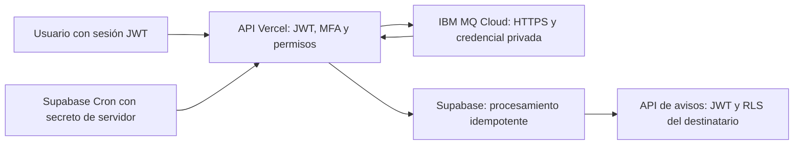

# IBM MQ REST en Vercel y Supabase Cloud

La aplicación usa IBM MQ Cloud como broker mediante su Messaging REST API v3.
Next.js en Vercel ejecuta ciclos acotados; Supabase Cron los invoca por HTTPS.
No se necesita un equipo encendido, puente localhost, cliente MQI ni certificados
de cliente empaquetados en Vercel. El código nativo anterior se conserva en
`workers/` y su documentación histórica en `mensajeria-mq-nativo.md`.

## Autenticación y autorización

El JWT de Supabase se transporta mediante las cookies de sesión existentes.
`requireUser()` valida al usuario contra Supabase Auth y comprueba MFA. No se
aceptan un `userId`, destinatario ni nombres de cola enviados por el navegador.

| Ruta de usuario | Protección |
|---|---|
| `PATCH /api/cards/{id}/schedule` | Sesión JWT/MFA, rol y validaciones de la RPC existente. |
| `POST /api/cards/{id}/complete` | Sesión JWT/MFA y acceso a la tarjeta. |
| `POST /api/boards/{id}/summary` | JWT/MFA, tablero activo y membresía; el servidor toma `userId` de la sesión. |
| `GET /api/notifications` | JWT/MFA, filtro por usuario verificado y RLS con su sesión. |
| `PATCH /api/notifications/{id}` | JWT/MFA, destinatario propio y RLS; solo marca leído. |

El servidor vuelve a comprobar acceso y estado actual al procesar mensajes. La
lectura de una respuesta de resumen recuperada revalida el acceso al tablero.
El JWT no se guarda en MQ, outbox, inbox ni BOQ y no se envía a IBM como credencial.
IBM autentica por separado con IBM MQ username/API key mediante HTTP Basic sobre TLS.

Los endpoints operativos no aceptan una sesión de usuario para ejecutar trabajo
global. `POST /api/mq/tick` exige `Authorization: Bearer <MQ_CRON_SECRET>`;
`GET /api/mq/poc` exige `x-mq-poc-secret: <MQ_POC_SECRET>`. Son secretos independientes
de 32 caracteres o más, exclusivos de servidor. El diagnóstico solo hace GET de
browse; no publica, retira mensajes ni escribe en Supabase. Sus respuestas no
incluyen cuerpos de mensajes ni credenciales. No existe un proxy de colas arbitrarias.

## Qué confirma REST y qué no

Una publicación se registra como `PUBLISHED` cuando IBM devuelve éxito HTTP y un
`ibm-mq-md-messageId` válido. Se solicita `persistent` y expiración en **milisegundos**.
Esto confirma aceptación por MQ, no ejecución del efecto de negocio.

REST no ofrece una unidad de trabajo que el cliente pueda confirmar/revertir
entre llamadas. No se implementan métodos ficticios `commit` o `rollback`. Un POST
sin respuesta puede haber publicado; reintentarlo puede duplicar el evento. El
`eventId` permanece estable y `process_reminder_event` evita duplicar notificaciones.
No se promete entrega exactamente una vez ni una transacción distribuida MQ/SQL.
[Limitaciones oficiales](https://www.ibm.com/docs/en/ibm-mq/9.3.x?topic=mq-messaging-using-rest-api).

## Flujo asíncrono y recuperación

1. `enqueue_due_reminders` prepara eventos en `notification_outbox` de forma atómica.
2. El productor reutiliza reservas/token y confirmación de las RPC de 0007.
3. Publica texto JSON persistente por REST. La reserva no se marca publicada ante
   timeout; se recupera con el mismo evento según la política existente (cinco intentos).
4. El receptor hace **GET browse**, que no retira el mensaje.
5. `mq_rest_capture` guarda cuerpo y metadatos en `mq_rest_inbox`, con unicidad por
   gestor, cola y MsgId. Un ID reutilizado con distinto cuerpo bloquea la retirada.
6. Solo entonces hace **DELETE filtrado por ese MsgId**. Un timeout, expiración o
   caída en este punto deja una copia durable en SQL. Nunca se usa DELETE sin filtro.
7. Una reserva SQL de 120 segundos permite procesar el inbox. Las reservas vencidas
   se recuperan con un token nuevo; un token viejo no puede terminar ni cambiar la salida.
8. El recordatorio se valida y se procesa con `process_reminder_event` de 0008,
   conservando idempotencia, permisos, versión, cancelación y comprobación de vigencia.

Si falla Supabase antes de capturar, no se retira nada de MQ. Si falla después del
efecto de negocio y antes de terminar el inbox, se repite la RPC idempotente. Si se
solapan dos ejecuciones, la captura deduplica y las reservas separan el procesamiento.
Las pausas del proceso o funciones terminadas por presupuesto se recuperan en Cron.

No ejecutar productores/consumidores MQI simultáneamente con el receptor REST: un
consumidor nativo podría retirar el mensaje antes de que REST lo capture. El cambio
debe realizarse con los procesos anteriores detenidos, una vez autorizado el entorno.

## Reintentos, BOQ y DLQ

El procesamiento temporal se reintenta hasta cinco reservas. Se aplica espera
creciente de 5, 10, 20 y 40 segundos, con tope de 300 segundos para fallos posteriores.
Los mensajes malformados, errores permanentes y reintentos agotados generan un
sobre JSON de cuarentena dirigido a `AUTHCDN.REMINDERS.BOQ`.

El sobre contiene `inboxId`, cola/MsgId originales, motivo, intentos y cuerpo original.
Se persiste la salida completa antes del POST a BOQ. Si se pierde la confirmación,
puede repetirse el sobre con el mismo `inboxId`; ese identificador permite deduplicar.
Un fallo persistente de BOQ conserva la salida en SQL y reintenta con espera acotada
sin descartar el original. La BOQ no se consume automáticamente.

Esta es una BOQ de aplicación. No se fabrica una cabecera MQDLH ni se confunde el
sobre JSON con una DLQ nativa. `DEV.DEAD.LETTER.QUEUE` conserva su función de broker;
su asociación como `DEADQ` y permisos deben comprobarse administrativamente. No se
ha cambiado la configuración del gestor. El traslado REST no es un GET/PUT atómico.

REST solo permite leer MQSTR/JMS TextMessage. Un mensaje binario no compatible
requiere intervención administrativa; el endpoint devuelve fallo operativo y no
intenta eliminarlo. Esta limitación queda fuera de la recuperación automática de JSON.

## Request/Reply de resúmenes

La ruta autenticada publica una solicitud persistente en `AUTHCDN.SUMMARY.REQUEST.Q`
con TTL de 30 segundos y ReplyTo fijo. El MsgId devuelto por IBM será el CorrelId
de la respuesta en `AUTHCDN.SUMMARY.REPLY.Q`. Se conservan los IDs v3 con prefijo
`ID:` y 48 dígitos hexadecimales, tanto en filtros como en cabeceras.

La misma invocación cloud ejecuta el respondedor para esa solicitud; Cron puede
recuperarla si se interrumpe. No se espera al siguiente minuto para responder al
usuario. El respondedor valida contrato, ReplyTo permitido, caducidad y membresía,
calcula el resumen y persiste la respuesta exacta antes de publicarla. El cliente
captura también la respuesta antes de retirarla, y comprueba CorrelId, requestId y
boardId. La respuesta tiene TTL de 60 segundos. El presupuesto interactivo es de
20 segundos y las llamadas individuales están acotadas. Un timeout HTTP no equivale
a cancelar una publicación ya aceptada por IBM.

## Expiración, retención y alertas

- Recordatorios: TTL restante según el contrato vigente; el preventivo expira al
  vencimiento y el vencido 24 horas después. No se interpreta TTL como entrega diferida.
- `mq_rest_maintenance` reconcilia recordatorios QUEUED ya caducados aunque el mensaje
  haya expirado en IBM. Conserva el hecho histórico `PUBLISHED` del outbox.
- Inbox DONE y outbox PUBLISHED/CANCELLED/EXPIRED: limpieza después de 30 días.
- Inbox pendiente, salidas de cuarentena y outbox FAILED: se conservan para revisión,
  sin purga automática. Los sobres BOQ se publican sin TTL para evitar perder evidencia;
  su archivado/purga exige intervención explícita. No se eliminan avisos de usuario
  ni recordatorios terminales mediante esta limpieza.
- Fallo de publicación agotado: mantenimiento crea un aviso deduplicado para el
  destinatario, visible en **Avisos**, bajo JWT/MFA y RLS.
- El endpoint de ciclos devuelve 502 y registra `MQ_REST_CYCLE_ERRORS` si detecta
  fallos. `mq_rest_health()` informa pendientes antiguos, cuarentenas y reintentos.
  Configurar alertas de logs en Vercel/Supabase si se necesita aviso externo proactivo.
  El aviso en la aplicación exige que el usuario la consulte; no se ha añadido email,
  otro proveedor ni un monitor que garantice avisar si Vercel y Supabase dejan de funcionar.

## Configuración y puesta en marcha autorizada

Ejemplo versionado sin secretos: [`mq-rest-config.example.txt`](mq-rest-config.example.txt).
`.env.example` contiene el mismo ejemplo para uso local. `.env.local` no se modifica
ni se sube. En Vercel usar variables privadas de servidor; solo las claves públicas
de Supabase y la URL del sitio llevan `NEXT_PUBLIC_`.

`MQ_REST_BASE_URL` es `https://web-<hostname-del-gestor>/ibmmq/rest/v3`, sin puerto
del listener MQI. No se desactiva la validación TLS ni se necesita MQ_TLS_* para REST.
[Formato oficial de IBM Cloud](https://www.ibm.com/docs/en/mq-as-a-service?topic=manager-invoking-queue-rest-apis).

| Cola | Identidad de productor | Identidad de consumidor |
|---|---|---|
| AUTHCDN.REMINDERS.Q | PUT | GET, INQ, BROWSE |
| AUTHCDN.REMINDERS.BOQ | — | PUT |
| AUTHCDN.SUMMARY.REQUEST.Q | PUT | GET, INQ, BROWSE |
| AUTHCDN.SUMMARY.REPLY.Q | GET, INQ, BROWSE | PUT |

Primero validar en un entorno de ensayo autorizado:

1. Instalar dependencias con `pnpm install --frozen-lockfile` (Node 22, pnpm 9.15).
2. Aplicar migraciones existentes 0001–0008 y después 0009 y 0010. Ninguna se aplicó
   remotamente durante este desarrollo. No ejecutar rollback sobre datos productivos.
3. Configurar variables REST y secretos en el entorno de Vercel seleccionado.
4. Ejecutar `node --env-file=.env.local scripts/mq-rest-probe.mjs` para browse sin
   publicar/retirar; o llamar a `/api/mq/poc` con su secreto privado.
5. Detener los procesos MQI anteriores antes de habilitar el consumidor REST.
6. Revisar [`supabase/cron/mq-rest.sql`](../supabase/cron/mq-rest.sql). En Supabase,
   habilitar Cron/pg_net y guardar URL HTTPS y secreto en Vault. El SQL no contiene
   credenciales y no se ejecuta como migración. Activarlo requiere autorización.
7. Invocar el ciclo y verificar avisos desde una sesión de ensayo con permisos.
8. Verificar los códigos HTTP en `net._http_response`: un job Cron exitoso solo prueba
   que pg_net encoló la petición. Supervisar también la salud y las cuarentenas.

Vercel declara un máximo de 60 segundos por función; cada ciclo usa un presupuesto
de 35 segundos y lotes máximos de diez iteraciones. Cada llamada tiene timeout y
comparte el presupuesto restante. La cadencia inicial es de un minuto, con latencia
adicional posible; ajustar capacidad/lotes según las mediciones del entorno.
El secreto de Vault se descifra para enviar el header: administradores con acceso a
las tablas operativas de pg_net pueden ver solicitudes; restringir ese acceso.
[Cron/pg_net oficial](https://supabase.com/docs/guides/functions/schedule-functions).

## Evidencia y pruebas

Se confirmó HTTPS y autenticación de ambas identidades contra el gestor real.
Los GET de consumidor en REMINDERS/REQUEST y productor en REPLY devolvieron 204
después de revisar los permisos. No se hicieron POST/DELETE reales ni cambios de
datos remotos. Esta prueba no demuestra permisos PUT ni recuperación del broker.

`pnpm test:mq:rest` ejecuta pruebas aisladas de transporte HTTP simulado, captura antes
de retirada, fallos inciertos, reintentos, correlación, autorización y persistencia SQL
con PGlite. `pnpm test` incluye además las pruebas heredadas de negocio y MQI simulado.
Las pruebas nativas específicas de Linux se omiten en Windows.

Para completar la evidencia de la evaluación en un entorno autorizado:

| Caso | Qué comprobar con servicios reales |
|---|---|
| Asíncrono | Programar tarjeta, ejecutar Cron y recibir exactamente un aviso visible. |
| Síncrono | Dos resúmenes simultáneos; cada sesión recibe su requestId/tablero. |
| Confirmación | PUBLISHED solo tras HTTP exitoso; resultado incierto conserva recuperación. |
| Interrupción | Cortar después de captura y después de RPC; recuperar sin perder ni duplicar aviso. |
| Reintentos/BOQ | Cinco fallos y cuarentena; fallar PUT a BOQ y recuperar la salida persistida. |
| TTL/retención | Expirar mensaje y reconciliar SQL; conservar pendientes/cuarentenas durante limpieza. |
| Seguridad | JWT ausente/caducado, MFA pendiente, otro usuario y miembro retirado: acceso rechazado. |
| Alertas | Agotar publicación y observar aviso; comprobar 502/log y supervisión de pg_net. |

Publish/Subscribe continúa fuera del alcance acordado. La evidencia anterior de
MQCMIT/MQBACK pertenece al transporte nativo histórico y no se presenta como prueba REST.
