# EV2 — revalidación del preview tras reorganizar IBM MQ

Este es el documento principal para los diez requisitos de la tabla acordada. Publish/Subscribe quedó excluido del alcance desde el inicio. Cada requisito conserva su nombre, explica cómo funciona y compara el resultado esperado con el obtenido. Las evidencias corresponden a nuevas pruebas ejecutadas el 20 de octubre de 2026 contra el preview https://auth-pawu47st3-anthonys-projects-0d8acba7.vercel.app. No se reutilizan como pruebas actuales las respuestas ni capturas de la ronda anterior.

Rama local: refactor/estructura-ibm-mq, commit 56a5502. No se obtuvo el hash de build remoto para compararlo con ese commit. Arquitectura: API Vercel con JWT, MFA y permisos → integración REST oficial de IBM MQ Cloud → Supabase Cloud. Los procesadores automáticos usan secreto de máquina y se ejecutan mediante Supabase Cron. No se incluyen credenciales ni certificados.

**Cómo leer el resultado:** «Correcto» significa que la evidencia coincide con lo esperado para la prueba descrita. Un 504, 502 o 501 puede ser el rechazo previsto en una prueba de fallo; no se presenta como éxito de una operación normal.

Los diez requisitos tienen evidencia satisfactoria en el alcance descrito. ACK se valida mediante HTTP y transacciones SQL; no con MQCMIT/MQBACK. La recuperación interrumpe una RPC SQL concreta, no reinicia IBM. Retención usa antigüedad simulada. Cada apartado deja estas condiciones explícitas para no atribuir a la prueba más de lo observado. Se conserva además NATIVE-HEADER-PREMATURE-READ: el arnés leyó una pestaña de consola antes de terminar su carga; la lectura completa posterior y la captura verificaron el enrutamiento. El Cron permanente del alias anterior comparte las mismas colas y base. La auditoría de la fase D explica un 200 sin trabajo en la quinta llamada manual: el Cron concurrente ya había ejecutado ese intento y el contador avanzó a cinco. La condición de prueba original exigía indebidamente 502 en todas las llamadas; el registro original FAIL se conserva y no se presenta como un fallo de pérdida de mensajes. El diagnóstico opcional /api/mq/poc no se probó con credencial válida porque MQ_POC_SECRET no existe en el archivo local; su rechazo 401 no bloqueó los flujos funcionales comprobados.

## Matriz de los diez requisitos

| Requisito | Prueba realizada | Resultado obtenido | Veredicto |
|---|---|---|---|

| IBM MQ como broker de mensajería | Publicar un evento de ensayo en AUTHCDN.REMINDERS.Q mediante POST REST. | POST 201 y GET 200. El MsgId de publicación coincide con el leído, y el encabezado persistence indica persistent. | Correcto en el alcance descrito |

| Mensajería asíncrona | Programar un recordatorio con PATCH autenticado mediante JWT. | Programación 200 y aviso normal visible. En el ensayo autónomo, el mismo eventId aparece en outbox PUBLISHED, inbox DONE y la notificación; el recordatorio preventivo queda PROCESSED. | Correcto en el alcance descrito |

| Mensajería síncrona | Enviar POST autenticado al resumen de un tablero. | Resumen 200 con totalActive=3 y pending=3 para el estado de ese tablero en ese momento. CorrelId de respuesta igual al MsgId de solicitud. La demora produjo 504 GATEWAY_TIMEOUT y la petición posterior devolvió 200. | Correcto en el alcance descrito |

| ACK / confirmaciones | Confirmar el POST de publicación. | Publicación 201, captura 200 y DELETE 200. El cuerpo quedó PENDING después de retirarlo de MQ. En la interrupción SQL se observaron cero avisos parciales y, al recuperar, un único aviso. | Correcto en el alcance descrito |

| Durabilidad de mensajes | Verificar persistence=persistent en una lectura real de IBM. | Persistencia IBM confirmada. El backend SQL fue terminado; quedó PENDING y cero avisos. Otro tick respondió 200, terminó DONE con attempts=2 y creó exactamente una notificación. | Correcto en el alcance descrito |

| DLQ / gestión de mensajes fallidos | Enviar JSON mal formado, contrato inválido, referencias inconsistentes y ReplyTo no permitido. | BOQ mostró MALFORMED_JSON, INVALID_REMINDER, PERMANENT_ERROR, INVALID_REPLY_DESTINATION y RETRIES_EXHAUSTED. La prueba añadió un mensaje nuevo a la DLQ: mensaje generado por AUTHCDNQM con MQDLH/MQTM, motivo MQRC_Q_FULL y destino INIT de ensayo. | Correcto en el alcance descrito |

| Reintentos de procesamiento | Provocar un error SQL P0001 solo al insertar el aviso de una tarjeta propia. | Se contaron cinco fallos RPC, inbox attempts=5, salida QUARANTINE terminada y cero avisos. La consola IBM mostró el mensaje BOQ con attempts=5. La salida con destino corregido terminó después de cinco errores sin perder el cuerpo. | Correcto en el alcance descrito |

| Políticas de retención | Preparar tres registros técnicos propios con 40 días de antigüedad: DONE ordinario, PENDING y cuarentena. | Mantenimiento respondió 200 con purgedInbox=1. El DONE ordinario desapareció; la consulta devolvió PENDING y cuarentena. El trabajo de mantenimiento fue verificado activo cada minuto. | Correcto en el alcance descrito |

| Expiración de mensajes | Publicar un mensaje persistente con TTL de 1200 ms. | El mensaje fue visible con expiración restante y luego devolvió 204. La reconciliación dejó el recordatorio EXPIRED y el outbox PUBLISHED. | Correcto en el alcance descrito |

| Alertas de fallos | Preparar un evento válido con TTL vencido: la validación del transporte rechaza el envío antes de efectuar un POST a IBM. | Outbox FAILED con attempts=5. Mantenimiento creó una alerta; los ciclos siguientes conservaron una sola. GET /api/notifications con sesión válida respondió 200 y contenía ese mismo id de aviso. | Correcto en el alcance descrito |


<a id="r1"></a>

## 1. IBM MQ como broker de mensajería

**Cómo funciona.** IBM MQ Cloud recibe y conserva los mensajes publicados por la API REST oficial. Vercel usa credenciales privadas; las operaciones del usuario pasan primero por JWT y permisos.

**Prueba realizada.**

1. Publicar un evento de ensayo en AUTHCDN.REMINDERS.Q mediante POST REST.
2. Guardar el MsgId devuelto por IBM.
3. Examinar ese mismo MsgId mediante GET, sin retirarlo.

**Resultado esperado.** IBM acepta el envío con HTTP 201, asigna un MsgId y devuelve el mismo evento con HTTP 200 en la lectura.

**Resultado obtenido.** POST 201 y GET 200. El MsgId de publicación coincide con el leído, y el encabezado persistence indica persistent.

**Veredicto: correcto en el alcance descrito.**

**Alcance de esta evidencia.** La prueba demuestra uso real de IBM MQ como broker. No se usa una cola en memoria para sustituirlo.

### Respuestas y comprobación

El siguiente extracto selecciona campos y estados de los registros originales. Los nombres de agrupación son explicativos; las respuestas completas, sin esa selección, se conservan debajo.

```json
{
  "POST": {
    "status": 201,
    "metadata": {
      "ibm-mq-md-messageId": "ID:414d51204155544843444e514d2020203736d56a21b32140"
    }
  },
  "GET": {
    "status": 200,
    "metadata": {
      "ibm-mq-md-messageId": "ID:414d51204155544843444e514d2020203736d56a21b32140",
      "ibm-mq-md-persistence": "persistent",
      "ibm-mq-md-expiry": "unlimited"
    }
  }
}
```

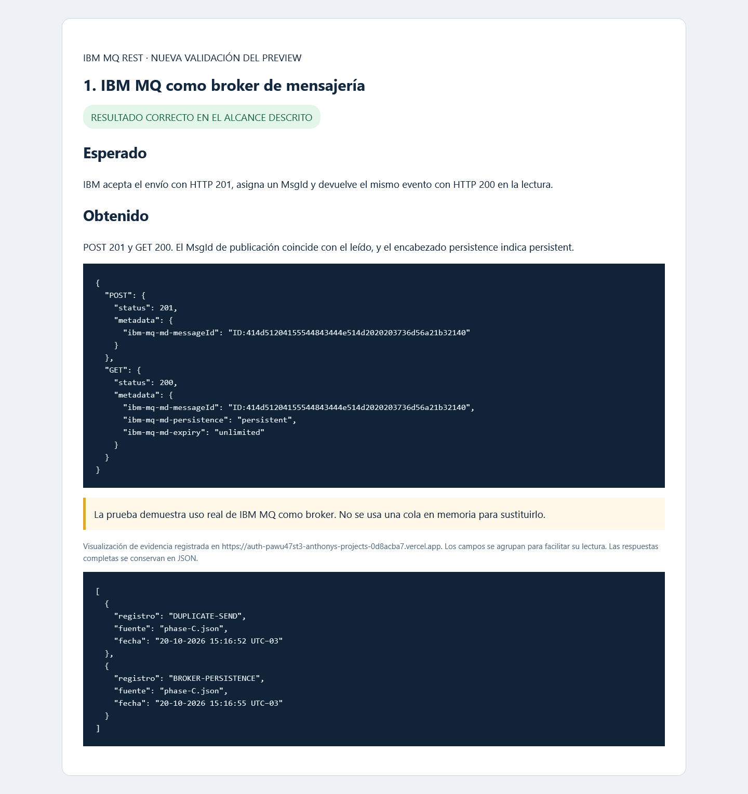

*Vista generada de las respuestas de esta ronda; no es una captura de IBM Console.*

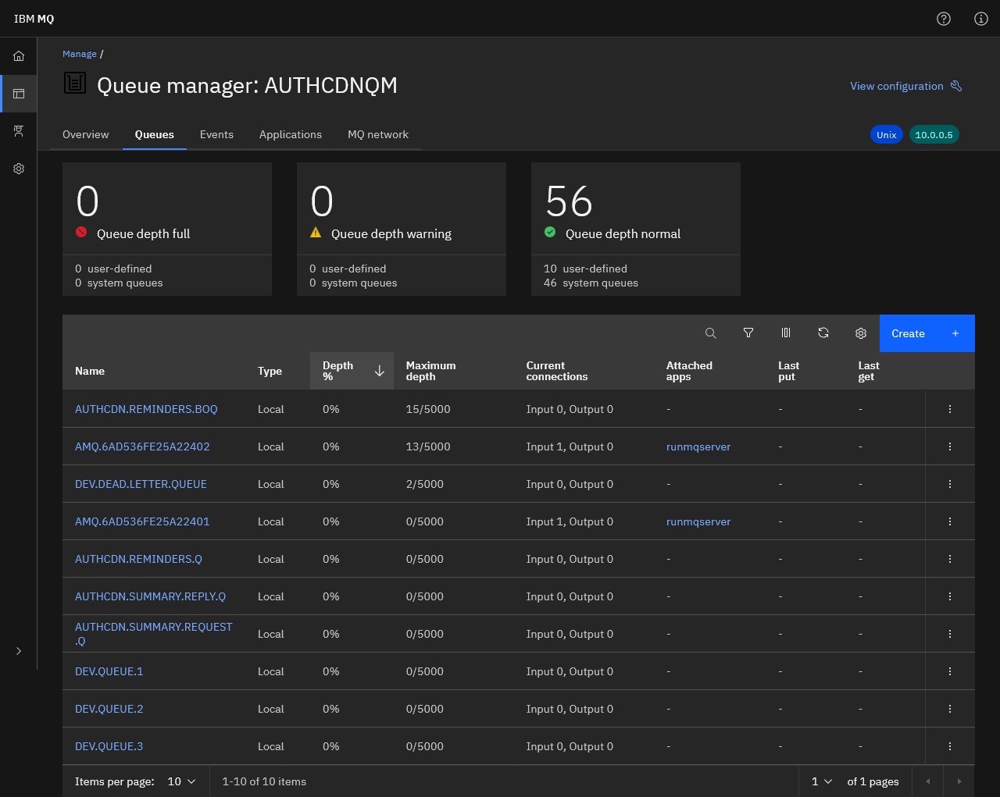

*Captura real de IBM Console: queue manager y colas del proyecto después de limpiar el ensayo.*

### Evidencias originales de este requisito

**`DUPLICATE-SEND` · 20-10-2026 15:16:52 UTC−03 · PASS.** [Registro original](respuestas/phase-C.json).

<details>
<summary>Ver petición, respuesta o consulta y estado completo registrado</summary>

```json
{
  "request": {
    "role": "producer",
    "method": "POST",
    "queue": "AUTHCDN.REMINDERS.Q",
    "selector": {},
    "body": {
      "cardId": "781ea7cf-f469-44eb-9eeb-ffd32f244912",
      "eventId": "baa9427c-8199-4364-beb6-02299000ad5e",
      "eventType": "TASK_REMINDER_DUE",
      "expiresAt": "2026-10-20T18:36:15.957Z",
      "occurredAt": "2026-10-20T18:16:29.787Z",
      "reminderId": "2438f624-0c7a-4a37-ab5a-f371bb625646",
      "workspaceId": "1f4af17f-2074-4bcc-bcb2-ed118f3b84df",
      "schemaVersion": 1,
      "scheduleVersion": 2
    }
  },
  "status": 201,
  "body": "",
  "metadata": {
    "ibm-mq-md-messageId": "ID:414d51204155544843444e514d2020203736d56a21b32140"
  }
}
```

</details>

**`BROKER-PERSISTENCE` · 20-10-2026 15:16:55 UTC−03 · PASS.** [Registro original](respuestas/phase-C.json).

<details>
<summary>Ver petición, respuesta o consulta y estado completo registrado</summary>

```json
{
  "request": {
    "role": "consumer",
    "method": "GET",
    "queue": "AUTHCDN.REMINDERS.Q",
    "selector": {
      "id": "ID:414d51204155544843444e514d2020203736d56a21b32140"
    },
    "body": null
  },
  "status": 200,
  "body": {
    "cardId": "781ea7cf-f469-44eb-9eeb-ffd32f244912",
    "eventId": "baa9427c-8199-4364-beb6-02299000ad5e",
    "eventType": "TASK_REMINDER_DUE",
    "expiresAt": "2026-10-20T18:36:15.957Z",
    "occurredAt": "2026-10-20T18:16:29.787Z",
    "reminderId": "2438f624-0c7a-4a37-ab5a-f371bb625646",
    "workspaceId": "1f4af17f-2074-4bcc-bcb2-ed118f3b84df",
    "schemaVersion": 1,
    "scheduleVersion": 2
  },
  "metadata": {
    "ibm-mq-md-messageId": "ID:414d51204155544843444e514d2020203736d56a21b32140",
    "ibm-mq-md-persistence": "persistent",
    "ibm-mq-md-expiry": "unlimited"
  }
}
```

</details>


<a id="r2"></a>

## 2. Mensajería asíncrona

**Cómo funciona.** Programar la tarjeta guarda el trabajo en Supabase. Al llegar la fecha, el productor publica el evento en IBM; el consumidor cloud lo captura y process_reminder_event crea el aviso. La respuesta al usuario no espera a esa entrega futura.

**Prueba realizada.**

1. Programar un recordatorio con PATCH autenticado mediante JWT.
2. Esperar notifyAt y ejecutar el procesamiento cloud.
3. Consultar los avisos del usuario y relacionar eventId entre outbox, inbox y notificación.
4. Repetir con Supabase Cron sin invocar tick manualmente después de programar.

**Resultado esperado.** La programación responde 200. Después aparece un aviso del usuario, con outbox PUBLISHED, inbox DONE y recordatorio PROCESSED. La entrega autónoma no depende de un trabajador local.

**Resultado obtenido.** Programación 200 y aviso normal visible. En el ensayo autónomo, el mismo eventId aparece en outbox PUBLISHED, inbox DONE y la notificación; el recordatorio preventivo queda PROCESSED.

**Veredicto: correcto en el alcance descrito.**

**Alcance de esta evidencia.** La profundidad de la cola principal puede volver a cero porque el consumidor ya retiró el mensaje. El Cron permanente sigue apuntando al alias anterior. En esta ronda se programó un ensayo temporal dirigido expresamente a este nuevo preview, sin modificar los dos trabajos permanentes.

### Respuestas y comprobación

El siguiente extracto selecciona campos y estados de los registros originales. Los nombres de agrupación son explicativos; las respuestas completas, sin esa selección, se conservan debajo.

```json
{
  "scheduleHttp": 200,
  "notificationsHttp": 200,
  "autonomousEventId": "54a535d8-296e-4b80-ad63-3ae2cfe0f335",
  "outboxStatus": "PUBLISHED",
  "inboxStatus": "DONE",
  "notification": {
    "id": "9195abe7-02de-4a94-90de-707df8e16bb6",
    "event_id": "54a535d8-296e-4b80-ad63-3ae2cfe0f335",
    "message": "La tarjeta \"MQ-E2E-20261020181439 cron-autonomo\" vence el 2026-10-20T18:59:17Z.",
    "created_at": "2026-10-20T18:30:16.870428+00:00"
  }
}
```

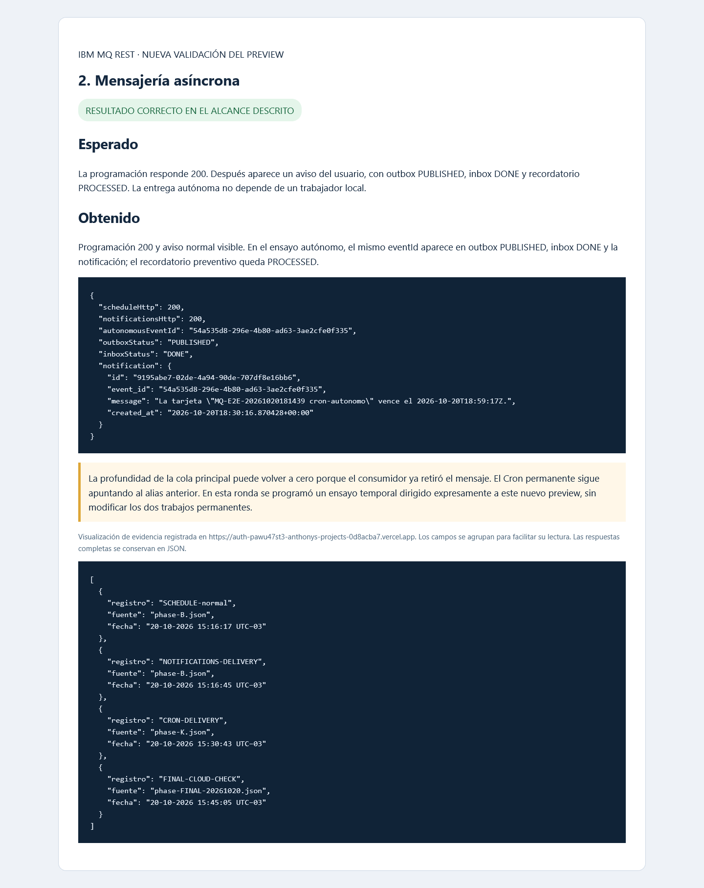

*Vista generada de las respuestas de esta ronda; no es una captura de IBM Console.*

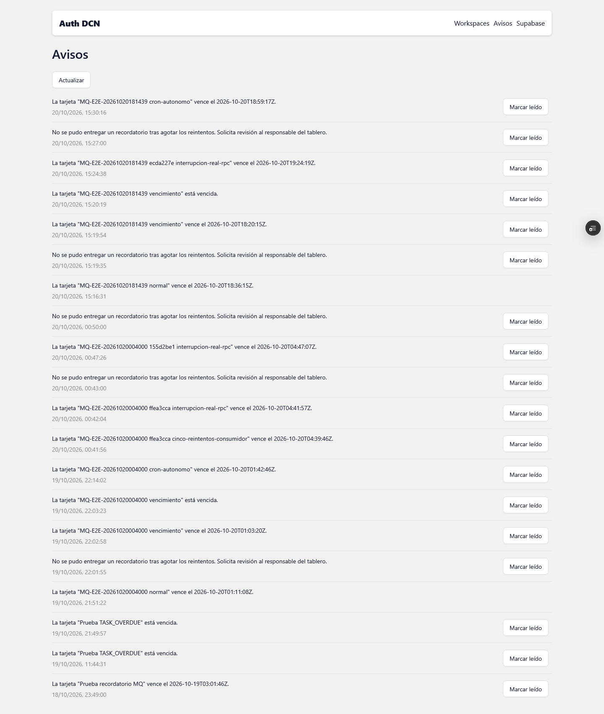

*Captura real de la aplicación en Firefox; incluye el aviso cron-autonomo.*

### Evidencias originales de este requisito

**`SCHEDULE-normal` · 20-10-2026 15:16:17 UTC−03 · PASS.** [Registro original](respuestas/phase-B.json).

<details>
<summary>Ver petición, respuesta o consulta y estado completo registrado</summary>

```json
{
  "request": {
    "method": "PATCH",
    "path": "/api/cards/781ea7cf-f469-44eb-9eeb-ffd32f244912/schedule",
    "body": {
      "expectedVersion": 1,
      "dueAt": "2026-10-20T18:36:15.957Z",
      "notifyAt": "2026-10-20T18:16:21.957Z",
      "assigneeIds": []
    }
  },
  "status": 200,
  "body": {
    "card": {
      "id": "781ea7cf-f469-44eb-9eeb-ffd32f244912",
      "due_at": "2026-10-20T18:36:15.957+00:00",
      "notify_at": "2026-10-20T18:16:21.957+00:00",
      "assignee_ids": [],
      "completed_at": null,
      "schedule_version": 2
    }
  }
}
```

</details>

**`NOTIFICATIONS-DELIVERY` · 20-10-2026 15:16:45 UTC−03 · PASS.** [Registro original](respuestas/phase-B.json).

<details>
<summary>Ver petición, respuesta o consulta y estado completo registrado</summary>

```json
{
  "request": {
    "method": "GET",
    "path": "/api/notifications",
    "body": null
  },
  "status": 200,
  "body": {
    "notifications": [
      {
        "id": "34416025-503d-47d6-9639-ac8f97c6abe5",
        "card_id": "781ea7cf-f469-44eb-9eeb-ffd32f244912",
        "message": "La tarjeta \"MQ-E2E-20261020181439 normal\" vence el 2026-10-20T18:36:15Z.",
        "created_at": "2026-10-20T18:16:31.117028+00:00",
        "read_at": null
      }
    ]
  }
}
```

</details>

**`CRON-DELIVERY` · 20-10-2026 15:30:43 UTC−03 · PASS.** [Registro original](respuestas/phase-K.json).

<details>
<summary>Ver petición, respuesta o consulta y estado completo registrado</summary>

```json
{
  "scheduledAt": "2026-10-20T18:29:19.177Z",
  "notifications": {
    "status": 200,
    "body": [
      {
        "id": "9195abe7-02de-4a94-90de-707df8e16bb6",
        "event_id": "54a535d8-296e-4b80-ad63-3ae2cfe0f335",
        "message": "La tarjeta \"MQ-E2E-20261020181439 cron-autonomo\" vence el 2026-10-20T18:59:17Z.",
        "created_at": "2026-10-20T18:30:16.870428+00:00"
      }
    ]
  },
  "reminders": {
    "status": 200,
    "body": [
      {
        "id": "0a222310-79f9-4b1a-8c1c-1acba2348a9f",
        "kind": "TASK_OVERDUE",
        "status": "SCHEDULED",
        "processed_at": null
      },
      {
        "id": "75fe77ec-7393-4433-a412-0cf9cbf17b9f",
        "kind": "TASK_REMINDER_DUE",
        "status": "PROCESSED",
        "processed_at": "2026-10-20T18:30:16.87183+00:00"
      }
    ]
  },
  "outbox": {
    "status": 200,
    "body": [
      {
        "event_id": "54a535d8-296e-4b80-ad63-3ae2cfe0f335",
        "status": "PUBLISHED",
        "published_at": "2026-10-20T18:30:16.180806+00:00",
        "payload": {
          "cardId": "26d1cf68-ee61-472c-a2fb-16325e12ec4b",
          "eventId": "54a535d8-296e-4b80-ad63-3ae2cfe0f335",
          "eventType": "TASK_REMINDER_DUE",
          "expiresAt": "2026-10-20T18:59:17.793Z",
          "occurredAt": "2026-10-20T18:30:15.463Z",
          "reminderId": "75fe77ec-7393-4433-a412-0cf9cbf17b9f",
          "workspaceId": "1f4af17f-2074-4bcc-bcb2-ed118f3b84df",
          "schemaVersion": 1,
          "scheduleVersion": 2
        }
      }
    ]
  },
  "inbox": {
    "status": 200,
    "body": [
      {
        "id": "7e33bafc-82d8-4e5a-a816-c678f8464dbc",
        "message_id": "ID:414D51204155544843444E514D2020203736D56A2FB32140",
        "state": "DONE",
        "attempts": 1,
        "body": "{\"schemaVersion\":1,\"eventId\":\"54a535d8-296e-4b80-ad63-3ae2cfe0f335\",\"eventType\":\"TASK_REMINDER_DUE\",\"reminderId\":\"75fe77ec-7393-4433-a412-0cf9cbf17b9f\",\"cardId\":\"26d1cf68-ee61-472c-a2fb-16325e12ec4b\",\"workspaceId\":\"1f4af17f-2074-4bcc-bcb2-ed118f3b84df\",\"scheduleVersion\":2,\"occurredAt\":\"2026-10-20T18:30:15.463Z\",\"expiresAt\":\"2026-10-20T18:59:17.793Z\"}",
        "created_at": "2026-10-20T18:30:16.478328+00:00",
        "completed_at": "2026-10-20T18:30:17.073727+00:00"
      }
    ]
  }
}
```

</details>

**`FINAL-CLOUD-CHECK` · 20-10-2026 15:45:05 UTC−03 · PASS.** [Registro original](respuestas/phase-FINAL-20261020.json).

<details>
<summary>Ver petición, respuesta o consulta y estado completo registrado</summary>

```json
{
  "activeTestReminders": 0,
  "health": {
    "deliveryRetries": 0,
    "failedPublications": 0,
    "pendingInbox": 0,
    "quarantined": 13,
    "staleInbox": 0
  },
  "jobs": [
    {
      "active": true,
      "name": "authcdn-mq-rest-minute",
      "schedule": "* * * * *"
    },
    {
      "active": true,
      "name": "authcdn-mq-maintenance",
      "schedule": "* * * * *"
    }
  ],
  "origin": "https://auth-pawu47st3-anthonys-projects-0d8acba7.vercel.app",
  "permanentTarget": "https://auth-cdn-git-feature-mq-consumidor-anthonys-projects-0d8acba7.vercel.app",
  "temporaryTables": 0,
  "temporaryVaultEntries": 0,
  "testFaultFunctions": 0,
  "testFaultTriggers": 0
}
```

</details>


<a id="r3"></a>

## 3. Mensajería síncrona

**Cómo funciona.** El usuario solicita un resumen y espera la respuesta. Vercel publica en AUTHCDN.SUMMARY.REQUEST.Q; el responder cloud contesta por AUTHCDN.SUMMARY.REPLY.Q. requestId identifica la operación y CorrelId enlaza la respuesta con el MsgId de la solicitud.

**Prueba realizada.**

1. Enviar POST autenticado al resumen de un tablero.
2. Comprobar estadísticas, requestId y correlación entre las dos colas.
3. Enviar solicitudes simultáneas y verificar que no se mezclan sus respuestas.
4. Demorar solo el tablero de ensayo hasta agotar la espera y retirar luego esa demora.

**Resultado esperado.** En operación normal, HTTP 200 con el resumen correcto. Cada respuesta corresponde a su solicitud. Si no llega a tiempo, HTTP 504; tras resolver la demora, una nueva solicitud vuelve a responder 200.

**Resultado obtenido.** Resumen 200 con totalActive=3 y pending=3 para el estado de ese tablero en ese momento. CorrelId de respuesta igual al MsgId de solicitud. La demora produjo 504 GATEWAY_TIMEOUT y la petición posterior devolvió 200.

**Veredicto: correcto en el alcance descrito.**

**Alcance de esta evidencia.** El timeout se provocó con una demora SQL restringida al tablero de ensayo. La duración medida de extremo a extremo fue 28.765 ms; incluye trabajo previo y red. La foto de resumen corresponde a un momento posterior con más tarjetas y no se usa para justificar los conteos de la primera respuesta.

### Respuestas y comprobación

El siguiente extracto selecciona campos y estados de los registros originales. Los nombres de agrupación son explicativos; las respuestas completas, sin esa selección, se conservan debajo.

```json
{
  "normal": {
    "request": {
      "method": "POST",
      "path": "/api/boards/9dbe1264-eccd-4342-a7d8-3524727a333a/summary",
      "body": null
    },
    "status": 200,
    "body": {
      "summary": {
        "totalActive": 3,
        "pending": 3,
        "completed": 0,
        "overdue": 0
      },
      "requestId": "c9b85d2e-0d6b-47a5-b673-5005da441128",
      "generatedAt": "2026-10-20T18:15:02.110Z"
    }
  },
  "correlation": {
    "requestId": "c9b85d2e-0d6b-47a5-b673-5005da441128",
    "requestMessageId": "ID:414D51204155544843444E514D2020203736D56A12491E40",
    "replyCorrelationId": "ID:414D51204155544843444E514D2020203736D56A12491E40"
  },
  "timeout": {
    "request": {
      "method": "POST",
      "path": "/api/boards/5e3fddbf-3724-45dd-a1e4-664416ab4136/summary",
      "body": null
    },
    "elapsedMs": 28765,
    "status": 504,
    "body": {
      "error": {
        "code": "GATEWAY_TIMEOUT",
        "message": "El resumen superó el tiempo de espera.",
        "details": {
          "code": "GATEWAY_TIMEOUT"
        }
      }
    }
  },
  "afterRecovery": {
    "request": {
      "method": "POST",
      "path": "/api/boards/5e3fddbf-3724-45dd-a1e4-664416ab4136/summary",
      "body": null
    },
    "elapsedMs": 4134,
    "status": 200,
    "body": {
      "summary": {
        "totalActive": 0,
        "pending": 0,
        "completed": 0,
        "overdue": 0
      },
      "requestId": "b91ba2cd-6e20-4c33-89e3-34dff56ef1ba",
      "generatedAt": "2026-10-20T18:22:32.520Z"
    }
  }
}
```

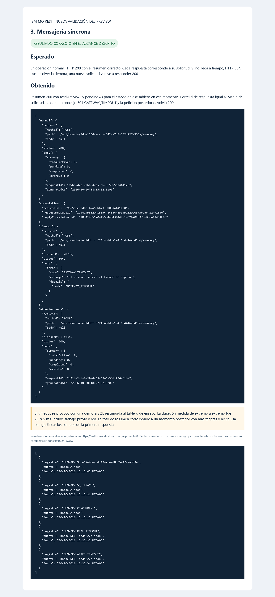

*Vista generada de las respuestas de esta ronda; no es una captura de IBM Console.*

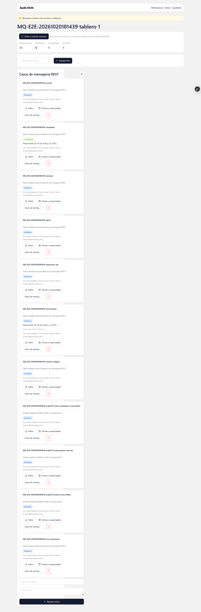

*Captura real de otro resumen de esta misma ronda, con el conteo visible en ese momento.*

### Evidencias originales de este requisito

**`SUMMARY-9dbe1264-eccd-4342-a7d8-3524727a333a` · 20-10-2026 15:15:05 UTC−03 · PASS.** [Registro original](respuestas/phase-A.json).

<details>
<summary>Ver petición, respuesta o consulta y estado completo registrado</summary>

```json
{
  "request": {
    "method": "POST",
    "path": "/api/boards/9dbe1264-eccd-4342-a7d8-3524727a333a/summary",
    "body": null
  },
  "status": 200,
  "body": {
    "summary": {
      "totalActive": 3,
      "pending": 3,
      "completed": 0,
      "overdue": 0
    },
    "requestId": "c9b85d2e-0d6b-47a5-b673-5005da441128",
    "generatedAt": "2026-10-20T18:15:02.110Z"
  }
}
```

</details>

**`SUMMARY-SQL-TRACE` · 20-10-2026 15:15:21 UTC−03 · PASS.** [Registro original](respuestas/phase-A.json).

<details>
<summary>Ver petición, respuesta o consulta y estado completo registrado</summary>

```json
{
  "status": 200,
  "body": [
    {
      "id": "caf934e4-ae80-4d7f-bcbc-a10a6e6524d1",
      "queue_name": "AUTHCDN.SUMMARY.REPLY.Q",
      "message_id": "ID:414D51204155544843444E514D2020203736D56A1FB32140",
      "correlation_id": "ID:414D51204155544843444E514D2020203736D56A15491E40",
      "reply_to": null,
      "state": "DONE",
      "attempts": 1,
      "output_attempts": 0,
      "body": "{\"schemaVersion\":1,\"requestId\":\"43d58ec1-bd76-40a9-9104-fde5aea2620b\",\"boardId\":\"9dbe1264-eccd-4342-a7d8-3524727a333a\",\"generatedAt\":\"2026-10-20T18:15:11.058Z\",\"status\":\"OK\",\"stats\":{\"totalActive\":3,\"pending\":3,\"completed\":0,\"overdue\":0}}",
      "output": null,
      "created_at": "2026-10-20T18:15:11.507252+00:00"
    },
    {
      "id": "18807548-f031-4c2d-b0a8-0af4bce58b35",
      "queue_name": "AUTHCDN.SUMMARY.REPLY.Q",
      "message_id": "ID:414D51204155544843444E514D2020203736D56A17491E40",
      "correlation_id": "ID:414D51204155544843444E514D2020203736D56A16491E40",
      "reply_to": null,
      "state": "DONE",
      "attempts": 1,
      "output_attempts": 0,
      "body": "{\"schemaVersion\":1,\"requestId\":\"96689907-9cd3-48ec-9851-a906ca83a66f\",\"boardId\":\"5e3fddbf-3724-45dd-a1e4-664416ab4136\",\"generatedAt\":\"2026-10-20T18:15:10.886Z\",\"status\":\"OK\",\"stats\":{\"totalActive\":0,\"pending\":0,\"completed\":0,\"overdue\":0}}",
      "output": null,
      "created_at": "2026-10-20T18:15:11.314064+00:00"
    },
    {
      "id": "478bc0a3-0358-4170-bcb9-2092c7c94d75",
      "queue_name": "AUTHCDN.SUMMARY.REQUEST.Q",
      "message_id": "ID:414D51204155544843444E514D2020203736D56A16491E40",
      "correlation_id": null,
      "reply_to": "AUTHCDN.SUMMARY.REPLY.Q@AUTHCDNQM",
      "state": "DONE",
      "attempts": 1,
      "output_attempts": 1,
      "body": "{\"schemaVersion\":1,\"requestId\":\"96689907-9cd3-48ec-9851-a906ca83a66f\",\"boardId\":\"5e3fddbf-3724-45dd-a1e4-664416ab4136\",\"userId\":\"45e0ff79-940c-4230-bd97-bb9e0572e0f0\",\"createdAt\":\"2026-10-20T18:15:10.057Z\",\"expiresAt\":\"2026-10-20T18:15:40.057Z\"}",
      "output": {
        "body": "{\"schemaVersion\":1,\"requestId\":\"96689907-9cd3-48ec-9851-a906ca83a66f\",\"boardId\":\"5e3fddbf-3724-45dd-a1e4-664416ab4136\",\"generatedAt\":\"2026-10-20T18:15:10.886Z\",\"status\":\"OK\",\"stats\":{\"totalActive\":0,\"pending\":0,\"completed\":0,\"overdue\":0}}",
        "queue": "AUTHCDN.SUMMARY.REPLY.Q",
        "expiresAt": "2026-10-20T18:16:10.886Z",
        "correlationId": "ID:414D51204155544843444E514D2020203736D56A16491E40"
      },
      "created_at": "2026-10-20T18:15:10.225511+00:00"
    },
    {
      "id": "52dc46fc-1a2f-4eea-94b5-d1dfdd7644f0",
      "queue_name": "AUTHCDN.SUMMARY.REQUEST.Q",
      "message_id": "ID:414D51204155544843444E514D2020203736D56A15491E40",
      "correlation_id": null,
      "reply_to": "AUTHCDN.SUMMARY.REPLY.Q@AUTHCDNQM",
      "state": "DONE",
      "attempts": 1,
      "output_attempts": 1,
      "body": "{\"schemaVersion\":1,\"requestId\":\"43d58ec1-bd76-40a9-9104-fde5aea2620b\",\"boardId\":\"9dbe1264-eccd-4342-a7d8-3524727a333a\",\"userId\":\"45e0ff79-940c-4230-bd97-bb9e0572e0f0\",\"createdAt\":\"2026-10-20T18:15:09.655Z\",\"expiresAt\":\"2026-10-20T18:15:39.655Z\"}",
      "output": {
        "body": "{\"schemaVersion\":1,\"requestId\":\"43d58ec1-bd76-40a9-9104-fde5aea2620b\",\"boardId\":\"9dbe1264-eccd-4342-a7d8-3524727a333a\",\"generatedAt\":\"2026-10-20T18:15:11.058Z\",\"status\":\"OK\",\"stats\":{\"totalActive\":3,\"pending\":3,\"completed\":0,\"overdue\":0}}",
        "queue": "AUTHCDN.SUMMARY.REPLY.Q",
        "expiresAt": "2026-10-20T18:16:11.058Z",
        "correlationId": "ID:414D51204155544843444E514D2020203736D56A15491E40"
      },
      "created_at": "2026-10-20T18:15:10.015874+00:00"
    },
    {
      "id": "9b9ad4e6-bb65-4b96-81e9-6830b81b6533",
      "queue_name": "AUTHCDN.SUMMARY.REPLY.Q",
      "message_id": "ID:414D51204155544843444E514D2020203736D56A1EB32140",
      "correlation_id": "ID:414D51204155544843444E514D2020203736D56A14491E40",
      "reply_to": null,
      "state": "DONE",
      "attempts": 1,
      "output_attempts": 0,
      "body": "{\"schemaVersion\":1,\"requestId\":\"539dcd1c-60d0-4214-9390-2ab08840a3e0\",\"boardId\":\"5e3fddbf-3724-45dd-a1e4-664416ab4136\",\"generatedAt\":\"2026-10-20T18:15:07.223Z\",\"status\":\"OK\",\"stats\":{\"totalActive\":0,\"pending\":0,\"completed\":0,\"overdue\":0}}",
      "output": null,
      "created_at": "2026-10-20T18:15:07.630665+00:00"
    },
    {
      "id": "f104dae3-aa90-431d-9433-cfd367d477b0",
      "queue_name": "AUTHCDN.SUMMARY.REQUEST.Q",
      "message_id": "ID:414D51204155544843444E514D2020203736D56A14491E40",
      "correlation_id": null,
      "reply_to": "AUTHCDN.SUMMARY.REPLY.Q@AUTHCDNQM",
      "state": "DONE",
      "attempts": 1,
      "output_attempts": 1,
      "body": "{\"schemaVersion\":1,\"requestId\":\"539dcd1c-60d0-4214-9390-2ab08840a3e0\",\"boardId\":\"5e3fddbf-3724-45dd-a1e4-664416ab4136\",\"userId\":\"45e0ff79-940c-4230-bd97-bb9e0572e0f0\",\"createdAt\":\"2026-10-20T18:15:06.447Z\",\"expiresAt\":\"2026-10-20T18:15:36.447Z\"}",
      "output": {
        "body": "{\"schemaVersion\":1,\"requestId\":\"539dcd1c-60d0-4214-9390-2ab08840a3e0\",\"boardId\":\"5e3fddbf-3724-45dd-a1e4-664416ab4136\",\"generatedAt\":\"2026-10-20T18:15:07.223Z\",\"status\":\"OK\",\"stats\":{\"totalActive\":0,\"pending\":0,\"completed\":0,\"overdue\":0}}",
        "queue": "AUTHCDN.SUMMARY.REPLY.Q",
        "expiresAt": "2026-10-20T18:16:07.223Z",
        "correlationId": "ID:414D51204155544843444E514D2020203736D56A14491E40"
      },
      "created_at": "2026-10-20T18:15:06.593415+00:00"
    },
    {
      "id": "ad549f5d-6ad1-4dcb-9897-832de2b4258d",
      "queue_name": "AUTHCDN.SUMMARY.REPLY.Q",
      "message_id": "ID:414D51204155544843444E514D2020203736D56A13491E40",
      "correlation_id": "ID:414D51204155544843444E514D2020203736D56A12491E40",
      "reply_to": null,
      "state": "DONE",
      "attempts": 1,
      "output_attempts": 0,
      "body": "{\"schemaVersion\":1,\"requestId\":\"c9b85d2e-0d6b-47a5-b673-5005da441128\",\"boardId\":\"9dbe1264-eccd-4342-a7d8-3524727a333a\",\"generatedAt\":\"2026-10-20T18:15:02.110Z\",\"status\":\"OK\",\"stats\":{\"totalActive\":3,\"pending\":3,\"completed\":0,\"overdue\":0}}",
      "output": null,
      "created_at": "2026-10-20T18:15:02.832968+00:00"
    },
    {
      "id": "d08e2b51-9fae-40d2-8fbd-00fc132e764b",
      "queue_name": "AUTHCDN.SUMMARY.REQUEST.Q",
      "message_id": "ID:414D51204155544843444E514D2020203736D56A12491E40",
      "correlation_id": null,
      "reply_to": "AUTHCDN.SUMMARY.REPLY.Q@AUTHCDNQM",
      "state": "DONE",
      "attempts": 1,
      "output_attempts": 1,
      "body": "{\"schemaVersion\":1,\"requestId\":\"c9b85d2e-0d6b-47a5-b673-5005da441128\",\"boardId\":\"9dbe1264-eccd-4342-a7d8-3524727a333a\",\"userId\":\"45e0ff79-940c-4230-bd97-bb9e0572e0f0\",\"createdAt\":\"2026-10-20T18:14:59.441Z\",\"expiresAt\":\"2026-10-20T18:15:29.441Z\"}",
      "output": {
        "body": "{\"schemaVersion\":1,\"requestId\":\"c9b85d2e-0d6b-47a5-b673-5005da441128\",\"boardId\":\"9dbe1264-eccd-4342-a7d8-3524727a333a\",\"generatedAt\":\"2026-10-20T18:15:02.110Z\",\"status\":\"OK\",\"stats\":{\"totalActive\":3,\"pending\":3,\"completed\":0,\"overdue\":0}}",
        "queue": "AUTHCDN.SUMMARY.REPLY.Q",
        "expiresAt": "2026-10-20T18:16:02.110Z",
        "correlationId": "ID:414D51204155544843444E514D2020203736D56A12491E40"
      },
      "created_at": "2026-10-20T18:15:00.491257+00:00"
    }
  ]
}
```

</details>

**`SUMMARY-CONCURRENT` · 20-10-2026 15:15:13 UTC−03 · PASS.** [Registro original](respuestas/phase-A.json).

<details>
<summary>Ver petición, respuesta o consulta y estado completo registrado</summary>

```json
[
  {
    "request": {
      "method": "POST",
      "path": "/api/boards/9dbe1264-eccd-4342-a7d8-3524727a333a/summary",
      "body": null
    },
    "status": 200,
    "body": {
      "summary": {
        "totalActive": 3,
        "pending": 3,
        "completed": 0,
        "overdue": 0
      },
      "requestId": "43d58ec1-bd76-40a9-9104-fde5aea2620b",
      "generatedAt": "2026-10-20T18:15:11.058Z"
    }
  },
  {
    "request": {
      "method": "POST",
      "path": "/api/boards/5e3fddbf-3724-45dd-a1e4-664416ab4136/summary",
      "body": null
    },
    "status": 200,
    "body": {
      "summary": {
        "totalActive": 0,
        "pending": 0,
        "completed": 0,
        "overdue": 0
      },
      "requestId": "96689907-9cd3-48ec-9851-a906ca83a66f",
      "generatedAt": "2026-10-20T18:15:10.886Z"
    }
  }
]
```

</details>

**`SUMMARY-REAL-TIMEOUT` · 20-10-2026 15:22:23 UTC−03 · PASS.** [Registro original](respuestas/phase-DEEP-ecda227e.json).

<details>
<summary>Ver petición, respuesta o consulta y estado completo registrado</summary>

```json
{
  "request": {
    "method": "POST",
    "path": "/api/boards/5e3fddbf-3724-45dd-a1e4-664416ab4136/summary",
    "body": null
  },
  "elapsedMs": 28765,
  "status": 504,
  "body": {
    "error": {
      "code": "GATEWAY_TIMEOUT",
      "message": "El resumen superó el tiempo de espera.",
      "details": {
        "code": "GATEWAY_TIMEOUT"
      }
    }
  }
}
```

</details>

**`SUMMARY-AFTER-TIMEOUT` · 20-10-2026 15:22:34 UTC−03 · PASS.** [Registro original](respuestas/phase-DEEP-ecda227e.json).

<details>
<summary>Ver petición, respuesta o consulta y estado completo registrado</summary>

```json
{
  "request": {
    "method": "POST",
    "path": "/api/boards/5e3fddbf-3724-45dd-a1e4-664416ab4136/summary",
    "body": null
  },
  "elapsedMs": 4134,
  "status": 200,
  "body": {
    "summary": {
      "totalActive": 0,
      "pending": 0,
      "completed": 0,
      "overdue": 0
    },
    "requestId": "b91ba2cd-6e20-4c33-89e3-34dff56ef1ba",
    "generatedAt": "2026-10-20T18:22:32.520Z"
  }
}
```

</details>


<a id="r4"></a>

## 4. ACK / confirmaciones

**Cómo funciona.** En REST la aceptación de publicación se confirma con HTTP 201. Para consumir, primero se guarda el cuerpo en un inbox durable y después se retira por MsgId con DELETE. El efecto en Supabase se confirma dentro de su transacción; si falla, no se confirma un aviso parcial.

**Prueba realizada.**

1. Confirmar el POST de publicación.
2. Examinar el mensaje y registrar mq_rest_capture antes de retirarlo.
3. Retirar exclusivamente ese MsgId con DELETE.
4. Comprobar el trabajo PENDING y su recuperación; comprobar también que una RPC interrumpida no deja avisos parciales.

**Resultado esperado.** POST 201; captura durable confirmada; DELETE 200 del mismo mensaje; si el procesamiento falla, ningún aviso parcial y trabajo recuperable.

**Resultado obtenido.** Publicación 201, captura 200 y DELETE 200. El cuerpo quedó PENDING después de retirarlo de MQ. En la interrupción SQL se observaron cero avisos parciales y, al recuperar, un único aviso.

**Veredicto: correcto en el alcance descrito.**

**Alcance de esta evidencia.** La frase de la tabla original «commit y rollback probados» se interpreta aquí como confirmaciones REST y transacción SQL. No se ejecutaron MQCMIT/MQBACK nativos ni existe una transacción distribuida IBM/Supabase. La corrección ante reentregas depende de idempotencia; esta diferencia debe mantenerse en la presentación.

### Respuestas y comprobación

El siguiente extracto selecciona campos y estados de los registros originales. Los nombres de agrupación son explicativos; las respuestas completas, sin esa selección, se conservan debajo.

```json
{
  "publishHttp": 201,
  "capture": {
    "status": 200,
    "body": "dec50db5-874b-465c-af5f-bf1d2d012cc8"
  },
  "delete": {
    "request": {
      "role": "consumer",
      "method": "DELETE",
      "queue": "AUTHCDN.REMINDERS.Q",
      "selector": {
        "id": "ID:414d51204155544843444e514d2020203736d56a27b32140"
      },
      "body": null
    },
    "status": 200
  },
  "afterDelete": {
    "state": "PENDING"
  },
  "partialNotificationsAfterSqlFailure": []
}
```

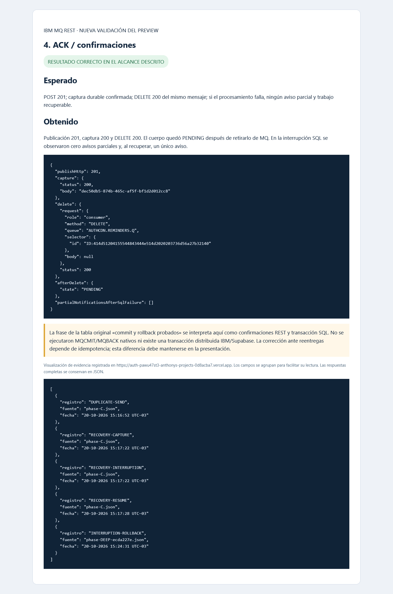

*Vista generada de las respuestas de esta ronda; no es una captura de IBM Console.*

### Evidencias originales de este requisito

**`DUPLICATE-SEND` · 20-10-2026 15:16:52 UTC−03 · PASS.** [Registro original](respuestas/phase-C.json).

<details>
<summary>Ver petición, respuesta o consulta y estado completo registrado</summary>

```json
{
  "request": {
    "role": "producer",
    "method": "POST",
    "queue": "AUTHCDN.REMINDERS.Q",
    "selector": {},
    "body": {
      "cardId": "781ea7cf-f469-44eb-9eeb-ffd32f244912",
      "eventId": "baa9427c-8199-4364-beb6-02299000ad5e",
      "eventType": "TASK_REMINDER_DUE",
      "expiresAt": "2026-10-20T18:36:15.957Z",
      "occurredAt": "2026-10-20T18:16:29.787Z",
      "reminderId": "2438f624-0c7a-4a37-ab5a-f371bb625646",
      "workspaceId": "1f4af17f-2074-4bcc-bcb2-ed118f3b84df",
      "schemaVersion": 1,
      "scheduleVersion": 2
    }
  },
  "status": 201,
  "body": "",
  "metadata": {
    "ibm-mq-md-messageId": "ID:414d51204155544843444e514d2020203736d56a21b32140"
  }
}
```

</details>

**`RECOVERY-CAPTURE` · 20-10-2026 15:17:22 UTC−03 · PASS.** [Registro original](respuestas/phase-C.json).

<details>
<summary>Ver petición, respuesta o consulta y estado completo registrado</summary>

```json
{
  "read": {
    "request": {
      "role": "consumer",
      "method": "GET",
      "queue": "AUTHCDN.REMINDERS.Q",
      "selector": {
        "id": "ID:414d51204155544843444e514d2020203736d56a27b32140"
      },
      "body": null
    },
    "status": 200,
    "body": {
      "cardId": "781ea7cf-f469-44eb-9eeb-ffd32f244912",
      "eventId": "baa9427c-8199-4364-beb6-02299000ad5e",
      "eventType": "TASK_REMINDER_DUE",
      "expiresAt": "2026-10-20T18:36:15.957Z",
      "occurredAt": "2026-10-20T18:16:29.787Z",
      "reminderId": "2438f624-0c7a-4a37-ab5a-f371bb625646",
      "workspaceId": "1f4af17f-2074-4bcc-bcb2-ed118f3b84df",
      "schemaVersion": 1,
      "scheduleVersion": 2
    },
    "metadata": {
      "ibm-mq-md-messageId": "ID:414d51204155544843444e514d2020203736d56a27b32140",
      "ibm-mq-md-persistence": "persistent",
      "ibm-mq-md-expiry": "unlimited"
    }
  },
  "captured": {
    "status": 200,
    "body": "dec50db5-874b-465c-af5f-bf1d2d012cc8"
  }
}
```

</details>

**`RECOVERY-INTERRUPTION` · 20-10-2026 15:17:22 UTC−03 · PASS.** [Registro original](respuestas/phase-C.json).

<details>
<summary>Ver petición, respuesta o consulta y estado completo registrado</summary>

```json
{
  "removed": {
    "request": {
      "role": "consumer",
      "method": "DELETE",
      "queue": "AUTHCDN.REMINDERS.Q",
      "selector": {
        "id": "ID:414d51204155544843444e514d2020203736d56a27b32140"
      },
      "body": null
    },
    "status": 200,
    "body": {
      "cardId": "781ea7cf-f469-44eb-9eeb-ffd32f244912",
      "eventId": "baa9427c-8199-4364-beb6-02299000ad5e",
      "eventType": "TASK_REMINDER_DUE",
      "expiresAt": "2026-10-20T18:36:15.957Z",
      "occurredAt": "2026-10-20T18:16:29.787Z",
      "reminderId": "2438f624-0c7a-4a37-ab5a-f371bb625646",
      "workspaceId": "1f4af17f-2074-4bcc-bcb2-ed118f3b84df",
      "schemaVersion": 1,
      "scheduleVersion": 2
    },
    "metadata": {
      "ibm-mq-md-messageId": "ID:414d51204155544843444e514d2020203736d56a27b32140",
      "ibm-mq-md-persistence": "persistent",
      "ibm-mq-md-expiry": "unlimited"
    }
  },
  "pending": {
    "status": 200,
    "body": [
      {
        "id": "dec50db5-874b-465c-af5f-bf1d2d012cc8",
        "queue_name": "AUTHCDN.REMINDERS.Q",
        "message_id": "ID:414d51204155544843444e514d2020203736d56a27b32140",
        "correlation_id": null,
        "reply_to": null,
        "body": "{\"cardId\":\"781ea7cf-f469-44eb-9eeb-ffd32f244912\",\"eventId\":\"baa9427c-8199-4364-beb6-02299000ad5e\",\"eventType\":\"TASK_REMINDER_DUE\",\"expiresAt\":\"2026-10-20T18:36:15.957Z\",\"occurredAt\":\"2026-10-20T18:16:29.787Z\",\"reminderId\":\"2438f624-0c7a-4a37-ab5a-f371bb625646\",\"workspaceId\":\"1f4af17f-2074-4bcc-bcb2-ed118f3b84df\",\"schemaVersion\":1,\"scheduleVersion\":2}",
        "state": "PENDING",
        "attempts": 0,
        "output_attempts": 0,
        "output": null,
        "next_attempt_at": "2026-10-20T18:19:22.091+00:00",
        "last_error": null
      }
    ]
  }
}
```

</details>

**`RECOVERY-RESUME` · 20-10-2026 15:17:28 UTC−03 · PASS.** [Registro original](respuestas/phase-C.json).

<details>
<summary>Ver petición, respuesta o consulta y estado completo registrado</summary>

```json
{
  "inbox": {
    "status": 200,
    "body": [
      {
        "id": "dec50db5-874b-465c-af5f-bf1d2d012cc8",
        "queue_name": "AUTHCDN.REMINDERS.Q",
        "message_id": "ID:414d51204155544843444e514d2020203736d56a27b32140",
        "correlation_id": null,
        "reply_to": null,
        "body": "{\"cardId\":\"781ea7cf-f469-44eb-9eeb-ffd32f244912\",\"eventId\":\"baa9427c-8199-4364-beb6-02299000ad5e\",\"eventType\":\"TASK_REMINDER_DUE\",\"expiresAt\":\"2026-10-20T18:36:15.957Z\",\"occurredAt\":\"2026-10-20T18:16:29.787Z\",\"reminderId\":\"2438f624-0c7a-4a37-ab5a-f371bb625646\",\"workspaceId\":\"1f4af17f-2074-4bcc-bcb2-ed118f3b84df\",\"schemaVersion\":1,\"scheduleVersion\":2}",
        "state": "DONE",
        "attempts": 1,
        "output_attempts": 0,
        "output": null,
        "next_attempt_at": "2026-10-20T18:17:21.98+00:00",
        "last_error": null
      }
    ]
  },
  "notifications": {
    "status": 200,
    "body": [
      {
        "id": "34416025-503d-47d6-9639-ac8f97c6abe5",
        "event_id": "baa9427c-8199-4364-beb6-02299000ad5e",
        "card_id": "781ea7cf-f469-44eb-9eeb-ffd32f244912"
      }
    ]
  }
}
```

</details>

**`INTERRUPTION-ROLLBACK` · 20-10-2026 15:24:31 UTC−03 · PASS.** [Registro original](respuestas/phase-DEEP-ecda227e.json).

<details>
<summary>Ver petición, respuesta o consulta y estado completo registrado</summary>

```json
{
  "signal": {
    "status": 200,
    "body": {
      "pid": 456056,
      "queryStart": "2026-10-20T18:24:26.359123+00:00",
      "terminated": true,
      "backendStart": "2026-10-20T18:24:18.103658+00:00",
      "reminderStatus": "QUEUED",
      "applicationName": "authcdn-e2e-interrupt-ecda227e",
      "fixtureNotifications": 0
    }
  },
  "tick": {
    "request": {
      "method": "POST",
      "path": "/api/mq/tick",
      "body": {}
    },
    "elapsedMs": 6000,
    "status": 502,
    "body": {
      "published": 1,
      "captured": 1,
      "worked": 1,
      "errors": 1
    }
  },
  "inbox": {
    "status": 200,
    "body": [
      {
        "id": "378c2480-dabf-4860-941d-3c82d4cef36f",
        "message_id": "ID:414D51204155544843444E514D2020203736D56A2EB32140",
        "body": "{\"schemaVersion\":1,\"eventId\":\"bc4a65aa-0c40-4779-a6cd-66e85cec0bbc\",\"eventType\":\"TASK_REMINDER_DUE\",\"reminderId\":\"861876f0-fe56-4e53-8c79-3702df6fa0e2\",\"cardId\":\"447981e5-495a-46de-9763-71357a5682c6\",\"workspaceId\":\"1f4af17f-2074-4bcc-bcb2-ed118f3b84df\",\"scheduleVersion\":2,\"occurredAt\":\"2026-10-20T18:24:25.096Z\",\"expiresAt\":\"2026-10-20T19:24:19.848Z\"}",
        "state": "PENDING",
        "attempts": 1,
        "output_attempts": 0,
        "output": null,
        "next_attempt_at": "2026-10-20T18:25:56.912306+00:00",
        "last_error": "PROCESSING_OR_DELIVERY_UNCONFIRMED"
      }
    ]
  },
  "notifications": {
    "status": 200,
    "body": []
  }
}
```

</details>


<a id="r5"></a>

## 5. Durabilidad de mensajes

**Cómo funciona.** El mensaje se publica como persistent. Tras la captura, el cuerpo también permanece en Supabase hasta terminar el trabajo. Una interrupción de procesamiento no debe perder ese trabajo ni duplicar su aviso.

**Prueba realizada.**

1. Verificar persistence=persistent en una lectura real de IBM.
2. Persistir y retirar un mensaje, pausar antes de procesarlo y recuperarlo en otro ciclo.
3. Interrumpir el backend PostgreSQL dedicado a la RPC de una tarjeta de ensayo.
4. Comprobar cero avisos parciales y recuperar con otra invocación de Vercel.

**Resultado esperado.** El cuerpo se conserva durante la interrupción. Antes de recuperarse no hay un aviso parcial; después el inbox termina DONE y existe un solo aviso.

**Resultado obtenido.** Persistencia IBM confirmada. El backend SQL fue terminado; quedó PENDING y cero avisos. Otro tick respondió 200, terminó DONE con attempts=2 y creó exactamente una notificación.

**Veredicto: correcto en el alcance descrito.**

**Alcance de esta evidencia.** La interrupción fue real sobre el backend de la RPC identificado para el ensayo. No se reiniciaron IBM MQ ni el proveedor Vercel: no se presenta esta evidencia como una prueba de reinicio del queue manager.

### Respuestas y comprobación

El siguiente extracto selecciona campos y estados de los registros originales. Los nombres de agrupación son explicativos; las respuestas completas, sin esa selección, se conservan debajo.

```json
{
  "persistence": "persistent",
  "interruption": {
    "status": 200,
    "body": {
      "pid": 456056,
      "queryStart": "2026-10-20T18:24:26.359123+00:00",
      "terminated": true,
      "backendStart": "2026-10-20T18:24:18.103658+00:00",
      "reminderStatus": "QUEUED",
      "applicationName": "authcdn-e2e-interrupt-ecda227e",
      "fixtureNotifications": 0
    }
  },
  "beforeRecovery": {
    "state": "PENDING",
    "notifications": []
  },
  "recoveryTick": {
    "request": {
      "method": "POST",
      "path": "/api/mq/tick",
      "body": {}
    },
    "elapsedMs": 4704,
    "status": 200,
    "body": {
      "published": 0,
      "captured": 0,
      "worked": 1,
      "errors": 0
    }
  },
  "afterRecovery": {
    "state": "DONE",
    "attempts": 2,
    "notifications": [
      {
        "id": "47e78e00-5c1b-425a-b351-4565652c6b48",
        "event_id": "bc4a65aa-0c40-4779-a6cd-66e85cec0bbc",
        "message": "La tarjeta \"MQ-E2E-20261020181439 ecda227e interrupcion-real-rpc\" vence el 2026-10-20T19:24:19Z.",
        "created_at": "2026-10-20T18:24:38.171233+00:00"
      }
    ]
  }
}
```

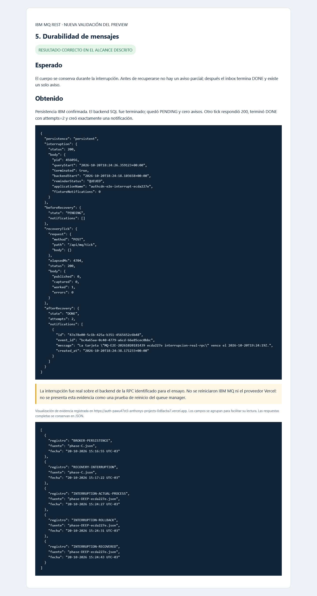

*Vista generada de las respuestas de esta ronda; no es una captura de IBM Console.*

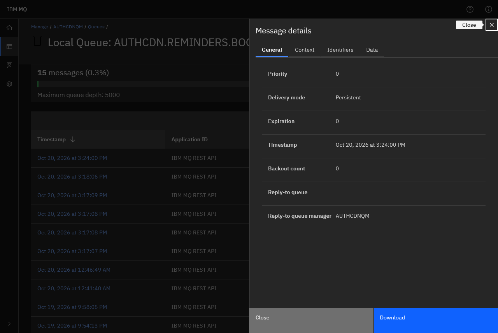

*Captura real: un mensaje persistente en la BOQ; el MsgId de la prueba principal se identifica en la respuesta REST.*


*Captura real: aviso interrupcion-real-rpc de la ronda ecda227e.*

### Evidencias originales de este requisito

**`BROKER-PERSISTENCE` · 20-10-2026 15:16:55 UTC−03 · PASS.** [Registro original](respuestas/phase-C.json).

<details>
<summary>Ver petición, respuesta o consulta y estado completo registrado</summary>

```json
{
  "request": {
    "role": "consumer",
    "method": "GET",
    "queue": "AUTHCDN.REMINDERS.Q",
    "selector": {
      "id": "ID:414d51204155544843444e514d2020203736d56a21b32140"
    },
    "body": null
  },
  "status": 200,
  "body": {
    "cardId": "781ea7cf-f469-44eb-9eeb-ffd32f244912",
    "eventId": "baa9427c-8199-4364-beb6-02299000ad5e",
    "eventType": "TASK_REMINDER_DUE",
    "expiresAt": "2026-10-20T18:36:15.957Z",
    "occurredAt": "2026-10-20T18:16:29.787Z",
    "reminderId": "2438f624-0c7a-4a37-ab5a-f371bb625646",
    "workspaceId": "1f4af17f-2074-4bcc-bcb2-ed118f3b84df",
    "schemaVersion": 1,
    "scheduleVersion": 2
  },
  "metadata": {
    "ibm-mq-md-messageId": "ID:414d51204155544843444e514d2020203736d56a21b32140",
    "ibm-mq-md-persistence": "persistent",
    "ibm-mq-md-expiry": "unlimited"
  }
}
```

</details>

**`RECOVERY-INTERRUPTION` · 20-10-2026 15:17:22 UTC−03 · PASS.** [Registro original](respuestas/phase-C.json).

<details>
<summary>Ver petición, respuesta o consulta y estado completo registrado</summary>

```json
{
  "removed": {
    "request": {
      "role": "consumer",
      "method": "DELETE",
      "queue": "AUTHCDN.REMINDERS.Q",
      "selector": {
        "id": "ID:414d51204155544843444e514d2020203736d56a27b32140"
      },
      "body": null
    },
    "status": 200,
    "body": {
      "cardId": "781ea7cf-f469-44eb-9eeb-ffd32f244912",
      "eventId": "baa9427c-8199-4364-beb6-02299000ad5e",
      "eventType": "TASK_REMINDER_DUE",
      "expiresAt": "2026-10-20T18:36:15.957Z",
      "occurredAt": "2026-10-20T18:16:29.787Z",
      "reminderId": "2438f624-0c7a-4a37-ab5a-f371bb625646",
      "workspaceId": "1f4af17f-2074-4bcc-bcb2-ed118f3b84df",
      "schemaVersion": 1,
      "scheduleVersion": 2
    },
    "metadata": {
      "ibm-mq-md-messageId": "ID:414d51204155544843444e514d2020203736d56a27b32140",
      "ibm-mq-md-persistence": "persistent",
      "ibm-mq-md-expiry": "unlimited"
    }
  },
  "pending": {
    "status": 200,
    "body": [
      {
        "id": "dec50db5-874b-465c-af5f-bf1d2d012cc8",
        "queue_name": "AUTHCDN.REMINDERS.Q",
        "message_id": "ID:414d51204155544843444e514d2020203736d56a27b32140",
        "correlation_id": null,
        "reply_to": null,
        "body": "{\"cardId\":\"781ea7cf-f469-44eb-9eeb-ffd32f244912\",\"eventId\":\"baa9427c-8199-4364-beb6-02299000ad5e\",\"eventType\":\"TASK_REMINDER_DUE\",\"expiresAt\":\"2026-10-20T18:36:15.957Z\",\"occurredAt\":\"2026-10-20T18:16:29.787Z\",\"reminderId\":\"2438f624-0c7a-4a37-ab5a-f371bb625646\",\"workspaceId\":\"1f4af17f-2074-4bcc-bcb2-ed118f3b84df\",\"schemaVersion\":1,\"scheduleVersion\":2}",
        "state": "PENDING",
        "attempts": 0,
        "output_attempts": 0,
        "output": null,
        "next_attempt_at": "2026-10-20T18:19:22.091+00:00",
        "last_error": null
      }
    ]
  }
}
```

</details>

**`INTERRUPTION-ACTUAL-PROCESS` · 20-10-2026 15:24:27 UTC−03 · PASS.** [Registro original](respuestas/phase-DEEP-ecda227e.json).

<details>
<summary>Ver petición, respuesta o consulta y estado completo registrado</summary>

```json
{
  "status": 200,
  "body": {
    "pid": 456056,
    "queryStart": "2026-10-20T18:24:26.359123+00:00",
    "terminated": true,
    "backendStart": "2026-10-20T18:24:18.103658+00:00",
    "reminderStatus": "QUEUED",
    "applicationName": "authcdn-e2e-interrupt-ecda227e",
    "fixtureNotifications": 0
  }
}
```

</details>

**`INTERRUPTION-ROLLBACK` · 20-10-2026 15:24:31 UTC−03 · PASS.** [Registro original](respuestas/phase-DEEP-ecda227e.json).

<details>
<summary>Ver petición, respuesta o consulta y estado completo registrado</summary>

```json
{
  "signal": {
    "status": 200,
    "body": {
      "pid": 456056,
      "queryStart": "2026-10-20T18:24:26.359123+00:00",
      "terminated": true,
      "backendStart": "2026-10-20T18:24:18.103658+00:00",
      "reminderStatus": "QUEUED",
      "applicationName": "authcdn-e2e-interrupt-ecda227e",
      "fixtureNotifications": 0
    }
  },
  "tick": {
    "request": {
      "method": "POST",
      "path": "/api/mq/tick",
      "body": {}
    },
    "elapsedMs": 6000,
    "status": 502,
    "body": {
      "published": 1,
      "captured": 1,
      "worked": 1,
      "errors": 1
    }
  },
  "inbox": {
    "status": 200,
    "body": [
      {
        "id": "378c2480-dabf-4860-941d-3c82d4cef36f",
        "message_id": "ID:414D51204155544843444E514D2020203736D56A2EB32140",
        "body": "{\"schemaVersion\":1,\"eventId\":\"bc4a65aa-0c40-4779-a6cd-66e85cec0bbc\",\"eventType\":\"TASK_REMINDER_DUE\",\"reminderId\":\"861876f0-fe56-4e53-8c79-3702df6fa0e2\",\"cardId\":\"447981e5-495a-46de-9763-71357a5682c6\",\"workspaceId\":\"1f4af17f-2074-4bcc-bcb2-ed118f3b84df\",\"scheduleVersion\":2,\"occurredAt\":\"2026-10-20T18:24:25.096Z\",\"expiresAt\":\"2026-10-20T19:24:19.848Z\"}",
        "state": "PENDING",
        "attempts": 1,
        "output_attempts": 0,
        "output": null,
        "next_attempt_at": "2026-10-20T18:25:56.912306+00:00",
        "last_error": "PROCESSING_OR_DELIVERY_UNCONFIRMED"
      }
    ]
  },
  "notifications": {
    "status": 200,
    "body": []
  }
}
```

</details>

**`INTERRUPTION-RECOVERED` · 20-10-2026 15:24:43 UTC−03 · PASS.** [Registro original](respuestas/phase-DEEP-ecda227e.json).

<details>
<summary>Ver petición, respuesta o consulta y estado completo registrado</summary>

```json
{
  "tick": {
    "request": {
      "method": "POST",
      "path": "/api/mq/tick",
      "body": {}
    },
    "elapsedMs": 4704,
    "status": 200,
    "body": {
      "published": 0,
      "captured": 0,
      "worked": 1,
      "errors": 0
    }
  },
  "inbox": {
    "status": 200,
    "body": [
      {
        "id": "378c2480-dabf-4860-941d-3c82d4cef36f",
        "message_id": "ID:414D51204155544843444E514D2020203736D56A2EB32140",
        "body": "{\"schemaVersion\":1,\"eventId\":\"bc4a65aa-0c40-4779-a6cd-66e85cec0bbc\",\"eventType\":\"TASK_REMINDER_DUE\",\"reminderId\":\"861876f0-fe56-4e53-8c79-3702df6fa0e2\",\"cardId\":\"447981e5-495a-46de-9763-71357a5682c6\",\"workspaceId\":\"1f4af17f-2074-4bcc-bcb2-ed118f3b84df\",\"scheduleVersion\":2,\"occurredAt\":\"2026-10-20T18:24:25.096Z\",\"expiresAt\":\"2026-10-20T19:24:19.848Z\"}",
        "state": "DONE",
        "attempts": 2,
        "output_attempts": 0,
        "output": null,
        "next_attempt_at": "2026-10-20T18:24:37.66+00:00",
        "last_error": null
      }
    ]
  },
  "notifications": {
    "status": 200,
    "body": [
      {
        "id": "47e78e00-5c1b-425a-b351-4565652c6b48",
        "event_id": "bc4a65aa-0c40-4779-a6cd-66e85cec0bbc",
        "message": "La tarjeta \"MQ-E2E-20261020181439 ecda227e interrupcion-real-rpc\" vence el 2026-10-20T19:24:19Z.",
        "created_at": "2026-10-20T18:24:38.171233+00:00"
      }
    ]
  }
}
```

</details>


<a id="r6"></a>

## 6. DLQ / gestión de mensajes fallidos

**Cómo funciona.** La BOQ de aplicación conserva eventos inválidos o cuyo procesamiento agota sus intentos. La DLQ nativa del queue manager conserva determinados mensajes que IBM no puede entregar. Son mecanismos diferentes y se comprobaron ambos.

**Prueba realizada.**

1. Enviar JSON mal formado, contrato inválido, referencias inconsistentes y ReplyTo no permitido.
2. Comprobar sus motivos y cuerpos originales en AUTHCDN.REMINDERS.BOQ.
3. Comprobar DEADQ=DEV.DEAD.LETTER.QUEUE en la configuración del queue manager.
4. Llenar una cola de iniciación exclusiva de ensayo y disparar un nuevo mensaje de control; examinar el mensaje que IBM envía automáticamente a DLQ.

**Resultado esperado.** Los errores de aplicación terminan en BOQ sin aviso de negocio indebido. IBM enruta automáticamente el control que no puede entregar a la DLQ configurada, con cabecera que identifica motivo y destino.

**Resultado obtenido.** BOQ mostró MALFORMED_JSON, INVALID_REMINDER, PERMANENT_ERROR, INVALID_REPLY_DESTINATION y RETRIES_EXHAUSTED. La prueba añadió un mensaje nuevo a la DLQ: mensaje generado por AUTHCDNQM con MQDLH/MQTM, motivo MQRC_Q_FULL y destino INIT de ensayo.

**Veredicto: correcto en el alcance descrito.**

**Alcance de esta evidencia.** El mensaje nativo DLQ es un control MQTM no persistente generado por IBM, distinto de la carga persistente que disparó el ensayo. Examinarlo por REST devuelve 501 MQWB0309E por formato binario no soportado; su cabecera sí se verificó en consola y se conservó. Ese 501 no es evidencia de fallo del enrutamiento.

### Respuestas y comprobación

El siguiente extracto selecciona campos y estados de los registros originales. Los nombres de agrupación son explicativos; las respuestas completas, sin esa selección, se conservan debajo.

```json
{
  "boq": {
    "queue": "AUTHCDN.REMINDERS.BOQ",
    "reason": "RETRIES_EXHAUSTED",
    "attempts": 5
  },
  "nativeDlq": {
    "queue": "DEV.DEAD.LETTER.QUEUE",
    "applicationId": "AUTHCDNQM",
    "headers": [
      "MQDLH",
      "MQTM"
    ]
  },
  "nativeBinaryBrowse": {
    "request": {
      "method": "GET",
      "queue": "DEV.DEAD.LETTER.QUEUE",
      "messageId": "ID:414d51204155544843444e514d2020203736d56a33b32140"
    },
    "status": 501,
    "body": {
      "error": [
        {
          "msgId": "MQWB0309E",
          "action": "Resubmit the request, correcting any issues.",
          "completionCode": 0,
          "reasonCode": 0,
          "type": "rest",
          "message": "MQWB0309E: The received or browsed message type is unsupported by the mqweb server.",
          "explanation": "The mqweb server successfully received an MQ message, but was of an unsupported message type."
        }
      ]
    }
  }
}
```

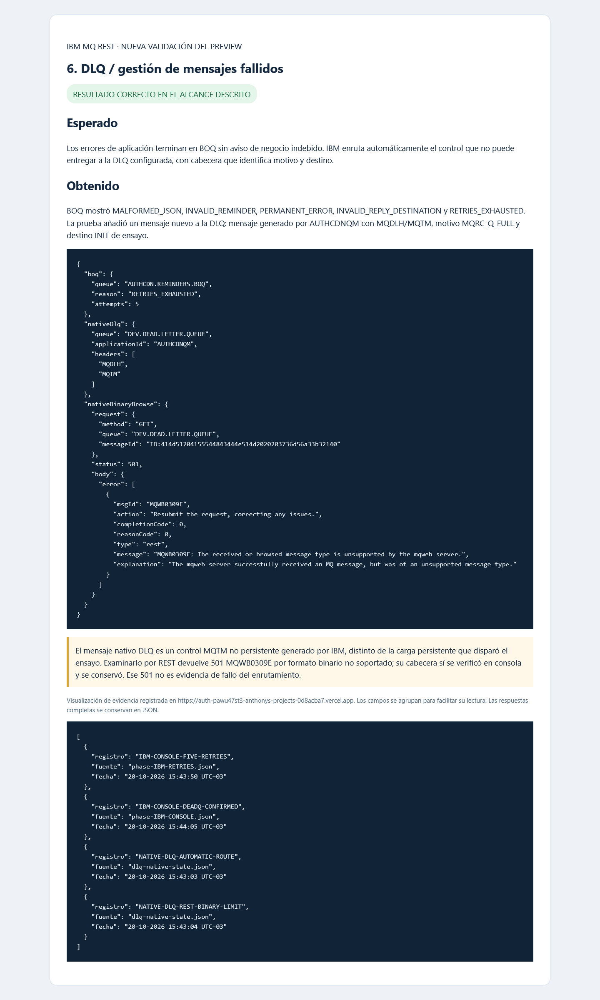

*Vista generada de las respuestas de esta ronda; no es una captura de IBM Console.*

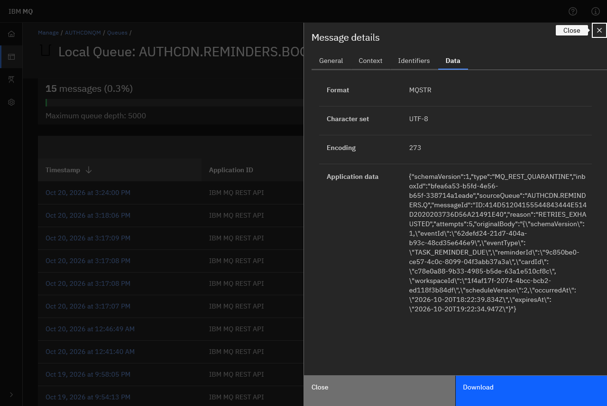

*Captura real de BOQ: RETRIES_EXHAUSTED y attempts=5.*

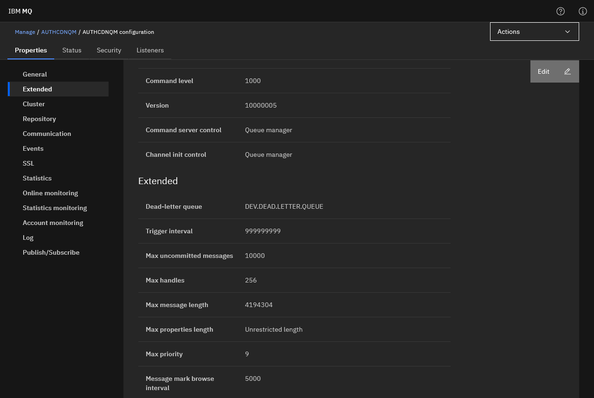

*Captura real de DEADQ asignada.*

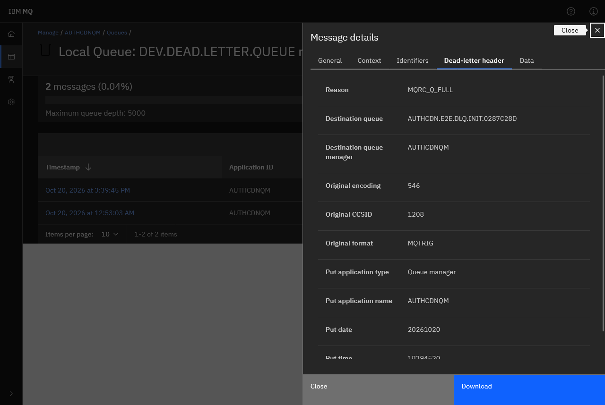

*Captura real de DLQ nativa: MQRC_Q_FULL y destino de ensayo.*

### Evidencias originales de este requisito

**`IBM-CONSOLE-FIVE-RETRIES` · 20-10-2026 15:43:50 UTC−03 · PASS.** [Registro original](respuestas/phase-IBM-RETRIES.json).

<details>
<summary>Ver petición, respuesta o consulta y estado completo registrado</summary>

```json
{
  "queue": "AUTHCDN.REMINDERS.BOQ",
  "body": {
    "schemaVersion": 1,
    "type": "MQ_REST_QUARANTINE",
    "inboxId": "bfea6a53-b5fd-4e56-b65f-338714a1eade",
    "sourceQueue": "AUTHCDN.REMINDERS.Q",
    "messageId": "ID:414D51204155544843444E514D2020203736D56A21491E40",
    "reason": "RETRIES_EXHAUSTED",
    "attempts": 5,
    "originalBody": "{\"schemaVersion\":1,\"eventId\":\"62defd24-21d7-404a-b93c-48cd35e646e9\",\"eventType\":\"TASK_REMINDER_DUE\",\"reminderId\":\"9c850be0-ce57-4c0c-8099-04f3abb37a3a\",\"cardId\":\"c78e0a88-9b33-4985-b5de-63a1e510cf8c\",\"workspaceId\":\"1f4af17f-2074-4bcc-bcb2-ed118f3b84df\",\"scheduleVersion\":2,\"occurredAt\":\"2026-10-20T18:22:39.834Z\",\"expiresAt\":\"2026-10-20T19:22:34.947Z\"}"
  },
  "screenshot": "45-ibm-boq-cinco-intentos.png",
  "persistenceScreenshot": "22-ibm-boq-persistencia.png"
}
```

</details>

**`IBM-CONSOLE-DEADQ-CONFIRMED` · 20-10-2026 15:44:05 UTC−03 · PASS.** [Registro original](respuestas/phase-IBM-CONSOLE.json).

<details>
<summary>Ver petición, respuesta o consulta y estado completo registrado</summary>

```json
{
  "queueManager": "AUTHCDNQM",
  "deadLetterQueue": "DEV.DEAD.LETTER.QUEUE",
  "consoleText": "Skip to main content\nIBM\n MQ\nLogout\nManage\nAUTHCDNQM\nAUTHCDNQM configuration\nActions\nProperties\nStatus\nSecurity\nListeners\nGeneral\nExtended\nCluster\nRepository\nCommunication\nEvents\nSSL\nStatistics\nOnline monitoring\nStatistics monitoring\nAccount monitoring\nLog\nPublish/Subscribe\nHide empty property fields\nEdit\nGeneral\nQueue manager name\tAUTHCDNQM\nPlatform\tUnix\nQueue manager status\tRunning\nCoded character set ID\t1208\nDescription\t\nCommand level\t1000\nVersion\t10000005\nCommand server control\tQueue manager\nChannel init control\tQueue manager\nExtended\nDead-letter queue\tDEV.DEAD.LETTER.QUEUE\nTrigger interval\t999999999\nMax uncommitted messages\t10000\nMax handles\t256\nMax message length\t4194304\nMax properties length\tUnrestricted length\nMax priority\t9\nMessage mark browse interval\t5000\nCommand input queue\tSYSTEM.ADMIN.COMMAND.QUEUE\nSyncpoint\tAvailable\nDistribution lists\tSupported\nTelemetry\tNot supported\nAMQP\tNot supported\nCustom\t\nSecurity policies\tSupported\nConnection authentication\tCLOUD.AUTHINFO\nInitial key\t\nAdvanced capability\tSupported\nCluster\nCluster workload exit\t\nCluster workload data\t\nCluster workload length\t100\nMax outbound cluster channels\t999999999\nCluster workload use queue\tLocal\nDefault CLXMIT queue\tSYSTEM.CLUSTER.TRANSMIT.QUEUE\nRepository\nRepository name\t\nRepository name list\t\nCommunication\nDefault transmission queue\t\nChannel auto definition\tDisabled\nChannel auto definition exit\t\nIP address version\tIPV4\nActivity recording\tMessage\nTrace-route recording\tMessage\nCHLAUTH records\tEnabled\nREVDNS lookup\tEnabled\nEvents\nAuthority events\tDisabled\nAuthority event scope\tFailure events only\nInhibit events\tDisabled\nLocal events\tDisabled\nRemote events\tDisabled\nStart and stop events\tEnabled\nPerformance events\tDisabled\nCommand events\tDisabled\nChannel events\tDisabled\nChannel auto definition events\tDisabled\nSSL events\tDisabled\nConfiguration events\tDisabled\nLogger events\tDisabled\nSSL\nSSL Key repository\t/var/mqm/qmgrs/AUTHCDNQM/ssl/key\nCryptographic hardware\t\nSSL Key repository password\t\nRevocation namelist\t\nCertificate validation policy\tAny\nCert label\tqmgrcert\nSSL reset count\t0\nSSL FIPS required\tNo\nSuite B strength\t\nNone\nStatistics\nCreation date\t2026-10-18\nCreation time\t21.11.08\nAlteration date\t2026-10-18\nAlteration time\t21.12.30\nQMID\tAUTHCDNQM_2026-10-18_21.11.08\nOnline monitoring\nChannel monitoring\tOff\nQueue monitoring\tOff\nAuto CLUSSDR monitoring\tQueue manager\nActivity trace override\tDisabled\nActivity trace\tOff\nStatistics monitoring\nMQI statistics\tOff\nQueue statistics\tOn\nChannel statistics\tOff\nAuto CLUSSDR statistics\tQueue manager\nStatistics interval\t1800\nAccount monitoring\nMQI accounting\tOff\nQueue accounting\tOff\nAccounting interval\t1800\nAccounting conn override\tDisabled\nLog\nMedia image scheduling\tManual\nAutomatic media image interval\t60\nAutomatic media image log length\tOff\nObject media image recoverability\tYes\nQueue media image recoverability\tYes\nPublish/Subscribe\nPublish/Subscribe mode\tEnabled\nMessage retry count\t5\nPublish/Subscribe syncpoint\tIf persistent\nUndelivered non-persistent input message\tDiscard\nUndelivered non-persistent response\tNormal\nTree lifetime\t1800\nParent\t\nPublish/Subscribe clustering\tEnabled",
  "screenshot": "19-ibm-config-deadq-firefox.png"
}
```

</details>

**`NATIVE-DLQ-AUTOMATIC-ROUTE` · 20-10-2026 15:43:03 UTC−03 · PASS.** [Registro original](respuestas/dlq-native-state.json).

<details>
<summary>Ver petición, respuesta o consulta y estado completo registrado</summary>

```json
{
  "queue": "DEV.DEAD.LETTER.QUEUE",
  "applicationId": "AUTHCDNQM",
  "headers": [
    "MQDLH",
    "MQTM"
  ],
  "nativeHeader": "Skip to main content\nIBM\n MQ\nLogout\nHome\nManage\nLearning resources\nSettings\nToggle opening or closing the side navigation\nManage\nAUTHCDNQM\nQueues\nLocal Queue: DEV.DEAD.LETTER.QUEUE messages\nActions\nMessage details\nGeneral\nContext\nIdentifiers\nDead-letter header\nData\nReason\tMQRC_Q_FULL\nDestination queue\tAUTHCDN.E2E.DLQ.INIT.0287C28D\nDestination queue manager\tAUTHCDNQM\nOriginal encoding\t546\nOriginal CCSID\t1208\nOriginal format\tMQTRIG\nPut application type\tQueue manager\nPut application name\tAUTHCDNQM\nPut date\t20261020\nPut time\t18394520\nClose\nDownload\n2 messages (0.04%)\nMaximum queue depth: 5000\nCreate\nTimestamp\n\t\nApplication ID\n\t\nUser ID\n\t\nApplication data\n\t\nActions\n\n\nOct 20, 2026 at 3:39:45 PM\n\t\nAUTHCDNQM\n\t\n-\n\tBinary message\t\n\n\nOct 20, 2026 at 12:53:03 AM\n\t\nAUTHCDNQM\n\t\n-\n\tBinary message\t\nItems per page:\n1-2 of 2 items\nPage of 1 pages\nof 1 pages",
  "nativeMessageId": "ID:414d51204155544843444e514d2020203736d56a33b32140",
  "beforeDepth": 1,
  "afterDepth": 2,
  "destination": "AUTHCDN.E2E.DLQ.INIT.0287C28D"
}
```

</details>

**`NATIVE-DLQ-REST-BINARY-LIMIT` · 20-10-2026 15:43:04 UTC−03 · PASS.** [Registro original](respuestas/dlq-native-state.json).

<details>
<summary>Ver petición, respuesta o consulta y estado completo registrado</summary>

```json
{
  "request": {
    "method": "GET",
    "queue": "DEV.DEAD.LETTER.QUEUE",
    "messageId": "ID:414d51204155544843444e514d2020203736d56a33b32140"
  },
  "status": 501,
  "body": {
    "error": [
      {
        "msgId": "MQWB0309E",
        "action": "Resubmit the request, correcting any issues.",
        "completionCode": 0,
        "reasonCode": 0,
        "type": "rest",
        "message": "MQWB0309E: The received or browsed message type is unsupported by the mqweb server.",
        "explanation": "The mqweb server successfully received an MQ message, but was of an unsupported message type."
      }
    ]
  }
}
```

</details>


<a id="r7"></a>

## 7. Reintentos de procesamiento

**Cómo funciona.** Un error recuperable de process_reminder_event conserva el trabajo y aumenta attempts. Al alcanzar cinco fallos, se entrega una cuarentena persistente a BOQ. Los fallos de entrega de una salida durable se conservan para recuperación posterior.

**Prueba realizada.**

1. Provocar un error SQL P0001 solo al insertar el aviso de una tarjeta propia.
2. Permitir que el consumidor cloud procese sus reintentos sobre el evento recibido de IBM.
3. Medir las cinco invocaciones fallidas y revisar attempts, salida BOQ y ausencia de avisos.
4. Como prueba complementaria, fallar cinco entregas de salida y corregir el destino para comprobar su recuperación.

**Resultado esperado.** Cinco fallos reales del consumidor: attempts=5, cero avisos de negocio y cuarentena RETRIES_EXHAUSTED confirmada en BOQ. Los fallos de salida conservan el cuerpo hasta poder entregarlo.

**Resultado obtenido.** Se contaron cinco fallos RPC, inbox attempts=5, salida QUARANTINE terminada y cero avisos. La consola IBM mostró el mensaje BOQ con attempts=5. La salida con destino corregido terminó después de cinco errores sin perder el cuerpo.

**Veredicto: correcto en el alcance descrito.**

**Alcance de esta evidencia.** El error se inyectó en SQL solo para ese fixture. El evento y la BOQ usan IBM real. No significa que se haya caído el broker ni que IBM rechazara cinco POST; lo probado aquí es el reintento de procesamiento del consumidor.

### Respuestas y comprobación

El siguiente extracto selecciona campos y estados de los registros originales. Los nombres de agrupación son explicativos; las respuestas completas, sin esa selección, se conservan debajo.

```json
{
  "actualRpcFailures": {
    "is_called": true,
    "last_value": 5
  },
  "inbox": {
    "state": "DONE",
    "attempts": 5,
    "outputQueue": "AUTHCDN.REMINDERS.BOQ",
    "purpose": "QUARANTINE",
    "outputAttempts": 1
  },
  "quarantineReason": "RETRIES_EXHAUSTED",
  "notifications": []
}
```

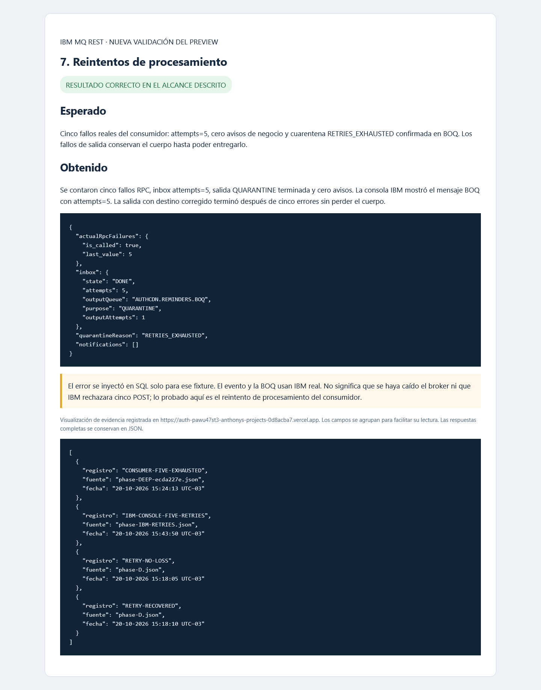

*Vista generada de las respuestas de esta ronda; no es una captura de IBM Console.*


*Captura real: resultado final en BOQ de la misma ronda.*

### Evidencias originales de este requisito

**`CONSUMER-FIVE-EXHAUSTED` · 20-10-2026 15:24:13 UTC−03 · PASS.** [Registro original](respuestas/phase-DEEP-ecda227e.json).

<details>
<summary>Ver petición, respuesta o consulta y estado completo registrado</summary>

```json
{
  "inbox": {
    "status": 200,
    "body": [
      {
        "id": "bfea6a53-b5fd-4e56-b65f-338714a1eade",
        "message_id": "ID:414D51204155544843444E514D2020203736D56A21491E40",
        "body": "{\"schemaVersion\":1,\"eventId\":\"62defd24-21d7-404a-b93c-48cd35e646e9\",\"eventType\":\"TASK_REMINDER_DUE\",\"reminderId\":\"9c850be0-ce57-4c0c-8099-04f3abb37a3a\",\"cardId\":\"c78e0a88-9b33-4985-b5de-63a1e510cf8c\",\"workspaceId\":\"1f4af17f-2074-4bcc-bcb2-ed118f3b84df\",\"scheduleVersion\":2,\"occurredAt\":\"2026-10-20T18:22:39.834Z\",\"expiresAt\":\"2026-10-20T19:22:34.947Z\"}",
        "state": "DONE",
        "attempts": 5,
        "output_attempts": 1,
        "output": {
          "body": "{\"schemaVersion\":1,\"type\":\"MQ_REST_QUARANTINE\",\"inboxId\":\"bfea6a53-b5fd-4e56-b65f-338714a1eade\",\"sourceQueue\":\"AUTHCDN.REMINDERS.Q\",\"messageId\":\"ID:414D51204155544843444E514D2020203736D56A21491E40\",\"reason\":\"RETRIES_EXHAUSTED\",\"attempts\":5,\"originalBody\":\"{\\\"schemaVersion\\\":1,\\\"eventId\\\":\\\"62defd24-21d7-404a-b93c-48cd35e646e9\\\",\\\"eventType\\\":\\\"TASK_REMINDER_DUE\\\",\\\"reminderId\\\":\\\"9c850be0-ce57-4c0c-8099-04f3abb37a3a\\\",\\\"cardId\\\":\\\"c78e0a88-9b33-4985-b5de-63a1e510cf8c\\\",\\\"workspaceId\\\":\\\"1f4af17f-2074-4bcc-bcb2-ed118f3b84df\\\",\\\"scheduleVersion\\\":2,\\\"occurredAt\\\":\\\"2026-10-20T18:22:39.834Z\\\",\\\"expiresAt\\\":\\\"2026-10-20T19:22:34.947Z\\\"}\"}",
          "queue": "AUTHCDN.REMINDERS.BOQ",
          "purpose": "QUARANTINE"
        },
        "next_attempt_at": "2026-10-20T18:23:59.707251+00:00",
        "last_error": null
      }
    ]
  },
  "actualRpcFailures": {
    "is_called": true,
    "last_value": 5
  },
  "notifications": {
    "status": 200,
    "body": []
  }
}
```

</details>

**`IBM-CONSOLE-FIVE-RETRIES` · 20-10-2026 15:43:50 UTC−03 · PASS.** [Registro original](respuestas/phase-IBM-RETRIES.json).

<details>
<summary>Ver petición, respuesta o consulta y estado completo registrado</summary>

```json
{
  "queue": "AUTHCDN.REMINDERS.BOQ",
  "body": {
    "schemaVersion": 1,
    "type": "MQ_REST_QUARANTINE",
    "inboxId": "bfea6a53-b5fd-4e56-b65f-338714a1eade",
    "sourceQueue": "AUTHCDN.REMINDERS.Q",
    "messageId": "ID:414D51204155544843444E514D2020203736D56A21491E40",
    "reason": "RETRIES_EXHAUSTED",
    "attempts": 5,
    "originalBody": "{\"schemaVersion\":1,\"eventId\":\"62defd24-21d7-404a-b93c-48cd35e646e9\",\"eventType\":\"TASK_REMINDER_DUE\",\"reminderId\":\"9c850be0-ce57-4c0c-8099-04f3abb37a3a\",\"cardId\":\"c78e0a88-9b33-4985-b5de-63a1e510cf8c\",\"workspaceId\":\"1f4af17f-2074-4bcc-bcb2-ed118f3b84df\",\"scheduleVersion\":2,\"occurredAt\":\"2026-10-20T18:22:39.834Z\",\"expiresAt\":\"2026-10-20T19:22:34.947Z\"}"
  },
  "screenshot": "45-ibm-boq-cinco-intentos.png",
  "persistenceScreenshot": "22-ibm-boq-persistencia.png"
}
```

</details>

**`RETRY-NO-LOSS` · 20-10-2026 15:18:05 UTC−03 · PASS.** [Registro original](respuestas/phase-D.json).

<details>
<summary>Ver petición, respuesta o consulta y estado completo registrado</summary>

```json
{
  "counts": [
    1,
    2,
    3,
    4,
    5
  ],
  "note": "Se aceleró next_attempt_at únicamente en este fixture; las esperas calculadas quedaron registradas. Es fallo de salida, no cinco fallos de la RPC de negocio."
}
```

</details>

**`RETRY-RECOVERED` · 20-10-2026 15:18:10 UTC−03 · PASS.** [Registro original](respuestas/phase-D.json).

<details>
<summary>Ver petición, respuesta o consulta y estado completo registrado</summary>

```json
{
  "status": 200,
  "body": [
    {
      "id": "d787888a-3961-488d-bedf-0efc3c5179dd",
      "queue_name": "AUTHCDN.REMINDERS.Q",
      "message_id": "ID:5960DA422F4E0D423A9D999F672FF40C6C56F3E4FDB267B4",
      "correlation_id": null,
      "reply_to": null,
      "body": "{\"testRun\":\"MQ-E2E-20261020181439\",\"case\":\"lease-and-retry\",\"note\":\"Fixture SQL: no es un MsgId emitido por IBM.\"}",
      "state": "DONE",
      "attempts": 2,
      "output_attempts": 6,
      "output": {
        "body": "{\"schemaVersion\":1,\"type\":\"MQ_REST_QUARANTINE\",\"testRun\":\"MQ-E2E-20261020181439\",\"inboxId\":\"d787888a-3961-488d-bedf-0efc3c5179dd\",\"reason\":\"E2E_INJECTED_OUTPUT_FAILURE\",\"originalBody\":\"{\\\"testRun\\\":\\\"MQ-E2E-20261020181439\\\",\\\"case\\\":\\\"lease-and-retry\\\",\\\"note\\\":\\\"Fixture SQL: no es un MsgId emitido por IBM.\\\"}\"}",
        "queue": "AUTHCDN.REMINDERS.BOQ",
        "purpose": "QUARANTINE"
      },
      "next_attempt_at": "2026-10-20T18:18:04.95+00:00",
      "last_error": null
    }
  ]
}
```

</details>


<a id="r8"></a>

## 8. Políticas de retención

**Cómo funciona.** El mantenimiento aplica una retención de 30 días a registros técnicos terminados elegibles. Conserva trabajos pendientes y cuarentenas. Esta limpieza está separada de la expiración de los mensajes en IBM.

**Prueba realizada.**

1. Preparar tres registros técnicos propios con 40 días de antigüedad: DONE ordinario, PENDING y cuarentena.
2. Ejecutar mq_rest_maintenance.
3. Comprobar que se purga el DONE ordinario y permanecen PENDING y cuarentena.
4. Verificar que el Cron permanente de mantenimiento quedó configurado.

**Resultado esperado.** La política elimina el registro terminado elegible antiguo y conserva los dos registros que requieren procesamiento o revisión.

**Resultado obtenido.** Mantenimiento respondió 200 con purgedInbox=1. El DONE ordinario desapareció; la consulta devolvió PENDING y cuarentena. El trabajo de mantenimiento fue verificado activo cada minuto.

**Veredicto: correcto en el alcance descrito.**

**Alcance de esta evidencia.** Los 40 días se simularon cambiando fechas solo de fixtures; no transcurrieron 40 días de observación. No se estableció una purga automática de mensajes BOQ/DLQ ni una retención administrativa global de IBM. Sus mensajes se conservan hasta revisión y retirada explícita.

### Respuestas y comprobación

El siguiente extracto selecciona campos y estados de los registros originales. Los nombres de agrupación son explicativos; las respuestas completas, sin esa selección, se conservan debajo.

```json
{
  "maintenance": {
    "status": 200,
    "body": {
      "purgedInbox": 1,
      "expiredCards": 1,
      "purgedOutbox": 0,
      "failureAlerts": 1
    }
  },
  "retainedRecords": {
    "status": 200,
    "body": [
      {
        "id": "700dafdd-458c-4209-91ca-8771b3c06c3b",
        "state": "DONE",
        "created_at": "2026-09-10T18:19:29.364+00:00",
        "completed_at": "2026-09-10T18:19:29.364+00:00",
        "output": {
          "body": "{\"testRun\":\"MQ-E2E-20261020181439\"}",
          "queue": "AUTHCDN.REMINDERS.BOQ",
          "purpose": "QUARANTINE"
        }
      },
      {
        "id": "8f7151ca-c5f2-456e-8770-511ac98679ce",
        "state": "PENDING",
        "created_at": "2026-09-10T18:19:28.773+00:00",
        "completed_at": null,
        "output": null
      }
    ]
  },
  "deletedOldDoneId": "1b6d3695-cd87-4f67-8ea0-ad782ba82d1d",
  "technicalRetentionDays": 30,
  "fixtureAgeDays": 40
}
```

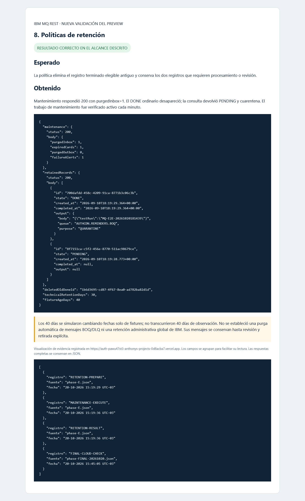

*Vista generada de las respuestas de esta ronda; no es una captura de IBM Console.*

### Evidencias originales de este requisito

**`RETENTION-PREPARE` · 20-10-2026 15:19:29 UTC−03 · PASS.** [Registro original](respuestas/phase-E.json).

<details>
<summary>Ver petición, respuesta o consulta y estado completo registrado</summary>

```json
{
  "policy": [
    {
      "id": "1b6d3695-cd87-4f67-8ea0-ad782ba82d1d",
      "messageId": "ID:8F249ECBC5613098B7BCD94B9448757D0D6A19236439AFE3",
      "name": "old-done"
    },
    {
      "id": "8f7151ca-c5f2-456e-8770-511ac98679ce",
      "messageId": "ID:8951C973BAF7487C8BB7FA05208E2C21CEA414C44C0D180F",
      "name": "old-pending"
    },
    {
      "id": "700dafdd-458c-4209-91ca-8771b3c06c3b",
      "messageId": "ID:4EA37104F64882C096465B8446C05C1AC66DA78CE1544477",
      "name": "old-quarantine"
    }
  ],
  "note": "Inyección de fechas de ensayo en la base real; no son 40 días de observación transcurridos."
}
```

</details>

**`MAINTENANCE-EXECUTE` · 20-10-2026 15:19:36 UTC−03 · PASS.** [Registro original](respuestas/phase-E.json).

<details>
<summary>Ver petición, respuesta o consulta y estado completo registrado</summary>

```json
{
  "status": 200,
  "body": {
    "purgedInbox": 1,
    "expiredCards": 1,
    "purgedOutbox": 0,
    "failureAlerts": 1
  }
}
```

</details>

**`RETENTION-RESULT` · 20-10-2026 15:19:36 UTC−03 · PASS.** [Registro original](respuestas/phase-E.json).

<details>
<summary>Ver petición, respuesta o consulta y estado completo registrado</summary>

```json
{
  "status": 200,
  "body": [
    {
      "id": "700dafdd-458c-4209-91ca-8771b3c06c3b",
      "state": "DONE",
      "created_at": "2026-09-10T18:19:29.364+00:00",
      "completed_at": "2026-09-10T18:19:29.364+00:00",
      "output": {
        "body": "{\"testRun\":\"MQ-E2E-20261020181439\"}",
        "queue": "AUTHCDN.REMINDERS.BOQ",
        "purpose": "QUARANTINE"
      }
    },
    {
      "id": "8f7151ca-c5f2-456e-8770-511ac98679ce",
      "state": "PENDING",
      "created_at": "2026-09-10T18:19:28.773+00:00",
      "completed_at": null,
      "output": null
    }
  ]
}
```

</details>

**`FINAL-CLOUD-CHECK` · 20-10-2026 15:45:05 UTC−03 · PASS.** [Registro original](respuestas/phase-FINAL-20261020.json).

<details>
<summary>Ver petición, respuesta o consulta y estado completo registrado</summary>

```json
{
  "activeTestReminders": 0,
  "health": {
    "deliveryRetries": 0,
    "failedPublications": 0,
    "pendingInbox": 0,
    "quarantined": 13,
    "staleInbox": 0
  },
  "jobs": [
    {
      "active": true,
      "name": "authcdn-mq-rest-minute",
      "schedule": "* * * * *"
    },
    {
      "active": true,
      "name": "authcdn-mq-maintenance",
      "schedule": "* * * * *"
    }
  ],
  "origin": "https://auth-pawu47st3-anthonys-projects-0d8acba7.vercel.app",
  "permanentTarget": "https://auth-cdn-git-feature-mq-consumidor-anthonys-projects-0d8acba7.vercel.app",
  "temporaryTables": 0,
  "temporaryVaultEntries": 0,
  "testFaultFunctions": 0,
  "testFaultTriggers": 0
}
```

</details>


<a id="r9"></a>

## 9. Expiración de mensajes

**Cómo funciona.** IBM aplica el TTL del mensaje y deja de ofrecerlo al vencer. El mantenimiento SQL reconcilia el recordatorio que quedó sin procesar, conservando la publicación histórica.

**Prueba realizada.**

1. Publicar un mensaje persistente con TTL de 1200 ms.
2. Examinarlo antes y después de vencer, sin ejecutar DELETE sobre él.
3. Preparar además un recordatorio propio con vencimiento pasado y ejecutar mantenimiento.
4. Comprobar EXPIRED en el recordatorio y PUBLISHED en su outbox histórico.

**Resultado esperado.** POST 201; GET antes del vencimiento 200 y después 204 sin mensaje. SQL marca EXPIRED y conserva el hecho PUBLISHED.

**Resultado obtenido.** El mensaje fue visible con expiración restante y luego devolvió 204. La reconciliación dejó el recordatorio EXPIRED y el outbox PUBLISHED.

**Veredicto: correcto en el alcance descrito.**

**Alcance de esta evidencia.** 204 solo indica que no hay un mensaje disponible con ese selector. En este ensayo no se ejecutó DELETE y el TTL fue la causa comprobada. La reconciliación se probó con una fecha pasada preparada por SQL en un fixture.

### Respuestas y comprobación

El siguiente extracto selecciona campos y estados de los registros originales. Los nombres de agrupación son explicativos; las respuestas completas, sin esa selección, se conservan debajo.

```json
{
  "publication": {
    "request": {
      "role": "consumer",
      "method": "POST",
      "queue": "AUTHCDN.SUMMARY.REPLY.Q",
      "selector": {
        "expiry": 1200
      },
      "body": {
        "testRun": "MQ-E2E-20261020181439",
        "case": "broker-ttl"
      }
    },
    "status": 201,
    "body": "",
    "metadata": {
      "ibm-mq-md-messageId": "ID:414d51204155544843444e514d2020203736d56a18491e40"
    }
  },
  "beforeExpiry": {
    "request": {
      "role": "producer",
      "method": "GET",
      "queue": "AUTHCDN.SUMMARY.REPLY.Q",
      "selector": {
        "id": "ID:414d51204155544843444e514d2020203736d56a18491e40"
      },
      "body": null
    },
    "status": 200,
    "body": {
      "testRun": "MQ-E2E-20261020181439",
      "case": "broker-ttl"
    },
    "metadata": {
      "ibm-mq-md-messageId": "ID:414d51204155544843444e514d2020203736d56a18491e40",
      "ibm-mq-md-persistence": "persistent",
      "ibm-mq-md-expiry": "500"
    }
  },
  "afterExpiry": {
    "request": {
      "role": "producer",
      "method": "GET",
      "queue": "AUTHCDN.SUMMARY.REPLY.Q",
      "selector": {
        "id": "ID:414d51204155544843444e514d2020203736d56a18491e40"
      },
      "body": null
    },
    "status": 204,
    "body": "",
    "metadata": {}
  },
  "sqlReconciliation": {
    "reminder": {
      "status": 200,
      "body": [
        {
          "id": "9dcd7891-d007-4cf2-8d8e-4ab9404eaaaf",
          "status": "EXPIRED",
          "expires_at": "2026-10-20T18:18:36.024+00:00"
        }
      ]
    },
    "outbox": {
      "status": 200,
      "body": [
        {
          "event_id": "f447cc35-148c-4005-8f16-e2d805256311",
          "status": "PUBLISHED",
          "published_at": "2026-10-20T18:19:36.212+00:00"
        }
      ]
    }
  }
}
```

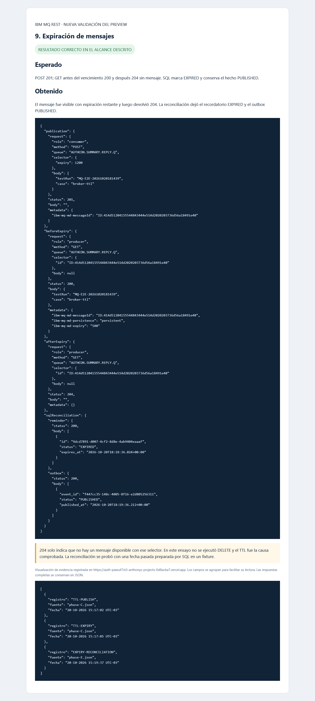

*Vista generada de las respuestas de esta ronda; no es una captura de IBM Console.*

### Evidencias originales de este requisito

**`TTL-PUBLISH` · 20-10-2026 15:17:02 UTC−03 · PASS.** [Registro original](respuestas/phase-C.json).

<details>
<summary>Ver petición, respuesta o consulta y estado completo registrado</summary>

```json
{
  "request": {
    "role": "consumer",
    "method": "POST",
    "queue": "AUTHCDN.SUMMARY.REPLY.Q",
    "selector": {
      "expiry": 1200
    },
    "body": {
      "testRun": "MQ-E2E-20261020181439",
      "case": "broker-ttl"
    }
  },
  "status": 201,
  "body": "",
  "metadata": {
    "ibm-mq-md-messageId": "ID:414d51204155544843444e514d2020203736d56a18491e40"
  }
}
```

</details>

**`TTL-EXPIRY` · 20-10-2026 15:17:05 UTC−03 · PASS.** [Registro original](respuestas/phase-C.json).

<details>
<summary>Ver petición, respuesta o consulta y estado completo registrado</summary>

```json
{
  "before": {
    "request": {
      "role": "producer",
      "method": "GET",
      "queue": "AUTHCDN.SUMMARY.REPLY.Q",
      "selector": {
        "id": "ID:414d51204155544843444e514d2020203736d56a18491e40"
      },
      "body": null
    },
    "status": 200,
    "body": {
      "testRun": "MQ-E2E-20261020181439",
      "case": "broker-ttl"
    },
    "metadata": {
      "ibm-mq-md-messageId": "ID:414d51204155544843444e514d2020203736d56a18491e40",
      "ibm-mq-md-persistence": "persistent",
      "ibm-mq-md-expiry": "500"
    }
  },
  "after": {
    "request": {
      "role": "producer",
      "method": "GET",
      "queue": "AUTHCDN.SUMMARY.REPLY.Q",
      "selector": {
        "id": "ID:414d51204155544843444e514d2020203736d56a18491e40"
      },
      "body": null
    },
    "status": 204,
    "body": "",
    "metadata": {}
  }
}
```

</details>

**`EXPIRY-RECONCILIATION` · 20-10-2026 15:19:37 UTC−03 · PASS.** [Registro original](respuestas/phase-E.json).

<details>
<summary>Ver petición, respuesta o consulta y estado completo registrado</summary>

```json
{
  "reminder": {
    "status": 200,
    "body": [
      {
        "id": "9dcd7891-d007-4cf2-8d8e-4ab9404eaaaf",
        "status": "EXPIRED",
        "expires_at": "2026-10-20T18:18:36.024+00:00"
      }
    ]
  },
  "outbox": {
    "status": 200,
    "body": [
      {
        "event_id": "f447cc35-148c-4005-8f16-e2d805256311",
        "status": "PUBLISHED",
        "published_at": "2026-10-20T18:19:36.212+00:00"
      }
    ]
  }
}
```

</details>


<a id="r10"></a>

## 10. Alertas de fallos

**Cómo funciona.** Si el productor agota los intentos, el outbox queda FAILED. El mantenimiento genera una notificación para el responsable; el usuario la recibe por la API autenticada y la ve en Avisos. Un identificador estable evita duplicarla.

**Prueba realizada.**

1. Preparar un evento válido con TTL vencido: la validación del transporte rechaza el envío antes de efectuar un POST a IBM.
2. Permitir cinco intentos normales hasta FAILED.
3. Esperar al Cron de mantenimiento y comprobar la alerta.
4. Ejecutar más ciclos y verificar que sigue existiendo una sola alerta para ese fallo; consultar Avisos con JWT.

**Resultado esperado.** FAILED con attempts=5 genera una alerta visible al responsable. Las ejecuciones repetidas no la duplican.

**Resultado obtenido.** Outbox FAILED con attempts=5. Mantenimiento creó una alerta; los ciclos siguientes conservaron una sola. GET /api/notifications con sesión válida respondió 200 y contenía ese mismo id de aviso.

**Veredicto: correcto en el alcance descrito.**

**Alcance de esta evidencia.** El error del productor fue un TTL vencido validado antes de enviar HTTP a IBM, no una caída del broker. FAILED no se insertó manualmente. La alerta implementada es interna de la aplicación; no se configuró correo ni SMS.

### Respuestas y comprobación

El siguiente extracto selecciona campos y estados de los registros originales. Los nombres de agrupación son explicativos; las respuestas completas, sin esa selección, se conservan debajo.

```json
{
  "failedPublication": {
    "status": 200,
    "body": [
      {
        "event_id": "bf4e57cf-cda1-4e29-9ef7-34717e85beee",
        "status": "FAILED",
        "attempts": 5,
        "last_error": "MQ_PUBLICATION_UNCONFIRMED"
      }
    ]
  },
  "alert": {
    "id": "dfcb882f-9bae-4278-bc80-094f544f2307",
    "event_id": "2ab94028-4e88-b77a-d26b-5de7506f9ce8",
    "message": "No se pudo entregar un recordatorio tras agotar los reintentos. Solicita revisión al responsable del tablero.",
    "created_at": "2026-10-20T18:27:00.037123+00:00"
  },
  "alertsAfterExtraCycles": 1,
  "authenticatedNotificationsHttp": 200,
  "sameAlertPresentInUserResponse": true
}
```

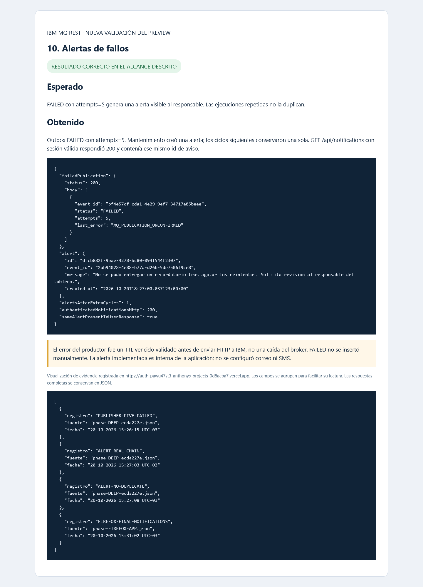

*Vista generada de las respuestas de esta ronda; no es una captura de IBM Console.*


*Captura real: la primera alerta corresponde al fallo de la ronda ecda227e, con su fecha de esta ronda visible en pantalla.*

### Evidencias originales de este requisito

**`PUBLISHER-FIVE-FAILED` · 20-10-2026 15:26:15 UTC−03 · PASS.** [Registro original](respuestas/phase-DEEP-ecda227e.json).

<details>
<summary>Ver petición, respuesta o consulta y estado completo registrado</summary>

```json
{
  "status": 200,
  "body": [
    {
      "event_id": "bf4e57cf-cda1-4e29-9ef7-34717e85beee",
      "status": "FAILED",
      "attempts": 5,
      "last_error": "MQ_PUBLICATION_UNCONFIRMED"
    }
  ]
}
```

</details>

**`ALERT-REAL-CHAIN` · 20-10-2026 15:27:03 UTC−03 · PASS.** [Registro original](respuestas/phase-DEEP-ecda227e.json).

<details>
<summary>Ver petición, respuesta o consulta y estado completo registrado</summary>

```json
{
  "outbox": {
    "status": 200,
    "body": [
      {
        "event_id": "bf4e57cf-cda1-4e29-9ef7-34717e85beee",
        "status": "FAILED",
        "attempts": 5,
        "last_error": "MQ_PUBLICATION_UNCONFIRMED"
      }
    ]
  },
  "notifications": {
    "status": 200,
    "body": [
      {
        "id": "dfcb882f-9bae-4278-bc80-094f544f2307",
        "event_id": "2ab94028-4e88-b77a-d26b-5de7506f9ce8",
        "message": "No se pudo entregar un recordatorio tras agotar los reintentos. Solicita revisión al responsable del tablero.",
        "created_at": "2026-10-20T18:27:00.037123+00:00"
      }
    ]
  },
  "note": "FAILED fue producido por los reintentos, no insertado manualmente."
}
```

</details>

**`ALERT-NO-DUPLICATE` · 20-10-2026 15:27:08 UTC−03 · PASS.** [Registro original](respuestas/phase-DEEP-ecda227e.json).

<details>
<summary>Ver petición, respuesta o consulta y estado completo registrado</summary>

```json
{
  "tick": {
    "request": {
      "method": "POST",
      "path": "/api/mq/tick",
      "body": {}
    },
    "elapsedMs": 4831,
    "status": 200,
    "body": {
      "published": 0,
      "captured": 0,
      "worked": 0,
      "errors": 0
    }
  },
  "notifications": {
    "status": 200,
    "body": [
      {
        "id": "dfcb882f-9bae-4278-bc80-094f544f2307",
        "event_id": "2ab94028-4e88-b77a-d26b-5de7506f9ce8",
        "message": "No se pudo entregar un recordatorio tras agotar los reintentos. Solicita revisión al responsable del tablero.",
        "created_at": "2026-10-20T18:27:00.037123+00:00"
      }
    ]
  }
}
```

</details>

**`FIREFOX-FINAL-NOTIFICATIONS` · 20-10-2026 15:31:02 UTC−03 · PASS.** [Registro original](respuestas/phase-FIREFOX-APP.json).

<details>
<summary>Ver petición, respuesta o consulta y estado completo registrado</summary>

```json
{
  "request": {
    "method": "GET",
    "path": "/api/notifications",
    "jwt": "validado; valor omitido"
  },
  "status": 200,
  "body": {
    "notifications": [
      {
        "id": "9195abe7-02de-4a94-90de-707df8e16bb6",
        "card_id": "26d1cf68-ee61-472c-a2fb-16325e12ec4b",
        "message": "La tarjeta \"MQ-E2E-20261020181439 cron-autonomo\" vence el 2026-10-20T18:59:17Z.",
        "created_at": "2026-10-20T18:30:16.870428+00:00",
        "read_at": null
      },
      {
        "id": "dfcb882f-9bae-4278-bc80-094f544f2307",
        "card_id": "00a44acf-89f6-439e-aaa3-3f62c9d01e6d",
        "message": "No se pudo entregar un recordatorio tras agotar los reintentos. Solicita revisión al responsable del tablero.",
        "created_at": "2026-10-20T18:27:00.037123+00:00",
        "read_at": null
      },
      {
        "id": "47e78e00-5c1b-425a-b351-4565652c6b48",
        "card_id": "447981e5-495a-46de-9763-71357a5682c6",
        "message": "La tarjeta \"MQ-E2E-20261020181439 ecda227e interrupcion-real-rpc\" vence el 2026-10-20T19:24:19Z.",
        "created_at": "2026-10-20T18:24:38.171233+00:00",
        "read_at": null
      },
      {
        "id": "2aab643a-8e90-49fa-a78a-316ec24a7f18",
        "card_id": "819e0ad9-fa08-4f78-95ea-5dfb22ccac31",
        "message": "La tarjeta \"MQ-E2E-20261020181439 vencimiento\" está vencida.",
        "created_at": "2026-10-20T18:20:19.536008+00:00",
        "read_at": null
      },
      {
        "id": "05c7c201-022b-47af-a5d7-10a7c70decca",
        "card_id": "819e0ad9-fa08-4f78-95ea-5dfb22ccac31",
        "message": "La tarjeta \"MQ-E2E-20261020181439 vencimiento\" vence el 2026-10-20T18:20:15Z.",
        "created_at": "2026-10-20T18:19:54.041034+00:00",
        "read_at": null
      },
      {
        "id": "5722839b-401b-4add-a08a-51b75b67cd4a",
        "card_id": "40fa8c16-8134-4e80-8abb-43d21d3fa5a8",
        "message": "No se pudo entregar un recordatorio tras agotar los reintentos. Solicita revisión al responsable del tablero.",
        "created_at": "2026-10-20T18:19:35.646364+00:00",
        "read_at": null
      },
      {
        "id": "34416025-503d-47d6-9639-ac8f97c6abe5",
        "card_id": "781ea7cf-f469-44eb-9eeb-ffd32f244912",
        "message": "La tarjeta \"MQ-E2E-20261020181439 normal\" vence el 2026-10-20T18:36:15Z.",
        "created_at": "2026-10-20T18:16:31.117028+00:00",
        "read_at": "2026-10-20T18:16:46.018+00:00"
      },
      {
        "id": "aee13992-3ea4-4a05-b789-ae3e617a3fd2",
        "card_id": "693c0929-b042-4811-ab78-c0273ee70c70",
        "message": "No se pudo entregar un recordatorio tras agotar los reintentos. Solicita revisión al responsable del tablero.",
        "created_at": "2026-10-20T03:50:00.02134+00:00",
        "read_at": null
      },
      {
        "id": "0c0cc90a-cc9b-46d1-a2fe-ab13bf56a39a",
        "card_id": "56453971-70c2-4612-986b-4466862b39f2",
        "message": "La tarjeta \"MQ-E2E-20261020004000 155d2be1 interrupcion-real-rpc\" vence el 2026-10-20T04:47:07Z.",
        "created_at": "2026-10-20T03:47:26.073471+00:00",
        "read_at": null
      },
      {
        "id": "50ad3546-69bd-4f15-83a9-ccd82832b3f9",
        "card_id": "fe7205b6-73f9-4263-914e-6bcad9e3f216",
        "message": "No se pudo entregar un recordatorio tras agotar los reintentos. Solicita revisión al responsable del tablero.",
        "created_at": "2026-10-20T03:43:00.038349+00:00",
        "read_at": null
      },
      {
        "id": "b81b773b-e04e-47d0-98ad-08ea8bd16f45",
        "card_id": "6770bf98-0838-4e7b-ae91-31f29731893e",
        "message": "La tarjeta \"MQ-E2E-20261020004000 ffea3cca interrupcion-real-rpc\" vence el 2026-10-20T04:41:57Z.",
        "created_at": "2026-10-20T03:42:04.260158+00:00",
        "read_at": null
      },
      {
        "id": "0e244320-b336-4b41-8842-a28a5aae5b3e",
        "card_id": "bd53b87f-b0af-4479-bcc2-a38d35f3f47f",
        "message": "La tarjeta \"MQ-E2E-20261020004000 ffea3cca cinco-reintentos-consumidor\" vence el 2026-10-20T04:39:46Z.",
        "created_at": "2026-10-20T03:41:56.697112+00:00",
        "read_at": null
      },
      {
        "id": "4911bd42-4520-4bdb-b927-097be3edc993",
        "card_id": "bfc16927-5eba-45ca-b3af-53392778447a",
        "message": "La tarjeta \"MQ-E2E-20261020004000 cron-autonomo\" vence el 2026-10-20T01:42:46Z.",
        "created_at": "2026-10-20T01:14:02.933951+00:00",
        "read_at": null
      },
      {
        "id": "b844a3ae-2014-44a8-9e0d-436e50d2586a",
        "card_id": "a49a239e-193f-484b-a654-cd05e03c8166",
        "message": "La tarjeta \"MQ-E2E-20261020004000 vencimiento\" está vencida.",
        "created_at": "2026-10-20T01:03:23.398854+00:00",
        "read_at": null
      },
      {
        "id": "9b61c9f9-bf72-4bf7-b04e-c1fb15d37ac2",
        "card_id": "a49a239e-193f-484b-a654-cd05e03c8166",
        "message": "La tarjeta \"MQ-E2E-20261020004000 vencimiento\" vence el 2026-10-20T01:03:20Z.",
        "created_at": "2026-10-20T01:02:58.666063+00:00",
        "read_at": null
      },
      {
        "id": "25f6608b-cb48-4721-916f-c83a76a4b336",
        "card_id": "1aa7a690-2402-4af5-b981-00b408a7d663",
        "message": "No se pudo entregar un recordatorio tras agotar los reintentos. Solicita revisión al responsable del tablero.",
        "created_at": "2026-10-20T01:01:55.075413+00:00",
        "read_at": null
      },
      {
        "id": "c54d9158-b6b2-4576-b479-dcaa8c7897b9",
        "card_id": "c65fade2-7ae4-4ccb-be7d-9c43229caa2c",
        "message": "La tarjeta \"MQ-E2E-20261020004000 normal\" vence el 2026-10-20T01:11:08Z.",
        "created_at": "2026-10-20T00:51:22.247911+00:00",
        "read_at": "2026-10-20T00:51:36.192+00:00"
      },
      {
        "id": "fd24fa87-8588-44e5-a4d4-cbf0ef0fa6ec",
        "card_id": "3a060d08-4602-4864-9c98-aeaff00c9bc8",
        "message": "La tarjeta \"Prueba TASK_OVERDUE\" está vencida.",
        "created_at": "2026-10-20T00:49:57.990091+00:00",
        "read_at": null
      },
      {
        "id": "76819338-3702-40bc-a1f5-fa66608f4808",
        "card_id": "3a060d08-4602-4864-9c98-aeaff00c9bc8",
        "message": "La tarjeta \"Prueba TASK_OVERDUE\" está vencida.",
        "created_at": "2026-10-19T14:44:31.638021+00:00",
        "read_at": null
      },
      {
        "id": "e45b3165-7081-42bc-a768-41dcad8a12aa",
        "card_id": "cfa02c59-2e15-4122-af77-8d034dda2cf6",
        "message": "La tarjeta \"Prueba recordatorio MQ\" vence el 2026-10-19T03:01:46Z.",
        "created_at": "2026-10-19T02:49:00.502704+00:00",
        "read_at": null
      }
    ]
  },
  "visibleText": "Auth DCN\nWorkspaces\nAvisos\nSupabase\nAvisos\nActualizar\nLa tarjeta \"MQ-E2E-20261020181439 cron-autonomo\" vence el 2026-10-20T18:59:17Z.\n20/10/2026, 15:30:16\nMarcar leído\nNo se pudo entregar un recordatorio tras agotar los reintentos. Solicita revisión al responsable del tablero.\n20/10/2026, 15:27:00\nMarcar leído\nLa tarjeta \"MQ-E2E-20261020181439 ecda227e interrupcion-real-rpc\" vence el 2026-10-20T19:24:19Z.\n20/10/2026, 15:24:38\nMarcar leído\nLa tarjeta \"MQ-E2E-20261020181439 vencimiento\" está vencida.\n20/10/2026, 15:20:19\nMarcar leído\nLa tarjeta \"MQ-E2E-20261020181439 vencimiento\" vence el 2026-10-20T18:20:15Z.\n20/10/2026, 15:19:54\nMarcar leído\nNo se pudo entregar un recordatorio tras agotar los reintentos. Solicita revisión al responsable del tablero.\n20/10/2026, 15:19:35\nMarcar leído\nLa tarjeta \"MQ-E2E-20261020181439 normal\" vence el 2026-10-20T18:36:15Z.\n20/10/2026, 15:16:31\nNo se pudo entregar un recordatorio tras agotar los reintentos. Solicita revisión al responsable del tablero.\n20/10/2026, 00:50:00\nMarcar leído\nLa tarjeta \"MQ-E2E-20261020004000 155d2be1 interrupcion-real-rpc\" vence el 2026-10-20T04:47:07Z.\n20/10/2026, 00:47:26\nMarcar leído\nNo se pudo entregar un recordatorio tras agotar los reintentos. Solicita revisión al responsable del tablero.\n20/10/2026, 00:43:00\nMarcar leído\nLa tarjeta \"MQ-E2E-20261020004000 ffea3cca interrupcion-real-rpc\" vence el 2026-10-20T04:41:57Z.\n20/10/2026, 00:42:04\nMarcar leído\nLa tarjeta \"MQ-E2E-20261020004000 ffea3cca cinco-reintentos-consumidor\" vence el 2026-10-20T04:39:46Z.\n20/10/2026, 00:41:56\nMarcar leído\nLa tarjeta \"MQ-E2E-20261020004000 cron-autonomo\" vence el 2026-10-20T01:42:46Z.\n19/10/2026, 22:14:02\nMarcar leído\nLa tarjeta \"MQ-E2E-20261020004000 vencimiento\" está vencida.\n19/10/2026, 22:03:23\nMarcar leído\nLa tarjeta \"MQ-E2E-20261020004000 vencimiento\" vence el 2026-10-20T01:03:20Z.\n19/10/2026, 22:02:58\nMarcar leído\nNo se pudo entregar un recordatorio tras agotar los reintentos. Solicita revisión al responsable del tablero.\n19/10/2026, 22:01:55\nMarcar leído\nLa tarjeta \"MQ-E2E-20261020004000 normal\" vence el 2026-10-20T01:11:08Z.\n19/10/2026, 21:51:22\nLa tarjeta \"Prueba TASK_OVERDUE\" está vencida.\n19/10/2026, 21:49:57\nMarcar leído\nLa tarjeta \"Prueba TASK_OVERDUE\" está vencida.\n19/10/2026, 11:44:31\nMarcar leído\nLa tarjeta \"Prueba recordatorio MQ\" vence el 2026-10-19T03:01:46Z.\n18/10/2026, 23:49:00\nMarcar leído",
  "screenshot": "01-app-avisos-preview.png"
}
```

</details>


## Anexos y trazabilidad

Las respuestas de esta revalidación están en la carpeta respuestas/ de este informe. Esta es la única ronda de documentación de pruebas conservada en el proyecto. Las imágenes de respuestas son vistas generadas de esos JSON; las capturas reales de la aplicación y de IBM MQ Console están identificadas. Las colas temporales y las inyecciones SQL de esta ronda se retiraron; los dos Cron permanentes anteriores se conservaron. El Cron temporal del nuevo preview, sus secretos y su tabla de trazabilidad se retiraron después de registrar sus respuestas. No se modifica producción al preparar esta edición.

- [Configuración permanente y comprobación de DLQ](cron-del-preview.md).
- [Estado final y limpieza](respuestas/phase-FINAL-20261020.json).
- [Integridad SHA-256](sha256.txt).
