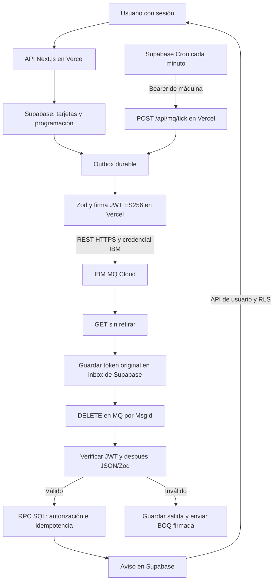

# IBM MQ: flujo completo, escenarios y seguridad

Revisión documental: 21 de octubre de 2026. Repositorio `auth-cdn`, rama **`refactor/estructura-ibm-mq`**. Código de referencia: **`960d0bfd756cebf570baa82ab60e1c9f21cc54c5`**, que incorpora la firma JWT de los mensajes.

**Estado real:** implementación en código y validación local disponibles. La nueva firma **no se ha desplegado ni probado de extremo a extremo en cloud** desde este computador. No se cambiaron claves remotas, Vault ni Cron. Las evidencias cloud del 20 de octubre son anteriores a la firma y no demuestran su activación.

## Índice de estudio

1. [Quién hace cada cosa](#1-quién-hace-cada-cosa).
2. [Conceptos desde cero](#2-conceptos-desde-cero).
3. [Flujo asíncrono de recordatorios](#3-flujo-asíncrono-de-recordatorios).
4. [Cómo entra y sale el cuerpo del archivo message-jwt](#4-cómo-entra-y-sale-el-cuerpo-del-archivo-message-jwt).
5. [Flujo síncrono Request/Reply](#5-flujo-síncrono-requestreply).
6. [ACK, persistencia, reintentos y estados](#6-ack-persistencia-reintentos-y-estados).
7. [Mapa de escenarios y pruebas](#7-mapa-de-escenarios-y-pruebas).
8. [Seguridad por capa](#8-seguridad-por-capa).
9. [Configuración, cabeceras y tiempos](#9-configuración-cabeceras-y-tiempos).
10. [Mapa de archivos y funciones](#10-mapa-de-archivos-y-funciones).
11. [Cómo demostrarlo sin credenciales cloud](#11-cómo-demostrarlo-sin-credenciales-cloud).
12. [Implementado, histórico y pendiente](#12-implementado-histórico-y-pendiente).

## 1. Quién hace cada cosa

La arquitectura de ejecución es **Vercel + Supabase Cloud + IBM MQ Cloud, sin workers locales permanentes**. Ejecutar pruebas en este computador no significa que la solución necesite un consumidor local.

| Componente | Responsabilidad real | Lo que no hace |
|---|---|---|
| Navegador | El usuario programa tarjetas, pide resúmenes y consulta avisos. | No recibe la clave privada de firma ni las credenciales MQ. |
| Supabase Auth | Identifica al usuario mediante su sesión; permite verificar MFA. | Su JWT de usuario no es la firma del mensaje MQ. |
| Supabase Postgres | Guarda tarjetas, recordatorios, outbox, inbox y avisos; aplica transacciones y controles de acceso. | No firma automáticamente los cuerpos MQ. |
| Supabase Cron | Despierta la API de Vercel cada minuto; otro trabajo ejecuta mantenimiento SQL. | No es un Cron de IBM ni publica directamente el JWT en IBM. |
| Vercel / Next.js | Ejecuta las rutas, productor, consumidor, firma/verificación y Request/Reply durante invocaciones acotadas. | No mantiene un proceso local encendido. |
| IBM MQ Cloud | Recibe, conserva y entrega mensajes mediante REST HTTPS y permisos propios del gestor. | No valida automáticamente nuestro JWT de aplicación ni las reglas de una tarjeta. |



El diagrama expresa dependencias lógicas. En `tick()` se atiende primero trabajo del inbox, después una publicación y luego capturas; un mensaje recién capturado se procesa en otra vuelta del ciclo o en una invocación posterior.

## 2. Conceptos desde cero

### Cron: el despertador

Cron programa una acción repetida. En este proyecto `* * * * *` significa **cada minuto**. Supabase ejecuta `pg_cron`; mediante `pg_net` hace una petición HTTP a Vercel. Es infraestructura de Supabase/Postgres, no una biblioteca de IBM. [Referencia oficial de Supabase Cron](https://supabase.com/docs/guides/cron).

En [mq-rest.sql](../../../supabase/cron/mq-rest.sql) existen dos definiciones: `authcdn-mq-rest-minute` llama a `/api/mq/tick`; `authcdn-mq-maintenance` llama a `mq_rest_maintenance()` dentro de Postgres. Que este archivo exista no demuestra que esos trabajos estén configurados actualmente en cloud.

### Zod: revisar la forma del dato

Zod es una biblioteca independiente de validación para TypeScript/JavaScript, instalada como dependencia `zod` en [package.json](../../../package.json). La dependencia declarada en este proyecto es `^3.23.8`; no es un servicio de IBM ni de Supabase.

Un esquema es una lista de condiciones: campos obligatorios, UUID, fechas, tipos, límites y campos extra permitidos o rechazados. `safeParse(valor)` devuelve éxito con `data` o un error; `parse(valor)` lanza un error si no cumple. [Uso básico oficial de Zod](https://zod.dev/basics) — la web vigente puede describir una versión posterior a la declarada aquí.

Aquí Zod valida programación HTTP, configuración, contratos de recordatorios, solicitudes/respuestas de resumen y claims JWT. **No solo define un contrato entre Supabase e IBM:** valida datos en varias fronteras. IBM transporta texto; es nuestro código el que comprueba el contrato. Zod no firma, no cifra y no concede permisos.

### Síncrono y asíncrono

- **Recordatorio asíncrono:** guardar la programación termina la petición del usuario. La publicación y el aviso ocurren después, impulsados por Cron. No se promete entrega al segundo exacto.
- **Resumen síncrono para el usuario:** la petición HTTP espera una respuesta, hasta el presupuesto disponible. Internamente usa colas y el patrón Request/Reply. Que exista `async/await` no define por sí solo el tipo de interacción.

### Los demás términos

| Término | Significado en este proyecto |
|---|---|
| Outbox | Tabla con un evento pendiente de publicar; permite recuperarlo tras una caída. |
| Inbox | Copia durable del mensaje recibido, antes de retirarlo de IBM; permite procesarlo después. |
| ACK | Confirmación de alguna etapa. Aquí hay distintas confirmaciones; no una única señal que demuestre todo. |
| Commit | Confirmación de una transacción. El runtime REST no usa llamadas MQI `MQCMIT`/`MQBACK`; usa HTTP y transacciones SQL separadas. |
| Idempotencia | Repetir un evento no debe crear dos avisos de negocio. Se apoya en identificadores y restricciones SQL. |
| Reintento | Volver a intentar una operación después de un fallo recuperable. |
| Backoff | Espera creciente entre intentos; no es lo mismo que backout nativo de MQ. |
| Backout / BOQ | Salida de un mensaje problemático hacia una cola de revisión. En este runtime la aplicación decide y publica la cuarentena. |
| DLQ / dead-letter | Cola del gestor para ciertos problemas de entrega del broker; no es la BOQ de nuestra validación. |
| Expiración / TTL | Plazo después del cual un mensaje o efecto deja de ser aceptable. Hay plazos distintos en MQ, JWT y negocio. |
| Persistencia | Se solicita a MQ almacenamiento persistente; además se conserva trabajo en Postgres. No equivale a ausencia de duplicados. |
| JWT firmado / JWS | Sobre que permite comprobar integridad y procedencia de una clave. El cuerpo continúa legible; no es cifrado JWE. [RFC 7515](https://www.rfc-editor.org/info/rfc7515/). |
| Request/Reply | Una solicitud viaja por una cola y su respuesta por otra, enlazadas por identificadores. |

## 3. Flujo asíncrono de recordatorios

Ejemplo: una tarjeta vence a las 15:00 y se programa aviso preventivo a las 14:45. Las fechas son ilustrativas; deben superar las comprobaciones de la API y de SQL.

| Paso | Qué lo dispara y qué sucede | Código principal | Protección / garantía |
|---|---|---|---|
| 1 | El usuario guarda las fechas y destinatarios mediante `PATCH /api/cards/[cardId]/schedule`. | [schedule/route.ts](../../../app/api/cards/[cardId]/schedule/route.ts), [cardOperation](../../../lib/cards/operaciones.ts). | Sesión verificada con `requireUser`; MFA si corresponde; Zod rechaza entrada inválida. |
| 2 | `schedule_card_reminders` bloquea la tarjeta, comprueba permisos, versión y fechas. Guarda recordatorios por destinatario en una transacción. | [0005_mq_programacion.sql](../../../supabase/migrations/0005_mq_programacion.sql). | Control de concurrencia por `expectedVersion`; pertenencia y destinatarios válidos. Si no se indican asignados, contempla al creador válido. |
| 3 | Se crean dos clases: `TASK_REMINDER_DUE` se activa en `notifyAt` y vence en `dueAt`; `TASK_OVERDUE` se activa en `dueAt` y vence 24 horas después. | `schedule_card_reminders`. | La vigencia forma parte del negocio; no se reutiliza indefinidamente el mismo evento. |
| 4 | Cada minuto Supabase Cron llama a `POST /api/mq/tick`. | [mq-rest.sql](../../../supabase/cron/mq-rest.sql), [tick/route.ts](../../../app/api/mq/tick/route.ts). | HTTPS y secreto privado `MQ_CRON_SECRET`, independiente del usuario y de IBM. |
| 5 | `tick()` invoca `enqueue_due_reminders(100)`. Pasa lo elegible de `SCHEDULED` a `QUEUED` e inserta outbox de manera atómica. Cancela o expira lo que ya no corresponda. | [cloud.ts](../application/cloud.ts), [0006_mq_scheduler.sql](../../../supabase/migrations/0006_mq_scheduler.sql). | Bloqueos `SKIP LOCKED`, transacción y restricciones de unicidad. |
| 6 | `claim_notification_event` reserva un evento con token y lease de 120 segundos; revalida su elegibilidad. `publishNext` valida el payload con Zod y su `eventId`. | [productor.ts](../application/productor.ts), [0007_mq_productor.sql](../../../supabase/migrations/0007_mq_productor.sql). | Solo RPC técnica autorizada; no se publica un contrato inválido. |
| 7 | `producer.send` pasa el JSON a `withMessageSigning`; `sign` lo envuelve en JWT/JWS ES256 con destino, vigencia e identificador. | [message-jwt.ts](../infrastructure/message-jwt.ts), `cloud.ts`, línea 89. | Firma con clave privada de mensajería. No usa el JWT del usuario. |
| 8 | `createRestMq.send` hace POST del **token** a `AUTHCDN.REMINDERS.Q`, solicitando persistencia y TTL restante. Tras confirmación válida, se registra `PUBLISHED`. | [rest.ts](../infrastructure/rest.ts), `finish_notification_event`. | HTTPS, autenticación IBM Basic, allowlist de colas; fallo ambiguo no se declara éxito. |
| 9 | El consumidor hace GET/browse, guarda token y metadatos en `mq_rest_inbox`, y solo después DELETE por ese MsgId. | [captureNext](../application/inbox.ts), [0009_mq_rest_inbox.sql](../../../supabase/migrations/0009_mq_rest_inbox.sql). | Copia durable antes de retirar. Si guardar falla, no se ejecuta DELETE. |
| 10 | Otro paso de trabajo reserva el inbox; `handle` verifica firma, emisor, destino, tiempos y contexto. Luego interpreta JSON y valida el contrato con Zod. | `cloud.ts`, líneas 37–53; `message-jwt.ts`, `verify`. | Firma incorrecta/sin firma: cuarentena antes de SQL de negocio. **La autenticación ocurre después de capturar y retirar, no antes del DELETE.** |
| 11 | `process_reminder_event` revalida tarjeta, versión, vigencia, destinatario y membresía; inserta el aviso y marca el recordatorio en una transacción. | [0008_mq_consumidor.sql](../../../supabase/migrations/0008_mq_consumidor.sql). | Idempotencia por estado e índices; un evento válido criptográficamente puede ser cancelado por negocio. |
| 12 | Se marca el inbox `DONE` si terminó. Si hay error recuperable conserva el trabajo; si es inválido prepara BOQ. | `processJob` y `mq_rest_update`. | Salidas persistidas antes de enviar; recuperación por lease. |
| 13 | El usuario consulta `GET /api/notifications`; puede marcar leído mediante `PATCH /api/notifications/[notificationId]`. | [notifications/route.ts](../../../app/api/notifications/route.ts), [ruta individual](../../../app/api/notifications/[notificationId]/route.ts). | Sesión verificada y RLS de avisos propios. Leer un aviso no es el ACK del broker. |

No se usa una transacción distribuida que abarque simultáneamente IBM y Postgres. Si el POST llegó a IBM pero su respuesta o la actualización SQL se perdieron, puede repetirse la publicación: la protección correcta es conservar el evento y deduplicar el efecto, no prometer entrega exactamente una vez.

## 4. Cómo entra y sale el cuerpo del archivo message-jwt

**Nadie pasa un mensaje “dentro del archivo” manualmente.** `cloud.ts` crea un objeto que tiene una función `send`. Esa función llama a otra función, pasándole el texto como argumento. `message-jwt.ts` contiene esas funciones, no una cola ni un archivo donde depositar mensajes.

### Salida: objeto → texto → token → HTTP

1. En `cloud.ts`, `event` es el objeto del recordatorio validado.
2. `JSON.stringify(event)` lo convierte a texto.
3. `producer` fue creado con `withMessageSigning(createRestMq(...), authentication)`; por eso su `send` primero firma.
4. El adaptador recibe `queue`, `body` y `options`. En ese punto **`body` es exactamente el texto del paso 2**.
5. `authentication.sign(queue, body, options)` coloca ese texto en el claim `body`, agrega contexto y firma con la clave privada. Devuelve un token `cabecera.payload.firma`.
6. El `transport.send` original recibe ese token como segundo argumento. `fetch` lo utiliza como cuerpo del POST a IBM. La clave privada nunca se envía en ese cuerpo.

Fragmentos reales, abreviados a las llamadas esenciales:

```ts
await producer.send(config.MQ_QUEUE, JSON.stringify(event), { expiresAt: event.expiresAt });
```

```ts
export function withMessageSigning(transport: MqTransport, authentication: MessageAuthentication): MqTransport {
  return { ...transport, async send(queue, body, options) {
    return transport.send(queue, await authentication.sign(queue, body, options), options);
  } };
}
```

Dentro de `sign`, la construcción empieza con `new SignJWT({ body, context: context(queue, options) })` y termina con `.sign(key)`. `jose` es la biblioteca criptográfica utilizada; Zod comprueba formas y configuración, no genera la firma.

### Llegada: token → verificación → texto → objeto

1. IBM entrega el token como texto; el inbox lo guarda en `job.body` **todavía sin confiar en él**.
2. `cloud.ts` llama a `authentication.verify(job.queue_name, job.body, metadatos)`.
3. `jwtVerify` comprueba el token con la clave pública configurada. El código además coteja claims y metadatos de IBM.
4. Si todo es válido, `verify` devuelve `claims.body`: el mismo texto de negocio que se firmó.
5. Solo entonces `JSON.parse(authenticatedBody)` recupera el objeto; Zod valida su contrato; SQL comprueba permisos y estado actual.

```text
event (objeto)
  → JSON.stringify(event) (texto de negocio)
  → sign(cola, texto, opciones) (JWT firmado)
  → POST IBM → GET IBM → inbox.job.body (JWT original)
  → verify(cola, token, metadatos) (texto autenticado)
  → JSON.parse → Zod → process_reminder_event
```

Las mismas funciones firman solicitudes de resumen, respuestas y sobres BOQ. El adaptador REST genérico **no firma por sí solo**: el runtime cloud envuelve sus identidades productor y consumidor. El legado nativo no se transforma automáticamente por este cambio.

### Qué se firma y qué no

El JWT incluye `iss` (emisor), `aud` (gestor/cola), `iat` (emisión), `exp` (vencimiento), `jti` (identificador), `body` (texto) y `context` (gestor, cola, CorrelId y ReplyTo). La cabecera exige `alg: ES256`, `typ: authcdn-mq+jwt` y un `kid` confiable.

Se detectan modificaciones del texto o del contexto comprobado. El MsgId asignado por IBM después del POST **no es un campo que el emisor pueda firmar anticipadamente**. El identificador lógico `eventId`/`requestId`/`inboxId` sí se relaciona con `jti`. Los metadatos de persistencia/TTL no están todos incluidos como claims: se fijan en transporte y se complementan con vigencia JWT y de negocio.

**Una firma acredita una clave de aplicación, no demuestra por sí sola que un usuario particular autorizó cada campo.** La autorización de usuario y las comprobaciones SQL siguen siendo imprescindibles. El JWT firmado es legible: no contiene cifrado del cuerpo ni sustituye HTTPS.

## 5. Flujo síncrono Request/Reply

Entrada: `POST /api/boards/[boardId]/summary`. Salida exitosa: estadísticas del tablero, `requestId` y `generatedAt`.

| Paso | Operación y protección |
|---|---|
| 1 | La ruta verifica sesión/MFA aplicable, UUID, tablero y workspace activos, y membresía activa del usuario. No acepta un `userId` arbitrario del navegador: usa `session.user.id`. |
| 2 | `summary()` genera `requestId` UUID y una solicitud Zod con vigencia de 30 segundos. Firma y publica en `AUTHCDN.SUMMARY.REQUEST.Q` con ReplyTo fijo a `AUTHCDN.SUMMARY.REPLY.Q`. IBM devuelve el MsgId de solicitud. |
| 3 | La misma invocación intenta capturar esa solicitud **por su MsgId**, conservarla en inbox y procesarla. No espera al Cron de un minuto para poder responder interactivamente. Si la invocación se corta, Cron puede recuperar trabajo pendiente. |
| 4 | El consumidor verifica JWT, contrato y ReplyTo permitido. `crearResumenStore().consultar` vuelve a comprobar membresía y disponibilidad del tablero; calcula completadas, vencidas y pendientes con las tarjetas activas correspondientes. |
| 5 | Se guarda una salida `OUTPUT` con el JSON de respuesta, cola, `correlationId = MsgId de solicitud` y vigencia de respuesta de 60 segundos. Se firma al enviar y se publica con ese CorrelId. |
| 6 | El solicitante busca respuestas por CorrelId de su solicitud, las captura durablemente y lee la respuesta de su inbox. Antes de exponerla verifica de nuevo su JWT y contexto. |
| 7 | Valida contrato, `requestId` y `boardId`; vuelve a consultar el acceso del usuario antes de devolver los datos. Solicitudes concurrentes quedan separadas por MsgId/CorrelId/requestId. |
| 8 | La espera tiene presupuesto de 20 segundos y pausas de 150 ms entre vueltas. Si no termina, se devuelve error de timeout, mapeado a HTTP 504. No se inventa un resultado exitoso. |

Implementación: [ruta de resumen](../../../app/api/boards/[boardId]/summary/route.ts), [resumen-cliente.ts](../application/resumen-cliente.ts), `cloud.ts:116`, [tablero.ts](../infrastructure/tablero.ts), [domain/resumen.ts](../domain/resumen.ts).

Emisor y receptor son responsabilidades lógicas dentro de la misma aplicación Vercel; no se debe presentar este código como dos microservicios independientes desplegados. Tampoco hay una base para afirmar que el TTL de 30/60 segundos amplía el presupuesto HTTP de 20 segundos.

## 6. ACK, persistencia, reintentos y estados

### No confundir las confirmaciones

| Confirmación | Qué demuestra | Qué no demuestra |
|---|---|---|
| POST aceptado por IBM con MsgId válido | El transporte confirmó la publicación. | Que ya existe un aviso o que un usuario lo leyó. |
| `outbox.PUBLISHED` | Se registró la publicación confirmada en SQL. | Que el consumidor terminó. |
| Inbox guardado + DELETE por MsgId | La responsabilidad de recuperación pasa a nuestra copia durable. | Que la firma sea válida o el negocio esté procesado. |
| Transacción `process_reminder_event` | El efecto de negocio quedó confirmado o se determinó un resultado terminal. | Que ese mensaje no pueda volver a llegar. |
| `inbox.DONE` | Ese trabajo técnico terminó, incluyendo descarte terminal o envío de cuarentena. | No significa siempre “aviso entregado”; también puede acabar en BOQ. |
| Aviso leído | El usuario marcó una notificación como leída. | No es un commit MQ. |

El orden de captura evita perder el cuerpo si Vercel cae después del DELETE. Si falla el guardado, no retira. Si el DELETE es ambiguo, queda el inbox y puede reaparecer la misma captura. La clave única `(qmgr, queue_name, message_id)` deduplica; reutilizar el MsgId con un cuerpo distinto produce `MQ_MESSAGE_ID_COLLISION` y bloquea ese retiro.

### Tres circuitos de reintento diferentes

| Circuito | Disparador y comportamiento | Límite y final |
|---|---|---|
| Publicación de outbox | Firma/envío fallan o no hay confirmación; `finish_notification_event(..., RETRY)` reprograma. Un contrato inválido usa `INVALID`, no un reintento indiscriminado. | Máximo 5 intentos de publicación; `FAILED` al agotar, o antes por invalidez. Lease 120 s; backoff `min(300, 5 * 2^(attempts-1))` segundos. |
| Procesamiento de inbox `PENDING` | Una excepción recuperable del manejador conserva el cuerpo y reprograma. | Al quinto intento de manejo fallido prepara BOQ `RETRIES_EXHAUSTED`. Firma/JSON/contrato inválidos se desvían directamente, sin esperar cinco fallos de negocio. |
| Entrega de una salida `OUTPUT` | Falló enviar la respuesta o BOQ ya persistida. Reintenta la misma salida sin recalcular el negocio. | No hay corte automático por cantidad de intentos. Backoff limitado a 300 s. Una respuesta con plazo vencido termina sin reenviarse; BOQ no tiene ese TTL de transporte. |

Los tiempos son mínimos de elegibilidad, no garantía de que Cron corra exactamente en ese instante. El adaptador HTTP **no repite automáticamente un POST**: un timeout puede haber publicado. La repetición durable puede producir nuevos MsgId y tokens, conservando el identificador lógico del evento y el cuerpo de negocio persistido.

El runtime REST implementa recuperación con inbox, leases y SQL. **No usa un rollback MQI de una sesión de consumo ni incrementa deliberadamente un contador nativo `BackoutCount` con `MQBACK`.** No confundir ese mecanismo histórico con el backoff y BOQ de aplicación actuales.

### Estados por entidad

| Entidad | Estados importantes y significado |
|---|---|
| `task_reminders` | `SCHEDULED` programado → `QUEUED` con outbox → `PROCESSED` aplicado. También puede acabar `CANCELLED`, `EXPIRED` o `FAILED`. |
| `notification_outbox` | `PENDING` → `PROCESSING` reservado → `PUBLISHED`. Fallo recuperable vuelve a `PENDING`; terminal `FAILED`, `CANCELLED` o `EXPIRED`. Un `PUBLISHED` confirmado no se borra lógicamente al cancelar la tarjeta. |
| `mq_rest_inbox` | `PENDING` → `DONE`, o `PENDING` → `OUTPUT` → `DONE`. Los reintentos conservan el estado/trabajo adecuado; un token de reserva vencido no autoriza finalizarlo. |

### BOQ y DLQ no son lo mismo

- **BOQ de aplicación:** `AUTHCDN.REMINDERS.BOQ`, configurable. `quarantine()` guarda diagnóstico, origen, MsgId, intentos y `originalBody`. El sobre se firma al enviarse. No hay consumidor automático de BOQ ni botón de reproceso implementado en este flujo.
- **DLQ del broker:** la evidencia histórica utiliza `DEV.DEAD.LETTER.QUEUE` y mensajes de control nativos con cabecera MQDLH. Un error JSON/JWT de nuestra aplicación no se manda automáticamente a esa DLQ.
- Que IBM responda 4xx/5xx no significa que “todos esos fallos van a DLQ”: el productor registra reintento/fallo según el código. El comportamiento y permisos del gestor son configuración cloud externa.

### Tres expiraciones y una retención

1. **MQ TTL:** `rest.ts` calcula milisegundos restantes para `ibm-mq-md-expiry`; rechaza localmente un envío ya vencido y solicita mensajes persistentes mediante `ibm-mq-md-persistence: persistent`.
2. **JWT `exp`:** sigue `expiresAt` si existe, redondeado al segundo superior. El verificador tolera 5 segundos de desfase de reloj. Token vencido → BOQ antes de RPC de negocio.
3. **Negocio:** SQL y el manejador comprueban vigencia y estado actual. Una firma válida no revive una tarjeta completada ni una programación antigua. El mantenimiento reconcilia recordatorios `QUEUED` ya vencidos aunque MQ haya expirado su copia.
4. **Retención técnica:** mantenimiento elimina inbox `DONE` elegible de más de 30 días, excepto salidas `QUARANTINE`; elimina outbox `PUBLISHED/CANCELLED/EXPIRED` antiguo. Preserva pendientes, publicaciones `FAILED` y cuarentenas. No es una purga general de todos los avisos o de BOQ/DLQ.

BOQ sin `expiresAt` recibe JWT con vigencia de 24 horas, pero no TTL de transporte. Expirar ese token no elimina evidencia: una revisión forense posterior no debe confundir autenticidad histórica con permiso para aceptarlo de nuevo como mensaje vigente.

## 7. Mapa de escenarios y pruebas

**Cómo leer las tablas:** “implementado” describe el código revisado, no una certificación de despliegue. Las pruebas citadas son archivos del repositorio; usan dependencias controladas o PGlite, salvo que se indique expresamente evidencia cloud histórica. Los enlaces del apartado 10 localizan las funciones.

### A. Casos funcionales

| Caso | Qué lo dispara → pasos y resultado | Código y configuración | Pruebas / estado |
|---|---|---|---|
| A1. Programación normal | Guardar fechas válidas → sesión/contrato → RPC transaccional → dos tipos de recordatorio por destinatario. | Ruta `schedule`; `schedule_card_reminders`; `notifyAt`, `dueAt`, `expectedVersion`, `assigneeIds`. | `operaciones.test.ts`, `base-datos.test.ts`. Implementado. |
| A2. Aviso preventivo | Llega `notifyAt` → enqueue/outbox → firma/POST → inbox/verificación → SQL crea aviso. | `TASK_REMINDER_DUE`; cola `MQ_QUEUE`; vigencia hasta `dueAt`. | `base-datos`, `consumidor`, `cloud`. Implementado; flujo cloud anterior a firma documentado. |
| A3. Aviso vencido | Llega `dueAt` sin completarse → mismo circuito con otro tipo de evento. | `TASK_OVERDUE`; vigencia `dueAt + 24 h`. | `base-datos`, `consumidor`. Implementado. |
| A4. Reprogramación | El usuario cambia fechas/versiones → invalida trabajo anterior → genera nueva versión. Si llega el evento anterior, SQL no aplica el aviso obsoleto. | `schedule_card_reminders`, `invalidate_card_reminders`, `process_reminder_event`. | `base-datos`, `consumidor`. Implementado. |
| A5. Completar tarjeta | `POST /api/cards/[cardId]/complete` → autorización/versionado → invalida recordatorios pendientes. Un mensaje ya publicado no se “despublica”; se revalida al recibir. | Ruta `complete`, `complete_card`, trigger de invalidación. | `operaciones`, `base-datos`, `consumidor`. Implementado. |
| A6. Acceso revocado o archivo | Entre programar y consumir se revoca membresía o archiva/cambia la tarjeta/tablero → revalidación actual → cancelación sin efecto improcedente. | SQL 0005–0008; `crearResumenStore().consultar` para resúmenes. | `consumidor`, `tablero`. Implementado. |
| A7. Duplicado lógico | Publicación repetida, incluso con MsgId distinto → mismo evento/recordatorio → no inserta otro aviso. | `process_reminder_event`; unicidad `(event_id, user_id)` y estados. | `consumidor`, `cloud`. Implementado; `jti` no sustituye esta deduplicación. |
| A8. Resumen normal/concurrente | Usuario autorizado solicita resumen → request firmada → respuesta firmada correlacionada → revalidación de acceso → HTTP. | `summary`, `calcularEstadisticas`; tres IDs de correlación. | `cloud` prueba dos solicitudes concurrentes; `resumen`, `tablero`, `resumen-cliente`. Implementado. |
| A9. Resumen sin acceso o sin respuesta | Sin membresía no contacta MQ; acceso perdido se vuelve a comprobar; si no termina dentro del presupuesto devuelve timeout. | Ruta `summary`, `summaryStore`, `ErrorPuenteResumen`. | `endpoints-rest`, `tablero`, `resumen-cliente`. Implementado. |
| A10. Consultar/marcar aviso | Usuario lee su listado o marca un aviso → sesión y RLS → acceso limitado. | Rutas `notifications`, SQL 0004. | `endpoints-rest`, `base-datos`. Implementado; no confundir con ACK MQ. |
| A11. Quitar programación / repetir guardado | Ambas fechas `null` eliminan la programación; repetir exactamente fechas y responsables existentes no genera otra versión ni más recordatorios. | `cardScheduleInput`, `schedule_card_reminders`. | `operaciones`, `base-datos`. Implementado; ambas fechas deben venir juntas o ser ambas nulas. |
| A12. Entrada inválida / edición concurrente | Fechas incoherentes, responsables duplicados/inactivos o sin permisos se rechazan; `expectedVersion` antigua produce conflicto en vez de pisar cambios. | Zod, `lock_card_for_scheduling`, `schedule_card_reminders`; mapeo de errores de `cardOperation`. | `operaciones`, `base-datos`. Implementado. |
| A13. Cambiar solo responsables | Conservando fechas, cambia la versión y destinatarios; los avisos ya procesados de quienes permanecen no se repiten por ese cambio. | `schedule_card_reminders`, consulta lateral de recordatorios previos. | `base-datos`. Implementado; no debe confundirse con crear siempre dos avisos nuevos para todos. |

### B. Transporte, recuperación y mantenimiento

| Caso | Qué lo dispara → pasos y resultado | Código / controles | Pruebas / estado |
|---|---|---|---|
| B1. POST incierto | Timeout o respuesta no válida → no marcar `PUBLISHED` → reintentar desde outbox; puede existir copia en IBM. | `rest.send`, `publishNext`, `finish_notification_event`. | `rest`, `productor`, `cloud`. Implementado. |
| B2. Caída tras publicar | MQ confirmó pero falla finalizar SQL → lease vence → mismo evento puede reenviarse → consumidor deduplica. | `publishNext`, lease/token SQL 0007. | `productor`, `base-datos`, `consumidor`. Implementado. |
| B3. SQL falla al capturar | GET obtuvo cuerpo pero guardar inbox falla → no DELETE → permanece recuperable en MQ mientras siga vigente. | `captureNext`. | `inbox`. Implementado. |
| B4. DELETE incierto/caída posterior | Inbox ya contiene el cuerpo → se recupera desde SQL; repetición de captura deduplicada. | `captureNext`, `mq_rest_capture`. | `inbox`, `rest-inbox`. Implementado. |
| B5. Colisión de MsgId | Misma clave de transporte con cuerpo diferente → error de captura, sin retirar ese mensaje. | `mq_rest_capture`, `MQ_MESSAGE_ID_COLLISION`. | `rest-inbox`. Implementado. |
| B6. Concurrencia/lease perdido | Otro ciclo tiene reserva activa → no toma el mismo trabajo; tras 120 s puede recuperarlo con nuevo token. Token viejo no finaliza. | SQL 0007/0009, `SKIP LOCKED`, `lock_token`. | `base-datos`, `rest-inbox`, `inbox`. Implementado. |
| B7. Error temporal de negocio | Excepción al procesar → conserva inbox → espera/reintenta; quinto manejo fallido prepara BOQ. | `processJob`, `mq_rest_update`, `RETRIES_EXHAUSTED`. | `inbox`, `rest-inbox`; evidencia cloud histórica con limitaciones abajo. Implementado. |
| B8. No puede entregar BOQ/respuesta | Se persiste `OUTPUT` antes del envío → falla → reintenta salida, no el negocio; no descarta por alcanzar cinco envíos. | `processJob`, `dispatchOutput`, SQL 0009. | `inbox`, `rest-inbox`. Implementado. |
| B9. Respuesta pendiente vencida | Al despachar, su `expiresAt` ya pasó → termina sin enviarla de nuevo. | `dispatchOutput`. | `inbox`. Implementado. |
| B10. Publicación agotada/alerta | Outbox alcanza cinco fallos o contrato inválido terminal → `FAILED` → mantenimiento crea aviso interno deduplicado. | SQL 0007/0010; no es email/SMS. | `base-datos`, `consumidor`. Implementado. |
| B11. Expiración de negocio | Se vence la vigencia antes de publicar/procesar o MQ elimina su copia por TTL → SQL marca o reconcilia `EXPIRED`. | SQL 0006–0008/0010; `rest.ts`. | `base-datos`, `consumidor`, `rest`. Implementado. |
| B12. Retención y salud | Cron SQL → reconcilia, alerta, purga solo estados elegibles; health cuenta pendientes, atrasados y fallos. | `mq_rest_maintenance`, `mq_rest_health`; 30 días/5 min. | `consumidor`; prueba histórica de retención usa fechas simuladas. Implementado. |
| B13. DLQ nativa | Problema del gestor en la prueba histórica: cola de iniciación llena → mensaje de control MQTM en DLQ con MQDLH. | Configuración IBM y evidencia histórica; no `quarantine()`. | Documentado antes de firma; no es un escenario nuevo ejecutado ahora ni un consumidor DLQ automático. |

### C. Casos de seguridad

| Caso | Qué lo dispara → respuesta del código | Dónde / prueba | Estado y límite |
|---|---|---|---|
| C1. JWT de mensaje válido | Clave/emisor/destino/contexto/vigencia correctos → recupera cuerpo → JSON → Zod → negocio. | `message-jwt`, `cloud`; `message-jwt.test.ts`, `cloud.test.ts`. | Implementado; no probado con firma en cloud. |
| C2. Mensaje sin firma | JSON directo o formato inválido → captura durable → verificación falla → BOQ firmada sin RPC de negocio. | `handle`, `processJob`; `cloud` prueba entrada sin firma. | Implementado; también rechaza mensajes antiguos sin firma, sin modo permisivo. |
| C3. Contenido alterado/clave ajena | Cambian el payload o firman con clave no confiable → fallo de verificación → cuarentena. | `verify`; `message-jwt`, `cloud`. | Implementado. Firma no equivale a cifrado. |
| C4. Algoritmo/tipo/emisor incorrectos | `none`, algoritmo no ES256, tipo de sesión, emisor distinto o claims obligatorios ausentes → no acepta. | `jwtVerify`, `claimsSchema`; `message-jwt`. | Implementado. No reutiliza sesión Supabase como mensaje válido. |
| C5. `kid` desconocido/URL de clave | `kid` fuera del mapa → rechazo; no descarga claves de `jku` recibidas del mensaje. | `verificationKey`; `message-jwt`. | Implementado. Confianza configurada en servidor. |
| C6. Desvío de cola/ReplyTo/CorrelId | Token movido a otra cola/gestor o metadatos comprobados distintos → rechazo. ReplyTo de solicitud además debe ser la cola fija. | `audience`, `context`, `handle`; `message-jwt`, `cloud`. | Implementado. No protege indistintamente todos los campos MQMD. |
| C7. Token vencido/futuro/ID incoherente | `exp` vencido, `iat` demasiado futuro o `jti` no concuerda con ID lógico → no invoca negocio. | `verify`; `message-jwt`. | Implementado; tolerancia de reloj de 5 s. |
| C8. Firma válida, dato inválido | JSON malformado → `MALFORMED_JSON`; contrato incorrecto → `INVALID_REMINDER`/`INVALID_REQUEST`; inconsistencia SQL → `PERMANENT_ERROR`. | `handle`; `contrato`, `cloud`, `consumidor`. | Implementado. Firmar algo no vuelve válidos sus datos. |
| C9. Claves faltantes/incoherentes | No configura clave activa o no coincide con su pública → falla cerrado al crear orquestador. | `createMessageAuthentication`; `message-jwt`. | Implementado; no genera claves remotas automáticamente ni degrada a JSON sin firma. |
| C10. Respuesta recuperada no confiable | Reply guardada sin firma → no entrega estadísticas al usuario; intenta tramitar cuarentena. | `summary` antes de devolver; `cloud` prueba respuesta SQL sin firma. | Implementado. Datos en inbox no son confianza automática. |
| C11. Llamada Cron no autorizada | Bearer incorrecto → 401; secreto ausente/corto → 503; no ejecuta ciclo. | Ruta `tick`, `validSecret`; `endpoints-rest`. | Implementado. Bearer opaco, no JWT de mensaje. |
| C12. Reenvío de JWT auténtico | Un token aún vigente puede volver a llegar → capas de idempotencia de transporte/negocio evitan efectos repetidos donde están definidas. | SQL 0008/0009; `consumidor`, `rest-inbox`. | No hay un registro universal independiente de revocación/replay de todos los JWT. `jti` por sí solo no bloquea reenvíos. |

## 8. Seguridad por capa

| Frontera / activo | Mecanismo que usa el código | Archivo | Alcance y límites |
|---|---|---|---|
| Usuario → API | `supabase.auth.getUser()`, estado MFA, validación y autorización de ruta/RPC. | [require-user.ts](../../../lib/auth/require-user.ts), [mfa.ts](../../../lib/auth/mfa.ts). | MFA se exige según factor verificado y nivel AAL de sesión; no se afirma que todos los usuarios tengan MFA obligatorio. |
| Usuario → filas de datos | RLS y controles de permisos SQL; lectura de avisos con identidad de sesión. | SQL 0004/0005, rutas de avisos. | No debe atribuirse a RLS la limitación del cliente técnico `service_role`, que puede omitirla. |
| Supabase Cron → Vercel | HTTPS + secreto `MQ_CRON_SECRET` en Vault y cabecera Bearer; comparación mediante `timingSafeEqual`. | `mq-rest.sql`, `security.ts`, ruta `tick`. | Es credencial de máquina; no cifra ni firma el cuerpo de los mensajes MQ. |
| Vercel → Supabase técnico | `SUPABASE_SERVICE_ROLE_KEY`, solo servidor; RPC técnicas con privilegios restringidos y validaciones explícitas. | [store.ts](../infrastructure/store.ts), SQL 0006–0010. | Clave privilegiada: si se filtra no se puede afirmar que RLS limite sus operaciones. |
| Vercel → IBM | REST sobre HTTPS, Basic con usuario/API key, roles productor/consumidor, allowlist de cuatro colas y ReplyTo fijo. | `rest.ts`. | Basic codifica la credencial, no la cifra; requiere TLS. Los permisos efectivos deben estar configurados en IBM, no se crean mágicamente al usar REST. |
| Cuerpo de mensaje | JWT/JWS ES256, clave privada para firmar y públicas confiables para verificar, `kid`, emisor, audiencia, tipo y fechas. | `message-jwt.ts`, `cloud.ts`. | Autenticidad/integridad de la clave de aplicación. No hay cifrado JWE del cuerpo ni firma personal de usuario. |
| Contrato de datos | Esquemas Zod y validación SQL de estado, fechas y pertenencia actual. | `domain`, `programacion.ts`, migraciones. | Un dato puede cumplir Zod y seguir sin estar autorizado. |
| Recuperación y duplicados | Outbox/inbox, transacciones, restricciones únicas, leases y tokens de reserva. | `productor.ts`, `inbox.ts`, SQL. | Reduce pérdida y efectos duplicados; no promete una transacción distribuida/exactly-once de transporte. |
| Errores/diagnóstico | Errores REST sanitizados, sin devolver el cuerpo de error de IBM al usuario; no-store y timeout. | `rest.ts`, rutas y cliente de resumen. | BOQ/inbox conservan datos originales: su acceso debe seguir restringido. No son almacenamiento cifrado por la firma. |
| Probe operativo | `MQ_POC_SECRET` independiente, fuerte, endpoint de lectura. | [poc/route.ts](../../../app/api/mq/poc/route.ts). | No demuestra permisos de escritura ni verificación JWT de mensajes; declara `writePermissions: NOT_TESTED`. |

**Respuesta directa:** ahora hay protección en el código para el contenido mediante firma ES256; antes no se debe confundir HTTPS/credenciales externas con firma del mensaje. Esa protección está implementada y probada localmente, **no confirmada como desplegada**. Ambos roles cloud actuales se crean en Vercel con la configuración de firma; no hay separación criptográfica independiente entre dos servicios desplegados.

## 9. Configuración, cabeceras y tiempos

### 9.1. Variables y plazos

Valores reales deben permanecer privados y fuera del repositorio. [Ejemplo de configuración sin secretos](../config/mq-rest-config.example.txt) y [detalle de firma/rotación](message-signing.md).

| Grupo | Variables / definición | Uso |
|---|---|---|
| Supabase | `NEXT_PUBLIC_SUPABASE_URL`, `NEXT_PUBLIC_SUPABASE_PUBLISHABLE_KEY`, `SUPABASE_SERVICE_ROLE_KEY`. | Cliente de usuario y cliente técnico separado. La clave técnica nunca debe llevar `NEXT_PUBLIC_`. |
| IBM | `MQ_REST_BASE_URL`, `MQ_QUEUE_MANAGER`. | Base HTTPS terminada en `/ibmmq/rest/v3`; no credenciales embebidas, query ni fragmento. |
| Identidad productora | `MQ_PRODUCER_USERNAME`, `MQ_PRODUCER_PASSWORD`. | Usuario IBM y API key usada como contraseña REST. |
| Identidad consumidora | `MQ_USERNAME`, `MQ_PASSWORD`. | Credencial IBM de la responsabilidad consumidora. Roles y permisos efectivos dependen de la configuración cloud. |
| Colas | `MQ_QUEUE`, `MQ_BACKOUT_QUEUE`, `MQ_SUMMARY_REQUEST_QUEUE`, `MQ_SUMMARY_REPLY_QUEUE`. | Por defecto las cuatro `AUTHCDN.*` descritas; deben ser distintas. No se crean mediante estas variables. |
| Firma | `MQ_MESSAGE_JWT_ISSUER`, `MQ_MESSAGE_JWT_KEY_ID`, `MQ_MESSAGE_JWT_PRIVATE_KEY`, `MQ_MESSAGE_JWT_PUBLIC_KEYS`. | Emisor; `kid` activo; PEM privada EC P-256 PKCS#8; JSON de públicas SPKI por `kid`. Se comprueba que el par activo corresponda. |
| Endpoints de máquina | `MQ_CRON_SECRET`, `MQ_POC_SECRET`. | Secretos independientes de al menos 32 caracteres. No son claves de firma JWT. |
| Supabase Vault | `mq_vercel_base_url`, `mq_cron_secret`. | Destino de Cron y mismo secreto esperado por Vercel; solo configuración autorizada del entorno. |
| HTTP IBM | `MQ_REST_TIMEOUT_MS`. | Por defecto 4.000 ms; configuración permitida 500–10.000 ms, además del presupuesto global de la invocación. |

| Plazo / cantidad | Valor observado en código | Ubicación |
|---|---|---|
| Cron y mantenimiento | Cada minuto | `supabase/cron/mq-rest.sql`. |
| Presupuesto normal `tick` / vueltas | 35 s / hasta 10 vueltas; enqueue hasta 100 | `cloud.ts:92`. No equivale a exactamente diez mensajes en todas las etapas. |
| Ruta Vercel / petición Cron | `maxDuration = 60` s / timeout `pg_net` 55 s | Ruta `tick`, SQL Cron. La capacidad efectiva del entorno Vercel no se certificó aquí. |
| Lease outbox/inbox | 120 s | SQL 0007/0009. |
| Espera resumen / vigencia request / reply | 20 s / 30 s / 60 s | `cloud.ts`. |
| Tolerancia JWT / vigencia sin expiresAt | 5 s / 24 h | `message-jwt.ts`. |
| Retención técnica / señal de atraso | 30 días / inbox no terminado de más de 5 min | SQL 0010. |

La rotación admite varias claves públicas confiables: distribuir públicas primero, después cambiar privada y `kid` firmante, y conservar la pública anterior mientras deba verificarse trabajo previo. No hay rotación automática de un gestor externo de claves implementada. Por solicitud del usuario esta revisión **solo deja código y documentación**, sin ejecutar cambios de configuración remota.

### 9.2. Tres cosas distintas llamadas header

Para no mezclar la autenticación de IBM con la firma del contenido:

| Capa | Qué contiene | Dónde viaja / quién lo usa |
|---|---|---|
| Cabeceras HTTP | `Authorization`, `Content-Type`, `ibm-mq-md-*` y otras de la petición REST. | Fuera del cuerpo HTTP; IBM las usa para autenticar y recibir opciones de mensajería. |
| Metadatos MQ / descriptor MQMD | MsgId, CorrelId, destino de respuesta, persistencia y expiración del mensaje. | IBM los administra; REST expone parte mediante cabeceras `ibm-mq-md-*`. No equivalen al JSON de negocio. |
| Cabecera protegida JWS | `alg`, `typ`, `kid`. | Primera parte del JWT que va **en el cuerpo HTTP**; `jose` y nuestro verificador la usan. No es `Authorization: Bearer ...` para IBM. |

En una sola frase: **Basic autentica la petición a IBM; el JWT del body autentica el contenido; los metadatos MQ controlan el mensaje en la cola.** La firma no convierte Basic en cifrado ni sustituye permisos de IBM.

Lo siguiente describe lo que construye el código revisado, no una captura actual de tráfico cloud. Los ejemplos usan datos ficticios y omiten deliberadamente secretos. La selección de cabeceras está en [rest.ts](../infrastructure/rest.ts), dentro de `createRestMq()` → `call()`; la firma está en [message-jwt.ts](../infrastructure/message-jwt.ts).

### 9.3. Cabeceras que salen hacia IBM: comunes a POST, GET y DELETE

| Header HTTP | Valor exacto / origen en el código | Para qué sirve y qué no demuestra |
|---|---|---|
| `Authorization` | `Basic ` + Base64 de `usuario:contraseña`. Para rol `producer`: `MQ_PRODUCER_USERNAME:MQ_PRODUCER_PASSWORD`; para `consumer`: `MQ_USERNAME:MQ_PASSWORD`. | Autentica la identidad IBM; la contraseña configurada es la API key correspondiente. Base64 es reversible, no cifrado. Nunca se documentan valores reales y se exige HTTPS. No contiene el JWT del mensaje ni el de Supabase. |
| `ibm-mq-rest-csrf-token` | Texto fijo `auth-cdn` en el adaptador de producción. | Cumple la cabecera de la interfaz REST. **No es un secreto, una firma ni una credencial suficiente**: cualquiera puede escribir ese literal. |
| `Accept` | `text/plain`. | Solicita respuesta en texto para mensajes. No autentica el cuerpo. |
| `Accept-Charset` | `UTF-8`. | Declara la codificación aceptada. No modifica el contrato Zod. |

Estos son los headers que el adaptador establece explícitamente; la implementación HTTP de Node puede añadir otros de protocolo, como `Host` o longitud del cuerpo. No se presenta esta tabla como un volcado completo de cabeceras de red.

### 9.4. Cabeceras adicionales al publicar un mensaje: POST

| Header HTTP | Cuándo se envía / valor | Efecto en este proyecto |
|---|---|---|
| `Content-Type` | En todos los POST: `text/plain;charset=utf-8`. | El cuerpo enviado a IBM es el **token JWT firmado como texto**, no el JSON de negocio suelto. |
| `ibm-mq-md-persistence` | En todos los POST: `persistent`. | Solicita persistencia para recordatorios, requests, replies y BOQ. No significa “ya procesado” ni demuestra una prueba real de reinicio del broker. |
| `ibm-mq-md-expiry` | Solo si existe `options.expiresAt`: `floor(Date.parse(expiresAt) - Date.now())`, limitado a `99999999900`, convertido a texto. | Milisegundos restantes; no fecha ISO, segundos ni unidades del helper nativo. Si es inválido o `<= 0`, falla **antes del HTTP** con `EXPIRED`. BOQ sin `expiresAt` no envía este header. |
| `ibm-mq-md-replyTo` | Solo si existe `options.replyTo`; únicamente admite el nombre configurado de la cola de respuestas. | En la solicitud de resumen indica dónde responder. El adaptador rechaza otro nombre con `REPLY_QUEUE_NOT_ALLOWED`. No redirige por sí solo el resultado de negocio. |
| `ibm-mq-md-correlationId` | Solo si existe `options.correlationId`; formato `ID:` + 48 caracteres hexadecimales. | En la respuesta se fija al **MsgId de la solicitud**. El código normaliza a mayúsculas y rechaza un ID inválido. No es el UUID `requestId`. |

La documentación oficial de IBM para [POST de mensajería REST](https://www.ibm.com/docs/en/ibm-mq/9.3.x?topic=messagingqmgrqmgrnamequeuequeuenamemessage-post) especifica el TTL en milisegundos, el prefijo `ID:` en v3 y la cabecera CSRF de valor arbitrario. IBM empieza el TTL al llegar a la cola; el código calcula el remanente antes de enviar, mientras JWT y negocio conservan sus controles de tiempo. No se debe presentar el TTL como una garantía de puntualidad absoluta.

### 9.5. Qué cabeceras devuelve IBM y cuáles lee nuestra aplicación

| Respuesta HTTP de IBM | Lectura efectiva en el código | Uso posterior |
|---|---|---|
| `ibm-mq-md-messageId` después de POST | `send()` exige `ID:` + 48 hex y devuelve el ID normalizado. Un 2xx sin ID válido no se considera publicación confirmada por este adaptador. | Guardar el resultado de transporte; en resumen sirve para capturar la solicitud y correlacionar su respuesta. La aplicación **no envía un header para asignar ese MsgId**. |
| `ibm-mq-md-messageId` después de GET con mensaje | `browse()` lo valida y asigna a `MqMessage.id`. | Se persiste como `message_id` y se usa para DELETE filtrado y deduplicación de captura. |
| `ibm-mq-md-correlationId` después de GET | `browse()` lo recoge; valida los IDs con prefijo `ID:`. | Se guarda en `correlation_id`; el verificador compara el contexto firmado con estos metadatos. La respuesta se busca por el CorrelId esperado. |
| `ibm-mq-md-replyTo` después de GET | `browse()` lo recoge como texto o `null`. | Se guarda en `reply_to`; se compara con el contexto firmado y se comprueba destino permitido para solicitudes. Se normaliza el sufijo local `@gestor` al verificar. |
| Otras cabeceras, por ejemplo persistencia/expiración/prioridad | El adaptador actual no las convierte en campos de `MqMessage` ni las utiliza para decidir el negocio. | No atribuir al código verificaciones de cabeceras de respuesta que no realiza. El cuerpo sí se conserva y autentica. |

En GET, `204` se interpreta como “sin mensaje disponible”. Si hay contenido válido se guarda cuerpo y metadatos antes del DELETE. En DELETE, el adaptador comprueba éxito HTTP y descarta el cuerpo de respuesta; no lo usa como segunda fuente del evento. Un error HTTP de IBM se sanitiza a `HTTP_ERROR`; no se devuelve su cuerpo potencialmente sensible al usuario.

Referencia del comportamiento de consulta y retiro: [IBM GET /message](https://www.ibm.com/docs/en/ibm-mq/9.3.x?topic=messagingqmgrqmgrnamequeuequeuenamemessage-get) y [IBM DELETE /message](https://www.ibm.com/docs/en/ibm-mq/9.3.x?topic=messagingqmgrqmgrnamequeuequeuenamemessage-delete). GET consulta sin retirar; nuestro DELETE se ejecuta por el ID ya capturado.

### 9.6. Qué va en URL, query y body, no en headers

```text
{MQ_REST_BASE_URL}/messaging/qmgr/{gestor}/queue/{cola}/message
```

- **Gestor y cola de destino:** van en el path de la URL, codificados con `encodeURIComponent`; no existe en este adaptador un header `queueName` que elija el destino. `MQ_QUEUE_MANAGER` y el nombre configurado de cola determinan ese path.
- **Filtro `messageId`:** va en la query de GET/DELETE, no en una cabecera de petición. Ejemplo conceptual: `?messageId=ID:...`; `URLSearchParams` codifica `:` como `%3A` en la URL transmitida.
- **Filtro `correlationId`:** va en la query del GET de respuestas. Distinto del header `ibm-mq-md-correlationId`, que establece el CorrelId al publicar la respuesta.
- **Cuerpo del POST:** el JWT firmado, que contiene `body` y contexto/claims; la clave privada nunca se incluye. El JSON de negocio contiene los identificadores UUID y sus datos según contrato.
- **Cuerpo de GET y DELETE enviados por este adaptador:** no se proporciona uno. No se adjunta JSON ni JWT a esas peticiones.

Por tanto: **el header al publicar fija metadatos; la query al leer selecciona mensajes; la URL elige la cola; el body lleva el contenido firmado.**

### 9.7. Qué cambia según cola y escenario

Los nombres siguientes son los valores por defecto y se pueden configurar. “Rol” significa qué conjunto de credenciales selecciona el código; los permisos efectivos se deben conceder en IBM.

| Cola / operación | Rol que usa el runtime | Headers opcionales de POST y cuerpo | Cómo se recupera |
|---|---|---|---|
| `AUTHCDN.REMINDERS.Q`: publicar recordatorio | `producer`. | Persistencia siempre; expiry hasta `event.expiresAt`; **sin** ReplyTo ni CorrelId establecidos por esta llamada. Body JWT del evento validado. | `consumer` hace GET sin filtro específico y DELETE por MsgId después de capturar. |
| `AUTHCDN.SUMMARY.REQUEST.Q`: publicar solicitud | `producer`. | Persistencia; expiry hasta `request.expiresAt` (30 s desde creación); ReplyTo `AUTHCDN.SUMMARY.REPLY.Q`; sin CorrelId explícito. Body JWT de request con UUID `requestId`. | `consumer` captura por MsgId en la invocación interactiva; Cron puede capturar solicitudes pendientes sin ese filtro. |
| `AUTHCDN.SUMMARY.REPLY.Q`: publicar respuesta | `consumer`. | Persistencia; expiry de respuesta (60 s desde su creación); CorrelId igual al MsgId de request; sin ReplyTo explícito. Body JWT de reply con el mismo `requestId`. | `producer` consulta por `?correlationId=...`, captura y retira por el MsgId propio de la respuesta. |
| `AUTHCDN.REMINDERS.BOQ`: publicar cuarentena | `consumer`. | Persistencia; sin expiry de transporte, ReplyTo ni CorrelId en esta salida. Body JWT del sobre con motivo y `originalBody`. Su JWT vence en 24 h, independientemente de la permanencia en cola. | No hay consumidor automático de BOQ implementado. Recuperación operativa/manual pendiente. |
| `DEV.DEAD.LETTER.QUEUE`: evidencia histórica | El flujo REST de producción no la selecciona como destino de `send()`. | No confundir sus cabeceras nativas MQDLH con los headers HTTP anteriores ni con una BOQ firmada por nuestra aplicación. | Revisión histórica con herramientas/privilegios del entorno; no hay lector DLQ general en `tick()`. |

**Permisos que necesita cada identidad según estas llamadas:** productora: publicar recordatorios/requests y consultar/retirar replies; consumidora: consultar/retirar recordatorios/requests y publicar replies/BOQ. Esto describe uso necesario, **no una auditoría de permisos concedidos**. La allowlist del adaptador contiene las cuatro colas para ambos roles; la separación efectiva de privilegios por identidad depende de IBM, no de que una variable se llame “producer”.

### 9.8. Ejemplos completos sin credenciales reales

Ejemplo de una solicitud de resumen; `mq.example`, `QM`, valores entre `<...>` y duración son ilustrativos, **no un envío capturado ni ejecutable tal cual**:

```http
POST /ibmmq/rest/v3/messaging/qmgr/QM/queue/AUTHCDN.SUMMARY.REQUEST.Q/message HTTP/1.1
Host: mq.example
Authorization: Basic <BASE64_USUARIO_PRODUCTOR_DOS_PUNTOS_API_KEY>
ibm-mq-rest-csrf-token: auth-cdn
Accept: text/plain
Accept-Charset: UTF-8
Content-Type: text/plain;charset=utf-8
ibm-mq-md-persistence: persistent
ibm-mq-md-expiry: 30000
ibm-mq-md-replyTo: AUTHCDN.SUMMARY.REPLY.Q

<JWT_ES256_DE_LA_SOLICITUD>
```

El TTL real suele ser menor que 30.000 ms por el tiempo transcurrido desde crear la solicitud. No se envía `Authorization: Bearer <JWT_ES256_DE_LA_SOLICITUD>` a IBM.

Ejemplo de la respuesta; el ID ficticio que aparece como CorrelId representa el MsgId de la solicitud, no el de la nueva respuesta:

```http
POST /ibmmq/rest/v3/messaging/qmgr/QM/queue/AUTHCDN.SUMMARY.REPLY.Q/message HTTP/1.1
Host: mq.example
Authorization: Basic <BASE64_USUARIO_CONSUMIDOR_DOS_PUNTOS_API_KEY>
ibm-mq-rest-csrf-token: auth-cdn
Accept: text/plain
Accept-Charset: UTF-8
Content-Type: text/plain;charset=utf-8
ibm-mq-md-persistence: persistent
ibm-mq-md-expiry: 60000
ibm-mq-md-correlationId: ID:111111111111111111111111111111111111111111111111

<JWT_ES256_DE_LA_RESPUESTA>
```

Para encontrarla se usa GET a la cola de respuestas con query `?correlationId=ID%3A111111111111111111111111111111111111111111111111`, usando los cuatro headers comunes y la credencial productora. Una vez guardado el resultado en inbox, DELETE usa **el MsgId de esa respuesta**, no su CorrelId ni el UUID del negocio. El código no retira el mensaje equivocado usando el ID de solicitud en lugar del de respuesta.

### 9.9. Qué NO se envía y qué no se debe confundir

- No se envía la clave privada ES256, `SUPABASE_SERVICE_ROLE_KEY`, `MQ_CRON_SECRET` ni el JWT de sesión como credencial de IBM. Las credenciales IBM sí van en Basic, protegidas en tránsito por HTTPS.
- No se fijan explícitamente prioridad `ibm-mq-md-priority`, propiedades `ibm-mq-usr`, `MsgType` Request/Reply ni un `BackoutCount` en estas llamadas. El patrón Request/Reply lo implementan cola, ReplyTo, CorrelId y contratos; no hay que inventar un header `ACK` o un `MQCMIT` HTTP.
- `alg`, `typ` y `kid` están en la cabecera **JWS** dentro del body. `iss`, `aud`, `iat`, `exp`, `jti`, `body` y `context` son claims del payload JWT, no headers HTTP.
- La verificación cruza `queue/qmgr/ReplyTo/CorrelId` con contexto firmado; no firma automáticamente todos los headers de red, la credencial Basic o cada atributo MQMD.
- La llamada **Supabase Cron → Vercel** usa `Content-Type: application/json` y `Authorization: Bearer <MQ_CRON_SECRET>`, con cuerpo `{}`. Es otra conexión y otra autenticación, no el POST de mensajes a IBM.
- El diagnóstico **cliente → GET /api/mq/poc** espera `x-mq-poc-secret: <MQ_POC_SECRET>`. Después usa el adaptador REST para browse; no verifica la firma del cuerpo. El script `mq:probe` usa `ibm-mq-rest-csrf-token: read-only-probe`, Basic y `Accept: text/plain`; es una herramienta separada, no el conjunto exacto de headers del runtime cloud.
- `cache: no-store`, `redirect: error` y `AbortSignal.timeout(...)` son opciones de `fetch`, no headers IBM que nuestro código agregue con esos nombres. El `Cache-Control: no-store` que devuelven nuestras rutas pertenece a la respuesta de Vercel, no es un metadato del mensaje MQ.

### 9.10. Cómo se comprueba esta sección

La fuente principal son las asignaciones explícitas de `rest.ts`, las opciones de envío de `cloud.ts` y `inbox.ts`, y las rutas/SQL citados. [rest.test.ts](../tests/unit/rest.test.ts) comprueba credenciales, persistencia, TTL en milisegundos, IDs, filtros de consulta/retiro y errores; [message-jwt.test.ts](../tests/unit/message-jwt.test.ts) comprueba que el body transmitido está firmado y conserva Basic/persistencia/expiry. No se afirma que cada celda de estas tablas tenga una aserción independiente ni que se haya inspeccionado tráfico real del entorno cloud actual.

## 10. Mapa de archivos y funciones

No hay una “clase IBM que haga todos los casos”. La implementación actual se organiza principalmente con **funciones, interfaces y RPC SQL**. Las clases `MqRestError`, `MessageAuthenticationError` y `MessageSigningConfigurationError` representan errores, no workers.

Todos los enlaces de esta sección son relativos al repositorio; los nombres de escenario del apartado 7 permiten seguirlos.

| Buscar | Archivo y entrada |
|---|---|
| Sesión y MFA | [requireUser](../../../lib/auth/require-user.ts), [getMfaState](../../../lib/auth/mfa.ts). |
| Entrada programación / completar | [PATCH schedule](../../../app/api/cards/[cardId]/schedule/route.ts), [POST complete](../../../app/api/cards/[cardId]/complete/route.ts), [cardOperation](../../../lib/cards/operaciones.ts), [contrato de programación](../../../lib/validation/programacion.ts). |
| Entrada resumen / avisos | [POST summary](../../../app/api/boards/[boardId]/summary/route.ts), [GET notifications](../../../app/api/notifications/route.ts), [PATCH notification](../../../app/api/notifications/[notificationId]/route.ts). |
| Ejecución programada | [POST tick](../../../app/api/mq/tick/route.ts), [SQL Cron](../../../supabase/cron/mq-rest.sql). |
| Orquestación y cuarentena | [cloud.ts](../application/cloud.ts): `createCloudMq`, `tick`, `summary`, `handle`, `work`, `publish`, `quarantine`. |
| Firma y verificación | [message-jwt.ts](../infrastructure/message-jwt.ts): `readMessageSigningSettings`, `createMessageAuthentication`, `sign`, `verify`, `withMessageSigning`. |
| Publicación durable | [productor.ts](../application/productor.ts): `publishNext`. |
| Captura y salida durable | [inbox.ts](../application/inbox.ts): `captureNext`, `processJob`, `dispatchOutput`. |
| HTTP IBM | [rest.ts](../infrastructure/rest.ts): `readRestConfig`, `createRestMq`, `browse`, `remove`, `send`. |
| Acceso SQL técnico | [store.ts](../infrastructure/store.ts): `createMqDatabase`, `createInboxStore`, `rpc`. |
| Resumen de tablero | [tablero.ts](../infrastructure/tablero.ts): `crearResumenStore`; [resumen.ts](../domain/resumen.ts): contratos y `calcularEstadisticas`; [resumen-cliente.ts](../application/resumen-cliente.ts): `solicitarResumenRemoto`. |
| Contrato de recordatorio | [contrato.ts](../domain/contrato.ts): `reminderEventSchema`. |
| Tablas, unicidad y RLS | [0004_mq_base.sql](../../../supabase/migrations/0004_mq_base.sql). |
| Programar, completar e invalidar | [0005_mq_programacion.sql](../../../supabase/migrations/0005_mq_programacion.sql): `schedule_card_reminders`, `complete_card`, `invalidate_card_reminders`, `lock_card_for_scheduling`. |
| Elegir recordatorios que ya corresponden | [0006_mq_scheduler.sql](../../../supabase/migrations/0006_mq_scheduler.sql): `enqueue_due_reminders`. |
| Reserva/finalización de publicación | [0007_mq_productor.sql](../../../supabase/migrations/0007_mq_productor.sql): `claim_notification_event`, `finish_notification_event`. |
| Efecto idempotente de negocio | [0008_mq_consumidor.sql](../../../supabase/migrations/0008_mq_consumidor.sql): `process_reminder_event`. |
| Inbox, leases, salida y retry | [0009_mq_rest_inbox.sql](../../../supabase/migrations/0009_mq_rest_inbox.sql): `mq_rest_capture`, `mq_rest_claim`, `mq_rest_update`. |
| Expiración, alerta, retención y salud | [0010_mq_rest_maintenance.sql](../../../supabase/migrations/0010_mq_rest_maintenance.sql): `mq_rest_maintenance`, `mq_rest_health`. |

### Índice de pruebas citado por las matrices

Los nombres abreviados anteriores corresponden a estos archivos, no a una lista de pruebas cloud ejecutadas ahora:

| Archivo | Qué demuestra localmente |
|---|---|
| [message-jwt.test.ts](../tests/unit/message-jwt.test.ts) | 16 casos: cuerpo exacto, alteración, sin firma, algoritmo, clave ajena, kid/URL, emisor/tipo, destino, correlación, expiración, claims, rotación, configuración y envío REST firmado. |
| [cloud.test.ts](../tests/unit/cloud.test.ts) | 10 casos: RPC idempotente, contrato/BOQ, resumen y correlación, ReplyTo, publicación incierta, concurrencia, entrada sin firma/alterada, evento firmado y respuesta SQL sin firma rechazada. |
| [inbox.test.ts](../tests/unit/inbox.test.ts) | Orden captura/DELETE, caídas, reserva, quinto fallo, OUTPUT durable y respuesta expirada. |
| [rest.test.ts](../tests/unit/rest.test.ts) | HTTPS, cabeceras/identidad, persistencia/TTL, MsgId, retiro filtrado y ausencia de retry automático de POST. |
| [productor.test.ts](../tests/unit/productor.test.ts) | Publicación/confirmación y recuperación; incluye auxiliares del legado que no deben confundirse con TTL REST en milisegundos. |
| [contrato.test.ts](../tests/unit/contrato.test.ts), [operaciones.test.ts](../tests/unit/operaciones.test.ts) | Validación de eventos/configuración y operaciones HTTP/RPC. |
| [resumen.test.ts](../tests/unit/resumen.test.ts), [tablero.test.ts](../tests/unit/tablero.test.ts), [resumen-cliente.test.ts](../tests/unit/resumen-cliente.test.ts) | Contratos, estadísticas, acceso actual al tablero, timeout y errores sanitizados. |
| [endpoints-rest.test.ts](../tests/unit/endpoints-rest.test.ts) | Sesión, membresía, lectura de avisos con identidad de usuario y secreto operativo. |
| [base-datos.test.ts](../tests/integration/base-datos.test.ts) | Programación, versión, permisos, MFA, RLS, atomicidad, reserva y reintentos de publicación con PGlite. |
| [consumidor.test.ts](../tests/integration/consumidor.test.ts) | Negocio idempotente, cancelaciones, coherencia del evento, expiración, alertas y retención con PGlite. |
| [rest-inbox.test.ts](../tests/integration/rest-inbox.test.ts) | Unicidad, colisión de MsgId, leases, tokens, OUTPUT, retry prolongado y privilegios con PGlite. |

## 11. Cómo demostrarlo sin credenciales cloud

Desde la raíz del repositorio, con dependencias instaladas y Node compatible con [package.json](../../../package.json):

```sh
pnpm exec vitest run modules/ibm-mq/tests/unit/message-jwt.test.ts modules/ibm-mq/tests/unit/cloud.test.ts
pnpm test:mq
pnpm test
pnpm typecheck
pnpm lint
pnpm build
```

El primer comando selecciona **26 pruebas de firma e integración cloud controlada**; genera/usa claves de prueba y dobles, no necesita iniciar sesión en IBM, Vercel o Supabase. No demuestra que el despliegue remoto tenga claves, permisos o Cron bien configurados.

Validación registrada para el cambio de firma `960d0bf`: **271 pruebas aprobadas, 0 fallidas, 3 omitidas en 33 archivos**, además de typecheck, lint y build de producción aprobados. Las tres omitidas pertenecen a diagnósticos del legado nativo. Esta actualización documental no convierte esas pruebas en una ejecución cloud ni afirma que las repitió todas.

Orden sugerido para explicarlo en una presentación:

1. Mostrar la arquitectura de tres nubes y distinguir el Cron de Supabase del broker IBM.
2. Seguir A2: programación → outbox → firma → REST → inbox → verificación → RPC → aviso.
3. Mostrar `cloud.ts:89` y el `withMessageSigning` de `message-jwt.ts`: el texto se pasa por argumentos, no por magia dentro de un archivo.
4. Mostrar C2/C3: entrada sin firma o alterada no llega a la RPC de negocio; conserva original y genera BOQ firmada.
5. Seguir A8: request/reply firmadas y correlacionadas; B8 muestra recuperación de respuesta persistida.
6. Terminar con la tabla de límites siguiente: código probado no equivale a despliegue verificado.

No hace falta publicar una clave privada, pegar tokens reales en una web externa ni habilitar workers locales para esta demostración.

## 12. Implementado, histórico y pendiente

| Tema | Estado que sí se puede afirmar | Lo que falta o no debe afirmarse |
|---|---|---|
| Runtime cloud REST | Código para Vercel + Supabase Cloud + IBM MQ Cloud. | No depende de un worker local permanente; legado MQI no es el runtime obligatorio. |
| Firma ES256 | Implementada en salidas cloud y verificación antes del negocio/devolver resumen; pruebas locales positivas y negativas. | No desplegada/verificada en cloud desde esta revisión. No hay evidencia de claves remotas configuradas. |
| Cifrado del cuerpo | HTTPS protege transporte; firma protege autenticidad/integridad a nivel de aplicación. | No hay JWE/cifrado extremo a extremo del payload implementado por este cambio. No se certifica aquí cifrado en reposo del proveedor. |
| Formato anterior | Rechazo estricto del mensaje sin firma. | Antes de activar: resolver mensajes/inbox antiguos y coordinar versión, claves y destino Cron. No se añadió una excepción silenciosa que acepte JSON antiguo. |
| Rotación | Verificador admite mapa de públicas por `kid`; comprueba par activo. | Distribución de claves y rotación operativa no son automáticas. |
| BOQ/DLQ | BOQ de aplicación durable y firmada; evidencia histórica separada de DLQ nativa. | No hay consumidor automático/reproceso general de cuarentena/DLQ. No todo error se convierte en DLQ. |
| Alertas | Mantenimiento crea notificación interna deduplicada por publicación `FAILED`; hay health y errores de ciclo. | No es un sistema completo de alertas por email/SMS/pager ni prueba de monitoreo externo activo. |
| Exactly-once | Idempotencia del efecto de aviso y recuperación durable. | No hay garantía universal de una sola entrega de transporte ni transacción distribuida IBM/Postgres. |
| Pub/Sub | Fuera del alcance del documento de requisitos revisado. | No se presenta como caso implementado. |

### Cómo interpretar las evidencias anteriores

Conservar el [informe de los diez requisitos EV2 del 20 de octubre](evidencias/2026-10-20-preview-refactor/requisitos-ev2-pruebas-y-resultados.md) como **evidencia histórica anterior a la firma**, junto con [su informe visual](evidencias/2026-10-20-preview-refactor/requisitos-ev2-pruebas-y-resultados.html). No se han reescrito los archivos de evidencia para aparentar que probaron JWT.

- El informe cubre broker, asincronía, sincronía, ACK, durabilidad, DLQ, reintentos, retención, expiración y alertas. Sus resultados no son el estado cloud actual.
- El registro [cron-del-preview.md](evidencias/2026-10-20-preview-refactor/cron-del-preview.md) muestra Cron permanente hacia el alias anterior de `feature/mq-consumidor` y uno temporal del refactor retirado. Compartir colas/base entre versiones puede interferir. No se cambió ahora esa configuración.
- Algún texto histórico menciona `/api/mq/cron/tick`; el código y SQL revisados usan **`/api/mq/tick`**. No se encontró una ruta equivalente que justifique dar ambos nombres por válidos.
- La prueba de durabilidad histórica interrumpió procesamiento SQL; no reinició el broker IBM. La retención de 30 días se probó con registros envejecidos, no esperando un mes real.
- La alerta histórica por publicación fallida incluyó expiración rechazada antes del POST; no demuestra cinco fallos HTTP contra IBM. En reintentos hubo una observación manual adelantada/interferida por Cron y comprobación posterior separada; no debe ocultarse esa limitación.
- La DLQ histórica muestra mensaje de control MQTM no persistente y cabecera MQDLH por cola llena; no demuestra que los JSON de usuario malformados terminen allí. Una lectura REST binaria tuvo limitación del proveedor; una identidad de aplicación no pudo examinar BOQ y se recurrió a consola administrativa.

**Pendiente si en otro momento se autoriza el despliegue:** coordinar un único conjunto compatible de productores/consumidores, configurar claves y Cron correctos, tratar mensajes previos y verificar en cloud los casos válido, alterado, sin firma, expirado, Request/Reply concurrente, recuperación y rotación. Esa fase no se ejecuta en esta actualización por falta de credenciales y por la instrucción de dejarlo en código.
